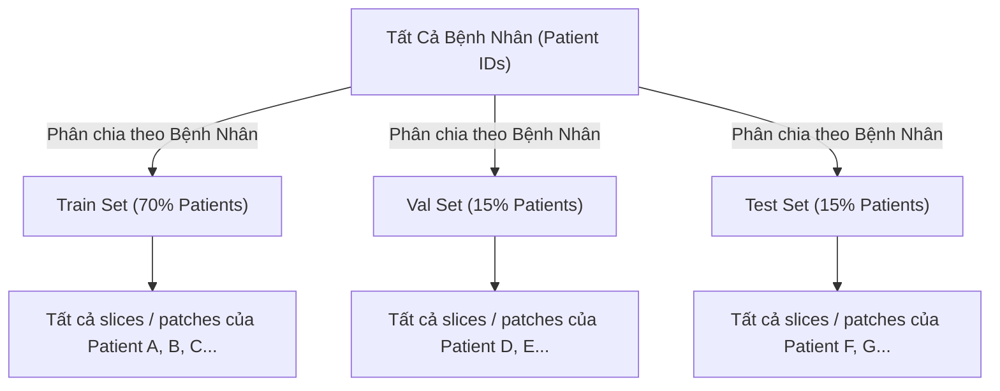

# Medical Imaging Architect Skill

Kỹ năng chuyên biệt phục vụ đồ án môn học **SE374.R11 - Trí tuệ nhân tạo trong Y tế & Xử lý ảnh Y khoa** (UIT).

---

## 1. Bản Chất Dữ Liệu Y Tế & Các Định Dạng Chuyên Biệt

1. **DICOM (`.dcm`):**
   - Định dạng chuẩn thiết bị y tế (CT, MRI, X-ray), chứa metadata phong phú (Patient ID, Slice Thickness, Rescale Slope/Intercept, Window Center/Width).
   - Đọc bằng `pydicom`: Chuyển đổi pixel array thành đơn vị Hounsfield Unit (HU) cho CT:
     ```python
     hu_array = dicom_slice.pixel_array * dicom_slice.RescaleSlope + dicom_slice.RescaleIntercept
     ```
2. **NIfTI (`.nii`, `.nii.gz`):**
   - Định dạng khối không gian 3D/4D phổ biến trong nghiên cứu thần kinh và ảnh cộng hưởng từ (MRI, fMRI, CT volumes).
   - Đọc bằng `nibabel`:
     ```python
     import nibabel as nib
     nii = nib.load("volume.nii.gz")
     volume_data = nii.get_fdata()
     affine = nii.affine
     ```
3. **Whole Slide Images (WSI - `.svs`, `.tif`, `.ndpi`):**
   - Ảnh giải phẫu bệnh siêu phân giải đa mức (gigapixel, độ phân giải thường lên tới $100,000 \times 100,000$ pixels).
   - Không thể nạp nguyên ảnh vào RAM/VRAM. Bắt buộc phải áp dụng quy trình chia mảng (Patching / Tiling) kết hợp Multiple Instance Learning (MIL).

---

## 2. Quy Chuẩn Bất Biến: Patient-Level Anti-Leakage Split



- **Quy tắc:** Tuyệt đối không xáo trộn (shuffle) các lát cắt (slices) hoặc các patch giữa các tập.
- Tất cả dữ liệu thuộc về cùng một bệnh nhân (`PatientID`) phải nằm trọn vẹn trong một tập duy nhất.

---

## 3. Kiến Trúc Giải Pháp Cho 8 Chủ Đề Môn Học SE374.R11

### Topic 1 & 2: Sparse-view & Limited-angle CT Reconstruction
- **Bài toán:** Khôi phục ảnh CT lát cắt chất lượng cao từ số lượng góc chiếu thưa (Sparse-view, ví dụ 32 hoặc 64 view thay vì 720 view) hoặc góc quét bị giới hạn (Limited-angle, ví dụ $\pm 60^\circ$).
- **Mô hình SOTA đề xuất:**
  * **CG-GLORE (arXiv:2608.15246):** Mạng unrolling bậc hai dùng Conjugate Gradient kết hợp mạng điều chuẩn Global-Local (Nyström attention + CNN).
  * **Learned Primal-Dual (LPD):** Cập nhật đồng thời trên miền sinogram và miền ảnh.
  * **FBPConvNet:** Tái tạo sơ bộ bằng FBP (Filtered Back Projection) sau đó dùng U-Net khử nhiễu vệt (streak artifacts).
- **Hàm mất mát & Chỉ số:**
  * Loss: $\mathcal{L} = \mathcal{L}_{1} + \lambda \mathcal{L}_{SSIM} + \gamma \mathcal{L}_{Perceptual}$.
  * Chỉ số: PSNR (dB), SSIM, NRMSE.

### Topic 3 & 4: Whole Slide Image (WSI) Subtyping & Survival Analysis
- **Bài toán:** Phân loại dưới nhóm ung thư hoặc dự đoán thời gian sống sót (Time-to-event) từ ảnh giải phẫu bệnh gigapixel.
- **Quy trình:**
  1. Tiền xử lý: Phân đoạn mô (Otsu thresholding), cắt patch $256 \times 256$, trích xuất embedding bằng CTransPath / UNI / ResNet-50.
  2. Gom cụm / Học biểu diễn (Bag of patches):
     * **CGRL (arXiv:2607.12556):** Tỉa bớt patch theo concept bệnh lý và học biểu diễn tương phản.
     * **CLAM / AB-MIL:** Attention-based Multiple Instance Learning.
     * **MergeSurv (arXiv:2607.04747):** Học liên tục (Continual learning) cho bài toán phân tích thời gian sống trên nhiều nhóm ung thư TCGA.
- **Hàm mất mát & Chỉ số:**
  * Subtyping: Cross-Entropy loss, Macro-F1, Balanced Accuracy, AUC-ROC.
  * Survival: Negative Partial Log-Likelihood (Cox loss), Concordance Index (C-Index).

### Topic 5: 3D Tumor Segmentation using CT / MRI
- **Bài toán:** Phân vùng khối u (u não Glioma, u gan, u thận) trên ảnh thể tích 3D.
- **Mô hình SOTA:**
  * **MONAI Swin-UNETR / 3D U-Net / nnU-Net:** Kiến trúc phân vùng 3D phân cấp.
  * Kỹ thuật inference: Sliding Window Inference với overlap $0.5$ để tránh artifact ở ranh giới mảng cắt.
- **Hàm mất mát & Chỉ số:**
  * Loss: DiceFocalLoss hoặc DiceCELoss.
  * Chỉ số: Dice Similarity Coefficient (DSC), 95% Hausdorff Distance (HD95).

### Topic 6: Weakly-Supervised Segmentation for WSI
- **Bài toán:** Phân vùng ranh giới tổn thương chỉ dựa trên nhãn mức slide (slide-level) hoặc ảnh độ phóng đại thấp (low-magnification).
- **Phương pháp tham khảo:**
  * **LowMagWSS (arXiv:2607.10783):** Tận dụng ảnh độ phóng đại thấp để phân vùng hiệu quả, giảm chi phí lưu trữ và tính toán.

### Topic 7: Acute Ischemic Stroke Collateral Imaging
- **Bài toán:** Đánh giá tuần hoàn bàng hệ và phân biệt vùng lõi nhồi máu (infarct core) với vùng tranh tối tranh sáng (ischemic penumbra) trên ảnh MRI (DWI, PWI, FLAIR).
- **Chỉ số:** Thể tích tổn thương ($cm^3$), độ nhạy, độ đặc hiệu.

### Topic 8: Tự Do Đề Xuất (fMRI Brain Connectivity & Medical VQA)
- **Đề tài ABIDE I:** Phân loại phổ tự kỷ (ASD) dựa trên ma trận kết nối chức năng não (Functional Connectivity Matrix) từ chuỗi ảnh fMRI thời gian, dùng GNN hoặc CNN.
- **Đề tài Medical VQA:** Xây dựng hệ thống thị giác - ngôn ngữ y tế hỗ trợ bác sĩ chẩn đoán hình ảnh.

---

## 4. Công Cụ & Thư Viện Cốt Lõi (Standard Tooling)

- **MONAI Framework:** `import monai` (Transforms, Networks, Losses, Metrics, DataLoaders).
- **NiBabel & SimpleITK:** Đọc, lưu trữ và nội suy ảnh thể tích 3D.
- **Streamlit Demo:** Tạo giao diện web trực quan cho phép duyệt lát cắt theo 3 mặt phẳng (Axial, Coronal, Sagittal) và hiển thị mask màu lớp phủ (overlay mask).
