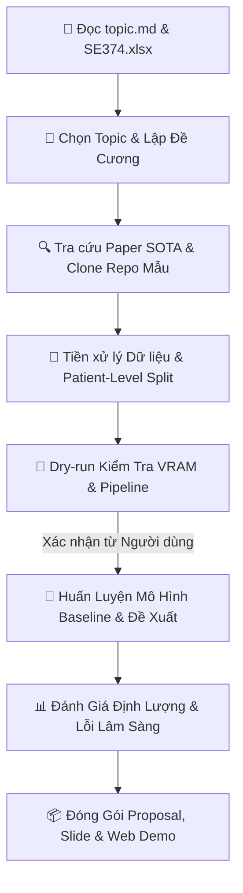

# Workflow 09: SE374.R11 Medical AI Research & Proposal SOP

---

## Giai Đoạn 1: Phân Tích Đề Bài & Lựa Chọn Chủ Đề (Topic Selection)

1. **Khảo sát đề bài & tình hình đăng ký nhóm:**
   - Đọc danh sách 8 topic trong `topic.md` và đối chiếu với file đăng ký `SE374.R11 - Đồ án cuối kỳ.xlsx`.
   - 8 nhóm chủ đề chính:
     * **Topic 1:** Sparse-view CT reconstruction (Bài toán tái tạo CT góc thưa, giảm liều tia X).
     * **Topic 2:** Limited-angle CT reconstruction (Tái tạo CT góc hạn chế, bù đắp góc chụp thiếu).
     * **Topic 3:** Cancer subtyping using Whole Slide Images (Phân loại dưới nhóm ung thư bằng giải phẫu bệnh số).
     * **Topic 4:** Survival analysis using Whole Slide Images (Dự đoán thời gian sống sót / tiên lượng bệnh).
     * **Topic 5:** Tumor segmentation using CT/fMRI (MRI) (Phân vùng u não / tổn thương 3D).
     * **Topic 6:** Weakly-supervised segmentation for Whole Slide Images (Phân vùng bán giám sát ảnh WSI).
     * **Topic 7:** Collateral imaging in acute ischemic stroke using MRI (Đánh giá tuần hoàn bàng hệ trong đột quỵ thiếu máu cục bộ).
     * **Topic 8:** Tự do đề xuất (Phát hiện tự kỷ ABIDE I bằng fMRI, Chatbot VQA hỗ trợ bác sĩ chẩn đoán hình ảnh).
2. **Xác nhận với người dùng:**
   - Hỏi người dùng xác nhận nhóm của mình chọn Topic nào (hoặc đã đăng ký ở STT nào trong bảng Excel).

---

## Giai Đoạn 2: Đối Soát Học Thuật & Chuyển Hóa Bài Báo Bằng Vision (Paper Vision-to-Markdown)

1. **Tải bài báo PDF về kho lưu trữ nội bộ:**
   - Tải toàn văn PDF từ các link của Giảng viên (`topic.md`) hoặc tìm qua arXiv/Firecrawl về lưu tại `docs/papers/<ten_paper>.pdf`.
   - Các bài báo trọng tâm:
     * Topic 1, 2: `docs/papers/CG_GLORE_arxiv_2608.15246.pdf`, Springer MVAP 2026.
     * Topic 3, 4: `docs/papers/CGRL_arxiv_2607.12556.pdf`, `docs/papers/MergeSurv_arxiv_2607.04747.pdf`.
     * Topic 5: `docs/papers/BraTS_arxiv_1804.10484.pdf`.
     * Topic 6: `docs/papers/LowMagWSS_arxiv_2607.10783.pdf`.
     * Topic 7: Springer Stroke Collateral MRI.

2. **Đọc trực quan bằng Vision (Multimodal Reading) & Viết File Markdown Toàn Văn:**
   - **Thực thi:** Dùng tính năng Vision / đọc đa phương thức để duyệt qua các trang PDF:
     * Nhận diện sơ đồ kiến trúc khối (pipeline/network diagrams).
     * Bóc tách chính xác các biểu thức toán học LaTeX (loss functions, unrolling formulation, Radon inversion).
     * Trích xuất các bảng số liệu thực nghiệm (Benchmark comparison tables: PSNR, SSIM, Dice, C-Index).
   - **Tạo tệp Markdown đối ứng:** Bắt buộc viết file `docs/papers/<ten_paper>.md` ghi lại đầy đủ và có hệ thống toàn bộ nội dung cốt lõi của bài báo.
   - **Lý do bắt buộc:** AI đọc PDF ảnh hoặc cột đôi rất kém và dễ nuốt mất ký hiệu công thức; đọc đi đọc lại file PDF thô gây tốn token và thiếu hiệu quả khi tái sử dụng. Tệp `.md` cấu trúc hóa cho phép Agent đọc lại tức thì, trích dẫn chính xác và tích hợp trực tiếp vào đề cương Mini Proposal và báo cáo đồ án.

3. **Kế thừa mã nguồn mở chuẩn từ GitHub:**
   - Dùng MCP `github` hoặc `firecrawl` để tìm và tham khảo repo chính thức của tác giả.
   - Đối chiếu kiến trúc trong paper với cấu trúc code trong repo để hiểu sâu cơ chế hoạt động.

---

## Giai Đoạn 3: Chuẩn Bị Dữ Liệu & Phân Chia Chống Rò Rỉ Bệnh Nhân (Patient-Level Split)

1. **Tải và kiểm tra dữ liệu y tế:**
   - Sử dụng các bộ dữ liệu mở chuẩn quốc tế (AAPM Low-Dose CT, TCGA-BRCA, TCGA-NSCLC, BraTS 2021/2023, ABIDE I, ISLES 2022).
2. **Thiết lập Patient-Level Split:**
   - Đảm bảo toàn bộ lát cắt/patch của cùng 1 Patient ID chỉ nằm trong duy nhất 1 tập (Train hoặc Val hoặc Test).
3. **Tiền xử lý chuẩn Y khoa:**
   - **CT:** Clip Hounsfield Units (HU windowing) phù hợp với cơ quan quan sát (Brain, Lung, Bone, Soft Tissue), chuẩn hóa về `[0, 1]` hoặc `[-1, 1]`.
   - **MRI:** Z-score normalization theo từng volume dựa trên vùng não (brain mask).
   - **WSI:** Lọc vùng mô (Otsu thresholding), trích xuất patch $256 \times 256$ hoặc $512 \times 512$, nạp qua feature extractor (CTransPath, UNI, ResNet50).

---

## Giai Đoạn 4: Huấn Luyện An Toàn & Sanity Check (Resource Safeguard)

1. **Chạy Dry-Run / Sanity Check:**
   - Chạy thử nghiệm 1 epoch trên 2-5 bệnh nhân mẫu.
   - Kiểm tra VRAM GPU, tốc độ load data (DataLoader num_workers) và sự hội tụ của loss.
2. **Xin xác nhận từ người dùng:**
   - Báo cáo kết quả dry-run, ước tính thời gian chạy full dataset và xin phê duyệt trước khi train chính thức.

---

## Giai Đoạn 5: Đánh Giá Định Lượng & Phân Tích Lỗi Lâm Sàng (Zero-Mockup)

1. **Đo lường định lượng:**
   - Tái tạo ảnh (Reconstruction): PSNR, SSIM, NRMSE.
   - Phân vùng (Segmentation): Dice Score, Jaccard Index (IoU), 95% Hausdorff Distance (HD95).
   - Phân loại / Tiên lượng (Classification / Survival): AUC-ROC, Macro-F1, C-Index (Concordance Index).
2. **Phân tích bóc tách (Ablation Study):**
   - Đánh giá sự đóng góp của từng thành phần trong mô hình đề xuất.
3. **Phân tích lỗi lâm sàng (Clinical Error Analysis):**
   - Trực quan hóa các trường hợp tái tạo còn nhiễu vệt (streak artifacts), phân vùng bị sót (false negatives) hoặc u giả (false positives).

---

## Giai Đoạn 6: Đóng Gói Sản Phẩm Cuối Cùng (Deliverables)

1. **Mini Proposal:** Biên dịch ra file Word `.docx` chuẩn mẫu UIT / Giảng viên bằng Pandoc.
2. **Slide Thuyết Trình:** Soạn thảo slide 16:9 bằng Marp CLI, xuất ra PDF/PPTX.
3. **Báo Cáo Đồ Án:** Soạn báo cáo kỹ thuật hoàn chỉnh ~15-20 trang (Springer LNCS hoặc mẫu UIT).
4. **Interactive Web Demo:** Xây dựng ứng dụng Streamlit trong `src/visualization/app_demo.py` để bác sĩ/người dùng có thể tải file `.dcm`, `.nii.gz` hoặc ảnh lát cắt lên để xem kết quả.
