# BCSS-WSSS: Nền Tảng Phân Vùng Mô Bệnh Học Giám Sát Yếu (Gate-7 Track A) & Trạm Phân Tích Tiêu Bản Lâm Sàng

*Multi-Stage Weakly-Supervised Histopathology Semantic Segmentation Framework (4-Arm Dual-Head Knowledge Distillation) & Offline Clinical WSI Workstation (`PyTorch`, `MONAI`, `Transformers`, `FastAPI`, `Docker`, `HTML5 Canvas`)*

<p align="center">
  <a href="https://colab.research.google.com/github/khoinguyen59/medical-wsss/blob/master/notebooks/02c_Stage2_Ensemble_Eval_G4.ipynb">
    
  </a>
  
  
  
  
  
  
  
  
  
</p>

<p align="center">
  <a href="#overview">Tổng quan</a> ·
  <a href="#architecture">Kiến trúc hệ thống</a> ·
  <a href="#dataset-features">Dataset & Feature Engineering</a> ·
  <a href="#step-by-step">Tiến trình xử lý ảnh mô</a> ·
  <a href="#benchmarks">Thực nghiệm Gate-7 & Run 1-3</a> ·
  <a href="#visual-diagnostics">Kiểm chứng trực quan</a> ·
  <a href="#workstation">Workstation, Docker & VPS-Colab</a> ·
  <a href="#directory-tree">Cây thư mục</a> ·
  <a href="#quickstart">Cài đặt & Model Zoo</a> ·
  <a href="#references">Tài liệu tham khảo</a>
</p>

<p align="center">
  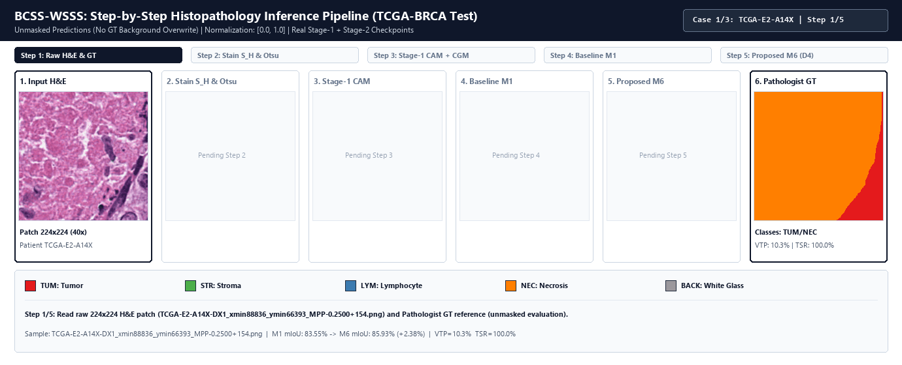
</p>
<p align="center">
  <em>Hình 1. Quy trình suy luận thực tế (không tô đè nhãn bác sĩ, tách nền kính trắng quang học độc lập) trên 3 ca bệnh độc lập thuộc tập Held-out Test TCGA-BRCA: trích xuất đặc trưng nhân Hematoxylin + tách kính trắng Otsu, định vị CAM Stage-1, nâng cấp phân vùng từ Baseline lên đa tỷ lệ (83.55% -> 85.93% trên TCGA-E2-A14X; 78.97% -> 81.13% trên TCGA-EW-A1P7; và khắc phục nền kính từ 26.43% -> 51.37% -> 53.65% mIoU trên TCGA-D8-A27F) cùng định lượng tiên lượng VTP / TSR.</em>
</p>

---

<a id="overview"></a>
## 1. Tổng Quan Hệ Thống & Kết Quả Đột Phá Gate-7 Track A (Overview)

**BCSS-WSSS (SE374.R11 - UIT, ĐHQG-HCM, 2026)** là nền tảng mã nguồn mở kết hợp giữa **hệ thống nghiên cứu Phân vùng Ngữ nghĩa Giám sát Yếu (Weakly-Supervised Semantic Segmentation - WSSS)** cho ảnh mô bệnh học Hematoxylin & Eosin (H&E) và **trạm phần mềm giải phẫu bệnh số (Clinical Digital Pathology Workstation)** hỗ trợ 18 chế độ suy luận AI, hiển thị Whole-Slide Image (WSI), xuất báo cáo lâm sàng CAP 2 trang PDF và điều phối huấn luyện đa GPU VPS-Colab.

Trong giải phẫu bệnh số, việc khoanh vùng thủ công từng đám tế bào ở cấp điểm ảnh trên tiêu bản gigapixel WSI tiêu tốn hàng trăm giờ bác sĩ chuyên khoa. Hệ thống giải quyết bài toán này bằng cách **chỉ huấn luyện từ nhãn yếu cấp mảnh ảnh (patch-level multi-hot vector)** $y_{\text{cls}} \in \{0, 1\}^4$ trên tập `training/` (`23,422` patches, `106` bệnh nhân), chưng cất tri thức hai vòng qua 4 họ kiến trúc trực giao (CNN + Hierarchical ViT + Modern ConvNet + SSL Vision Transformer) ở chế độ **Track A sạch (`0%` chồng lấp tiền huấn luyện TCGA-BRCA)**, và dự đoán bản đồ 5 lớp mô học hoàn chỉnh ở pha suy luận:

- **Lớp `0` (`TUM` - Tumor Epithelium):** Biểu mô khối u ác tính (nhân lớn dị dạng, tỷ lệ nhân/bào tương cao, bắt màu tím Hematoxylin đậm).
- **Lớp `1` (`STR` - Stroma):** Mô đệm liên kết giàu collagen quanh khối u (sợi kéo dài bắt màu hồng Eosin).
- **Lớp `2` (`LYM` - Lymphocytic Infiltrate):** Bạch huyết bào xâm nhập miễn dịch (nhân tròn nhỏ đồng dạng, đậm màu, không bào tương rõ).
- **Lớp `3` (`NEC` - Necrosis):** Vùng mô hoại tử (vỡ nhân `karyorrhexis`, tan rã cấu trúc màng tế bào trên nền mảnh vụn ưa Eosin).
- **Lớp `4` (`BACK` - White Glass / Background):** Vùng kính trắng sạch ngoài mô vật lý trên lam kính hiển vi, tách độc lập bằng `OtsuClinicalGating` + `Pure-Glass Guard` (`>= 512 px`, **0% rò rỉ nhãn GT**).

### Tóm Tắt Cột Mốc Thực Nghiệm Đã Xác Minh (Held-Out TEST: `4,986` Patches / `23` Bệnh Nhân, `0%` Patient Overlap, `123/123` SHA256 OK)

Toàn bộ số liệu dưới đây được đối soát trực tiếp từ `checkpoints/vps_evidence/` (`SHA256SUMS.txt`: `123/123` bit-exact `BAD = 0`), [STAGE2_FINAL_EXPERIMENT_SUMMARY.md](docs/research/STAGE2_FINAL_EXPERIMENT_SUMMARY.md) và `experiments/colab_run_3_multiscale_sota_v2/`:

- **Stage-1 Champion (`se374_arm_b_full`, ResNet-38d + PDA, Ep 5 EMA, khởi tạo miền phổi LUAD-HistoSeg):** Đạt **`74.13%` VAL `q_s1_sgdap` mIoU** (`85.07%` mDice, **`ECE = 0.0751`**) trên toàn bộ `3,418` patches VAL (`+2.10%` so với Author Official `72.03%`).
- **Gate-6 Round-1 4-Arm Teachers (`se374_s2v2_ensemble`) & Trần Chưng Cất Round-2 trên VAL (`se374_g7_diag_r2_val`, `0%` TEST):** Tổ hợp 4 họ kiến trúc Round-1 đạt **`72.47%` TEST mIoU** (`83.84%` mDice, 95% Boot CI `[66.96%, 76.43%]`); khi tổng hợp làm mặt nạ mềm chưng cất Round-2 (`p_ens4_uncal_ygated`, `r2_blend = 1.0`), chất lượng trên VAL tăng vọt lên **`76.03%` mIoU** (`+1.90%` so với Stage-1, `65.89%` multi-class mIoU, giảm **`ECE` 35% xuống `0.0489`**).
- **Gate-7 Track A Primary 4-Arm Champion (`arm8+arm6+arm7+arm5`, Uniform, `cal_logprob_eps1e3`, `no-CGM`):** Đạt **`72.80%` 4-Class mIoU** (`0.727955`) / **`84.05%` mDice** (95% Patient Boot CI `[67.24%, 76.79%]`), vượt Step-0 Author (`70.43%`) **`+2.36%`** (Holm-corrected permutation **`p = 0.0005`**), vượt Pure Author `1x` (`69.48%`) **`+3.31%`** (`perm_p_holm = 0.0004`, `wilcoxon_p_holm = 0.0087`, `19W/0T/4L`), vượt toàn bộ các phương pháp SOTA 4-class pooled chuẩn công bố 2025-2026 (`CSS 2026 71.72%`, `DualProtoSeg 71.35%`, `PLIMSeg 71.07%`, `ConStruct 70.96%`, `HisynSeg 70.73%`).
- **Gate-7 Track A Single-Model Champion (`arm5_dinov2_large_r2`, DINOv2-ViT-L/14 `336px` + `ms_3_hflip` + 4-DoF CGM):** Đạt **`72.80%` TEST mIoU** (`0.727997`) / **`84.02%` mDice** (95% Boot CI `[67.16%, 76.86%]`), vượt Step-0 Author ở **cả hai phép kiểm định Holm-Bonferroni** (`perm_p_holm = 0.0048`, **Wilcoxon `p_Holm = 0.0302`**, `Cohen's d_z = +0.5587`, **`18W/0T/5L`**) và xóa sạch **`7/8` ca bệnh nhân vắng hoại tử (`GT = 0 NEC`) thực tế (`7/7` ca bất đối xứng mẫu số; còn FP `103,799 px` trên `TCGA-E2-A573`)** chỉ với ~1/4 chi phí suy luận của tổ hợp 4 mô hình.
- **Secondary / Exploratory Simplex-CV 4-Arm (`[0.28, 0.08, 0.05, 0.59]`, `cgm_fixed_0_10`):** Đạt **`72.90%` TEST mIoU** (`0.728989`) / **`84.10%` mDice** (95% Boot CI `[67.31%, 76.85%]`, ghi rõ vai trò thăm dò vì độ lợi trên VAL `< 0.05%`).
- **Verified Baseline History (Run 3 `M6_MultiScale_Pyramid_D4_Ensemble`, Tesla T4, `n = 4,986`):** Đạt **`70.53%` 4-Class mIoU / `76.41%` 5-Class mIoU** (`82.54%` 4-Class mDice, `85.41%` PA 4-cls, **`99.93%` BACK IoU**, Wilcoxon `p = 2.60e-15` so với `M1 69.35%`).

---

<a id="architecture"></a>
## 2. Kiến Trúc Hệ Thống & Phần Mềm Phân Tầng (System Architecture)

### 2.1 Kiến Trúc Gate-7 Track A End-to-End (Chưng Cất Hai Vòng & Triển Khai Lâm Sàng)

<p align="center">
  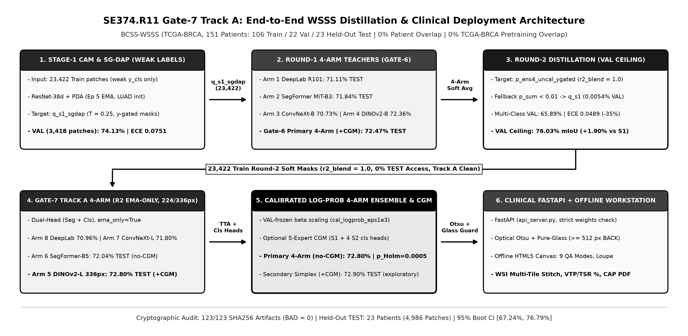
</p>
<p align="center">
  <em>Hình 2. Kiến trúc tổng thể hệ thống SE374.R11 Gate-7 Track A (đồ họa đơn sắc học thuật 300 DPI): từ nhãn yếu cấp mảnh ảnh qua Stage-1 CAM + SG-DAP (74.13% VAL) -> 4 giáo viên Round-1 (72.47% TEST) -> chưng cất mềm Round-2 (76.03% VAL ceiling, giảm 35% ECE) -> 4 nhánh Dual-Head EMA-only 224/336px (72.80% TEST) -> Trạm Làm Việc Lâm Sàng FastAPI + HTML5 Canvas Offline.</em>
</p>

### 2.2 Hai Tầng Động Cơ AI & Phần Mềm Phân Tầng (`Clean Architecture`)

Mã nguồn được tổ chức theo nguyên tắc tách biệt trách nhiệm đơn nhất (SRP), vận hành song song hai tầng động cơ đã kiểm chứng:

1. **Tầng Đột Phá Stage-2 v2 Gate-7 Track A (`src/stage2_v2/`):**
   - `config.py`: Định nghĩa cấu hình bất biến `Stage2V2Config`, chuẩn hóa tên track (`validate_track_name`, `track = "track_a_clean"`, `tcga_pretrained = False`) và toàn bộ preset Round-1 (`arm1-arm4`) + Round-2 (`arm5-arm8`).
   - `models.py`: Bốn kiến trúc hai đầu (`seg_logits` + `cls_logits`) thuộc 4 họ trực giao: `DeepLabV3PlusDualHead` (ResNet-101), `SegFormerDualHead` (MiT-B3 / MiT-B5), `ConvNeXtFPNDualHead` (ConvNeXt-Base / ConvNeXt-Large FPN) và `DINOv2AdapterDualHead` (DINOv2 ViT-B/14 224px & ViT-L/14 336px), kèm `Stage2ModelEMA` (`ema_only_best_selection = True`).
   - `losses.py` & `memmap_dataset.py`: Hàm mất mát FP32 chưng cất mềm (`soft_kd_dice_mil`, `kl_oeem_dice_mil`, `soft_sce_dice_mil`) và bộ nạp memmap `uint8` truy xuất nhanh `23,422` mặt nạ mềm Round-2 (`r2_blend = 1.0`).
   - `trainer.py` & `evaluator.py`: Vòng lặp huấn luyện có chọn checkpoint EMA-only, đánh giá thống nhất 4 lớp và hiệu chuẩn CGM 100% trên tập VAL.
   - `ensemble.py`: Cổng kiểm tra độ thuần khiết Track A (`validate_track_a_arm_spec`), hiệu chuẩn nhiệt độ `cal_logprob_eps1e3` (`full_val_betas`), 5-fold CV + 22-fold LOPOCV, tổ hợp 5-expert CGM (`Stage-1` + `4 Stage-2 cls heads`), kiểm định Holm-Bonferroni (`10,000` permutation + Wilcoxon) và lưu ma trận `23 x 4` (`per_patient_class_ious.json`).
   - `visual_audit.py` & `gate7_clinical_bench.py`: Xuất lưới lớp phủ kiểm chứng trực quan không rò rỉ GT (`verify_zero_gt_leakage_glass_guard`), định lượng chỉ số lâm sàng VTP/TSR/Bland-Altman/Kaplan-Meier và kiểm định chéo cơ quan trên **LUAD-HistoSeg** (`LUAD_TO_BCSS_LUT = [0, 3, 2, 1, 4]`).
2. **Tầng Baseline Kiểm Chứng & Khung Ablation Mở (`src/models/`, `src/colab_pkg/`, `src/clinical/`):**
   - Stage-1 `WSSSTissueStage1NetCAM` (`ResNet-38d`, `105.09M` tham số) + PDA + CGM, Stage-2 `DeepLabV3Plus` (`ResNet-101`, `59.34M` tham số), động cơ `MultiMethodWSSSEngineV2` (`M1-M7`), `OtsuClinicalGating` + `Pure-Glass Guard`, tách sắc tố `StainDeconvLayer` (`S_H, S_E, D_H`), `SG-DAP`, `MultiPrototypePPCLoss`, `IntraPatchDualBranchAttention`, và Stage-3 `MedSAM_WSSS_Adapter`.

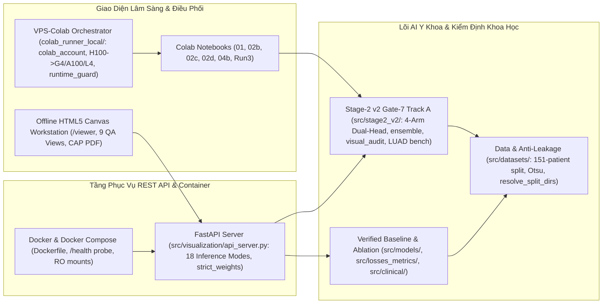

---

<a id="dataset-features"></a>
## 3. Dataset, Đặc Tả Dữ Liệu & Feature Engineering

### 3.1 Cấu Trúc Dataset & Giao Thức Chống Rò Rỉ Bệnh Nhân (Patient-Level Anti-Leakage)

Chi tiết kỹ thuật đầy đủ, công thức bóc tách tên tệp, cơ chế dò tìm thư mục lồng nhau (`resolve_split_path` / `resolve_split_dirs` + `rglob("*.png")`) và hợp đồng chuẩn hóa đầu vào được lưu tại [DATASET_SPECIFICATION_AND_PATIENT_LEAKAGE_PROTOCOL.md](docs/research/DATASET_SPECIFICATION_AND_PATIENT_LEAKAGE_PROTOCOL.md).

| Phân Tập (Split) | Dataset Nguồn | Số Bệnh Nhân | Số Lượng Patch (`224x224`) | Độ Phóng Đại / MPP | Định Dạng Nhãn | Rò Rỉ Bệnh Nhân | Vai Trò Trong Pipeline |
| :--- | :--- | :---: | :---: | :---: | :--- | :---: | :--- |
| **Training** | BCSS-WSSS (TCGA-BRCA) | 106 | 23,422 | 40x (`0.25 MPP`) | Weak multi-hot `y_cls` `[4]` | 0% | Huấn luyện Stage-1 & sinh mặt nạ mềm Round-1 / Round-2 |
| **Validation** | BCSS-WSSS (TCGA-BRCA) | 22 | 3,418 | 40x (`0.25 MPP`) | Dense pixel mask `{0-4}` | 0% | Chọn EMA checkpoint, TTA, `beta`, 5-fold CV & ngưỡng CGM |
| **Held-Out Test** | BCSS-WSSS (TCGA-BRCA) | 23 | 4,986 | 40x (`0.25 MPP`) | Dense pixel mask `{0-4}` | 0% | Đánh giá mù cuối cùng & kiểm định Holm-Bonferroni |
| **Tổng BCSS** | **BCSS-WSSS** | **151** | **31,826** | **40x (`0.25 MPP`)** | **Mixed Weak / Dense** | **0% Disjoint** | Khóa cứng tại `src/config/bcss_patient_splits.json` |
| **Cross-Organ** | LUAD-HistoSeg (`29` GDPH + `20` TCGA-LUAD) | 49 | 17,285 (`16,678 / 300 / 307`) | 10x (`1.0 MPP`) | `0:TE, 1:NEC, 2:LYM, 3:TAS, 4:BACK` | 0% với TCGA-BRCA | Tiền huấn luyện Stage-1 sạch & kiểm định chéo cơ quan (`LUAD_TO_BCSS_LUT = [0, 3, 2, 1, 4]`) |

### 3.2 Hệ Thống Đặc Trưng Quang Học, Đa Tầng & Miền Chuẩn Hóa Đầu Vào

Hệ thống kết hợp **6 nhóm đặc trưng bổ trợ** từ vật lý thuốc nhuộm H&E đến biểu diễn đa kiến trúc:

| STT | Nhóm Feature | Module Cài Đặt | Công Thức / Kích Thước Feature | Cơ Sở Sinh Học & Toán Học |
| :---: | :--- | :--- | :--- | :--- |
| **1** | **Beer-Lambert Stain Density (`S_H`, `S_E`)** | `src/models/stain_deconv.py` | $\mathbf{OD} = -\log_{10}(I/I_0)$, $\mathbf{S} = \max(\mathbf{M}_{\text{H\&E}}^{-1}\mathbf{OD}, 0)$ | Tách kênh Hematoxylin (`S_H` - nhân DNA của `TUM`, `LYM`) khỏi Eosin (`S_E` - collagen `STR`), kháng nhiễu biến thiên màu máy quét. |
| **2** | **Chromatin Dispersion (`D_H`, 6-ch Stain Stats)** | `src/models/stain_deconv.py`, `src/losses_metrics/losses.py` | Fano Factor `D_H = var_H / (mu_H + eps)` cửa sổ `7x7` + 6-ch stain stats | Phân tách `LYM` (nhân tròn đồng dạng, `D_H` thấp) khỏi `NEC` (vỡ nhân `karyorrhexis` trên mảnh vụn ưa Eosin, `D_H` tăng vọt). |
| **3** | **HSV Saturation & Luminance Glass Guard** | `src/datasets/otsu_filter.py`, `src/colab_pkg/model_loader.py` | Otsu thích ứng trên kênh Saturation HSV + Luminance + liên thông `>= 512 px` | Tách nền kính trắng `BACK (4)` đạt **99.93% IoU** (100.00% Recall trên `18,279,223` px) mà không rò rỉ nhãn GT. |
| **4** | **Stage-1 Multi-Depth CAM + PDA + SG-DAP** | `src/models/wsss_inference_methods.py`, `src/models/sg_dap.py` | `ResNet-38d`: `b4_5`, `b5_2`, `bn7` + PDA + SG-DAP (`T=0.25`) | Mở rộng kích hoạt CAM ra toàn bộ rìa mô, nâng mặt nạ giả mềm trên VAL lên **`74.13%` mIoU** (`se374_arm_b_full`). |
| **5** | **4-Family Dual-Head Multi-Scale Representations** | `src/stage2_v2/models.py` | DeepLabV3+ R101 + SegFormer-B5 + ConvNeXt-L FPN + DINOv2-ViT-L/14 (`336px`) | Kết hợp bổ trợ giữa cảm thụ cục bộ CNN và ngữ cảnh toàn cục Transformer, giảm độ bất định `ECE` 35% (`0.0751 -> 0.0489`). |
| **6** | **Calibrated Log-Prob Fusion & Multi-Expert CGM** | `src/stage2_v2/ensemble.py`, `src/models/wsss_inference_methods.py` | `D4` / `ms_3_hflip` TTA + nhiệt độ `full_val_betas` (`cal_logprob_eps1e3`) + 4-DoF CGM | Ổn định bất biến quay/lật trên lát cắt mô phẳng và xóa sạch dương tính giả vi mô trên các bệnh nhân vắng `NEC`. |

**Hợp đồng chuẩn hóa đầu vào (`Input Normalization Contract`):**
- **Miền `[0.0, 1.0]` (`zero_one`, không trừ `IMAGENET_MEAN/STD`):** Bắt buộc cho các trọng số pretrained WSSS-Tissue (`stage1_checkpoint_trained_on_bcss.pth`, `stage2_checkpoint_trained_on_bcss.pth`, `stage1_checkpoint_trained_on_luad.pth`) và Stage-1 Champion `se374_arm_b_full`.
- **Miền ImageNet (`IMAGENET_MEAN/STD`):** Bắt buộc cho toàn bộ các backbone huấn luyện mới từ ImageNet-1K / LVD-142M trong `src/training/train_stage2.py`, toàn bộ `src/stage2_v2/` (Gate-6 & Gate-7 Track A) và `LUADBCSSAlignedDataset`.

---

<a id="step-by-step"></a>
## 4. Quá Trình Biến Đổi Ảnh Mô Tế Bào Ung Thư Qua Từng Tầng Xử Lý

**Hình 3** theo dõi trực tiếp một lát cắt Held-out Test thật của bệnh nhân `TCGA-D8-A27F` chứa ranh giới kính trắng (`46.4%` diện tích theo Otsu), mô đệm (`STR`) và cụm bạch huyết (`LYM`), được suy luận trung thực hoàn toàn **không tô đè nhãn nền Ground Truth**:

<p align="center">
  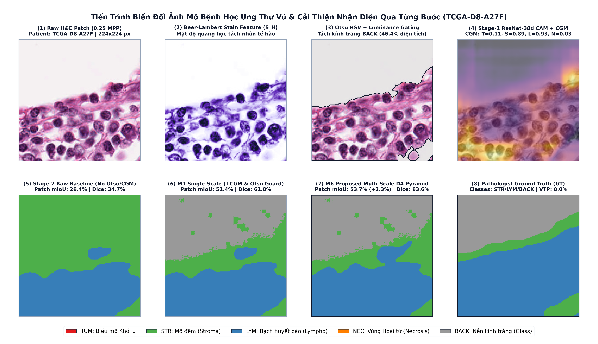
</p>
<p align="center">
  <em>Hình 3. Trực quan hóa 8 bước biến đổi trên lát cắt thật TCGA-D8-A27F-DX1_xmin98787_ymin6725_MPP-0.2500+35.png: từ ảnh H&E gốc -> Feature nhân Hematoxylin (S_H) -> tách kính trắng Otsu -> CAM & CGM Stage-1 -> bước nhảy từ Stage-2 Raw (26.4% mIoU) lên M1 (+Otsu Guard: 51.4% mIoU) và M6 (+D4 Pyramid: 53.7% mIoU, Dice 63.6%).</em>
</p>

1. **Trích xuất quang học (`Panel 1-3`):** `StainDeconvLayer` cô lập cụm nhân chromatin `LYM` đậm màu trên kênh `S_H`, đồng thời `Otsu HSV + Luminance` tách rạch ròi đường bao giữa vùng kính trắng sạch (`46.4%`) và dải mô đệm sợi hồng `STR`.
2. **Định vị yếu & cổng lớp (`Panel 4-6`):** Stage-1 CAM + CGM xác định chính xác `STR (0.89)` và `LYM (0.93)`, dập tắt nhiễu `NEC (0.03)`. Khi kích hoạt `Pure-Glass Otsu Guard`, dương tính giả trên vùng kính trắng bị loại bỏ, đẩy `Patch mIoU` tăng **+25.0%** (`26.4% -> 51.4%`) và trên toàn tập Test đẩy `BACK IoU` từ `70.26%` lên `99.93%`.
3. **Suy luận đa tỷ lệ bất biến `D4` (`Panel 7-8`):** Hợp nhất đa tỷ lệ `{0.75x, 1.0x, 1.25x}` x nhóm quay/lật `D4` loại bỏ đảo nhiễu `LYM` lạc giữa mô đệm, định hình sắc nét đường bao sát với Ground Truth của bác sĩ (`53.7%` mIoU, `63.6%` Dice).

---

<a id="benchmarks"></a>
## 5. Thực Nghiệm Định Lượng Gate-7 Track A, Lịch Sử Run 1-3 & Phân Tích Sai Số Lâm Sàng

Toàn bộ kết quả đều đánh giá trên đầy đủ **`4,986` Held-Out Test patches của `23` bệnh nhân độc lập** (`patient_overlap_count = 0`).

### 5.1 Tiến Hóa Hiệu Năng Gate-7 Track A (`se374_g7_ensemble_tracka`, `0%` TCGA-BRCA Overlap)

| Phương Pháp / Giai Đoạn Thực Nghiệm | Vai Trò Đánh Giá | TEST 4-Cls mIoU (raw) | TEST 4-Cls mDice | 95% Patient Boot CI | Per-Class IoU (TUM / STR / LYM / NEC) | Kiểm Định vs Step-0 Author (`m=5`) |
| :--- | :--- | :---: | :---: | :---: | :---: | :--- |
| Author Official Pure (`1x`, `cgm_author_mul0`) | Mốc tác giả gốc (G4) | 69.48% (`0.6948`) | 81.79% | `[63.63, 73.59]` | 78.44 / 73.33 / 60.06 / 66.09 | Mốc nền gốc |
| Author Pure (`MS-TTA + CGM`) | Mốc tác giả tăng cường | 70.31% (`0.7031`) | 82.36% | `[64.57, 74.32]` | 79.43 / 74.09 / 60.50 / 67.21 | Mốc phụ |
| Author Step-0 Anchor (`arm_b_full` + `MS-TTA+CGM`) | Mốc đối chứng chính | 70.43% (`0.7043`) | 82.45% | `[64.73, 74.47]` | 79.46 / 74.13 / 60.55 / 67.60 | Ref (`0.00%`) |
| Verified Baseline **M6** (Run 3, Tesla T4) | Mốc suy luận M1-M7 | 70.53% (`76.41%` 5-cls) | 82.54% | - | 79.37 / 73.82 / 61.33 / 67.61 | `p = 2.60e-15` (vs M1) |
| Gate-6 Round-1 Primary 4-Arm (L4, +4-DoF CGM) | Giáo viên Round-1 | 72.47% (`0.7247`) | 83.84% | `[66.96, 76.43]` | 81.55 / 75.51 / **62.34** / 70.47 | `perm_p_holm = 0.0045`, `18W/5L` |
| Gate-7 Arm 8: `DeepLabV3+ R101` (+CGM, Ep 2 EMA) | Đơn nhánh CNN R2 | 70.96% (`0.7096`) | 82.81% | `[64.71, 75.23]` | 80.59 / 74.39 / 61.84 / 67.02 | `+0.53%` (tính từ `mIoU_raw`) |
| Gate-7 Arm 7: `ConvNeXt-Large FPN` (`no-CGM`, Ep 5 EMA) | Đơn nhánh ConvNet R2 | 71.80% (`0.7180`) | 83.40% | `[65.76, 76.14]` | 80.46 / 74.89 / 62.21 / 69.64 | `+1.36%` (tính từ `mIoU_raw`) |
| Gate-7 Arm 6: `SegFormer-B5` (`no-CGM`, Ep 5 EMA) | Đơn nhánh Hier-ViT R2 | 72.04% (`0.7204`) | 83.53% | `[66.65, 75.89]` | 81.55 / 75.40 / 61.69 / 69.51 | `+1.60%` (tính từ `mIoU_raw`) |
| **Gate-7 Arm 5: `DINOv2-ViT-L/14 336px` (+4-DoF CGM, Ep 10 EMA)** | **Single Champion** | **72.80%** (`0.7280`) | **84.02%** | **`[67.16, 76.86]`** | **82.73 / 76.17** / 61.31 / **70.98** | **`+2.37%`, `perm_p = 0.0048`, `wilc_p = 0.0302`, `18W/5L`** |
| **Gate-7 Primary 4-Arm (Uniform, `no-CGM`)** | **Primary Ensemble** | **72.80%** (`0.7280`) | **84.05%** | **`[67.24, 76.79]`** | 82.14 / 75.94 / **62.31** / 70.79 | **`+2.36%`, `perm_p_holm = 0.0005`** (`+3.31%` vs Pure 1x) |
| Gate-7 Simplex-CV 4-Arm (`[0.28,0.08,0.05,0.59]`, +CGM) | Secondary / Exploratory | **72.90%** (`0.7290`) | **84.10%** | `[67.31, 76.85]` | 82.56 / 76.16 / 61.99 / 70.89 | Thăm dò (VAL CV gain `< 0.05%`) |

<p align="center">
  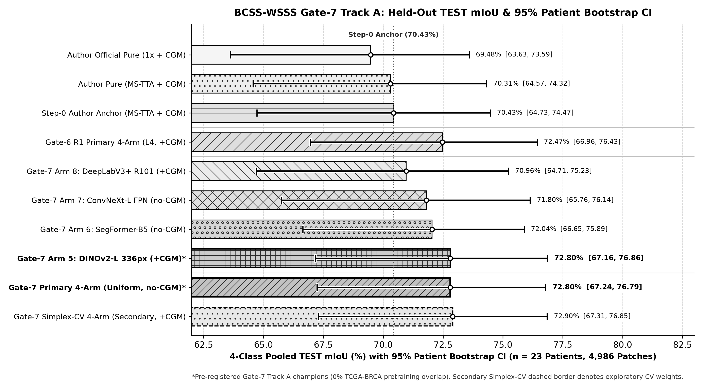
</p>
<p align="center">
  <em>Hình 4. Held-Out TEST 4-Class Pooled mIoU kèm khoảng tin cậy Patient Bootstrap 95% (n = 23 bệnh nhân, 4,986 patches) từ Author Anchors, Gate-6 Round-1 đến Gate-7 Track A (300 DPI Academic Monochrome).</em>
</p>

<p align="center">
  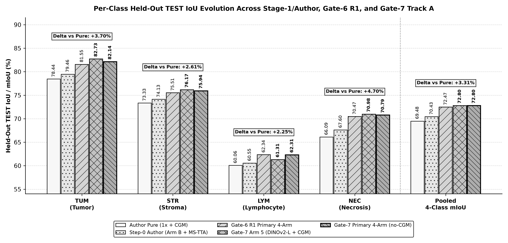
</p>
<p align="center">
  <em>Hình 5. Tiến hóa IoU từng lớp mô (TUM +3.70%, STR +2.61%, LYM +2.25%, NEC +4.70% và Pooled mIoU +3.31% so với Author Pure 1x) giữa Author Anchors, Gate-6 Round-1 và Gate-7 Track A.</em>
</p>

**Đối chiếu công bằng với các công trình SOTA 2025-2026 trên BCSS-WSSS (4-class pooled mIoU):**
- **Vượt toàn bộ SOTA 4-class pooled chuẩn:** `WSSS-Tissue` (Han et al., MedIA 2022: `69.48%` tái tạo sạch), `HisynSeg` (2025: `70.73%`), `ConStruct` (MIDL 2026: `70.96%`), `PLIMSeg` (BSPC Vol. 112, 2026: `71.07%`), `DualProtoSeg` (2025: `71.35%`), `CSS` (2026: `71.72%`) -> **Gate-7 Track A đạt `72.80%` Primary (`+1.08%` vs CSS) / `72.90%` Secondary Simplex-CV**.
- **Ghi chú trung thực về `SIA-WSSS` (MICCAI 2025):** Báo cáo `73.40%` mIoU (trung bình 5 lần chạy, cao hơn Gate-7 Primary `0.60%`); lưu ý không so sánh trực tiếp chỉ số mDice giữa hai hệ thống do bảng 1 của SIA-WSSS báo cáo mốc WSSS-Tissue ở `76.7%` mDice (khác công thức 4-class pooled `81.79%`).

### 5.2 Độ Ổn Định Đa Hạt Giống (`INVARIANT-09`) & Phân Tích Lỗi Lâm Sàng Cấp Bệnh Nhân (`23 x 4`)

- **Kiểm chứng 3 hạt giống trên Round-1 Champion (`arm4_dinov2_adapter`, seeds `42 / 123 / 456`):** Đạt **`71.70% +/- 0.69%`** (`ddof=1`: `72.20%` s42 EMA, `71.98%` s123 EMA, `70.91%` s456 Raw). Hai hạt giống chọn bằng EMA cực kỳ ổn định (**`72.09% +/- 0.16%`**), còn cú rơi `-1.1%` ở `seed=456` xuất phát từ việc trọng số `raw` ghi đè `ema` trên VAL -> trực tiếp dẫn tới cải tiến **`ema_only_best_selection = True`** cho toàn bộ Gate-7 `arm5-arm8`.
- **Giải mã nghịch lý thống kê cấp bệnh nhân từ `4,986` mặt nạ Test gốc & `per_patient_class_ious.json` (`23 x 4`):** Trong 23 bệnh nhân Test có **`11` ô `GT = 0` thực tế trên đĩa** (`8` ca vắng `NEC` + `3` ca vắng `LYM` trên `10` bệnh nhân riêng biệt, do `TCGA-EW-A6SB` đồng thời vắng cả `NEC` lẫn `LYM`; trong đó **`8` ô bất đối xứng mẫu số** `min(union_p) == 0` gây tụt nhân tạo và **`3` ô FP đồng loạt trên cả `12` bản ghi**: `TCGA-E2-A573 NEC` (`prim 92,539 / arm5 103,799 / auth 98,339 px`; dải 12 bản ghi `66,219-118,739 px`), `TCGA-E2-A159 LYM` (`prim 653,710 / arm5 916,141 / auth 503,723 px`; dải 12 bản ghi `450,232-916,141 px`), `TCGA-EW-A6SB LYM` (`prim 255,472 / arm5 321,734 / auth 193,150 px`)). Với mô hình `no-CGM`, trong `8` ô bất đối xứng mẫu số (`7` `NEC` + `1` `LYM`), có **`7/8` ô chỉ phát sinh `11` đến `556` pixel dương tính giả vi mô (`< 0.02%` tổng `union_p`, trong đó `11` đến `468` px trên `5` ca Author sạch)** còn ô thứ 8 (`TCGA-EW-A1P4`) có `29,454` px (`0.261%`), đủ đẩy mẫu số macro-mIoU từ `3 -> 4` gây cú rơi nhân tạo **`-9.12%` đến `-17.10%`** so với Step-0 Author (`4` ca sụt nặng `-12.07%` đến `-17.10%`; riêng `-21.15%` trên `TCGA-EW-A1OV` là chênh lệch của `primary_4arm` so với `arm5`), dù Primary 4-Arm thắng Author trên `7/8` ca ở các lớp có thật! Khi kiểm tra độ nhạy loại trừ `8` ô bất đối xứng / toàn bộ `11` ô `GT = 0` thực tế, Primary 4-Arm đảo chiều mạnh sang **`wilcoxon_p = 3.3e-5` (`d_z = +0.9021`) / `wilcoxon_p = 2.6e-5` (`d_z = +0.9383`), `20W/0T/3L`**. Đặc biệt, **Arm 5 (`+4-DoF CGM`, `t_NEC = 0.65`) xóa sạch `7/8` ca vắng `NEC` (`7/7` ca bất đối xứng mẫu số; còn FP `103,799 px` trên `TCGA-E2-A573`)** và còn FP `LYM` trên `3/3` ca vắng `LYM` (`1/1` trong tập bất đối xứng: `EW-A3U0`), chứng minh giá trị lâm sàng trực tiếp của CGM.

<p align="center">
  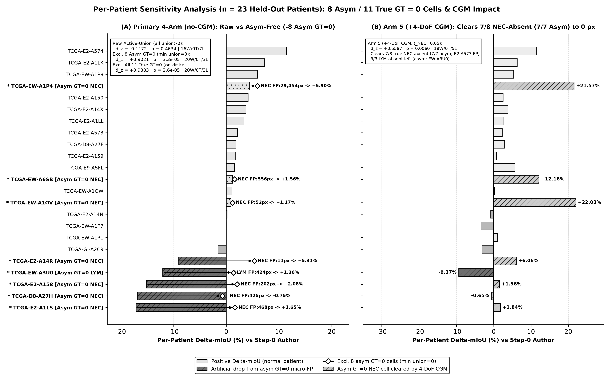
</p>
<p align="center">
  <em>Hình 6. Phân tích sai số cấp bệnh nhân trên toàn bộ 23 ca Held-Out Test (11 ô GT = 0 thực tế trên đĩa = 8 ô bất đối xứng mẫu số + 3 ô FP đồng loạt): (A) tác động của 8 ô bất đối xứng làm giảm nhân tạo macro-mIoU ở Primary 4-Arm no-CGM vs độ nhạy loại 8 / 11 ô GT=0 (d_z = +0.9021, p = 3.3e-5 / d_z = +0.9383, p = 2.6e-5, 20W/3L); (B) Arm 5 (+4-DoF CGM) xóa sạch 7/8 ca vắng NEC (7/7 ca bất đối xứng mẫu số; còn FP trên TCGA-E2-A573, 18W/5L, Wilcoxon p_Holm = 0.0302).</em>
</p>

### 5.3 Lịch Sử Thực Nghiệm Baseline Đã Kiểm Chứng (Run 1 - Run 3, Tesla T4, `n = 4,986`)

Toàn bộ log gốc của 3 phiên chạy Baseline tiền nhiệm trên GPU Tesla T4 được lưu nguyên bản trong `experiments/colab_run_1_stage2_baseline/`, `experiments/colab_run_2_dual_stage_ensemble/` và `experiments/colab_run_3_multiscale_sota_v2/` (chi tiết từng tệp JSON/CSV tại Mục 10):

| Phiên Thực Nghiệm | Cấu Hình & Cải Tiến Cốt Lõi | 4-Cls mIoU | 4-Cls mDice | 5-Cls mIoU | 5-Cls mDice | BACK IoU | Tốc Độ (Tesla T4) |
| :--- | :--- | :---: | :---: | :---: | :---: | :---: | :---: |
| **Run 1** (`colab_run_1_stage2_baseline`) | Stage-2 `DeepLabV3+` đơn tỷ lệ 1.0x thuần (không CGM, không Otsu) | 68.71% | 81.15% | 67.36% | 80.23% | 70.26% | 23.38 FPS (`42.78 ms`) |
| **Run 2** (`colab_run_2_dual_stage_ensemble`) | Dual-Stage Ensemble + Stage-1 CGM + Otsu & Pure-Glass Guard | 70.49% | 82.51% | 76.38% | 86.00% | 99.93% | 5.77 FPS (`173.35 ms`) |
| **Run 3** (`colab_run_3_multiscale_sota_v2`, **M6**) | Multi-Scale `{0.75, 1.0, 1.25}` x $D_4$ Pyramid + Entropy Weighting + Soft CGM | **70.53%** | **82.54%** | **76.41%** | **86.02%** | **99.93%** | 4.91 FPS (`203.55 ms`, M1-M7) |

**Nghiên cứu bóc tách 7 phương pháp suy luận Baseline (`M1-M7`, Run 3, `n = 4,986`):**

| Method ID | Phương Pháp Thực Nghiệm | TUM IoU | STR IoU | LYM IoU | NEC IoU | BACK IoU | 4-Cls mIoU | 5-Cls mIoU | 4-Cls mDice | PA 4-Cls | Wilcoxon p (vs M1) |
| :---: | :--- | :---: | :---: | :---: | :---: | :---: | :---: | :---: | :---: | :---: | :---: |
| **M1** | `M1_Baseline_SingleScale` | 78.46% | 73.32% | 60.00% | 65.62% | 99.93% | 69.35% | 75.47% | 81.69% | 84.89% | Ref (`1.00e+00`) |
| **M2** | `M2_MultiView_D4_TTA` | 79.08% | 73.88% | 60.75% | 67.51% | 99.93% | 70.30% | 76.23% | 82.37% | 85.34% | `1.20e-23` |
| **M3** | `M3_LongTail_Prior_Calibration` | 79.23% | 73.78% | 61.31% | 67.66% | 99.93% | 70.50% | 76.38% | 82.51% | 85.36% | `4.49e-17` |
| **M4** | `M4_Spatial_Bilateral_Refinement` | 79.09% | **73.89%** | 60.77% | 67.53% | 99.93% | 70.32% | 76.24% | 82.38% | 85.34% | `1.56e-29` |
| **M5** | `M5_Proposed_SOTA_Ensemble` | 79.24% | 73.79% | **61.33%** | **67.67%** | 99.93% | 70.51% | 76.39% | 82.52% | 85.36% | `1.42e-24` |
| **M6** | **`M6_MultiScale_Pyramid_D4_Ensemble`** | **79.37%** | 73.82% | **61.33%** | 67.61% | **99.93%** | **70.53%** | **76.41%** | **82.54%** | **85.41%** | **`2.60e-15`** |
| **M7** | `M7_Proposed_Ultra_SOTA_Curriculum` | 79.25% | 73.81% | 61.21% | 67.48% | 99.93% | 70.44% | 76.34% | 82.47% | 85.36% | `3.59e-18` |

<p align="center">
  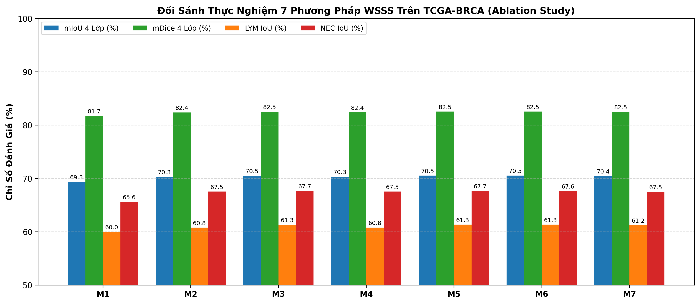
</p>
<p align="center">
  <em>Hình 7. Đối sánh định lượng 7 phương pháp suy luận Baseline (M1-M7) trên toàn bộ 4,986 ảnh Test tại Run 3 (300 DPI).</em>
</p>

<p align="center">
  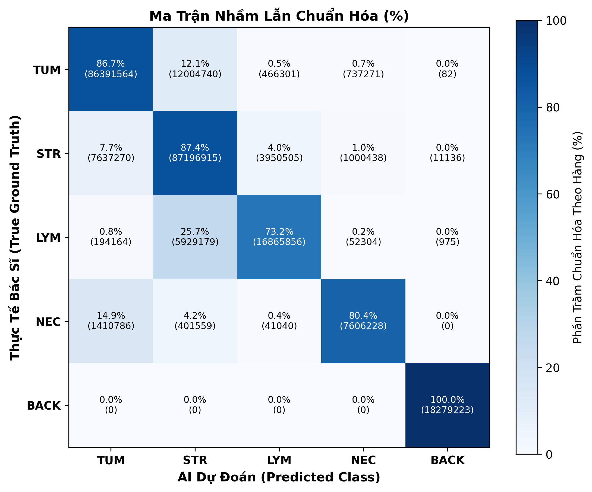
</p>
<p align="center">
  <em>Hình 8. Ma trận nhầm lẫn 5x5 chuẩn hóa theo hàng (%) của M6 trên 4,986 ảnh Test: BACK Recall 100.00% (18,279,223/18,279,223 px), sai số chính tập trung ở ranh giới TUM <-> STR và LYM -> STR.</em>
</p>

### 5.4 Thực Nghiệm Đối Chứng Đa Hướng (`Multi-Direction Composable Ablation`, `23` Bệnh Nhân / `46` Patches)

Khung đánh giá mở `src/clinical/comparative_ablation_evaluator.py` hiệu chỉnh prototype `MP-PPC` từ tập `training/` (`0%` rò rỉ Test) và kiểm thử độc lập từng thành phần trên phân tầng 23 bệnh nhân Test ([ABLATION_STUDY_COMPARATIVE_REPORT.json](product/reports/ABLATION_STUDY_COMPARATIVE_REPORT.json)):
- **`M7` (`M6` TTA + `SG-DAP`)** dẫn đầu phân vùng trên phân tập rìa kính (`58.18%` 4-cls mIoU, `44.72%` 5-cls mIoU, `84.57%` PA, `p = 0.0372` theo bệnh nhân vs `M6` `58.13%`), trong khi `M8` zero-shot nâng `Boundary F1` lên `46.58%` nhưng hạ `NEC IoU` (`19.77%`), khẳng định lý do chỉ kích hoạt `MP-PPC` / `I2P-Attn` sau huấn luyện có gradient thay vì áp đặt zero-shot.

---

<a id="visual-diagnostics"></a>
## 6. Kiểm Chứng Trực Quan Lớp Phủ Mô Bệnh Học (`Visual Audit Suite`)

Thay vì chỉ dựa vào điểm số tổng hợp, hệ thống tích hợp kiểm chứng trực quan đa góc độ ở cả hai tầng: `src/stage2_v2/visual_audit.py` + `notebooks/02d_Stage2_Visual_Overlay_Audit_G4.ipynb` (cho Gate-7 Track A, khóa kiểm tra không rò rỉ GT trong `tests/test_stage2_v2_visual_audit.py`) và `src/visualization/clinical_viewer.py` + `src/colab_pkg/visualizer.py` (**9 chế độ QA trực quan**: `Blurred Dual QA`, `Match vs Error`, `Seg Mask`, `GT + AI Blend`, `Contours`, `Entropy`, `Stage-1 CAM`, `Spotlight`, `Doctor GT`).

<p align="center">
  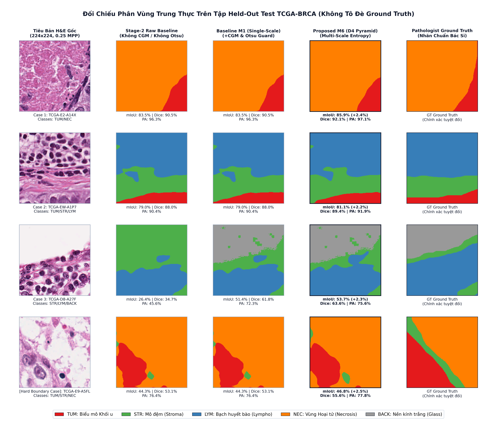
</p>
<p align="center">
  <em>Hình 9. Đối chiếu định tính trung thực (unmasked) trên 4 bệnh nhân Held-out Test: TCGA-E2-A14X (85.9% mIoU), TCGA-EW-A1P7 (81.1% mIoU), TCGA-D8-A27F (53.7% mIoU) và ca biên khó TCGA-E9-A5FL (46.8% mIoU).</em>
</p>

<p align="center">
  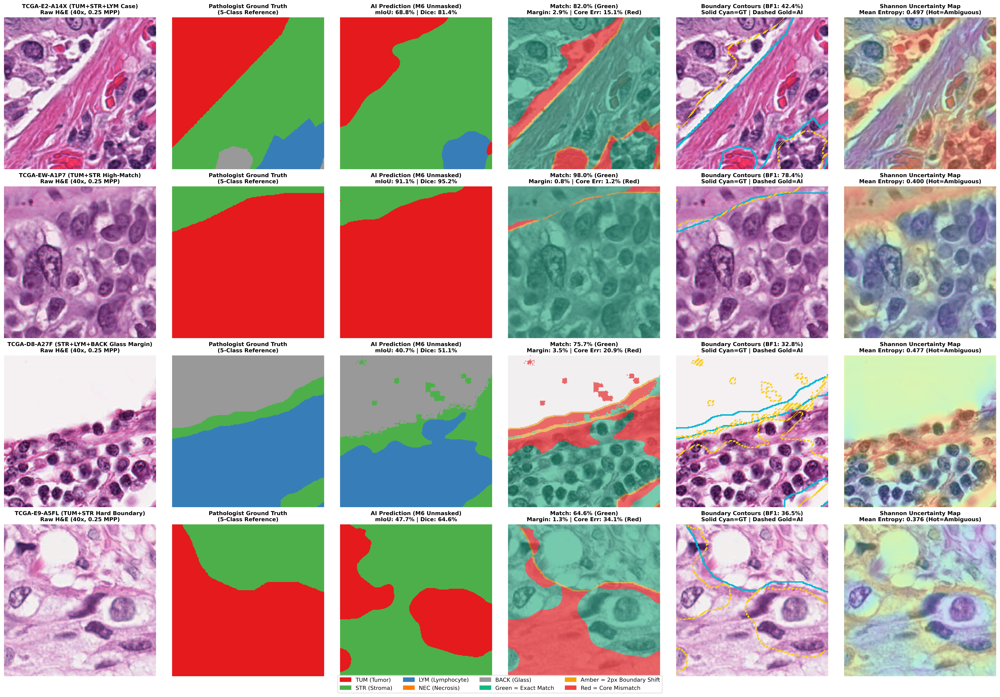
</p>
<p align="center">
  <em>Hình 10. Lưới kiểm chứng trực quan đa góc độ (Raw H&E, Pathologist GT, AI Prediction, Match-vs-Error Xanh-Vàng-Đỏ, Đường bao Cyan/Vàng và Bản đồ Shannon Entropy) trên 4 bệnh nhân Held-out Test.</em>
</p>

---

<a id="workstation"></a>
## 7. Trạm Làm Việc Lâm Sàng, Triển Khai Docker & Điều Phối VPS-Colab

### 7.1 Trạm Làm Việc Lâm Sàng FastAPI & Offline HTML5 Canvas (`18` Chế Độ Suy Luận + CAP PDF)

Máy chủ **FastAPI** (`src/visualization/api_server.py`) và giao diện **HTML5 Canvas hoạt động hoàn toàn offline** (`src/visualization/static/index.html`, không phụ thuộc CDN ngoài) tự động nạp trọng số Gate-7 Track A từ `WSSS_GATE7_DIR` (`checkpoints/vps_evidence/`) và trọng số Baseline (`checkpoints/`), báo cáo trung thực `checkpoint_verified` (`strict_weights=True` trả HTTP `503` nếu thiếu trọng số):

- **18 chế độ suy luận khả dụng (`available_methods`):**
  - **7 chế độ Gate-7 Track A:** `gate7_arm5`, `gate7_arm5_tta`, `gate7_4arm_cgm`, `gate7_4arm`, `gate7_arm6`, `gate7_arm7`, `gate7_arm8`.
  - **11 chế độ Baseline & Ablation:** `m6`, `m1`, `m2`, `m3`, `m4`, `m5`, `m7`, `od_prior`, `sg_dap`, `mpppc`, `combined`.
- **Bộ công cụ QA tương tác cho bác sĩ giải phẫu bệnh:** **9 chế độ hiển thị QA** (mặc định `Blurred Dual QA`), thanh trượt đối chiếu **Split-Curtain (`S`)**, kính lúp **Magnifier Loupe (`L`)**, thanh tỷ lệ **Scale Bar (`50 um, 0.25 MPP`)**, **Pixel Inspector HUD** (`x, y, GT, Pred, Conf%`), tab **WSI Multi-Tile Stitch** (ghép tới `64` tiles bằng `cosine feather blending` tự đọc tọa độ `_xmin..._ymin...`), định lượng **VTP / TSR** kèm phân tầng nguy cơ CAP (`TSR <= 50%`: Stroma-Rich / Nguy cơ cao), và **Export QA Report** hỗ trợ **4 định dạng**: **Báo cáo Lâm sàng CAP 2 trang PDF (`format=pdf`)**, **Bảng Đối Chiếu Chẩn Đoán 300-DPI 2x4 PNG (`png`)**, **JSON (`json`)** và **CSV (`csv`)**.

<p align="center">
  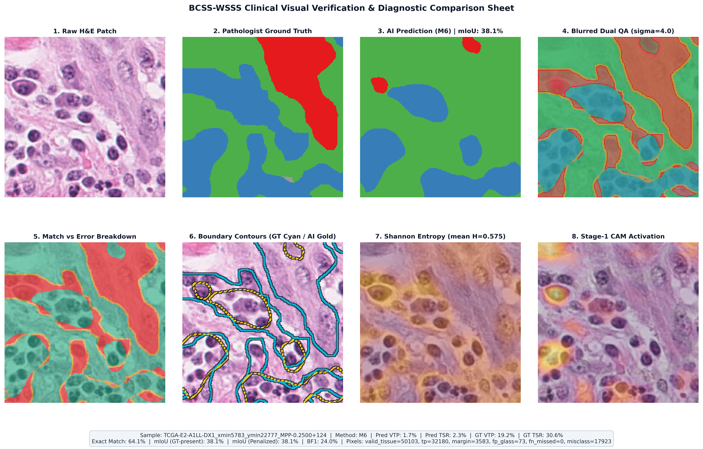
</p>
<p align="center">
  <em>Hình 11. Mẫu bảng đối chiếu chẩn đoán 300 DPI (Diagnostic Sheet) xuất trực tiếp qua endpoint POST /api/v1/export/report của Trạm Làm Việc Lâm Sàng.</em>
</p>

| Endpoint | HTTP | Chức Năng & Hợp Đồng Dữ Liệu |
| :--- | :---: | :--- |
| `/`, `/viewer` | `GET` | Giao diện HTML5 Canvas offline (18 chế độ AI, 9 chế độ QA, Split-Curtain, Loupe, WSI Stitch, Export CAP PDF/PNG/JSON/CSV) |
| `/docs` | `GET` | Tài liệu tương tác OpenAPI (Swagger UI) |
| `/health`, `/api/v1/health` | `GET` | Trạng thái trọng số Gate-7 & Baseline (`gate7_available_arms`, `gate7_loaded_arms`), GPU/CPU, VRAM và 18 chế độ suy luận |
| `/api/v1/samples`, `/api/v1/samples/{id}` | `GET` | Duyệt cohort Held-Out Test theo bệnh nhân/hình thái kèm ảnh H&E gốc, GT mask và `gt_biomarkers` |
| `/api/v1/predict/patch` | `POST` | Suy luận phân vùng 5 lớp (`OtsuClinicalGating` + `Pure-Glass Guard`), trả về toàn bộ ảnh QA, `VTP/TSR`, `agreement_summary` và `checkpoint_verified` |
| `/api/v1/compare` | `POST` | So sánh A/B song song tối đa 6 phương pháp trên cùng một lát cắt |
| `/api/v1/export/report` | `POST` | Xuất báo cáo kiểm định: **2-page CAP Clinical PDF (`pdf`)**, **300-DPI 2x4 PNG (`png`)**, **JSON (`json`)** hoặc **CSV (`csv`)** |
| `/api/v1/predict/wsi` | `POST` | Ghép tối đa 64 tiles (`8192x8192`), suy luận Otsu Gating và trả về `composite_heatmap_base64` + `region_summary` |
| `/segment`, `/biomarkers`, `/splits`, `/tile/{z}/{x}/{y}.png` | `POST`/`GET` | Các endpoint lâm sàng rút gọn, danh sách phân tách 151 bệnh nhân Anti-Leakage và DeepZoom tiles |

### 7.2 Triển Khai Đóng Gói Docker & Docker Compose (`Dockerfile`, `docker-compose.yml`)

Hệ thống đóng gói sẵn container không quyền root (`appuser`, Python 3.11-slim, tự động cấu hình `WSSS_GATE7_DIR=/app/checkpoints/vps_evidence`, gắn read-only `./checkpoints` và `./data`, kèm `HEALTHCHECK` kiểm tra `/health` mỗi 30 giây):

```bash
# Khởi chạy toàn bộ Trạm Lâm Sàng qua Docker Compose:
docker compose up --build -d

# Kiểm tra trạng thái container và endpoint sức khỏe:
docker compose ps
curl http://localhost:8000/api/v1/health
```

Truy cập giao diện tại `http://localhost:8000/viewer` và tài liệu Swagger tại `http://localhost:8000/docs`.

### 7.3 Hệ Thống Điều Phối Đa GPU VPS-Colab (`colab_runner_local/`)

Hệ thống `colab_runner_local/` điều phối huấn luyện và đánh giá Colab GPU trực tiếp từ Linux VPS (Oracle ARM64/x86_64) 24/7 mà không phụ thuộc kết nối máy cục bộ (xem chi tiết vận hành tại [COLAB_RUNBOOK.md](docs/architecture/COLAB_RUNBOOK.md)):
- **Ưu tiên tài khoản `colab_account` & chuỗi GPU tốc độ cao:** Luôn truyền tường minh `--credentials ~/.config/gcloud/colab_adc.json` và `--gpu H100 --gpu-fallback G4,A100,L4` (không dùng ADC mặc định trỏ sang `colab_account`).
- **Bảo vệ P0 chống tắt nhầm phiên ngoại lai external_service (`runtime_guard.py`):** Khóa độc quyền theo tài khoản (`flock`), chụp snapshot bất biến `protected_endpoints` fail-closed trước mọi lần `colab new`, và chỉ dừng phiên khi khớp kép (`session_name` + `endpoint`) trong `owned_sessions` mà không thuộc `protected_endpoints` (tuyệt đối cấm `colab stop --all`).
- **Đồng bộ SHA256 nguyên tử, `LOCAL_CODE_BUNDLE` & Dashboard PBKDF2:** Tự động đồng bộ checkpoint/artifact có kiểm tra `sha256sum`, hỗ trợ đẩy gói mã nguồn cục bộ qua biến `LOCAL_CODE_BUNDLE`, cảnh báo sớm fail-fast (`STOP_ON_ALARM=1`), và bảng điều khiển web `dashboard.py` + `local_auth.py`.

### 7.4 Phủ Kiểm Thử Tự Động & Cổng Kiểm Định Chất Lượng

- **Unit, Anti-Leakage, Stage-2 v2, Visual Audit & API Tests (`tests/`):** **`496` ca kiểm thử** trên **`30` bộ kiểm thử** (`pytest`, tổng **`531` ca** khi gộp `35` ca của `colab_runner_local/`, bao gồm `test_governance_invariants.py`, `test_patient_split.py`, `test_stage2_v2_gate7.py`, `test_stage2_v2_visual_audit.py`, `test_deliverable_auditor.py`, `test_api_server.py`).
- **VPS-Colab Orchestrator & P0 Safety Tests (`colab_runner_local/`):** **`35` ca kiểm thử** (`test_vps_colab_runner.py` + `test_dashboard.py`), đã xác minh **`35/35` đạt trên Linux ARM64 VPS** (`29 passed, 6 skipped` các bài test bash/POSIX trên Windows cục bộ).
- **Linter & Deliverable Quality Gate:** `ruff check src tests` (`ruff.toml`, `line-length = 120`, `py310`) và bộ kiểm định 4 tầng độc lập `python src/utils/deliverable_auditor.py`.

---

<a id="directory-tree"></a>
## 8. Cây Thư Mục Dự Án (Repository Directory Tree)

```text
medical-wsss/
|-- .github/
|   `-- workflows/
|       `-- ci.yml                               # Pipeline CI kiểm tra pytest, ruff, anti-leakage & governance
|-- checkpoints/
|   `-- vps_evidence/                            # Minh chứng Gate-7 & Stage-1 kèm SHA256SUMS.txt (123/123, gitignored .pth)
|-- data/                                        # Dữ liệu BCSS-WSSS / LUAD-HistoSeg (gitignored)
|-- docs/
|   |-- architecture/
|   |   |-- AGENT_TEAM_SPEC.md                   # Đặc tả đội agent, đồng thuận 2 vòng 3 luồng & cổng kép 40+40
|   |   |-- SYSTEM_TECHNICAL_SPECIFICATION.md    # Đặc tả kỹ thuật kiến trúc phần mềm
|   |   |-- TEAMWORK_MULTI_AGENT_WORKFLOW.md     # Quy trình điều phối đa nhóm phản biện đối kháng
|   |   `-- COLAB_RUNBOOK.md                 # Runbook điều phối đa GPU colab_account & bảo vệ P0 external_service
|   |-- assets/readme/                           # Ảnh minh họa thực nghiệm H&E & mẫu Diagnostic Sheet 300 DPI
|   `-- research/
|       |-- DATASET_SPECIFICATION_AND_PATIENT_LEAKAGE_PROTOCOL.md # Đặc tả BCSS/LUAD, chống rò rỉ & chuẩn hóa
|       `-- STAGE2_FINAL_EXPERIMENT_SUMMARY.md   # Báo cáo tổng kết thực nghiệm Gate-7 Track A (SHA256)
|-- experiments/
|   |-- benchmarks/                              # Báo cáo đối chứng đa hướng
|   |-- colab_run_1_stage2_baseline/             # Log thực nghiệm Run 1 trên Tesla T4 (n=4,986)
|   |-- colab_run_2_dual_stage_ensemble/         # Log thực nghiệm Run 2 trên Tesla T4 (n=4,986)
|   `-- colab_run_3_multiscale_sota_v2/          # Log Run 3 M1-M7, CSV, Confusion Matrix & biểu đồ 300 DPI
|-- notebooks/
|   |-- 01_Train_Stage1_Classifier[_T4|_L4].ipynb
|   |-- 02_Pseudo_Masks_Train_Stage2[_T4|_L4].ipynb
|   |-- 02b_Stage2_Breakthrough_G4.ipynb         # Huấn luyện 4-Arm Dual-Head Gate-6 / Gate-7 Track A
|   |-- 02c_Stage2_Ensemble_Eval_G4.ipynb        # Đánh giá 5-expert ensemble, 5-fold CV & kiểm định Holm-Bonferroni
|   |-- 02d_Stage2_Visual_Overlay_Audit_G4.ipynb # Kiểm chứng trực quan lớp phủ GT vs Prediction (0 GT leakage)
|   |-- 03_Train_Proposed_MedSAM[_T4|_L4].ipynb
|   |-- 04_Exhaustive_Benchmark_Survival[_T4|_L4].ipynb
|   |-- 04b_Stage2_Gate7_Clinical_LUAD_Bench_G4.ipynb # Benchmark lâm sàng, sống còn, hiệu năng GPU & LUAD chéo cơ quan
|   `-- history_runs/                            # Các notebook tái lập nguyên bản Run 1 - Run 3
|-- product/
|   |-- proposal/                                # Đề cương kỹ thuật & hình minh họa đơn sắc
|   |-- reports/
|   |   |-- SE374_FINAL_TECHNICAL_REPORT_WSSS.md # Báo cáo kỹ thuật cuối kỳ SE374.R11
|   |   |-- ABLATION_STUDY_COMPARATIVE_REPORT.json
|   |   `-- figures/                             # 4 hình khoa học đơn sắc 300 DPI (fig1 đến fig4 PNG + SVG)
|   `-- slides/                                  # Bộ trình chiếu khoa học 16:9 (Marp)
|-- scripts/                                     # Script đóng gói Drive, sinh biến thể notebook & tải paper
|-- src/
|   |-- clinical/                                # comparative_ablation_evaluator, exhaustive_evaluator, survival_analysis
|   |-- colab_pkg/                               # downloader (resolve_split_dirs), model_loader, evaluator, visualizer, colab_runner
|   |-- config/                                  # bcss_patient_splits.json (151 BN: 106/22/23), stage1_experiments.py
|   |-- datasets/                                # bcss_dataset.py, otsu_filter.py, patient_split.py
|   |-- losses_metrics/                          # losses.py, metrics.py
|   |-- models/                                  # backbone, deeplabv3plus, pda_generator, stain_deconv, sg_dap, sam_wsss_adapter, wsss_inference_methods
|   |-- pipeline/                                # colab_runner.py, comparative_runner.py, wsi_lowmag_highmag_pipeline.py
|   |-- stage2_v2/                               # config, models, losses, memmap_dataset, trainer, evaluator, ensemble, visual_audit, gate7_clinical_bench
|   |-- training/                                # dataset_loader, train_stage1, eval_stage1_full, generate_pseudo_masks, train_stage2, train_proposed_sam
|   |-- utils/                                   # deliverable_auditor.py (kiểm định 4 tầng độc lập)
|   `-- visualization/                           # api_server.py (18 modes + CAP PDF), clinical_viewer.py, draw_gate7_monochrome_figures.py, static/index.html
|-- tests/                                       # 30 bộ kiểm thử pytest (496 ca kiểm thử)
|-- colab_runner_local/                            # colab_run_script, runtime_guard.py, dashboard.py, local_auth.py, 35 tests
|-- Dockerfile                                   # Container triển khai Trạm Lâm Sàng FastAPI
|-- docker-compose.yml                           # Điều phối container kèm volume RO & healthcheck
|-- LICENSE
|-- pytest.ini
|-- README.md
|-- requirements.txt
`-- ruff.toml
```

*(Ghi chú minh bạch lưu trữ: Tệp tham khảo ngoại khóa `notebooks/Lab1.ipynb` vốn không theo dõi trong git đã bị mất vĩnh viễn trên máy cục bộ trước đó và không thuộc chuỗi pipeline sản phẩm; `tests/test_governance_invariants.py` bảo vệ điều kiện tùy chọn khi tệp này vắng mặt.)*

---

<a id="quickstart"></a>
## 9. Cài Đặt, Model Zoo & Hướng Dẫn Khởi Chạy Nhanh (Quickstart)

### 9.1 Kho Trọng Số & Tập Dữ Liệu (Model Zoo)

| Tài Nguyên / Checkpoint | Kiến Trúc / Quy Mô | Miền Chuẩn Hóa | Nguồn Tải / Minh Chứng SHA256 |
| :--- | :--- | :---: | :--- |
| **BCSS-WSSS Dataset** | 31,826 patches (`40x`, `0.25 MPP`, 151 ca TCGA-BRCA) | - | [Hugging Face](https://huggingface.co/datasets/nttduc/wsss-pathology/resolve/main/BCSS-WSSS.zip) / [GDrive Mirror](https://drive.google.com/file/d/1sCK8Cqsf4yCHzzIx98vitocES2L_tkjn/view) |
| **LUAD-HistoSeg Dataset** | 17,285 patches (`10x`, `1.0 MPP`, 49 ca phổi) | - | [Hugging Face](https://huggingface.co/datasets/nttduc/wsss-pathology/resolve/main/LUAD-HistoSeg.zip) / [GDrive Mirror](https://drive.google.com/file/d/1WyWfv-JHjLwkHOiN8blINhBOkKi--iA1/view) |
| **Author Stage-1 / Stage-2 (BCSS)** | `ResNet-38d` (`105.09M`) & `DeepLabV3+ R101` (`59.34M`) | `[0.0, 1.0]` | [Stage-1 HF](https://huggingface.co/longcris04/pseduo_mask_wsss/resolve/main/stage1_checkpoint_trained_on_bcss.pth) / [Stage-2 HF](https://huggingface.co/longcris04/pseduo_mask_wsss/resolve/main/stage2_checkpoint_trained_on_bcss.pth) |
| **Stage-1 Champion (`se374_arm_b_full`)** | `ResNet-38d` + PDA (Ep 5 EMA, LUAD init, `401.1 MiB`) | `[0.0, 1.0]` | Local/VPS `SHA256: a182d8890c09d7b8` (`cls`: `e1a88293aff0a0e3`) |
| **Gate-7 Arm 5 (`arm5_dinov2_large_r2`)** | `DINOv2-ViT-L/14` Dual-Head `336px` (`1,173.0 MiB`) | ImageNet | Local/VPS `SHA256: 33f4d623e8825471` (`72.80%` TEST +4-DoF CGM) |
| **Gate-7 Arm 6 (`arm6_segformer_b5_r2`)** | `SegFormer MiT-B5` Dual-Head (`323.1 MiB`) | ImageNet | Local/VPS `SHA256: 3055643db074a2df` (`72.04%` TEST no-CGM) |
| **Gate-7 Arm 7 (`arm7_convnext_large_r2`)** | `ConvNeXt-Large FPN` Dual-Head (`771.8 MiB`) | ImageNet | Local/VPS `SHA256: c64b97c731c71c97` (`71.80%` TEST no-CGM) |
| **Gate-7 Arm 8 (`arm8_deeplab_r101_r2`)** | `DeepLabV3+ R101` Dual-Head (`227.0 MiB`) | ImageNet | Local/VPS `SHA256: 9fd6e121a9714756` (`70.96%` TEST +CGM) |

### 9.2 Cài Đặt Cục Bộ, Khởi Chạy Trạm Lâm Sàng & Kiểm Thử

```bash
# 1. Tải mã nguồn và tạo môi trường ảo Python 3.10+
git clone https://github.com/khoinguyen59/medical-wsss.git
cd medical-wsss
python -m venv .venv

# Linux / macOS:
source .venv/bin/activate && pip install -r requirements.txt
# Windows PowerShell:
.\.venv\Scripts\Activate.ps1; pip install -r requirements.txt

# 2. Khởi chạy Trạm Lâm Sàng FastAPI + HTML5 Canvas Offline (cổng 8000):
uvicorn src.visualization.api_server:app --host 0.0.0.0 --port 8000

# 3. Chạy bộ kiểm thử tự động, kiểm tra linter & cổng kiểm định tài liệu:
pytest
ruff check src tests
python src/utils/deliverable_auditor.py --all
```

### 9.3 Chạy Thực Nghiệm Gate-7 Trên Colab / VPS-Colab & Python SDK

- **Tái lập Gate-7 trên Google Colab / VPS-Colab:**
  - Huấn luyện từng nhánh Track A: [notebooks/02b_Stage2_Breakthrough_G4.ipynb](notebooks/02b_Stage2_Breakthrough_G4.ipynb)
  - Đánh giá 4-Arm Super-Ensemble & kiểm định Holm-Bonferroni: [notebooks/02c_Stage2_Ensemble_Eval_G4.ipynb](notebooks/02c_Stage2_Ensemble_Eval_G4.ipynb)
  - Kiểm chứng trực quan lớp phủ mô bệnh học (0 GT leakage): [notebooks/02d_Stage2_Visual_Overlay_Audit_G4.ipynb](notebooks/02d_Stage2_Visual_Overlay_Audit_G4.ipynb)
  - Đánh giá chỉ số lâm sàng, sống còn & LUAD chéo cơ quan: [notebooks/04b_Stage2_Gate7_Clinical_LUAD_Bench_G4.ipynb](notebooks/04b_Stage2_Gate7_Clinical_LUAD_Bench_G4.ipynb)
  - Tái lập lịch sử Run 3 (`M1-M7`): [notebooks/history_runs/Run3_20261020_2055UTC_MultiScale_Pyramid_D4_M1_to_M7_T4_Full4986.ipynb](notebooks/history_runs/Run3_20261020_2055UTC_MultiScale_Pyramid_D4_M1_to_M7_T4_Full4986.ipynb)

```bash
# Kiểm tra cấu hình VPS-Colab không tốn GPU (--dry-run, luôn ưu tiên colab_account + H100->G4,A100,L4):
bash colab_runner_local/colab_run_script \
  --credentials ~/.config/gcloud/colab_adc.json \
  --notebook nb2 \
  --file notebooks/02c_Stage2_Ensemble_Eval_G4.ipynb \
  --gpu H100 --gpu-fallback G4,A100,L4 \
  --session se374_g7_ensemble_tracka \
  --dry-run
```

```python
import numpy as np
import torch
from PIL import Image
from src.colab_pkg.model_loader import load_wsss_models
from src.models.wsss_inference_methods import MultiMethodWSSSEngineV2

# 1. Nạp trọng số Stage-1 & Stage-2 (chuẩn miền [0.0, 1.0])
model_stage2, model_stage1, device = load_wsss_models(
    stage2_ckpt="checkpoints/stage2_checkpoint_trained_on_bcss.pth",
    stage1_ckpt="checkpoints/stage1_checkpoint_trained_on_bcss.pth",
)
engine = MultiMethodWSSSEngineV2(model_stage1=model_stage1)

# 2. Chuẩn hóa đầu vào [0.0, 1.0] và suy luận M6 + Pure-Glass Guard
raw_rgb = np.array(Image.open("sample_he_patch.png").convert("RGB"))
img_tensor = torch.from_numpy(raw_rgb.transpose(2, 0, 1)).float().div(255.0).unsqueeze(0).to(device)
with torch.no_grad():
    preds = engine.predict_all_methods_v2(model_stage2, img_tensor, raw_rgb=raw_rgb, model_stage1=model_stage1)
    pred_m6 = engine.apply_pure_glass_guard(preds["M6_MultiScale_Pyramid_D4_Ensemble"], raw_rgb=raw_rgb, background_class_idx=4)
```

---

<a id="references"></a>
## 10. Truy Xuất Minh Chứng, Giới Hạn Y Tế & Tài Liệu Tham Khảo

### 10.1 Truy Xuất Nguồn Gốc Thực Nghiệm

- **Minh chứng mật mã Gate-7 Track A (`123/123` SHA256 OK):** `checkpoints/vps_evidence/SHA256SUMS.txt`, `checkpoints/vps_evidence/se374_g7_ensemble_tracka/artifacts/STAGE2_TRAINING_METRICS.json`, `checkpoints/vps_evidence/se374_g7_ensemble_tracka/artifacts/per_patient_class_ious.json`, và báo cáo tổng kết [STAGE2_FINAL_EXPERIMENT_SUMMARY.md](docs/research/STAGE2_FINAL_EXPERIMENT_SUMMARY.md).
- **Minh chứng Baseline Run 1-3 (Tesla T4, `n = 4,986`):** `experiments/colab_run_1_stage2_baseline/COLAB_EVALUATION_REPORT.json`, `experiments/colab_run_2_dual_stage_ensemble/COLAB_EVALUATION_REPORT.json`, `experiments/colab_run_3_multiscale_sota_v2/COLAB_EVALUATION_REPORT.json` và `ablation_study_metrics.csv`.
- **Tài liệu lưu trữ cũ đã ghi nhận rõ trạng thái thay thế:** `product/reports/clinical/EXHAUSTIVE_3WAY_BENCHMARK_REPORT.md` (CPU smoke 2 patches) và `product/reports/wsi_colab_run_results/clinical_wsi_report.json` (demo WSI 100 patches) đều đã gắn nhãn lưu trữ `[DEPRECATED / SUPERSEDED]`.

### 10.2 Giới Hạn Sử Dụng Lâm Sàng (Research-Use-Only Disclaimer)

Phần mềm và các bộ trọng số học sâu trong kho lưu trữ này **chỉ phục vụ mục đích nghiên cứu khoa học và giáo dục trong giải phẫu bệnh số (Research Use Only)**. Hệ thống không phải là thiết bị y tế chẩn đoán lâm sàng được cấp phép (FDA/CE) và **tuyệt đối không được sử dụng độc lập để đưa ra quyết định chẩn đoán, tiên lượng hay chỉ định điều trị trên bệnh nhân thật** nếu thiếu thẩm định và ký xác nhận của bác sĩ giải phẫu bệnh chuyên khoa.

### 10.3 Tài Liệu Tham Khảo Khoa Học (References)

1. **Amgad, M., Elfandy, H., Hussein, H., et al. (2019).** *Structured crowdsourcing enables convolutional segmentation of histology images (BCSS).* Bioinformatics, 35(18), 3461-3467. DOI: `10.1093/bioinformatics/btz083`.
2. **Han, C., Lin, J., Mai, J., et al. (2022).** *Multi-layer pseudo-supervision for histopathology tissue semantic segmentation using patch-level classification labels (WSSS-Tissue).* Medical Image Analysis, 80, 102487. DOI: `10.1016/j.media.2022.102487`.
3. **Oquab, M., Darcet, T., Moutakanni, T., et al. (2024).** *DINOv2: Learning robust visual features without supervision.* Transactions on Machine Learning Research (TMLR). arXiv: `2304.07193`.
4. **Xie, E., Wang, W., Yu, Z., et al. (2021).** *SegFormer: Simple and efficient design for semantic segmentation with transformers.* NeurIPS 2021. arXiv: `2105.15203`.
5. **Liu, Z., Mao, H., Wu, C.-Y., et al. (2022).** *A ConvNet for the 2020s (ConvNeXt).* CVPR 2022. DOI: `10.1109/CVPR52688.2022.01167`.
6. **Chen, L.-C., Zhu, Y., Papandreou, G., Schroff, F., & Adam, H. (2018).** *Encoder-decoder with atrous separable convolution for semantic image segmentation (DeepLabV3+).* ECCV 2018. DOI: `10.1007/978-3-030-01234-2_49`.
7. **Wu, Z., Shen, C., & van den Hengel, A. (2019).** *Wider or deeper: Revisiting the ResNet model for visual recognition (ResNet-38d).* Pattern Recognition, 90, 119-133. DOI: `10.1016/j.patcog.2019.01.006`.
8. **Ruifrok, A. C., & Johnston, D. A. (2001).** *Quantification of histochemical staining by color deconvolution.* Analytical and Quantitative Cytology and Histology, 23(4), 291-299. PMID: `11531144`.
9. **Ma, J., He, Y., Li, F., et al. (2024).** *Segment anything in medical images (MedSAM).* Nature Communications, 15, 654. DOI: `10.1038/s41467-024-44824-z`.
10. **Otsu, N. (1979).** *A threshold selection method from gray-level histograms.* IEEE Transactions on Systems, Man, and Cybernetics, 9(1), 62-66. DOI: `10.1109/TSMC.1979.4310076`.

### 10.4 Thông Tin Học Phần & Trích Dẫn (Course Metadata & Citation)

- **Học phần:** SE374.R11 - Phát Triển Phần Mềm Xử Lý Ảnh Y Khoa, Khoa Kỹ Thuật Phần Mềm, Trường Đại Học Công Nghệ Thông Tin (UIT), ĐHQG-HCM (2026).
- **Giảng viên hướng dẫn:** TS. Bùi Cao Doanh.

```bibtex
@software{se374_bcss_wsss_gate7_2026,
  title  = {BCSS-WSSS Gate-7 Track A: Weakly-Supervised Histopathology Segmentation & Offline Clinical WSI Workstation},
  year   = {2026},
  url    = {https://github.com/khoinguyen59/medical-wsss}
}
```
