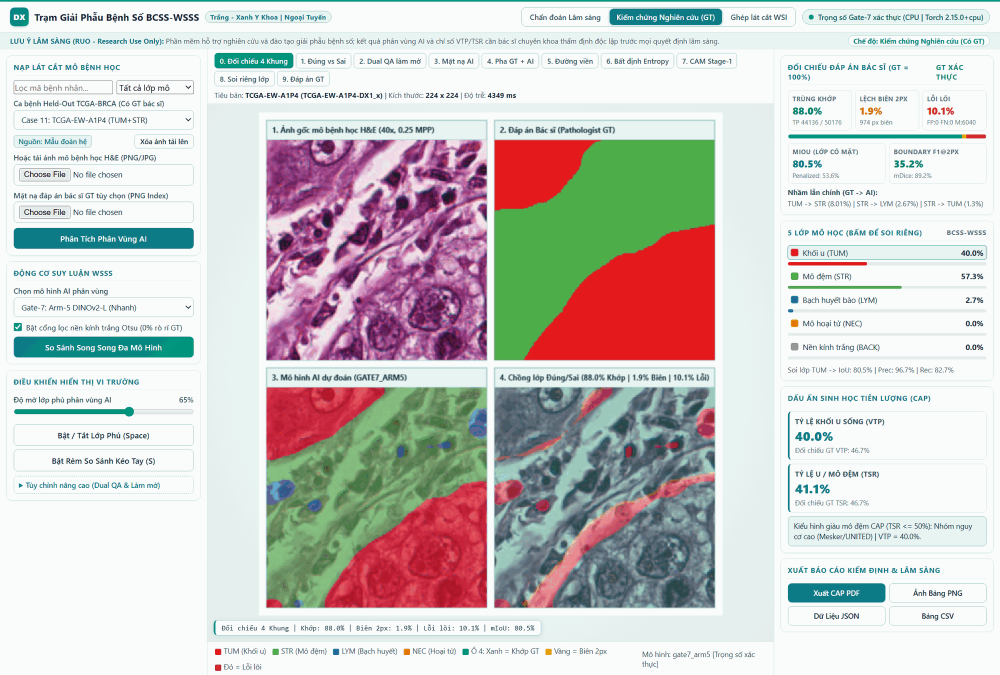
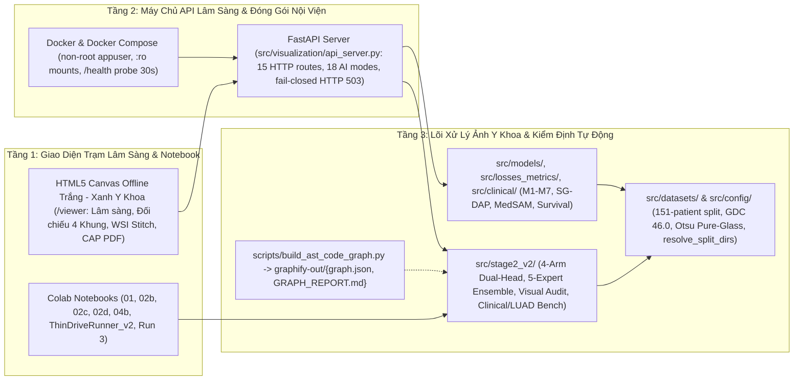
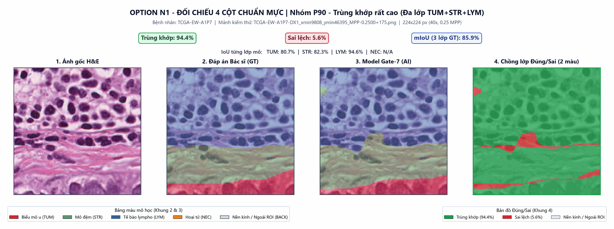

# Trạm Giải Phẫu Bệnh Số Ngoại Tuyến BCSS-WSSS (SE374.R11)

*Phần Mềm Hỗ Trợ Chẩn Đoán & Phân Vùng Mô Bệnh Học Ung Thư Vú Giám Sát Yếu (FastAPI + HTML5 Canvas Trắng - Xanh Y Khoa Ngoại Tuyến + Docker + Lõi AI Gate-7 Track A 4-Arm)*

<p align="center">
  <a href="https://colab.research.google.com/github/khoinguyen59/medical-wsss/blob/master/notebooks/02c_Stage2_Ensemble_Eval_G4.ipynb">
    
  </a>
  
  
  
  
  
  
  
</p>

<p align="center">
  <a href="#bai-toan-lam-sang">Bài toán lâm sàng</a> ·
  <a href="#phan-mem-tram-lam-sang">Phần 1: Hệ thống phần mềm</a> ·
  <a href="#phan-nghien-cuu-ai">Phần 2: Lõi nghiên cứu AI</a> ·
  <a href="#lo-trinh-nhom-3-nguoi">Phân công nhóm 3 người</a> ·
  <a href="#master-link-hub">Kho liên kết trực tiếp</a> ·
  <a href="#minh-bach-su-co">Minh bạch sự cố</a> ·
  <a href="#quickstart">Chạy phần mềm ngay</a>
</p>

> **Học phần:** SE374.R11 - Phát Triển Phần Mềm Xử Lý Ảnh Y Khoa, Khoa Kỹ Thuật Phần Mềm, Trường Đại Học Công Nghệ Thông Tin (UIT), ĐHQG-HCM (2026)  
> **Giảng viên hướng dẫn:** TS. Bùi Cao Doanh  
> **Đề tài:** Đề tài 6 - Phát Triển Phần Mềm & Lõi AI Phân Vùng Ngữ Nghĩa Giám Sát Yếu Cho Ảnh Mô Bệnh Học WSI (`BCSS-WSSS` / `TCGA-BRCA` + `LUAD-HistoSeg`)  
> **Thông tin hành chính:** `[CẦN XÁC NHẬN: Họ tên 3 thành viên / MSSV / GVHD]`

---

<a id="bai-toan-lam-sang"></a>
## 1. Bối Cảnh Lâm Sàng: Một Ngày Làm Việc Của Bác Sĩ Giải Phẫu Bệnh & Nút Thắt Cần Giải Quyết

Trong chẩn đoán ung thư vú hiện đại, **Giải phẫu bệnh số (Digital Pathology)** là "tiêu chuẩn vàng" quyết định phác đồ điều trị và tiên lượng sống còn của bệnh nhân. Tuy nhiên, quy trình làm việc hằng ngày tại khoa Giải phẫu bệnh đang đối mặt với **4 áp lực thực tế rất lớn**:

1. **Quá tải đọc tiêu bản khổng lồ (Whole Slide Image - WSI):** Mỗi ngày một bác sĩ giải phẫu bệnh phải rà soát hàng chục đến hàng trăm tiêu bản sinh thiết nhuộm **H&E** được quét ở độ phóng đại **`40x` (`0.25 um/pixel`)**, kích thước mỗi tiêu bản lên tới hàng trăm nghìn pixel (tương đương hàng nghìn vi trường `224 x 224` px).
2. **Ước lượng thủ công các dấu ấn tiên lượng sống còn dễ sai lệch:** Để phân tầng nguy cơ bệnh nhân theo chuẩn quốc tế **CAP / UNITED (Mesker et al.)**, bác sĩ phải phân biệt trực quan `4` vùng mô đan xen phức tạp gồm **Khối u biểu mô (`TUM`)**, **Mô đệm (`STR`)**, **Bạch huyết bào xâm nhập (`LYM`)** và **Mô hoại tử (`NEC`)**, sau đó ước lượng bằng mắt thường **Tỷ lệ khối u sống (`VTP`)** và **Tỷ lệ U / Mô đệm (`TSR <= 50%` thuộc nhóm giàu mô đệm nguy cơ cao)**. Đánh giá bằng mắt thường tốn thời gian và dễ dao động giữa các bác sĩ (*inter-observer variability*).
3. **Mỏi thị giác do quang học màu mô H&E & yêu cầu bảo mật nội viện:** Khi làm việc liên tục nhiều giờ với mô nhuộm H&E mang tông **hồng - đỏ đậm** (Eosin / máu), màn hình giao diện tối hoặc phối màu sặc sỡ gây hiện tượng **dư ảnh đỏ trên võng mạc** và chói mỏi mắt. Đồng thời, dữ liệu tiêu bản bệnh nhân không thể tùy tiện đẩy lên dịch vụ đám mây bên ngoài mà cần phần mềm chạy **100% ngoại tuyến trong mạng nội viện**.
4. **Nút thắt chi phí xây dựng AI y tế (vì sao cần Giám sát yếu - WSSS):** Muốn huấn luyện AI khoanh vùng chính xác từng tế bào theo cách giám sát đầy đủ, bệnh viện phải thuê bác sĩ tô viền từng điểm ảnh (*pixel-level mask*) cho hàng chục nghìn ảnh mô - cực kỳ tốn kém. Hướng tiếp cận **Phân vùng Ngữ nghĩa Giám sát Yếu (Weakly-Supervised Semantic Segmentation - WSSS)** giải bài toán này bằng cách chỉ cần **nhãn cấp mảnh ảnh 4-bit** (`[TUM, STR, LYM, NEC]`: có hay không từng loại mô trong ảnh) ở pha huấn luyện, nhưng vẫn sinh ra mặt nạ khoanh vùng sắc nét tới từng pixel ở pha suy luận.

**Giải pháp của đồ án SE374.R11:** Xây dựng trọn vẹn **hai phần song hành** - (1) **Phần mềm Trạm Giải Phẫu Bệnh Số Ngoại Tuyến (`Offline Digital Pathology Workstation`)** chuẩn công thái học bệnh viện để bác sĩ và kỹ sư dùng trực tiếp hằng ngày, và (2) **Lõi Nghiên cứu AI WSSS (`Gate-7 Track A 4-Arm`)** sạch rò rỉ bệnh nhân đứng phía sau cung cấp khả năng phân vùng tin cậy.

---

<a id="phan-mem-tram-lam-sang"></a>
## 2. PHẦN 1: HỆ THỐNG PHẦN MỀM - TRẠM GIẢI PHẪU BỆNH SỐ NGOẠI TUYẾN (Software Product)

*Đọc đặc tả kiến trúc phần mềm đầy đủ (12 Hub Modules, 4 End-to-End Call Chains Mermaid, bản đồ AST `graphify`, gói `src/colab_pkg/` thuần `/content/`, Docker và lệnh biên dịch Pandoc/Marp) tại [Guide 03: Phần Mềm, Kiến Trúc AST & Vận Hành](docs/guides/03_PHAN_2_PHAN_MEM_KIEN_TRUC_GRAPHIFY_AST_VA_VAN_HANH.md).*

### 2.1 Bác Sĩ & Kỹ Sư Sử Dụng Phần Mềm Này Như Thế Nào? (3 Chế Độ Nghiệp Vụ Tách Bạch)

Phần mềm là ứng dụng web lâm sàng ngoại tuyến (**FastAPI REST API** + **HTML5 Canvas** tại `http://localhost:8000/viewer`, `0` CDN ngoài), thiết kế theo **hệ màu công thái học bệnh viện Trắng Lâm Sàng + Xanh Phẫu Thuật (`#FFFFFF`, `#F4FAFA`, `#0E7C86`, `#00957E`, `#2A9D8F`)** để trung hòa dư ảnh đỏ của máu và mô H&E, đi kèm dải cảnh báo **RUO (Research Use Only)** thường trực và **3 chế độ thao tác riêng biệt**:

| Chế Độ Trong Phần Mềm | Đối Tượng Sử Dụng | Quy Trình Thao Tác Hằng Ngày & Tính Năng Chính |
| :--- | :--- | :--- |
| **1. Chẩn đoán Lâm sàng (`Clinical Doctor Mode`)** | Bác sĩ giải phẫu bệnh | Giao diện gọn thoáng, **ẩn hoàn toàn bảng kỹ thuật & GT nghiên cứu**. Bác sĩ nạp lát cắt H&E -> AI phân vùng 4 lớp mô + tự động lọc nền kính trắng quang học Otsu (`Pure-Glass Guard`) -> trả ngay tỷ lệ 5 lớp mô, chỉ số tiên lượng **VTP**, **TSR**, phân tầng nguy cơ **CAP/UNITED**, cho phép kéo rèm so sánh **`Split-Curtain (S)`**, soi kính lúp **`Magnifier Loupe (L)`**, đo kích thước vật lý **`Scale Bar [2-200] um`**, và bấm 1 nút xuất **Phiếu Báo Cáo Giải Phẫu Bệnh CAP PDF 2 trang** (cùng PNG / JSON / CSV). |
| **2. Ghép lát cắt vùng mô lớn (`Multi-Tile WSI Stitch`)** | Bác sĩ & kỹ thuật viên mô học | Nạp đồng thời nhiều mảnh H&E liên tiếp để phần mềm tự ghép thành bản đồ mô rộng (hỗ trợ chồng lấp mượt Hann-50% khử đường nối) và tính toán thống nhất **VTP / TSR toàn vùng WSI** mà không có điều khiển nghiên cứu gây nhiễu. |
| **3. Kiểm chứng Nghiên cứu (`Research QA Mode`)** | Kỹ sư AI & nhà nghiên cứu | Phục vụ thẩm định độ tin cậy của AI trước khi triển khai thử nghiệm: chế độ **`0. Đối chiếu 4 Khung`** (`Ảnh gốc H&E \| Đáp án Bác sĩ GT \| AI Dự đoán \| Bản đồ Đúng/Sai`), thanh KPI cộng đủ **`100.0%`** (`Trùng khớp + Lệch biên 2px + Lỗi lõi`), bản đồ bất định **Shannon Entropy** khoanh vùng cần bác sĩ ưu tiên kiểm tra lại, và cửa sổ **So sánh song song đa mô hình (`18` chế độ suy luận)** (`Compare Modal`). |




### 2.2 Kiến Trúc Phần Mềm 3 Tầng, An Toàn Y Khoa & Triển Khai Nội Viện



- **Kiến trúc phân tầng sạch (`src/` gồm `11` gói con, `61` module `.py`, `0` lỗi AST):** Tách bạch rõ `config/`, `datasets/`, `losses_metrics/`, `models/`, `stage2_v2/`, `training/`, `clinical/`, `pipeline/`, `colab_pkg/`, `visualization/`, và `utils/`. Bản đồ phụ thuộc mã nguồn (`graphify-out/{graph.json, GRAPH_REPORT.md}`) được dựng lại trong `< 2` giây qua `scripts/build_ast_code_graph.py`.
- **Nguyên tắc an toàn phần mềm y tế (Fail-Closed & Zero Mockup):** Máy chủ `FastAPI` (`15` endpoints) bật mặc định `strict_weights=True` - **từ chối trả kết quả giả bằng HTTP `503`** khi thiếu trọng số xác thực; giao diện `static/index.html` không dùng `alert()` chặn luồng, không gọi bất kỳ CDN bên ngoài nào; Docker chạy quyền hạn tối thiểu `appuser` (non-root), gắn dữ liệu/trọng số ở chế độ chỉ đọc (`:ro`) và có `/health` probe mỗi `30` giây.


### 2.3 Bảng 7 Lựa Chọn Kiểm Tra & Kiểm Định Chất Lượng Phần Mềm

| STT | Lựa Chọn Kiểm Tra / Kiểm Định | Lệnh / Công Cụ Thực Thi | Phạm Vi & Tiêu Chuẩn Đạt |
| :---: | :--- | :--- | :--- |
| **1** | **Kiểm tra nhanh quản trị, anti-leakage & API** | `.\.venv\Scripts\python.exe -m pytest tests/test_governance_invariants.py tests/test_patient_split.py tests/test_api_server.py -q` | `0` em-dash, `0` rò rỉ tài khoản/đường dẫn cá nhân (cả text & OOXML `.docx`/`.pptx`), `0%` rò rỉ 151 bệnh nhân, fail-closed `503` |
| **2** | **Toàn bộ bộ kiểm thử tự động y khoa (`501` ca)** | `.\.venv\Scripts\python.exe -m pytest tests -q` | `30` bộ kiểm thử trong `tests/` (`500 passed, 1 skipped` do `Lab1.ipynb` mất `2026-11-23`, `0 failed`) |
| **3** | **Kiểm tra chuẩn mã nguồn (Linter)** | `.\.venv\Scripts\ruff.exe check src tests scripts` | `0` lỗi cú pháp, import và phong cách PEP8 theo `ruff.toml` |
| **4** | **Kiểm định ấn phẩm học thuật 4 tầng (`16` tệp `.md`)** | `.\.venv\Scripts\python.exe -m src.utils.deliverable_auditor README.md "docs/guides/*.md" "docs/research/*.md" "experiments/benchmarks/*.md" "experiments/colab_run_*/*.md" notebooks/history_runs/README.md product/proposal/SE374_MINI_PROPOSAL_WSSS_WSI.md "product/reports/*.md" product/slides/SE374_FINAL_DEFENSE_SLIDES_WSSS_WSI.md` | Bắt buộc **`0 CRITICAL, 0 WARNING`** về đồ họa 300 DPI, chữ đen `#000000`, dấu gạch ngang ASCII, không rò rỉ đường dẫn |
| **5** | **Kiểm chứng trực quan không rò rỉ GT & UI sống** | Chạy `notebooks/02d_Stage2_Visual_Overlay_Audit_G4.ipynb` (`src/stage2_v2/visual_audit.py`) & soi trực tiếp tại `http://localhost:8000/viewer` | `6/6` assertion PASS (`0%` rò rỉ GT vào `BACK=4`), `Boundary F1@2px`, Hann-50% & kiểm tra đủ 3 chế độ giao diện |
| **6** | **Đánh giá lâm sàng, sống còn & chéo cơ quan** | `src/clinical/` & `notebooks/04b_Stage2_Gate7_Clinical_LUAD_Bench_G4.ipynb` | Đối soát VTP/TSR, đồng thuận Mesker/UNITED (`91.30%`), sống còn `NCI GDC 46.0` và `LUAD 2x` zoom |
| **7** | **Toàn vẹn mật mã `SHA256SUMS.txt` & CI GitHub** | `sha256sum -c checkpoints/vps_evidence/SHA256SUMS.txt` & `.github/workflows/ci.yml` | Khóa cứng `228/228` tệp minh chứng (`BAD = 0`) + GitHub Actions CI chạy tự động mỗi lần push/PR |

---

<a id="phan-nghien-cuu-ai"></a>
## 3. PHẦN 2: LÕI NGHIÊN CỨU AI & THỰC NGHIỆM KHOA HỌC (Research Core)

*Đọc phân tích chuyên sâu tại [Guide 02: Nghiên Cứu, Dataset, Mô Hình & 19 Bài Báo](docs/guides/02_PHAN_1_NGHIEN_CUU_DATASET_MODEL_VA_19_BAI_BAO.md), [STAGE2_FINAL_EXPERIMENT_SUMMARY.md](docs/research/STAGE2_FINAL_EXPERIMENT_SUMMARY.md), [DATASET_SPECIFICATION_AND_PATIENT_LEAKAGE_PROTOCOL.md](docs/research/DATASET_SPECIFICATION_AND_PATIENT_LEAKAGE_PROTOCOL.md) và [COLAB_3_FULL_RUNS_EVOLUTION_COMPARISON.md](experiments/benchmarks/COLAB_3_FULL_RUNS_EVOLUTION_COMPARISON.md).*

### 3.1 Bộ Dữ Liệu Chuẩn & Giao Thức Chống Rò Rỉ Bệnh Nhân Tuyệt Đối
- **`BCSS-WSSS` (`TCGA-BRCA`, `40x / 0.25 MPP`, `224 x 224` px):** Khóa cứng `151` bệnh nhân tách biệt 100% (`0%` overlap) tại `src/config/bcss_patient_splits.json` gồm **`106` Train** (`23,422` patches, chỉ có nhãn yếu multi-hot 4-bit), **`22` Val** (`3,418` patches, dense mask) và **`23` Held-Out Test** (`4,986` patches, dense mask). Tập mẫu mini [`data/sample_dataset/`](data/sample_dataset/) nằm sẵn trong kho để chạy kiểm thử nhanh không cần tải dữ liệu lớn.
- **`LUAD-HistoSeg` (`10x / 1.0 MPP`, Ung thư phổi):** `49` bệnh nhân (`29` GDPH + `20` TCGA-LUAD, `17,285` patches: `16,678 / 300 / 307`, `0%` chồng lấp TCGA-BRCA), ánh xạ chéo cơ quan qua `LUAD_TO_BCSS_LUT = [0, 3, 2, 1, 4]`.
- **Sống còn thật `NCI GDC Release 46.0`:** Đối soát API sống cho `151/151` bệnh nhân tại `src/config/tcga_bcss_151_gdc_clinical.json` (`20` tử vong Train / `1` Val / `2` Test).
- **Hợp đồng chuẩn hóa 2 miền:** `[0.0, 1.0]` (`img / 255.0`, không trừ ImageNet mean/std) cho trọng số `WSSS-Tissue` & Stage-1 Champion `se374_arm_b_full`; chuẩn `IMAGENET_MEAN/STD` cho toàn bộ backbone Stage-2 v2 (`arm1-arm8`).

### 3.2 Tiến Hóa Kết Quả Thực Nghiệm Thật (Held-Out TEST: `4,986` Patches / `23` Bệnh Nhân)

<p align="center">
  
</p>
<p align="center">
  <em>Hình 1. Kiến trúc lõi AI 6 tầng Gate-7 Track A Phase 1B (đơn sắc học thuật 300 DPI): từ nhãn yếu Stage-1 CAM + SG-DAP (74.13% VAL) qua chưng cất hai vòng 4 họ kiến trúc trực giao (72.79% no-CGM / 72.80% NEC-1DoF CGM / 72.90% Simplex TEST) cung cấp đầu suy luận cho Trạm Lâm Sàng FastAPI.</em>
</p>

| Phương Pháp / Cột Mốc (`02c_v2` & `Run 1-3`, `n = 4,986`) | TEST 4-Cls mIoU | TEST mDice | 95% Patient Boot CI | TUM / STR / LYM / NEC IoU | Điểm Nổi Bật & Ý Nghĩa Thống Kê |
| :--- | :---: | :---: | :---: | :---: | :--- |
| Run 1 Baseline (`DeepLabV3+ R101` đơn, T4) | 68.71% | 81.15% | - | 79.12 / 73.50 / 56.97 / 65.23 | `67.36%` 5-cls (`BACK 70.26%`, `23.38 FPS`) |
| Author Official Pure `1x` (`cgm_author_mul0`) | 69.48% | 81.79% | `[63.63, 73.59]` | 78.44 / 73.33 / 60.06 / 66.09 | Mốc tác giả gốc (`Raw 1x: 69.35%`) |
| Author Step-0 Anchor (`arm_b_full` + `MS-TTA+CGM`) | 70.43% | 82.45% | `[64.72, 74.47]` | 79.46 / 74.13 / 60.55 / 67.59 | Mốc đối chứng chính (`m = 5`) |
| Run 2 Dual-Stage `M5` (`M1-M5`, FP32, T4) | 70.49% | 82.51% | - | 79.19 / 73.80 / 61.27 / 67.69 | `76.38%` 5-cls (`BACK 99.93%`) |
| Run 3 Baseline `M6` (`MultiScale Pyramid D4`, T4) | 70.53% | 82.54% | - | 79.37 / 73.82 / 61.33 / 67.61 | `76.41%` 5-cls (`p = 2.60e-15` vs `M1`) |
| Gate-6 Round-1 Primary 4-Arm (Teachers) | 72.47% | 83.84% | `[66.96, 76.43]` | 81.55 / 75.51 / 62.34 / 70.47 | Tạo mặt nạ mềm Round-2 `76.03%` VAL (`-35%` ECE) |
| Gate-7 `arm8` (`DeepLabV3+ R101`, +CGM) | 71.09% | 82.90% | `[64.81, 75.41]` | 80.75 / 74.55 / 62.02 / 67.06 | Nhánh CNN ASPP (`no-CGM: 70.70%`) |
| Gate-7 `arm7` (`ConvNeXt-L FPN`, post-fix `no-CGM`) | 71.88% | 83.45% | `[65.73, 76.22]` | 80.83 / 74.89 / **62.13** / 69.67 | Đệm `_pad_to_multiple_of_32`; **trội Pareto `202.5 FPS` L4** |
| Gate-7 `arm6` (`SegFormer-B5`, `no-CGM`) | 72.04% | 83.54% | `[66.68, 75.92]` | 81.37 / 75.30 / 61.53 / 69.97 | Nhánh Hierarchical ViT (`+CGM: 72.10%`) |
| Gate-7 `arm5` (`DINOv2-L 336px`, +CGM) | 72.63% | 83.90% | `[67.06, 76.59]` | **82.66 / 76.10** / 61.23 / 70.56 | 3-seed `02c_v2`: `72.44+/-0.13%` / `72.53+/-0.13%` |
| **Gate-7 Primary 4-Arm (`Uniform`, `no-CGM`)** | **72.79%** | **84.04%** | **`[67.17, 76.83]`** | 82.12 / 75.85 / **62.30** / 70.89 | 3-seed **`72.74+/-0.05%`**; `perm_p_holm = 0.0005` vs Step-0; `+3.31%` vs Pure 1x (`21W/2L`) |
| **Gate-7 Primary 4-Arm + `cgm_nec_focused_1dof`** | **72.80%** | **84.06%** | **`[67.19, 76.86]`** | 82.12 / 75.85 / **62.30** / **70.95** | 3-seed **`72.76+/-0.05%`**; xóa **`6/8` BN vắng NEC về `0 px`**; **`4/4` lớp `p_holm < 0.05`** |
| Gate-7 Secondary Simplex-CV (`+NEC-1DoF`) | **72.90%** | **84.11%** | `[67.28, 76.89]` | 82.55 / 76.13 / 61.93 / **71.01** | Thăm dò (`[0.61, 0.06, 0.05, 0.28]`) |

<p align="center">
  
</p>
<p align="center">
  <em>Hình 2. Held-Out TEST 4-Class Pooled mIoU kèm khoảng tin cậy Patient Bootstrap 95% (n = 23 bệnh nhân, 4,986 patches, Phase 1B 02c_v2, 300 DPI Academic Monochrome).</em>
</p>

- **Kiểm chứng bóc tách `H1 / H2 / H3`, Lâm sàng GDC, Pareto `L4` & Chéo cơ quan `LUAD 2x`:**
  - `H3` (`ens4_r2`) vượt `H2` (`stage1`) **`+0.94%`** Raw 1x và **`+0.65%`** Cal CGM; `336px` nâng lớp `NEC` **`+1.00%-1.37%`** so với `224px` (`H1`); `Best EMA` thắng `Best Raw` cả `3/3` phiên.
  - `04b_v2` (`L4`): `arm5_cal` hạ **ECE `0.00408` (`-92.1%`)**; `ens4_cgm` đạt đồng thuận nguy cơ Mesker/UNITED **`91.30%` (`21/23`, `kappa = 0.8271`)**, `VTP_RCB r = 0.9543`; trên phổi `LUAD` Zero-Shot, phóng `2x` (`10x -> 20x`, 0 train lại) đẩy `arm5` lên **`51.47%` mIoU** và `ens4` lên **`49.92%`**.
  - `02d_v2` (`G4`, `6/6` PASS): `Boundary F1@2px = 53.30%` (`p = 0.000298`), ghép **Whole-ROI Hann-50%** giảm **`-98.35%`** đứt gãy đường nối (`TCGA-EW-A1P4 0.5421 -> 0.5557`), sàng lọc bất định Entropy đạt `Spearman rho = -0.5599` (`91.15%` vs `53.59%`).

### 3.3 Bảng Các Lựa Chọn Nghiên Cứu Khác Nhau (Mô Hình, Thiết Kế & Hình Ảnh `N1-N5`)

#### A. Bảy Họ Mô Hình / Phương Pháp Trong `src/`

| STT | Phương Pháp / Họ Mô Hình | Module Nguồn Trong `src/` | Kết Quả Định Lượng Thật | Vai Trò Trong Hệ Thống |
| :---: | :--- | :--- | :--- | :--- |
| **1** | **Stage-1 `WSSSTissueStage1NetCAM`** (`ResNet-38d` + PDA) | `src/models/`, `src/training/train_stage1.py` | `73.18%` VAL (`ms_tta_sg_dap`), `74.13%` (`q_s1_sgdap`) | Sinh mặt nạ giả ban đầu & đầu phân loại CGM |
| **2** | **Baseline `DeepLabV3+ R101` & `M1-M7`** | `src/models/wsss_inference_methods.py`, `src/colab_pkg/` | `68.71%` (Run 1) -> `70.49%` (`M5`) -> **`70.53%`** (`M6` Run 3) | Mốc đối chứng cổ điển trên nền `WSSS-Tissue` |
| **3** | **Giải chập sắc tố `StainDeconv` + `SG-DAP`** | `src/models/stain_deconv.py`, `src/models/sg_dap.py` | Tinh chỉnh nhãn giả mềm `T = 0.25` lên `74.13%` VAL | Tách quang học H&E & lọc nhiễu nhãn giả Stage-1 |
| **4** | **`MedSAM_WSSS_Adapter` (PEFT)** | `src/models/sam_wsss_adapter.py`, `src/training/train_proposed_sam.py` | Kiến trúc đối chứng PEFT ViT-B + CAM point prompt | Nhánh đối chứng Foundation Adapter *(weight cũ mất 2026-11-05)* |
| **5** | **`arm6` (`SegFormer-B5`) & `arm7` (`ConvNeXt-L FPN`)** | `src/stage2_v2/models.py` | `arm6`: `72.04%` / `72.10%`; `arm7`: **`71.88%` (`202.5 FPS` L4)** | Nhánh Hierarchical ViT & ConvNet trội Pareto tốc độ |
| **6** | **`arm5` (`DINOv2-ViT-L/14`, `336px`) & `arm8` (`R101`)** | `src/stage2_v2/models.py` | `arm5`: **`72.63%`** (`82.66%` TUM); `arm8`: `71.09%` | Đơn mô hình mạnh nhất & nhánh CNN ASPP bổ sung đa dạng |
| **7** | **Primary 4-Arm 5-Expert Ensemble (`02c_v2`)** | `src/stage2_v2/ensemble.py` | **`72.79%`** (`no-CGM`) / **`72.80%`** (`nec_1dof`) / **`72.90%`** (`Simplex`) | **Tổ hợp chốt Gate-7 Track A**, `4/4` lớp `p_holm < 0.05` |

#### B. Bảy Trục Đánh Đổi Thiết Kế & Năm Phương Án Ảnh Kiểm Chứng Nghiên Cứu (`N1-N5`)

| Trục Đánh Đổi Thiết Kế | Lựa Chọn Chính Đã Chốt | Phương Án Đối Chứng / Mở Rộng | Lý Do & Bằng Chứng (Chi Tiết Xem [Guide 02](docs/guides/02_PHAN_1_NGHIEN_CUU_DATASET_MODEL_VA_19_BAI_BAO.md)) |
| :--- | :--- | :--- | :--- |
| **1. Tiền huấn luyện** | **Track A sạch (`track_a_clean`)**: ImageNet-1K & LVD-142M | Track B PFM (`Phikon-v2`, `UNI`, `CONCH`) | Track A khóa **`0%` rò rỉ gián tiếp TCGA-BRCA** mà vẫn vượt toàn bộ SOTA 4-class pooled 2022-2026 |
| **2. Nguồn mặt nạ giả** | **Chưng cất Round-2 `ens4_r2`** (`76.03%` VAL) | Mặt nạ Stage-1 `q_s1_sgdap` (`74.13%` VAL) | `H3` vs `H2` chứng minh `ens4_r2` tăng **`+0.94%`** Raw 1x và **`+0.65%`** Cal CGM trên TEST |
| **3. Cổng CGM 4-Arm** | `no-CGM` (`72.79%`) & **`nec_1dof` (`t_nec=0.40`, `72.80%`)** | `cgm_val_calibrated` (`0.10`) / Author `> 0.1` | `nec_1dof` xóa **`6/8` BN vắng NEC về `0 px`** (`p = 0.0091`) và `4/4` lớp `p_holm < 0.05` |
| **4. Độ phân giải ViT** | **`336 x 336` px** (`arm5`, lưới `24 x 24`) | `224 x 224` px (`H1`, lưới `16 x 16`) | `336px` nâng lớp đuôi dài `NEC` **`+1.00%` đến `+1.37%`** |
| **5. Tốc độ vs Chính xác** | `arm7` 1x (`202.5 FPS`, `71.61%`) / `arm5` (`73.2 FPS`) | `Primary 4-Arm` (`27.2 FPS` 1x / `1.9 FPS` 48x `72.80%`) | Trạm Lâm Sàng hỗ trợ chọn linh hoạt cả `18` chế độ tùy ngữ cảnh sàng lọc hay hội chẩn |
| **6. Trọng số 4-Arm** | **Uniform `[0.25]*4`** (Primary bảo thủ) | Simplex-CV `[0.61, 0.06, 0.05, 0.28]` (`72.90%`) | 5-fold CV VAL chỉ chênh `+0.00012` nên chọn Uniform chống overfit VAL |
| **7. Lọc kính trắng** | **`Pure-Glass Guard >= 512 px`** (`0.0%` xói mòn NEC) | `Cand1 Bright-Glass` (`72.22%`) / Otsu mạnh (`70.82%`) | `Pure-Glass` giữ nguyên `72.80%` và không xói mòn mô hoại tử sáng màu |

- **5 Phương án ảnh kiểm chứng chồng lớp nghiên cứu (`N1-N5`, xem hướng dẫn đọc chi tiết tại [Guide 04](docs/guides/04_HUONG_DAN_DOC_ANH_TRUC_QUAN_N1_N5_VA_P1_P5.md)):** `N1` Match-vs-Error (`P90 / P50 / P10`), `N2` Đường viền Contours không che tế bào (`Boundary F1@2px`), `N3` Tách từng lớp `TP/FP/FN` 3 màu, `N4` Tiến hóa 4 mốc mô hình (xóa `NEC FP = 0 px`), `N5a/N5b` Ghép Whole-ROI Hann-50% & Zoom `2x2`. Dưới đây là 3 mẫu đại diện nhẹ tại `docs/assets/readme/`:




---

<a id="lo-trinh-nhom-3-nguoi"></a>
## 4. Phân Công & Lộ Trình Đọc Cho Nhóm 3 Thành Viên

Toàn bộ tài liệu hướng dẫn đã được hợp nhất gọn thành **4 Cẩm Nang Tiếng Việt Có Dấu Chuẩn (`Guide 01-04`)** dưới `docs/guides/`. Nhánh GitHub chính chỉ giữ mã nguồn cốt lõi, bộ kiểm thử, `16` tệp `.md` hợp nhất, `4` ấn phẩm chính thức và `6` ảnh đại diện nhẹ; toàn bộ công cụ phụ trợ cục bộ và bản lưu đầy đủ được giữ tại nhánh cục bộ `local-archive/full-workspace`.

| Vai Trò Trong Nhóm 3 Người | Cẩm Nang Bắt Buộc Đọc | Ấn Phẩm & Mã Nguồn Trực Tiếp Phụ Trách | Nhiệm Vụ Khi Bảo Vệ Đồ Án |
| :--- | :--- | :--- | :--- |
| **Thành viên 1: Phần Mềm, Giao Diện & Kiến Trúc** | [Guide 01](docs/guides/01_TONG_QUAN_TRANG_THAI_VA_PHAN_CONG_NHOM_3_NGUOI.md) -> [Guide 03](docs/guides/03_PHAN_2_PHAN_MEM_KIEN_TRUC_GRAPHIFY_AST_VA_VAN_HANH.md) -> [Guide 04 (P1-P5)](docs/guides/04_HUONG_DAN_DOC_ANH_TRUC_QUAN_N1_N5_VA_P1_P5.md) | `src/visualization/api_server.py`, `static/index.html`, `clinical_viewer.py`, `scripts/build_ast_code_graph.py`, `Dockerfile`, `docker-compose.yml` | Demo trực tiếp Trạm Lâm Sàng Trắng - Xanh Y Khoa (`/viewer`: Chế độ Lâm sàng không GT, Đối chiếu 4 Khung GT, Split-Curtain, Loupe, Compare Modal, WSI Stitch, xuất CAP PDF) & trình bày kiến trúc 3 tầng, Docker, AST |
| **Thành viên 2: Nghiên Cứu AI & Thực Nghiệm** | [Guide 01](docs/guides/01_TONG_QUAN_TRANG_THAI_VA_PHAN_CONG_NHOM_3_NGUOI.md) -> [Guide 02](docs/guides/02_PHAN_1_NGHIEN_CUU_DATASET_MODEL_VA_19_BAI_BAO.md) -> [Guide 04 (N1-N5)](docs/guides/04_HUONG_DAN_DOC_ANH_TRUC_QUAN_N1_N5_VA_P1_P5.md) | [STAGE2_FINAL_EXPERIMENT_SUMMARY.md](docs/research/STAGE2_FINAL_EXPERIMENT_SUMMARY.md), [DATASET_SPECIFICATION_AND_PATIENT_LEAKAGE_PROTOCOL.md](docs/research/DATASET_SPECIFICATION_AND_PATIENT_LEAKAGE_PROTOCOL.md), `notebooks/02b-04b_*.ipynb`, `src/stage2_v2/` | Trình bày bài toán nhãn yếu, chống rò rỉ `151` BN, độ thuần khiết Track A, chưng cất 2 vòng 4-Arm, bóc tách `H1-H3`, `LUAD 2x` zoom và `19` bài báo SOTA |
| **Thành viên 3: Kiểm Định, Báo Cáo & Slide** | [Guide 01 (Mục 5 Minh bạch)](docs/guides/01_TONG_QUAN_TRANG_THAI_VA_PHAN_CONG_NHOM_3_NGUOI.md#5-lich-su-kiem-toan-minh-bach-su-co--gioi-han-khoa-hoc-mo) -> [Guide 04](docs/guides/04_HUONG_DAN_DOC_ANH_TRUC_QUAN_N1_N5_VA_P1_P5.md) | [SE374_MINI_PROPOSAL_WSSS_WSI.docx](product/proposal/SE374_MINI_PROPOSAL_WSSS_WSI.docx), [SE374_FINAL_TECHNICAL_REPORT_WSSS.docx](product/reports/SE374_FINAL_TECHNICAL_REPORT_WSSS.docx), [SE374_MULTI_AGENT_AUDIT_AND_DEFECT_RESOLUTION_REPORT.docx](product/reports/SE374_MULTI_AGENT_AUDIT_AND_DEFECT_RESOLUTION_REPORT.docx), [SE374_FINAL_DEFENSE_SLIDES_WSSS_WSI.pptx](product/slides/SE374_FINAL_DEFENSE_SLIDES_WSSS_WSI.pptx) | Chốt hình minh họa, điền thông tin hành chính 3 thành viên, chạy `pytest` (`501` ca) / `ruff` / `DeliverableAuditor`, giải trình minh bạch 2 sự cố dữ liệu & cổng kiểm định chất lượng |

---

<a id="master-link-hub"></a>
## 5. Kho Liên Kết Trực Tiếp (Click Mở Được Toàn Bộ 16 `.md` & 4 `.docx`/`.pptx`)

### 5.1 Toàn Bộ `15` Tệp `.md` Tài Liệu & Báo Cáo Thực Nghiệm (Cùng `README.md` = `16` Tệp `.md` Sạch)
- **Bộ 4 Cẩm Nang Hợp Nhất (`docs/guides/`):**
  1. [Guide 01 - Tổng quan, Trạng thái, Minh bạch sự cố & Phân công 3 người](docs/guides/01_TONG_QUAN_TRANG_THAI_VA_PHAN_CONG_NHOM_3_NGUOI.md)
  2. [Guide 02 - Phần Nghiên cứu: Dataset, Mô hình & 19 Bài báo](docs/guides/02_PHAN_1_NGHIEN_CUU_DATASET_MODEL_VA_19_BAI_BAO.md)
  3. [Guide 03 - Phần Phần mềm: Kiến trúc, Bản đồ AST, Colab thuần đĩa, Trạm Lâm Sàng & Docker](docs/guides/03_PHAN_2_PHAN_MEM_KIEN_TRUC_GRAPHIFY_AST_VA_VAN_HANH.md)
  4. [Guide 04 - Giải mã 13 loại ảnh, 6 ảnh đại diện & fig1-fig9](docs/guides/04_HUONG_DAN_DOC_ANH_TRUC_QUAN_N1_N5_VA_P1_P5.md)
- **Hồ Sơ Nghiên Cứu & Thực Nghiệm (`docs/research/`, `experiments/`, `notebooks/`):**
  5. [STAGE2_FINAL_EXPERIMENT_SUMMARY.md](docs/research/STAGE2_FINAL_EXPERIMENT_SUMMARY.md) - Tổng kết thực nghiệm Gate-7 Phase 1B khóa SHA256
  6. [DATASET_SPECIFICATION_AND_PATIENT_LEAKAGE_PROTOCOL.md](docs/research/DATASET_SPECIFICATION_AND_PATIENT_LEAKAGE_PROTOCOL.md) - Đặc tả `BCSS-WSSS`, `LUAD-HistoSeg`, `sample_dataset/` & chống rò rỉ
  7. [COLAB_3_FULL_RUNS_EVOLUTION_COMPARISON.md](experiments/benchmarks/COLAB_3_FULL_RUNS_EVOLUTION_COMPARISON.md) - Đối chứng 3 phiên chạy thật `4,986` ảnh (`68.71% -> 70.49% -> 70.53%`)
  8. [Colab Run 1 Baseline Report](experiments/colab_run_1_stage2_baseline/COLAB_EVALUATION_REPORT.md)
  9. [Colab Run 2 Dual-Stage M1-M5 Report](experiments/colab_run_2_dual_stage_ensemble/COLAB_EVALUATION_REPORT.md)
  10. [Colab Run 3 Multi-Scale M1-M7 Report](experiments/colab_run_3_multiscale_sota_v2/COLAB_EVALUATION_REPORT.md)
  11. [Notebooks History Runs README](notebooks/history_runs/README.md) - Nhật ký 3 notebook lịch sử `Run 1-3`
- **4 Ấn Phẩm Bàn Giao Chính Thức (`product/` - Kèm Bản Biên Dịch `.docx` / `.pptx`):**
  12. **Mini Proposal:** [SE374_MINI_PROPOSAL_WSSS_WSI.md](product/proposal/SE374_MINI_PROPOSAL_WSSS_WSI.md) | [Word (.docx)](product/proposal/SE374_MINI_PROPOSAL_WSSS_WSI.docx)
  13. **Báo cáo kỹ thuật cuối kỳ:** [SE374_FINAL_TECHNICAL_REPORT_WSSS.md](product/reports/SE374_FINAL_TECHNICAL_REPORT_WSSS.md) | [Word (.docx)](product/reports/SE374_FINAL_TECHNICAL_REPORT_WSSS.docx)
  14. **Biên bản kiểm định & khắc phục lỗi:** [SE374_MULTI_AGENT_AUDIT_AND_DEFECT_RESOLUTION_REPORT.md](product/reports/SE374_MULTI_AGENT_AUDIT_AND_DEFECT_RESOLUTION_REPORT.md) | [Word (.docx)](product/reports/SE374_MULTI_AGENT_AUDIT_AND_DEFECT_RESOLUTION_REPORT.docx)
  15. **Slide bảo vệ cuối kỳ 16:9:** [SE374_FINAL_DEFENSE_SLIDES_WSSS_WSI.md](product/slides/SE374_FINAL_DEFENSE_SLIDES_WSSS_WSI.md) | [PowerPoint (.pptx)](product/slides/SE374_FINAL_DEFENSE_SLIDES_WSSS_WSI.pptx)

### 5.2 Hình Báo Cáo Chính Thức (`fig1-fig9`) & Notebooks Thực Nghiệm
- **Bộ 9 hình báo cáo (`product/reports/figures/`):** [fig1 CI](product/reports/figures/fig1_gate7_test_miou_ci_bw.png) | [fig2 Per-Class](product/reports/figures/fig2_gate7_per_class_evolution_bw.png) | [fig3 GT=0 & NEC](product/reports/figures/fig3_patient_gt0_sensitivity_bw.png) | [fig4 Kiến trúc](product/reports/figures/fig4_gate7_pipeline_architecture_bw.png) | [fig5 Alignment](product/reports/figures/fig5_spatial_alignment_bw.png) | [fig6 Bland-Altman](product/reports/figures/fig6_bland_altman_tsr_vtp_bw.png) | [fig7 KM Survival](product/reports/figures/fig7_km_survival_tsr_bw.png) | [fig8 GPU Pareto](product/reports/figures/fig8_gpu_pareto_efficiency_bw.png) | [fig9 Whole-ROI H&E](product/reports/figures/fig9_whole_roi_he_overlay_audit.png)
- **Notebooks thực nghiệm Gate-7 & Lịch sử:** [02b_Stage2_Breakthrough_G4.ipynb](notebooks/02b_Stage2_Breakthrough_G4.ipynb) | [02c_Stage2_Ensemble_Eval_G4.ipynb](notebooks/02c_Stage2_Ensemble_Eval_G4.ipynb) | [02d_Stage2_Visual_Overlay_Audit_G4.ipynb](notebooks/02d_Stage2_Visual_Overlay_Audit_G4.ipynb) | [04b_Stage2_Gate7_Clinical_LUAD_Bench_G4.ipynb](notebooks/04b_Stage2_Gate7_Clinical_LUAD_Bench_G4.ipynb) | [Lịch sử Run 3 M1-M7 T4](notebooks/history_runs/Run3_20261020_2055UTC_MultiScale_Pyramid_D4_M1_to_M7_T4_Full4986.ipynb)

---

<a id="minh-bach-su-co"></a>
## 6. Bảng Minh Bạch Liêm Chính Khoa Học & Sự Cố Dữ Liệu

*Chi tiết biên niên sử 6 đợt kiểm toán và 5 giới hạn khoa học mở xem tại [Guide 01 (Mục 5)](docs/guides/01_TONG_QUAN_TRANG_THAI_VA_PHAN_CONG_NHOM_3_NGUOI.md#5-lich-su-kiem-toan-minh-bach-su-co--gioi-han-khoa-hoc-mo).*

| Hạng Mục Minh Bạch | Thực Trạng Trung Thực 100% | Ảnh Hưởng & Cách Xử Lý |
| :--- | :--- | :--- |
| **Sự cố `2026-11-05` (Mất MedSAM)** | Cặp trọng số cục bộ `checkpoints/medsam_wsss_adapter_{best,last}.pth` (`2 x 86 MB`) bị ghi đè mất vĩnh viễn do test cũ chưa cô lập `tmp_path` và nhánh fallback giả lập ghi đè `.pth`. | Không ảnh hưởng tuyến chính Gate-7 (`arm5-arm8`) hay Baseline Author; test đã được cô lập hoàn toàn vào `tmp_path` và chặn fallback ghi đè `.pth`. |
| **Sự cố ổ `C:\` `2026-11-23`** | Lỗi thoát dấu ngoặc PowerShell-to-cmd làm **mất vĩnh viễn `notebooks/Lab1.ipynb`** (bài tập ngoại khóa không theo dõi git) và **mất đĩa ảo WSL2 Ubuntu (`ext4.vhdx`)**. | Toàn bộ mã nguồn/báo cáo khôi phục 100% từ git; minh chứng `checkpoints/vps_evidence/` xác minh **`228/228` SHA256 OK (`BAD = 0`)**. |
| **Tệp gitignored (chỉ có cục bộ)** | `data/BCSS-WSSS/`, `checkpoints/` (`.pth` + `vps_evidence`), `docs/papers/` (19 bài `.md`), `repos/` (`WSSS-Tissue`, `LowMagWSS`) không đẩy lên GitHub. | 2 thành viên còn lại tải `BCSS-WSSS` theo link HF/GDrive ở Mục 7; **19 bài báo đã tóm tắt đủ trong [Guide 02](docs/guides/02_PHAN_1_NGHIEN_CUU_DATASET_MODEL_VA_19_BAI_BAO.md)**. |
| **Tệp lưu nhánh cục bộ riêng** | Bộ `25` ảnh Showcase đầy đủ, `docs/lectures/`, `docs/course/`, `results_dryrun_v1/`, `docs/templates/` mở rộng lưu tại `local-archive/full-workspace` (không push GitHub). | Nhánh GitHub chính gọn nhẹ và giữ nguyên lịch sử commit sạch; dùng `git show local-archive/full-workspace:<path>` khi cần tra cứu bản lưu cũ. |
| **Tệp thiếu ngay cả trên máy cục bộ** | `data/LUAD-HistoSeg/` chưa lưu cục bộ (đã chạy thật trên GPU Cloud ở `04b_v2`); `graphify` CLI chưa cài sẵn trên Windows. | Dùng `.\.venv\Scripts\python.exe scripts/build_ast_code_graph.py` để tạo `graphify-out/{graph.json, GRAPH_REPORT.md}` trong `< 2` giây. |
| **Hạn chế khoa học mở** | Sống còn GDC Held-Out Test chỉ có `n = 23` BN / `2` biến cố tử vong (`GT p = 0.1869`, `AI p = 0.1474`, chưa đủ lực cho `p < 0.05`); `arm6/7/8` đơn seed (3-seed đã xác minh trên `arm5` & 4-Arm); kém `-0.50%` đến `-0.61%` mIoU so với 5-class `SIA-WSSS` (có lớp `OTR`, khác định nghĩa mDice). | Công bố thẳng thắn trong báo cáo, slide và Guide 01; không tô hồng hay che giấu bất kỳ giới hạn nào. |

---

<a id="quickstart"></a>
## 7. Khởi Chạy Phần Mềm, Model Zoo & Giới Hạn Lâm Sàng (Quickstart)

### 7.1 Khởi Chạy Trạm Lâm Sàng Ngoại Tuyến Trong 3 Phút (Windows `.venv` / Docker)

```powershell
# 1. Clone kho mã nguồn và tạo môi trường ảo Python 3.10 - 3.12
git clone https://github.com/khoinguyen59/medical-wsss.git
cd medical-wsss
py -3.12 -m venv .venv
.\.venv\Scripts\python.exe -m pip install -r requirements.txt -r requirements-dev.txt

# 2. Khởi chạy Trạm Giải Phẫu Bệnh Số Ngoại Tuyến tại http://localhost:8000/viewer
.\.venv\Scripts\python.exe -m uvicorn src.visualization.api_server:app --host 0.0.0.0 --port 8000

# 3. Hoặc triển khai nội viện bằng Docker Compose (non-root appuser, :ro mounts, /health probe)
docker compose up --build -d

# 4. Sinh bản đồ phụ thuộc mã nguồn AST (graphify-out/graph.json và GRAPH_REPORT.md)
.\.venv\Scripts\python.exe scripts/build_ast_code_graph.py

# 5. Chạy bộ kiểm thử y khoa (501 ca), linter và kiểm định tài liệu 4 tầng
.\.venv\Scripts\python.exe -m pytest tests -q
.\.venv\Scripts\ruff.exe check src tests scripts
.\.venv\Scripts\python.exe -m src.utils.deliverable_auditor README.md "docs/guides/*.md" "docs/research/*.md" "experiments/benchmarks/*.md" "experiments/colab_run_*/*.md" notebooks/history_runs/README.md product/proposal/SE374_MINI_PROPOSAL_WSSS_WSI.md "product/reports/*.md" product/slides/SE374_FINAL_DEFENSE_SLIDES_WSSS_WSI.md
```

### 7.2 Kho Dữ Liệu & Trọng Số (`Model Zoo`)

| Tài Nguyên / Checkpoint | Kiến Trúc / Quy Mô | Miền Chuẩn Hóa | Nguồn Tải / Mã Băm SHA256 |
| :--- | :--- | :---: | :--- |
| **BCSS-WSSS Dataset** | `31,826` patches (`40x`, `0.25 MPP`, `151` BN TCGA-BRCA) | - | [Hugging Face](https://huggingface.co/datasets/nttduc/wsss-pathology/resolve/main/BCSS-WSSS.zip) / [GDrive Mirror](https://drive.google.com/file/d/1sCK8Cqsf4yCHzzIx98vitocES2L_tkjn/view) |
| **LUAD-HistoSeg Dataset** | `17,285` patches (`10x`, `1.0 MPP`, `49` ca phổi) | - | [Hugging Face](https://huggingface.co/datasets/nttduc/wsss-pathology/resolve/main/LUAD-HistoSeg.zip) / [GDrive Mirror](https://drive.google.com/file/d/1WyWfv-JHjLwkHOiN8blINhBOkKi--iA1/view) |
| **Author Stage-1 / Stage-2 (BCSS)** | `ResNet-38d` (`105.09M`) & `DeepLabV3+ R101` (`59.34M`) | `[0.0, 1.0]` | [Stage-1 HF](https://huggingface.co/longcris04/pseduo_mask_wsss/resolve/main/stage1_checkpoint_trained_on_bcss.pth) / [Stage-2 HF](https://huggingface.co/longcris04/pseduo_mask_wsss/resolve/main/stage2_checkpoint_trained_on_bcss.pth) |
| **Stage-1 Champion (`se374_arm_b_full`)** | `ResNet-38d` + PDA (Ep 5 EMA, LUAD init, `401.1 MiB`) | `[0.0, 1.0]` | Cục bộ / Cloud `SHA256: a182d8890c09d7b8` (`cls`: `e1a88293aff0a0e3`) |
| **Gate-7 `arm5` (`DINOv2-ViT-L/14`)** | Dual-Head `336px` (`307.46M`, `1,173.0 MiB`) | ImageNet | Cục bộ / Cloud `SHA256: 33f4d623e8825471` (`72.63%` +CGM / `72.55%` no-CGM) |
| **Gate-7 `arm6` (`SegFormer MiT-B5`)** | Dual-Head `224px` (`84.60M`, `323.1 MiB`) | ImageNet | Cục bộ / Cloud `SHA256: 3055643db074a2df` (`72.04%` no-CGM / `72.10%` +CGM) |
| **Gate-7 `arm7` (`ConvNeXt-Large FPN`)** | Dual-Head `224px` + `_pad_to_multiple_of_32` (`771.8 MiB`) | ImageNet | Cục bộ / Cloud `SHA256: c64b97c731c71c97` (`71.88%` post-fix / `202.5 FPS` L4) |
| **Gate-7 `arm8` (`DeepLabV3+ R101`)** | Dual-Head `224px` (`59.35M`, `227.0 MiB`) | ImageNet | Cục bộ / Cloud `SHA256: 9fd6e121a9714756` (`71.09%` +CGM / `70.70%` no-CGM) |

### 7.3 Giới Hạn Sử Dụng Lâm Sàng (Research-Use-Only Disclaimer)

Phần mềm và các bộ trọng số học sâu trong kho lưu trữ này **chỉ phục vụ mục đích nghiên cứu khoa học và giáo dục trong giải phẫu bệnh số (Research Use Only)**. Hệ thống không phải là thiết bị y tế chẩn đoán lâm sàng được cấp phép (FDA/CE) và **tuyệt đối không được sử dụng độc lập để đưa ra quyết định chẩn đoán, tiên lượng hay chỉ định điều trị trên bệnh nhân thật** nếu thiếu thẩm định và ký xác nhận của bác sĩ giải phẫu bệnh chuyên khoa.

### 7.4 Tài Liệu Tham Khảo Cốt Lõi

1. **Amgad, M., et al. (2019).** *Structured crowdsourcing enables convolutional segmentation of histology images (BCSS).* Bioinformatics, 35(18), 3461-3467. DOI: `10.1093/bioinformatics/btz083`.
2. **Han, C., et al. (2022).** *Multi-layer pseudo-supervision for histopathology tissue semantic segmentation using patch-level classification labels (WSSS-Tissue).* Medical Image Analysis, 80, 102487. DOI: `10.1016/j.media.2022.102487`.
3. **Do, D. M., Huynh, N.-T., Huynh, D. M., Bui, D. C., & Nguyen, K. (2026).** *Toward Efficient Weakly Supervised Semantic Segmentation Using Only Low-Magnification Histopathological Images (LowMagWSS).* MAPR 2026, pp. 334-339. DOI: `10.1109/MAPR72750.2026.11685691`.
4. **Zhang, H., et al. (2026).** *C2RM-Seg: Causal Counterfactual Reasoning with Structural-Semantic Priors for Weakly Supervised Histopathological Tissue Segmentation.* MICCAI 2026, Paper 4147 (`arXiv:2606.25508`).
5. **Oquab, M., et al. (2024).** *DINOv2: Learning robust visual features without supervision.* TMLR (`arXiv:2304.07193`).
6. Xem danh mục tóm lược đầy đủ toàn bộ **19/19 bài báo tham khảo** tại [docs/guides/02_PHAN_1_NGHIEN_CUU_DATASET_MODEL_VA_19_BAI_BAO.md](docs/guides/02_PHAN_1_NGHIEN_CUU_DATASET_MODEL_VA_19_BAI_BAO.md).
