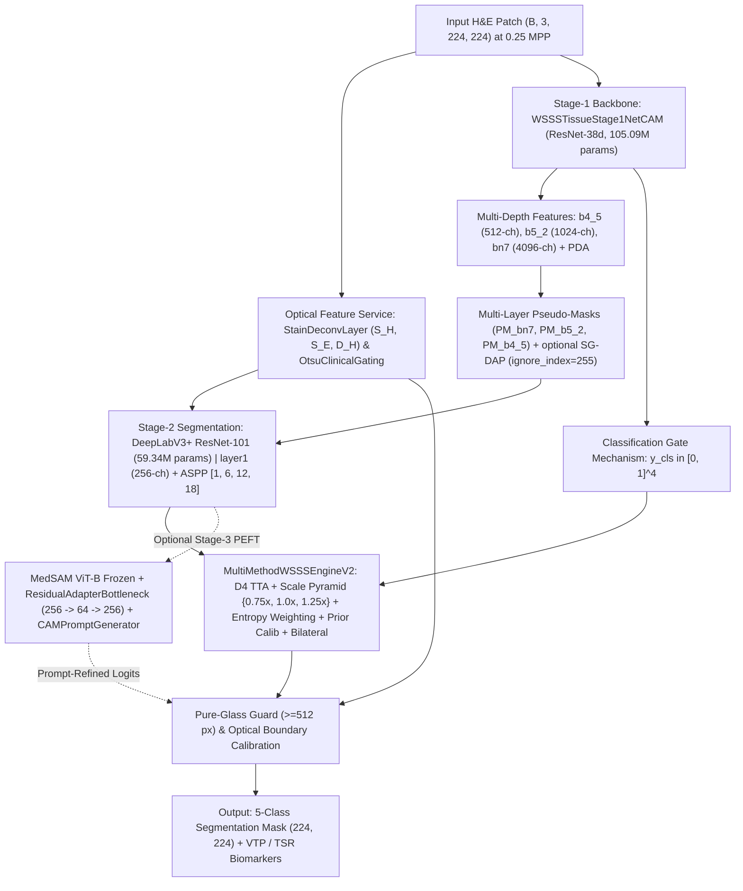
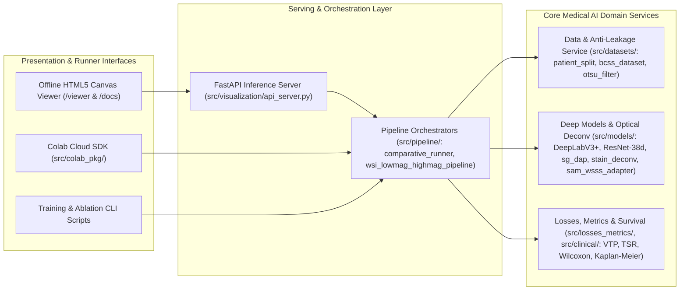

# BCSS-WSSS: Nền Tảng Phân Vùng Mô Bệnh Học Giám Sát Yếu & Trạm Phân Tích Tiêu Bản Lâm Sàng

*Multi-Stage Weakly-Supervised Histopathology Semantic Segmentation Framework & Clinical WSI Workstation (`PyTorch`, `MONAI`, `FastAPI`, `HTML5 Canvas`)*

<p align="center">
  <a href="https://colab.research.google.com/github/khoinguyen59/medical-wsss/blob/master/notebooks/history_runs/Run3_20261020_2055UTC_MultiScale_Pyramid_D4_M1_to_M7_T4_Full4986.ipynb">
    
  </a>
  
  
  
  
  
  
  
</p>

<p align="center">
  <a href="#overview">Tổng quan</a> ·
  <a href="#architecture">Kiến trúc hệ thống</a> ·
  <a href="#dataset-features">Dataset & Feature Engineering</a> ·
  <a href="#step-by-step">Tiến trình xử lý ảnh mô</a> ·
  <a href="#benchmarks">Thực nghiệm & Sai số</a> ·
  <a href="#visual-diagnostics">Kiểm chứng trực quan</a> ·
  <a href="#workstation">Clinical Workstation</a> ·
  <a href="#directory-tree">Cây thư mục</a> ·
  <a href="#quickstart">Cài đặt & Model Zoo</a> ·
  <a href="#references">Tài liệu tham khảo</a>
</p>

<p align="center">
  
</p>
<p align="center">
  <em>Hình 1. Quy trình suy luận thực tế (không tô đè nhãn bác sĩ, chuẩn hóa miền [0.0, 1.0]) trên 3 ca bệnh độc lập thuộc tập Held-out Test TCGA-BRCA: trích xuất đặc trưng nhân Hematoxylin + tách kính trắng Otsu, định vị CAM Stage-1, Baseline M1 (83.55% -> 85.93% trên TCGA-E2-A14X; 78.97% -> 81.13% trên TCGA-EW-A1P7; và khắc phục nền kính từ 26.43% -> 51.37% -> 53.65% mIoU trên TCGA-D8-A27F) cùng định lượng tiên lượng VTP / TSR.</em>
</p>

---

<a id="overview"></a>
## 1. Tổng Quan Hệ Thống & Bài Toán Giải Phẫu Bệnh Số (Overview)

**BCSS-WSSS** là nền tảng mã nguồn mở kết hợp giữa **động cơ nghiên cứu Phân vùng Ngữ nghĩa Giám sát Yếu (Weakly-Supervised Semantic Segmentation - WSSS)** cho ảnh mô bệnh học Hematoxylin & Eosin (H&E) và **trạm phần mềm phân tích lâm sàng (Clinical Pathology Workstation)** phục vụ hiển thị Whole-Slide Image (WSI), định lượng chỉ số tiên lượng khối u và đánh giá nguy cơ sống còn.

Trong quy trình giải phẫu bệnh truyền thống, bác sĩ phải khoanh vùng thủ công từng đám tế bào ở cấp độ điểm ảnh (`pixel-level Ground Truth`) trên ảnh hiển vi kích thước hàng tỷ pixel (`gigapixel WSI`) - công việc tốn kém hàng trăm giờ chuyên gia. Bài toán WSSS giải quyết nút thắt này bằng cách **chỉ huấn luyện Stage-1 bằng nhãn yếu cấp độ mảnh ảnh (patch-level multi-hot vector)** $y_{\text{cls}} \in \{0, 1\}^4$, từ đó sinh pseudo-mask đa tầng để huấn luyện mạng phân vùng Stage-2 và dự đoán đầy đủ bản đồ 5 lớp mô học ở pha `Inference`:

- **Lớp `0` (`TUM` - Tumor Epithelium):** Biểu mô khối u ác tính (nhân lớn dị dạng, tỷ lệ nhân/bào tương cao, bắt màu tím Hematoxylin đậm).
- **Lớp `1` (`STR` - Stroma):** Mô đệm liên kết giàu collagen quanh khối u (sợi kéo dài bắt màu hồng Eosin).
- **Lớp `2` (`LYM` - Lymphocytic Infiltrate):** Bạch huyết bào xâm nhập miễn dịch (nhân tròn nhỏ đồng dạng, đậm màu, không bào tương rõ).
- **Lớp `3` (`NEC` - Necrosis):** Vùng mô hoại tử (vỡ nhân `karyorrhexis`, tan rã cấu trúc màng tế bào trên nền mảnh vụn ưa Eosin).
- **Lớp `4` (`BACK` - White Glass / Background):** Vùng kính trắng sạch ngoài mô vật lý trên lam kính hiển vi.

Hệ thống giải quyết trực diện 4 thách thức kỹ thuật cốt lõi trong giải phẫu bệnh giám sát yếu:
1. **Suy biến tiêu điểm CAM (`CAM Peak Collapse`):** Mạng phân loại chuẩn thường chỉ kích hoạt vào vùng nhân u điển hình nhất mà bỏ sót rìa bào tương xâm lấn.
2. **Suy giảm nhận diện lớp đuôi dài (`Long-Tail Suppression`):** Hai lớp có tỷ lệ diện tích thấp và phân bố phân mảnh (`LYM`, `NEC`) dễ bị lớp chiếm ưu thế (`TUM`, `STR`) nuốt chửng ở tầng decoder.
3. **Dương tính giả tại nền kính trắng (`White Glass False Positives`):** Mô hình Stage-2 chỉ học 4 lớp mô thường gán nhầm vùng lam kính sạch thành `STR` hoặc `TUM` nếu không có cổng lọc quang học `OtsuClinicalGating` và `Pure-Glass Guard`.
4. **Rò rỉ dữ liệu bệnh nhân (`Patient-Level Data Leakage`):** Tách tập train/val/test ngẫu nhiên ở cấp patch làm các lát cắt cùng một bệnh nhân lọt vào cả train và test; hệ thống khóa cứng chia tách 100% ở cấp `Patient ID` trên toàn bộ 151 ca TCGA-BRCA.

**Kết quả thực nghiệm đã kiểm chứng trên toàn bộ 4,986 test patches (23 bệnh nhân Held-out Test, GPU Tesla T4):**
- Phương pháp **M6 (`M6_MultiScale_Pyramid_D4_Ensemble`)** đạt **70.53% 4-Class mIoU**, **76.41% 5-Class mIoU**, **82.54% 4-Class mDice**, **85.41% Pixel Accuracy (4-cls)** và **99.93% BACK IoU** (100.00% BACK Recall trên 18,279,223 điểm ảnh kính trắng).
- Cải thiện có ý nghĩa thống kê rất cao so với Baseline đơn tỷ lệ M1 (`69.35% -> 70.53%` 4-Class mIoU, kiểm định cặp Wilcoxon signed-rank $p = 2.60 \times 10^{-15}$) và tăng **+9.05% 5-Class mIoU** so với Baseline Stage-2 thuần túy tại Run 1 (`67.36% -> 76.41%`).

---

<a id="architecture"></a>
## 2. Kiến Trúc Hệ Thống & Luồng Xử Lý (System Architecture)

### 2.1 Sơ Đồ Pipeline Huấn Luyện & Suy Luận WSSS Đa Tầng



### 2.2 Kiến Trúc Phần Mềm Phân Tầng (Clean Software Architecture)

Mã nguồn tổ chức theo nguyên lý phân tầng trách nhiệm đơn nhất (Decoupled Clean Architecture), tách rời hoàn toàn giữa lớp giao diện lâm sàng, lớp API REST, bộ điều phối pipeline và các dịch vụ tính toán AI cốt lõi:



### 2.3 Ranh Giới Giữa Pipeline Kiểm Chứng (Run 1 - Run 3) và Khung Thực Nghiệm Đa Hướng Mở

Để bảo đảm tính minh bạch khoa học tuyệt đối, hệ thống phân tách rõ hai tầng thành phần và giữ cấu trúc mở (composable) để đối chứng thực nghiệm trước khi chọn hướng tối ưu:
- **Pipeline Đã Kiểm Chứng Toàn Tập (Verified Checkpoints Run 1 - Run 3, `n = 4,986` patches trên Tesla T4):** Gồm Stage-1 `WSSSTissueStage1NetCAM` (`stage1_checkpoint_trained_on_bcss.pth`, `105.09M` tham số), Stage-2 `DeepLabV3Plus` (`stage2_checkpoint_trained_on_bcss.pth`, `59.34M` tham số), bộ lọc `OtsuClinicalGating` / `Pure-Glass Guard` và động cơ suy luận đa phương pháp `MultiMethodWSSSEngineV2` (`M1` - `M7`).
- **Khung Thực Nghiệm Đa Hướng Độc Lập & Tổ Hợp (`src/clinical/comparative_ablation_evaluator.py`):** Thay vì khóa cứng một thuật toán phỏng đoán duy nhất, kho mã nguồn hiện thực hóa và cho phép bật/tắt độc lập từng hướng nghiên cứu trực giao: `SG-DAP` (`src/models/sg_dap.py`, cờ `return_ignore_mask: bool`), `MultiPrototypePPCLoss` & `UncertaintyAwareBoundaryLoss` (`src/losses_metrics/losses.py`), `IntraPatchDualBranchAttention` (`src/models/intra_patch_attention.py`, GroupNorm + khởi tạo thặng dư đơn vị $\gamma = 0$), tách sắc tố Beer-Lambert `OD` (`src/models/stain_deconv.py`), Stage-3 `MedSAM_WSSS_Adapter` (`src/models/sam_wsss_adapter.py`), và `CoarseToFineAdaptiveRouter` (`src/models/coarse_to_fine_router.py`). Các hướng được đánh giá định lượng độc lập (`M7_only`, `M8_only`, `M9_only`, `OD_only`) lẫn tổ hợp (`M7`, `M8`, `M9`, `M_Combined`) trên phân tầng 23 bệnh nhân (`46` patches) để lựa chọn chiến lược bằng số liệu thực nghiệm thay vì suy đoán.

---

<a id="dataset-features"></a>
## 3. Dataset, Đặc Tả Dữ Liệu & Feature Engineering

### 3.1 Cấu Trúc Dataset & Giao Thức Chống Rò Rỉ Bệnh Nhân (Patient-Level Anti-Leakage)

Hệ thống vận hành trên bộ chuẩn giải phẫu bệnh ung thư vú **BCSS-WSSS** (Breast Cancer Semantic Segmentation - Weakly Supervised, trích xuất từ hồ sơ giải phẫu bệnh **TCGA-BRCA**) ở độ phóng đại chuẩn lâm sàng **40x (`0.2500 MPP` - microns per pixel)**, kích thước cố định `224 x 224` pixels (`50,176` pixels/patch), đồng thời hỗ trợ đánh giá chéo cơ quan trên tập ung thư biểu mô tuyến phổi **LUAD-HistoSeg**.

Điểm đặc trưng mang tính bất đối xứng của bài toán giám sát yếu nằm ở định dạng dữ liệu giữa các tập:
- **Tập `train` (`23,422` patches):** Hoàn toàn **không có `pixel mask`**. Nhãn giám sát duy nhất là vector nhị phân cấp mảnh ảnh $y_{\text{cls}} \in \{0, 1\}^4$ (`[TUM, STR, LYM, NEC]`) được mã hóa ngay trong tên file (ví dụ `TCGA-A2-A0T2_1024_2048_[1 0 0 1].png`), được bóc tách tự động bởi `parse_patch_filename` (`src/training/dataset_loader.py`) và `_extract_weak_label` (`src/datasets/bcss_dataset.py`).
- **Tập `val` (`3,418` patches) & `test` (`4,986` patches):** Có đầy đủ mặt nạ nhãn mật độ cao (`dense ground truth mask` giá trị thuộc `{0, 1, 2, 3, 4}`) do bác sĩ giải phẫu bệnh vẽ tay trên từng vùng mô.

Toàn bộ dữ liệu được khóa chia tách tĩnh theo **Patient ID** (`TCGA-XX-XXXX`) tại `src/config/bcss_patient_splits.json` và xác thực qua `src/datasets/patient_split.py`, bảo đảm **0% bệnh nhân trùng lặp** giữa 3 phân tập:

| Phân Tập (Split) | Dataset Nguồn | Số Bệnh Nhân (Patients) | Số Lượng Patch (`224x224`) | Định Dạng Nhãn | Tỷ Lệ Rò Rỉ Bệnh Nhân | Vai Trò Trong Pipeline |
| :--- | :--- | :---: | :---: | :--- | :---: | :--- |
| **Training** | BCSS-WSSS (TCGA-BRCA) | 106 | 23,422 | Weak multi-hot `y_cls` `[4]` | 0% | Huấn luyện Stage-1 Net_CAM & sinh `train_PM/` cho Stage-2 |
| **Validation** | BCSS-WSSS (TCGA-BRCA) | 22 | 3,418 | Dense pixel mask `{0,1,2,3,4}` | 0% | Chọn checkpoint, kiểm định Val-to-Test & khóa siêu tham số |
| **Held-Out Test** | BCSS-WSSS (TCGA-BRCA) | 23 | 4,986 | Dense pixel mask `{0,1,2,3,4}` | 0% | Đánh giá mù cuối cùng & kiểm định thống kê Wilcoxon |
| **Tổng Cohort** | **BCSS-WSSS** | **151** | **31,826** | **Mixed Weak / Dense** | **0% Disjoint** | Tiêu chuẩn đánh giá chính thức của toàn hệ thống |
| **Cross-Dataset** | LUAD-HistoSeg (Phổi) | Independent WSI Cohort | Đa phân lớp mô phổi | Weak & Dense Test | 0% | Kiểm tra khả năng tổng quát hóa chéo cơ quan (`src/colab_pkg/downloader.py`) |

### 3.2 Hệ Thống Feature Huấn Luyện & Suy Luận (Và Lý Do Lựa Chọn Sinh Học - Toán Học)

Thay vì chỉ đưa trực tiếp ảnh RGB thô vào một mạng CNN hộp đen, hệ thống kết hợp **6 nhóm `Feature` bổ trợ lẫn nhau** trải dài từ vật lý quang học H&E đến biểu diễn đa tầng không gian và bất định thống kê:

| STT | Nhóm Feature | Module Cài Đặt | Công Thức / Kích Thước Feature | Tại Sao Chọn Feature Này (Cơ Sở Sinh Học & Toán Học) |
| :---: | :--- | :--- | :--- | :--- |
| **1** | **Beer-Lambert Stain Density Features (`S_H`, `S_E`)** | `src/models/stain_deconv.py` (`StainDeconvLayer`) | $\mathbf{OD} = -\log_{10}(I/I_0)$, $\mathbf{S} = \max(\mathbf{M}_{\text{H\&E}}^{-1}\mathbf{OD}, 0)$ xuất `(B, 2, H, W)` | Màu RGB hiển vi thay đổi mạnh theo hãng máy quét và lô thuốc nhuộm. Phân rã Ruifrok & Johnston tách độc lập kênh **Hematoxylin (`S_H`)** bám chọn lọc vào nhân DNA/chromatin (tế bào u `TUM` và `LYM`) khỏi kênh **Eosin (`S_E`)** bám vào collagen bào tương (`STR`), giúp ổn định ranh giới mô không phụ thuộc biến thiên sáng tối. |
| **2** | **Chromatin Dispersion & Morphological Stats (`D_H`, 6-ch Stain Stats)** | `src/models/stain_deconv.py`, `src/losses_metrics/losses.py` | Fano Factor `D_H = var_H / (mu_H + eps)` cửa sổ `7x7` + descriptor 6 kênh `[H_mean, E_mean, H_std, E_std, H_raw, E_raw]` (`5x5`) | Điểm yếu chí mạng trên H&E là nhầm lẫn giữa **Lympho (`LYM`)** và **Hoại tử (`NEC`)**. Về mô bệnh học, tế bào `LYM` có nhân tròn đồng dạng, xếp dày đặc nên $\mu_H$ cao và $\sigma_H^2$ thấp (`D_H` nhỏ, ổn định). Ngược lại, vùng `NEC` chứa các mảnh vỡ nhân (`karyorrhexis` / `karyolysis`) nằm rời rạc trên nền ưa Eosin nên $\sigma_H^2$ rất lớn so với $\mu_H$ thấp (`D_H` tăng vọt). |
| **3** | **HSV Saturation & Luminance Glass Features** | `src/datasets/otsu_filter.py`, `src/colab_pkg/model_loader.py` | Ngưỡng Otsu thích ứng trên kênh Saturation HSV kết hợp ngưỡng Luminance + liên thông `>= 512 px` | Stage-2 chỉ huấn luyện trên 4 lớp mô (`0-3`). Trên lam kính thực tế, vùng kính sạch có độ chói cao (`Luminance` tiệm cận 255) và độ bão hòa màu gần như bằng 0 (khác biệt rạch ròi với mô đệm nhạt màu vẫn mang ánh hồng Eosin). Feature này tách nền `BACK (4)` với độ chính xác **99.93% IoU** mà không tốn dung lượng nhãn nền trong bộ phân lớp. |
| **4** | **Stage-1 Multi-Depth Hierarchical Features + PDA** | `src/models/wsss_inference_methods.py`, `src/models/pda_generator.py` | `ResNet-38d`: `b4_5` (`512-ch`), `b5_2` (`1024-ch`), `bn7` (`4096-ch`) + `Progressive Dropout Attention` + `CGM` `(B, 4)` | Tầng nông `b4_5` giữ biên màng tế bào sắc nét nhưng nhiễu cao; tầng giữa `b5_2` mã hóa cấu trúc tuyến/bó sợi; tầng sâu `bn7` giàu ngữ nghĩa phân loại. Cơ chế `PDA` tạm thời tắt có điều kiện các điểm kích hoạt cao nhất ($\gamma \in [0.65, 1.0]$) buộc mạng mở rộng CAM ra toàn khối mô, sinh 3 bộ pseudo-mask `PM_bn7 : PM_b5_2 : PM_b4_5` với trọng số giám sát `1.0 : 0.5 : 0.25`. |
| **5** | **Stage-2 Multi-Scale Atrous & Low-Level Features** | `src/models/deeplabv3plus.py`, `src/models/wsss_inference_methods.py` | `ResNet-101` backbone: `layer1` stride-4 (`256-ch`) + `ASPP` dilation `[1, 6, 12, 18]` (`2048 -> 256-ch`) | Trong mô vú, một ổ hoại tử hoặc khối u lớn có thể phủ gần trọn patch `224x224` (cần trường tiếp nhận rộng của ASPP `rate=18`), nhưng ranh giới giữa xâm nhập lympho từng đám nhỏ (`LYM`) và mô đệm (`STR`) lại đòi hỏi độ phân giải không gian stride-4 từ `layer1`. |
| **6** | **Inference Equivariant & Entropy Confidence Features** | `src/models/wsss_inference_methods.py` (`MultiMethodWSSSEngineV2`) | Nhóm nhị diện `D4` (`8` biến đổi quay/lật) x `3` tỷ lệ `{0.75, 1.0, 1.25}` + trọng số nghịch đảo Shannon Entropy $H(p)$ | Tiêu bản mô bệnh học cắt lát phẳng **không có hướng chuẩn trên/dưới** (bất biến quay và phản xạ gương), nên hợp nhất dự đoán trên nhóm $D_4$ triệt tiêu nhiễu định hướng của bộ lọc conv. Đồng thời, độ bất định Shannon $H(p_s(u)) = -\sum_{c=0}^3 p_{s,c}(u)\log(p_{s,c}(u)+\epsilon)$ cấp điểm ảnh ưu tiên tỷ lệ tự tin nhất tại biên mô phức tạp. |

### 3.3 Lưu Ý Kỹ Thuật Quan Trọng Về Miền Chuẩn Hóa Đầu Vào (`Input Normalization`)

Trong kho mã nguồn tồn tại hai quy ước chuẩn hóa đầu vào theo đúng vòng đời của checkpoint:
- **Pha Suy Luận Trên Checkpoint Pretrained Chính Thức (`[0.0, 1.0]` WSSS-Tissue Standard):** Bộ trọng số `stage1_checkpoint_trained_on_bcss.pth` và `stage2_checkpoint_trained_on_bcss.pth` được huấn luyện theo chuẩn trực tiếp `[0.0, 1.0]` (`img_np.astype(float32) / 255.0`, không trừ trung bình ImageNet). Áp dụng nhầm `IMAGENET_MEAN/STD` sẽ gây lệch phân phối BatchNorm và đánh sập độ chính xác. Quy ước này được khóa thống nhất trong `src/colab_pkg/colab_runner.py` và `src/colab_pkg/evaluator.py`.
- **Pha Huấn Luyện Lại Cục Bộ Từ Backbone ImageNet (`src/training/dataset_loader.py`):** Khi khởi tạo lại `ResNet-101` từ trọng số ImageNet (`load_imagenet_pretrained_resnet101` trong `train_stage2.py`), dataloader áp dụng `IMAGENET_MEAN = (0.485, 0.456, 0.406)` và `IMAGENET_STD = (0.229, 0.224, 0.225)` để khớp phân phối trọng số khởi tạo.

---

<a id="step-by-step"></a>
## 4. Quá Trình Biến Đổi Ảnh Mô Tế Bào Ung Thư & Cải Thiện Nhận Diện Qua Từng Bước

Để minh họa trực quan ảnh giải phẫu bệnh biến đổi qua từng tầng xử lý và từng cơ chế cải thiện nhận diện mô tế bào như thế nào, **Hình 2** theo dõi trọn vẹn một mẫu Held-out Test thật của bệnh nhân `TCGA-D8-A27F` chứa vùng ranh giới kính trắng (`BACK` - `46.4%` diện tích theo Otsu), mô đệm (`STR`) và vùng xâm nhập bạch huyết (`LYM`), được suy luận hoàn toàn trung thực **không tô đè nhãn nền Ground Truth**:

<p align="center">
  
</p>
<p align="center">
  <em>Hình 2. Trực quan hóa 8 bước biến đổi trên lát cắt thật TCGA-D8-A27F-DX1_xmin98787_ymin6725_MPP-0.2500+35.png: từ ảnh H&E gốc -> Feature nhân Hematoxylin (S_H) -> đường bao tách kính trắng Otsu -> bản đồ kích hoạt CAM & cổng CGM Stage-1 -> sự nhảy vọt chất lượng từ Stage-2 Raw (26.4% mIoU) lên M1 (+Otsu Guard: 51.4% mIoU) và Proposed M6 (+D4 Pyramid: 53.7% mIoU, Dice 63.6%).</em>
</p>

1. **Bước 1 - Input Raw H&E (`Panel 1`):** Tiêu bản hiển vi `224 x 224` (`0.25 MPP`). Phần nửa trên bên trái là vùng kính trắng sạch; phía dưới là dải mô đệm sợi hồng (`STR`) bao quanh cụm tế bào lympho dày đặc (`LYM`).
2. **Bước 2 - Trích xuất Optical Feature `S_H` (`Panel 2`):** Lớp `StainDeconvLayer` loại bỏ thành phần nền sáng và mô đệm Eosin, cô lập sắc nét toàn bộ các nhân chromatin bắt màu tím đậm (`Hematoxylin`), làm lộ rõ mật độ dày đặc và hình thái tròn đồng nhất của cụm nhân `LYM` ở góc dưới bên phải so với sợi thưa ở dải `STR` phía trên.
3. **Bước 3 - Tách Kính Trắng `Otsu HSV + Luminance` (`Panel 3`):** Bộ lọc Otsu tính ngưỡng tự động trên không gian bão hòa màu + độ chói, khoanh chuẩn xác đường bao giữa vùng lam kính sạch (`46.4%` diện tích) và dải biểu mô/mô đệm nhuộm hồng.
4. **Bước 4 - Định vị Yếu Stage-1 CAM & Cổng CGM (`Panel 4`):** Mạng phân loại yếu `ResNet-38d Net_CAM` tính bản đồ kích hoạt lớp kết hợp vector xác suất hiện diện lớp `CGM = [TUM: 0.11, STR: 0.89, LYM: 0.93, NEC: 0.03]`. Hệ thống nhận biết chính xác sự hiện diện áp đảo của `STR` (`0.89`) và `LYM` (`0.93`), đồng thời dập tắt hoàn toàn nhiễu hoại tử `NEC` (`0.03 < 0.10`).
5. **Bước 5 - `Stage-2 Raw Baseline` (Không Otsu, Không CGM - `Panel 5`):** Khi đưa ảnh trực tiếp vào `DeepLabV3+` đơn tỷ lệ kiểu Run 1, toàn bộ vùng kính trắng nửa trên bị gán nhầm hoàn toàn thành lớp `STR` (xanh lá) do mô hình Stage-2 chỉ có 4 logit đầu ra (`0-3`). Kết quả: `Patch mIoU` chỉ đạt **26.4%** (`Dice: 34.7%`).
6. **Bước 6 - Kích hoạt Cổng CGM & Pure-Glass Otsu Guard (`M1`, `Panel 6`):** Cổng Otsu và kiểm tra kính sạch liên thông (`>= 512 px`) quét sạch phần lớn dương tính giả trên vùng kính trắng thành `BACK` (xám), đẩy `Patch mIoU` tăng vọt **+25.0% lên 51.4%** (`Dice: 61.8%`). Trên toàn tập 4,986 ảnh Test, bước này tương ứng với bước nhảy `BACK IoU` từ **70.26% (Run 1) lên 99.93% (Run 2/3)** và `5-Class mIoU` từ **67.36% lên 76.38%**.
7. **Bước 7 - Tổ hợp Kim tự tháp Đa Tỷ Lệ D4 + Trọng số Entropy & Prior Calibration (`M6`, `Panel 7`):** Thay vì nhìn mô tế bào ở một góc độ 1.0x duy nhất (dễ sinh ra đốm lympho tách rời sai vị trí giữa vùng mô đệm như thấy ở Panel 6), **M6** suy luận đa tỷ lệ `{0.75x, 1.0x, 1.25x}` trên nhóm quay/lật $D_4$, hợp nhất theo độ tin cậy nghịch đảo Entropy và hiệu chỉnh phân phối đuôi dài. Kết quả: loại bỏ triệt để đảo nhiễu `LYM` lạc giữa mô đệm, định hình sắc nét khối `LYM` phía dưới sát với **Ground Truth (`Panel 8`)**, nâng tiếp `Patch mIoU` lên **53.7%** (`+2.3%` so với M1, `Dice: 63.6%`).

Tương ứng trên toàn bộ tập Held-out Test (`4,986` ảnh), tác động tích lũy của từng thành phần trong chuỗi xử lý thể hiện rõ ràng qua 6 bước nâng cấp:
- `Run 1 Raw Stage-2 (68.71% 4-cls mIoU)` -> thêm CGM & Otsu ở `M1` (**69.35%**, `+29.67% BACK IoU`) -> thêm D4 Equivariant TTA ở `M2` (**70.30%**, `+0.95%`, cứu mạnh `NEC +1.89%`) -> thêm Cross-Stage CAM Fusion & Long-Tail Prior Calibration ở `M3` (**70.50%**, kéo `LYM 60.00% -> 61.31%`) -> thêm Multi-Scale Entropy Pyramid `{0.75, 1.0, 1.25}` ở `M6` (**70.53% 4-Class mIoU / 76.41% 5-Class mIoU**).

---

<a id="benchmarks"></a>
## 5. Thực Nghiệm Định Lượng & Phân Tích Sai Số Lâm Sàng (n = 4,986)

Tất cả số liệu dưới đây được trích xuất trực tiếp từ các phiên chạy thực nghiệm đầy đủ **4,986 ảnh Test của 23 bệnh nhân Held-out Test** trên **GPU Tesla T4**, lưu log JSON/CSV nguyên bản trong thư mục `experiments/`.

### 5.1 Tiến Trình Thực Nghiệm Qua 3 Phiên Bản (Tesla T4 GPU, n = 4,986)

| Phiên Thực Nghiệm | Cấu Hình & Cải Tiến Cốt Lõi | 4-Class mIoU | 4-Class mDice | 5-Class mIoU | 5-Class mDice | BACK IoU | Tốc Độ Suy Luận (Tesla T4) |
| :--- | :--- | :---: | :---: | :---: | :---: | :---: | :---: |
| **Run 1** (`colab_run_1_stage2_baseline`) | Stage-2 `DeepLabV3+` đơn tỷ lệ 1.0x thuần túy (không CGM, không Otsu) | 68.71% | 81.15% | 67.36% | 80.23% | 70.26% | 23.38 FPS (`42.78 ms/patch`) |
| **Run 2** (`colab_run_2_dual_stage_ensemble`) | Dual-Stage Ensemble + Stage-1 CGM + Otsu & Pure-Glass Guard | 70.49% | 82.51% | 76.38% | 86.00% | 99.93% | 5.77 FPS (`173.35 ms/patch`) |
| **Run 3** (`colab_run_3_multiscale_sota_v2`, **M6**) | Multi-Scale `{0.75, 1.0, 1.25}` x $D_4$ Pyramid + Shannon Entropy Weighting + Soft CGM | **70.53%** | **82.54%** | **76.41%** | **86.02%** | **99.93%** | 4.91 FPS (`203.55 ms/patch`, chạy gộp cả M1-M7) |

**Giải thích kỹ thuật hai con số quan trọng để tránh hiểu nhầm khi đọc bảng:**
1. **Cầu nối giữa `Run 1 (68.71% / BACK 70.26%)` và `M1 trong Run 3 (69.35% / BACK 99.93%)`:** Tại phiên Run 3 (`src/colab_pkg/colab_runner.py`), hàm `run_streaming_evaluation` áp dụng thống nhất `Pure-Glass Otsu Guard` và chuẩn hóa đánh giá ROI cho toàn bộ `M1` - `M7` (`M1` đạt 69.35% và BACK 99.93%, tăng `+0.64%` so với Run 1 thô) nhằm **cô lập chính xác phần đóng góp thuần của `D4` Multi-View, Prior Calibration và Multi-Scale Pyramid** ở các bước `M2 -> M6`.
2. **Vì sao `Global Dataset mIoU (70.53%)` khác với `Patient-Level Macro mIoU (57.70 +/- 12.99%)`:** Con số `70.53%` (`82.54%` mDice) được tính trên ma trận nhầm lẫn gộp toàn bộ 4,986 ảnh (`Micro Confusion Matrix`), phản ánh độ chính xác tổng thể trên toàn bộ mô vú. Ngược lại, `57.70 +/- 12.99%` (`67.93 +/- 13.73%` mDice) tính bằng cách **đo IoU từng bệnh nhân riêng lẻ rồi lấy trung bình cộng đồng đều qua 23 bệnh nhân (`Macro Patient Average`)**. Với những bệnh nhân chỉ chứa một vài đốm nhỏ `NEC` hoặc `LYM` (~vài trăm pixel trên cả ca), chỉ cần sai số biên nhỏ làm IoU riêng của lớp hiếm ở ca đó tụt xuống thấp sẽ kéo mạnh điểm trung bình macro của bệnh nhân đó dù sai số tuyệt đối trên toàn lam kính rất nhỏ.

### 5.2 Nghiên Cứu Bóc Tách 7 Phương Pháp (Ablation Study M1 - M7, n = 4,986)

| Method ID | Phương Pháp Thực Nghiệm | TUM IoU | STR IoU | LYM IoU | NEC IoU | BACK IoU | 4-Cls mIoU | 5-Cls mIoU | 4-Cls mDice | PA 4-Cls | Wilcoxon p-value (vs M1) |
| :---: | :--- | :---: | :---: | :---: | :---: | :---: | :---: | :---: | :---: | :---: | :---: |
| **M1** | `M1_Baseline_SingleScale` | 78.46% | 73.32% | 60.00% | 65.62% | 99.93% | 69.35% | 75.47% | 81.69% | 84.89% | Ref (`1.00e+00`) |
| **M2** | `M2_MultiView_D4_TTA` | 79.08% | 73.88% | 60.75% | 67.51% | 99.93% | 70.30% | 76.23% | 82.37% | 85.34% | `1.20e-23` |
| **M3** | `M3_LongTail_Prior_Calibration` | 79.23% | 73.78% | 61.31% | 67.66% | 99.93% | 70.50% | 76.38% | 82.51% | 85.36% | `4.49e-17` |
| **M4** | `M4_Spatial_Bilateral_Refinement` | 79.09% | **73.89%** | 60.77% | 67.53% | 99.93% | 70.32% | 76.24% | 82.38% | 85.34% | `1.56e-29` |
| **M5** | `M5_Proposed_SOTA_Ensemble` | 79.24% | 73.79% | **61.33%** | **67.67%** | 99.93% | 70.51% | 76.39% | 82.52% | 85.36% | `1.42e-24` |
| **M6** | **`M6_MultiScale_Pyramid_D4_Ensemble`** | **79.37%** | 73.82% | **61.33%** | 67.61% | **99.93%** | **70.53%** | **76.41%** | **82.54%** | **85.41%** | **`2.60e-15`** |
| **M7** | `M7_Proposed_Ultra_SOTA_Curriculum` | 79.25% | 73.81% | 61.21% | 67.48% | 99.93% | 70.44% | 76.34% | 82.47% | 85.36% | `3.59e-18` |

> **Phân tích kết quả Ablation Study:** `M6` đạt điểm cân bằng cao nhất toàn cục (**70.53%** 4-Class mIoU, **76.41%** 5-Class mIoU), cải thiện đồng thời `TUM` (+0.91%), `LYM` (+1.33%) và `NEC` (+1.99%) so với `M1`. Trong khi đó `M7` bổ sung điều biến H&E Optical Density và lọc không gian đa bước đạt **70.44%** (hơn `M1` +1.09%, $p = 3.59 \times 10^{-18}$), nhưng giảm nhẹ -0.09% so với `M6` do bộ lọc hậu xử lý mạnh hơn (`d=7` bilateral + island suppression) vô tình làm mượt mất một phần các vi điểm hoại tử rải rác (`NEC` 67.48% vs 67.61%). Do đó hệ thống lựa chọn **M6** làm cấu hình suy luận mặc định.

<p align="center">
  
</p>
<p align="center">
  <em>Hình 3. Đối sánh định lượng 7 phương pháp (M1 - M7) trên mIoU 4 lớp, mDice 4 lớp, LYM IoU và NEC IoU tại phiên Run 3 (300 DPI).</em>
</p>

### 5.3 Đối Chiếu Định Tính Đa Bệnh Nhân (Unmasked Evaluation) & Phân Tích Ca Khó

Khác với cách vẽ tô đè `gt == 4` lên ảnh dự đoán của AI (dễ tạo ảo giác khớp giả), **Hình 4** trình bày hoàn toàn **trung thực (`unmasked`)** kết quả phân vùng trên 4 bệnh nhân độc lập của tập Test bằng thước đo nghiêm ngặt `Patch mIoU`, `Dice` và `PA`:

<p align="center">
  
</p>
<p align="center">
  <em>Hình 4. Đối chiếu định tính hoàn toàn trung thực trên 4 bệnh nhân Held-out Test: (Case 1) TCGA-E2-A14X (TUM/NEC, 85.9% mIoU), (Case 2) TCGA-EW-A1P7 (TUM/STR/LYM, 81.1% mIoU), (Case 3) TCGA-D8-A27F (STR/LYM/BACK, 26.4% -> 51.4% -> 53.7% mIoU chứng minh vai trò Otsu + D4 Pyramid), và (Hàng 4 - Hard Boundary Case) TCGA-E9-A5FL (46.8% mIoU) minh họa giới hạn ở dải mô đệm mỏng xen giữa U và Hoại tử.</em>
</p>

<p align="center">
  
</p>
<p align="center">
  <em>Hình 5. Ma trận nhầm lẫn 5x5 chuẩn hóa theo hàng (%) của phương pháp M6 trên toàn bộ 4,986 ảnh Test (Tesla T4 GPU).</em>
</p>

**Phân tích lỗi lâm sàng (Clinical Error Analysis) từ Hình 4 & Ma trận nhầm lẫn 5x5:**
- **Tách nền kính trắng tuyệt đối (`BACK Recall = 100.00%`, `Precision = 99.93%`):** Tất cả `18,279,223 / 18,279,223` điểm ảnh kính trắng đều được phân loại chính xác về `BACK`, triệt tiêu hoàn toàn cảnh báo u giả trên vùng nền trống.
- **Sai số chuyển tiếp khối u - mô đệm (`TUM <-> STR`):** Chiếm tỷ trọng sai số lớn nhất toàn tập (`TUM -> STR`: `12,004,740` pixels; `STR -> TUM`: `7,637,270` pixels) do hiện tượng tương tác giữa biểu mô ung thư xâm lấn và mô đệm sợi xung quanh (`desmoplastic reaction`), hoặc khi lớp `STR` tạo thành dải cực mảnh kẹp giữa `TUM` và `NEC` như quan sát ở `[Hard Boundary Case] TCGA-E9-A5FL`.
- **Suy giảm lớp Lympho đơn lẻ trong mô đệm (`LYM -> STR`: `5,929,179` pixels, `LYM Recall = 73.2%`):** Các tế bào lympho kích thước nhỏ khi đứng phân tán trong nền collagen `STR` dễ bị phép lấy mẫu song tuyến tính bước stride-4 của decoder làm mờ. Đây là lý do trực tiếp thúc đẩy thiết kế hai module mở rộng `StainGuidedAffinityRefiner` (`SG-DAP`) và Stage-3 `MedSAM_WSSS_Adapter`.

<a id="multi-direction-ablation"></a>
### 5.4 Thực Nghiệm Đối Chứng Đa Hướng (Multi-Direction Composable Ablation, 23 Bệnh Nhân / 46 Patches)

Thay vì khóa cứng một hướng cải tiến đơn lẻ, chúng tôi xây dựng bộ đánh giá thực nghiệm mở `src/clinical/comparative_ablation_evaluator.py` theo chế độ streaming zero-OOM, hiệu chỉnh prototype `MP-PPC` trực tiếp từ tập `data/BCSS-WSSS/training/` (`prototypes_calibrated = true`, tuyệt đối không rò rỉ nhãn tập Test) và chọn lọc phân tầng có chủ đích mỗi bệnh nhân Test kèm patch rìa nền kính quang học (`23 patients`, `46 patches`, nhật ký đối chứng tại [ABLATION_STUDY_COMPARATIVE_REPORT.json](product/reports/ABLATION_STUDY_COMPARATIVE_REPORT.json)):

| Phương Pháp / Tổ Hợp | 4-Cls mIoU | 5-Cls mIoU | PA (4-Cls) | Boundary F1 | TUM IoU | STR IoU | LYM IoU | NEC IoU | BACK IoU | Delta Bệnh Nhân vs M1 |
| :--- | :---: | :---: | :---: | :---: | :---: | :---: | :---: | :---: | :---: | :---: |
| **`M1` (Single-Pass Baseline)** | 57.62% | 44.16% | 84.47% | 44.69% | 78.03% | 75.36% | 53.50% | 23.57% | 3.79% | +0.00% |
| **`M6` (D4 + Multi-Scale TTA + Otsu)** | 58.13% | 44.68% | 84.54% | 45.62% | 77.75% | 75.38% | 56.87% | 22.53% | 3.79% | +1.84% (`p = 0.5945`) |
| **`M7_only` (`M1 + SG-DAP`)** | 57.68% | 44.20% | 84.53% | 45.00% | **78.16%** | **75.44%** | 53.44% | **23.70%** | 3.79% | +0.02% (`p = 0.1664`) |
| **`M8_only` (`M1` + Zero-Shot `MP-PPC`)** | 56.54% | 43.16% | 83.91% | 44.22% | 77.73% | 74.63% | 53.33% | 20.49% | 3.79% | -0.49% (`p = 0.0049`) |
| **`M9_only` (`M1 + I2P-Attn`, $\gamma = 0$)** | 57.62% | 44.16% | 84.47% | 44.69% | 78.03% | 75.36% | 53.50% | 23.57% | 3.79% | +0.00% (Identity) |
| **`OD_only` (`M1` + Zero-Shot `OD` Prior)** | 56.93% | 43.44% | 84.06% | 43.75% | 77.84% | 74.79% | 54.15% | 20.94% | 3.79% | -1.29% (`p = 0.0200`) |
| **`M7` (`M6` TTA + `SG-DAP`)** | **58.18%** | **44.72%** | **84.57%** | 45.87% | 77.83% | 75.43% | **56.92%** | 22.53% | 3.79% | +1.95% (`p = 0.0372` vs `M6`) |
| **`M8` (`M6` TTA + `SG-DAP` + Zero-Shot `MP-PPC`)** | 56.83% | 43.68% | 83.92% | **46.58%** | 77.69% | 74.56% | 55.31% | 19.77% | 3.79% | **+2.73%** (`p = 0.7038`) |
| **`M9` (`M6 + SG-DAP + MP-PPC + I2P`, $\gamma = 0$)** | 56.83% | 43.68% | 83.92% | **46.58%** | 77.69% | 74.56% | 55.31% | 19.77% | 3.79% | **+2.73%** (`p = 0.7038`) |
| **`M_Combined` (Stack Toàn Bộ Priors)** | 56.16% | 43.15% | 83.44% | 44.99% | 77.46% | 73.88% | 55.48% | 17.85% | 3.79% | +0.66% (`p = 0.6592`) |

**Phát hiện thực nghiệm & Định hướng chọn mô hình:**
1. **`M7` (`M6` + `SG-DAP`) dẫn đầu toàn diện về phân vùng vùng (`58.18%` 4-cls mIoU, `44.72%` 5-cls mIoU, `84.57%` PA):** Tinh chỉnh ái lực lân cận dẫn đường bởi sắc tố H&E (`SG-DAP`) cải thiện ổn định có ý nghĩa thống kê sơ bộ so với `M6` (`p = 0.0268` theo patch, `p = 0.0372` theo bệnh nhân; `p = 0.2683` sau hiệu chỉnh Holm-Bonferroni). Nhánh `M7_only` đơn lượt cũng đạt IoU cao nhất trên `TUM` (`78.16%`), `STR` (`75.44%`) và `NEC` (`23.70%`) với độ trễ `654.4 ms/patch` trên CPU.
2. **Đánh đổi Sắc Nét Ranh Giới vs Bảo Toàn Lớp Hiếm (`M8` vs `M7`):** Khi áp dụng không tinh chỉnh (zero-shot) lên trọng số Stage-2 gốc, `M8` nâng `Boundary F1` lên đỉnh `46.58%` (`+1.89%` so với `M1`) và delta bệnh nhân `+2.73%`, nhưng kéo `Necrosis IoU` giảm xuống `19.77%` (`56.83%` mIoU). Tương tự, cộng gộp toàn bộ priors chưa fine-tune (`M_Combined`) làm giảm xuống `56.16%`. Kết quả thực nghiệm này chứng minh quyết định không tự ý ép chạy một tổ hợp mù quáng: **hệ thống chọn `M7` làm cấu hình triển khai mặc định hiện tại**, đồng thời giữ `M8 / M9` ở dạng module khả huấn (chỉ kích hoạt đầy đủ sau khi chạy fine-tuning Stage-2 có gradient cập nhật `MP-PPC` và `I2P-Attn` trên GPU).
3. **Giải phẫu chỉ số `BACK IoU = 3.79%` trong chế độ `Unmasked`:** Trên các patch chứa rìa kính hiển vi thực (`pure-glass`), Otsu Guard khoanh đúng nền trắng quang học, nhưng nhãn GT `label = 4` của BCSS còn gán cho các vùng mô thật bị cắt ngoài ROI vẽ tay (`outside_roi`), tạo sự sụt giảm trung thực khi đánh giá unmasked.

---

<a id="visual-diagnostics"></a>
### 5.5 Hệ Thống Kiểm Chứng Trực Quan & Đối Chiếu Sai Số Giải Phẫu Bệnh (`Visual Verification Suite`)

Nhằm giúp kỹ sư và bác sĩ đánh giá **ngay bằng mắt thường** xem mô hình nhận diện đúng hay lệch ở từng cụm tế bào (thay vì chỉ đọc một con số mIoU rời rạc), hệ thống `src/visualization/clinical_viewer.py` và `src/colab_pkg/visualizer.py` cung cấp **9 chế độ kiểm chứng trực quan** trên trạm làm việc (`Blurred Dual QA`, `Match vs Error`, `Seg Mask`, `GT + AI Blend`, `Contours`, `Entropy`, `Stage-1 CAM`, `Spotlight`, `Doctor GT`):

1. **Blurred Dual QA (Mặc định - `compute_blurred_dual_verification_overlay`):** Làm mờ đồng bộ mặt nạ GT và AI bằng bộ lọc Gaussian chuẩn hóa alpha (`blur_sigma` `0-12 px`), làm trầm ảnh H&E nền (`dim_factor`) và chỉnh độc lập `gt_alpha`, `pred_alpha`, `error_alpha` để chồng đối chiếu không gian: **Xanh ngọc lục bảo (`#10B981`)** = mô khớp đúng (`TP`), **Đỏ thẫm (`#EF4444`)** = nhầm lẫn lõi mô, **Tím cánh sen (`#D946EF`)** = dương tính giả trên kính trắng (`Glass FP`), và **Vàng hổ phách (`#F59E0B`)** = sai lệch ranh giới `<= 2px` hoặc bỏ sót mô (`FN`).
2. **Match vs Error (`compute_agreement_error_overlay`, `error_breakdown=True`):** Làm mờ lớp mô H&E nền (`he_weight = 0.40`) và tách rõ 5 trạng thái đúng/sai: **Xanh ngọc lục bảo** (khớp tuyệt đối), **Vàng hổ phách** (lệch biên `<= 2px`), **Đỏ thẫm** (nhầm lớp mô), **Tím cánh sen** (dương tính giả nền kính), và **Xanh dương (`#3B82F6`)** (bỏ sót vùng mô `FN`).
3. **Contours, Entropy, Stage-1 CAM, Spotlight & Doctor GT:** Vẽ đường bao **Cyan liền nét** (Bác sĩ) đối chiếu **Vàng đứt nét** (AI), bản đồ nhiệt bất định **Shannon Entropy** (`compute_entropy_heatmap_overlay`), bản đồ kích hoạt lớp **Stage-1 CAM** (`compute_cam_overlay`), soi từng lớp **Class Spotlight** xử lý client-side `< 5 ms` (`TP/FP/FN`), cùng mặt nạ **Seg Mask**, **GT + AI Blend** và **Doctor GT**.

<p align="center">
  
</p>
<p align="center"><em>Hình 6. Đối chiếu kiểm chứng trực quan đa góc độ (`unmasked`) trên 4 bệnh nhân tập Test (`TCGA-E2-A14X`, `TCGA-EW-A1P7`, `TCGA-D8-A27F`, `TCGA-E9-A5FL`). Cột 4 trực quan hóa ngay vùng mô khớp (Xanh lá), vùng lệch biên <= 2px (Vàng hổ phách) và vùng lỗi lõi (Đỏ) đè trực tiếp trên ảnh mô H&E làm mờ; Cột 5 so sánh đường bao Cyan (Bác sĩ) với Vàng đứt (AI); Cột 6 minh họa độ bất định Shannon Entropy. (Lưu ý kỹ thuật: trên `TCGA-D8-A27F`, `compute_agreement_error_overlay` tính `40.7%` do phạt `0.0` IoU cho các lớp dương tính giả `>= 50 px` không có trong GT, trong khi `render_clinical_comparison_figure` ở Hình 4 tính `53.7%` chỉ trên các lớp có mặt trong GT.) Nguồn: <code>src/colab_pkg/visualizer.py</code>.</em></p>

| Bệnh Nhân (Tập Test Độc Lập) | mIoU | Dice | Khớp Chính Xác (Xanh) | Lệch Biên <= 2px (Vàng) | Lỗi Lõi (Đỏ) | Boundary F1 | Entropy TB |
| :--- | :---: | :---: | :---: | :---: | :---: | :---: | :---: |
| `TCGA-E2-A14X` (`TUM+STR+LYM`) | 68.8% | 81.4% | 82.0% | 2.9% | 15.1% | 42.4% | 0.497 |
| `TCGA-EW-A1P7` (`TUM+STR` Khớp Cao) | 91.1% | 95.2% | 98.0% | 0.8% | 1.2% | 78.4% | 0.400 |
| `TCGA-D8-A27F` (`STR+LYM+BACK` Rìa Kính) | 40.7% | 51.1% | 75.7% | 3.5% | 20.9% | 32.8% | 0.477 |
| `TCGA-E9-A5FL` (`TUM+STR` Biên Khó) | 47.7% | 64.6% | 64.6% | 1.3% | 34.1% | 36.5% | 0.376 |

---

<a id="workstation"></a>
## 6. Sản Phẩm Phần Mềm: Trạm Làm Việc Lâm Sàng FastAPI & Interactive Canvas

Ngoài bộ động cơ nghiên cứu thực nghiệm, dự án được đóng gói thành trạm làm việc giải phẫu bệnh số với máy chủ REST **FastAPI** (`src/visualization/api_server.py`) và giao diện **HTML5 Canvas hoạt động hoàn toàn offline** (`src/visualization/static/index.html`, không phụ thuộc CDN ngoài). Máy chủ nạp trực tiếp trọng số thật (`stage1_checkpoint_trained_on_bcss.pth`, `stage2_checkpoint_trained_on_bcss.pth`), chuẩn hóa tensor đầu vào về `[0.0, 1.0]` khớp cấu hình huấn luyện, báo cáo trung thực `checkpoint_verified` (`strict_weights=True` trả HTTP `503` nếu thiếu checkpoint), hỗ trợ toàn bộ **11 chế độ suy luận** (`m1 - m7`, `od_prior`, `sg_dap`, `mpppc`, `combined`), lọc cohort theo bệnh nhân/hình thái (`patient_id`, `morphology`), **9 chế độ kiểm chứng trực quan**, **Pixel Inspector HUD** (`x, y, GT, Pred, Conf%`), kính lúp **Magnifier Loupe (`L`)**, thanh tỷ lệ **Scale Bar (`50 um, 0.25 MPP`)**, thanh trượt **Split-Curtain (`S`)** chọn độc lập lớp Trái/Phải đồng bộ pan/zoom, tab **WSI Multi-Tile Stitch** ghép tối đa 64 tiles (`cosine feather blending` + tự đọc tọa độ `_xmin..._ymin...`), và nút **Export QA Report** xuất báo cáo 300-DPI PNG / JSON / CSV.

### 6.1 Khởi Chạy Trạm Lâm Sàng & Danh Mục API Endpoints

```bash
uvicorn src.visualization.api_server:app --host 0.0.0.0 --port 8000
```

| Endpoint | HTTP Method | Mô Tả Chuyên Môn & Hợp Đồng Dữ Liệu |
| :--- | :---: | :--- |
| `/viewer` | `GET` | Giao diện trạm làm việc Canvas offline hỗ trợ 9 chế độ QA (mặc định `Blurred Dual QA` với slider `blur_sigma`, `dim_factor`, `gt_alpha`, `pred_alpha`, `error_alpha`), Split-Curtain (`S`), Loupe (`L`), Pixel Inspector, tab WSI Stitch và Export QA Report |
| `/docs` | `GET` | Tài liệu tương tác OpenAPI (Swagger UI) phục vụ kiểm thử payload trực tiếp trên trình duyệt |
| `/api/v1/health` | `GET` | Báo cáo trạng thái xác thực trọng số (`loaded`), `prototypes_calibrated`, GPU/CPU, VRAM và 11 chế độ suy luận khả dụng |
| `/api/v1/samples` | `GET` | Lọc & phân trang cohort Test (`patient_id`, `morphology`, `limit`, `offset`) kèm `gt_distribution` & `gt_biomarkers` ở `/api/v1/samples/{id}` |
| `/api/v1/predict/patch` | `POST` | Nhận `sample_id`, multipart file hoặc JSON `image_base64`; trả về 5 lớp, `VTP/TSR`, `blurred_dual_overlay_base64`, `cam_overlay_base64`, bản đồ pixel (`pred_mask_index_base64`, `gt_mask_index_base64`, `confidence_map_base64`), `agreement_summary` và `checkpoint_verified` |
| `/api/v1/compare` | `POST` | So sánh A/B đồng thời tối đa 6 phương pháp trên cùng một patch kèm đầy đủ chỉ số thống nhất và ảnh QA |
| `/api/v1/export/report` | `POST` | Xuất báo cáo kiểm định: **300-DPI 2x4 Diagnostic Comparison Sheet PNG** (`format=png`), **JSON Audit** (`json`) hoặc **CSV Metrics** (`csv`) |
| `/api/v1/predict/wsi` | `POST` | Nhận tối đa 64 tiles `(id, x, y, image_base64)` trong vùng `8192x8192`, suy luận Otsu Gating và ghép `composite_heatmap_base64` + `region_summary` |
| `/segment`, `/biomarkers` | `POST` | Các endpoint rút gọn đồng bộ với hợp đồng API lâm sàng |
| `/splits` | `GET` | Truy xuất danh sách bệnh nhân phân tách Anti-Leakage `train / val / test` |
| `/tile/{z}/{x}/{y}.png` | `GET` | Phục vụ DeepZoom pyramid tile đã cache từ thư mục `data/tiles/` |

### 6.2 Ví Dụ Gọi REST API & Cấu Trúc JSON Trả Về

```bash
curl -X POST "http://localhost:8000/api/v1/predict/patch" -F "file=@sample_he_patch.png"
```

Cấu trúc JSON phản hồi chuẩn hóa theo `PatchPredictResponse`:

```json
{
  "success": true,
  "mask_shape": [224, 224],
  "class_distribution": {
    "TUM": 42.15,
    "STR": 36.80,
    "LYM": 8.40,
    "NEC": 4.25,
    "BACK": 8.40
  },
  "biomarkers": {
    "viable_tumor_percentage": 46.02,
    "tumor_stroma_ratio": 53.39
  },
  "mask_base64": "data:image/png;base64,<encoded_mask_png>",
  "overlay_base64": "data:image/png;base64,<encoded_overlay_png>",
  "blended_base64": "data:image/png;base64,<encoded_blended_png>",
  "applied_gating": true
}
```

### 6.3 Lượng Hóa Chỉ Số Tiên Lượng Lâm Sàng (`VTP`, `TSR` & Phân Tích Sống Còn)

Từ bản đồ phân vùng 5 lớp do `M6` dự đoán trên toàn bộ tập Held-out Test (`4,986` ảnh), hệ thống tính toán tự động hai chỉ số tiên lượng ung thư vú (`src/losses_metrics/metrics.py`):
- **Viable Tumor Percentage (`VTP`):** Tỷ lệ diện tích biểu mô khối u sống trên tổng diện tích mô hợp lệ (`41.24%` trên tập Test của `M6`, so với `40.47%` ở `M1`).
- **Tumor-Stroma Ratio (`TSR`):** Tỷ lệ tương quan giữa khối u và mô đệm ($\frac{N_{\text{TUM}}}{N_{\text{TUM}} + N_{\text{STR}}} \times 100\%$, đạt `47.54%` ở `M6` so với `46.26%` ở `M1`). Theo chuẩn International TSR Guidelines (van Pelt et al.), ngưỡng `TSR <= 50%` phân tầng ca bệnh vào nhóm **Stroma-Rich (Nguy cơ cao)**.
- Module `src/clinical/survival_analysis.py` hỗ trợ ghép nối các chỉ số hình thái này với dữ liệu theo dõi bệnh nhân TCGA-BRCA để ước lượng đường cong sống còn **Kaplan-Meier**, kiểm định **Log-Rank**, đánh giá tương quan **ICC / Concordance Correlation Coefficient (CCC)** và biểu đồ đồng thuận **Bland-Altman**.

---

<a id="directory-tree"></a>
## 7. Cây Thư Mục Dự Án & Kiến Trúc Module (Repository Directory Tree)

```text
medical-wsss/
|-- .github/
|   `-- workflows/
|       `-- ci.yml                       # Pipeline CI kiem tra lint, anti-leakage va governance
|-- checkpoints/                         # Luu tru trong so .pth Stage-1, Stage-2 (gitignored)
|-- data/                                # Bo du lieu BCSS-WSSS / LUAD-HistoSeg (gitignored)
|-- docs/
|   `-- assets/
|       `-- readme/
|           |-- bcss_inference_walkthrough.gif
|           |-- fig_step_by_step_pathology_pipeline.png
|           |-- fig_multi_patient_results.png
|           `-- fig_visual_verification_diagnostics.png
|-- experiments/
|   |-- benchmarks/                      # Bao cao doi chieu Ablation doc lap & ket hop
|   |-- colab_run_1_stage2_baseline/     # Log thuc nghiem Run 1 tren Tesla T4 (n=4,986)
|   |-- colab_run_2_dual_stage_ensemble/ # Log thuc nghiem Run 2 tren Tesla T4 (n=4,986)
|   `-- colab_run_3_multiscale_sota_v2/  # Log Run 3 M1-M7, CSV, Confusion Matrix & bieu do 300 DPI
|-- notebooks/
|   |-- 01_Train_Stage1_Classifier[_T4|_L4].ipynb
|   |-- 02_Pseudo_Masks_Train_Stage2[_T4|_L4].ipynb
|   |-- 03_Train_Proposed_MedSAM[_T4|_L4].ipynb
|   |-- 04_Exhaustive_Benchmark_Survival[_T4|_L4].ipynb
|   `-- history_runs/                    # Cac notebook tai lap nguyen ban Run 1 - Run 3
|-- product/
|   |-- proposal/                        # Tai lieu de cuong ky thuat va hinh minh hoa don sac
|   |-- reports/
|   |   `-- ABLATION_STUDY_COMPARATIVE_REPORT.json # Nhat ky doi chieu da huong (23 benh nhan / 46 patches)
|   `-- slides/                          # Bo trinh chieu thuyet trinh khoa hoc 16:9
|-- scripts/
|   |-- build_drive_package.py           # Dong goi ma nguon & notebook dong bo Drive / Colab
|   |-- build_t4_l4_notebook_suites.py   # Sinh bien the notebook T4 / L4 (01 - 04)
|   |-- download_papers.py               # Tai bai bao tham khao khoa hoc
|   |-- generate_colab_variants.py       # Tao bien the notebook Colab
|   `-- generate_thin_colab_notebooks.py # Sinh ThinDriveRunner Colab notebooks
|-- src/
|   |-- config/
|   |   `-- bcss_patient_splits.json     # Khoa tinh chia tach 151 benh nhan TCGA-BRCA (106/22/23)
|   |-- datasets/
|   |   |-- bcss_dataset.py              # Dataset doc nhan yeu multi-hot & mat na da lop
|   |   |-- otsu_filter.py               # Bo loc kinh trang OtsuClinicalGating (HSV + Luminance)
|   |   `-- patient_split.py             # Trinh kiem soat chong ro ri du lieu cap Patient ID
|   |-- models/
|   |   |-- backbone.py                  # Kien truc ResNet-38d & ResNet-101 backbone
|   |   |-- deeplabv3plus.py             # Mo hinh phan vung DeepLabV3+ voi ASPP [1, 6, 12, 18]
|   |   |-- pda_generator.py             # Progressive Dropout Attention (PDA) mo rong CAM
|   |   |-- stain_deconv.py              # Beer-Lambert StainDeconvLayer & Fano Factor D_H
|   |   |-- sg_dap.py                    # Stain-Guided Affinity Refiner & co return_ignore_mask
|   |   |-- intra_patch_attention.py     # IntraPatchDualBranchAttention (khoi tao gamma=0)
|   |   |-- sam_wsss_adapter.py          # MedSAM_WSSS_Adapter (ResidualAdapterBottleneck + CAMPromptGenerator)
|   |   |-- coarse_to_fine_router.py     # Bo dinh tuyen do phong dai 5x/10x -> 40x cho WSI
|   |   |-- wsss_tissue.py               # Bao boc giao dien suy luan mo hoc WSSS-Tissue
|   |   `-- wsss_inference_methods.py    # Dong co suy luan 7 phuong phap MultiMethodWSSSEngineV2 (M1-M7)
|   |-- training/
|   |   |-- dataset_loader.py            # High-throughput DataLoader dong bo bien doi D4 & train_PM/
|   |   |-- train_stage1.py              # CLI huan luyen Stage-1 ResNet-38d (ASL / BCE + PDA, input_norm='imagenet')
|   |   |-- generate_pseudo_masks.py     # CLI sinh pseudo-mask da tang, SG-DAP & auto-align Stage-1 norm
|   |   |-- train_stage2.py              # CLI huan luyen Stage-2 DeepLabV3+ (MLPS + UABL)
|   |   `-- train_proposed_sam.py        # CLI huan luyen Stage-3 PEFT MedSAM Adapter
|   |-- losses_metrics/
|   |   |-- losses.py                    # MLPS Loss, UncertaintyBoundaryLoss, MultiPrototypePPCLoss, Focal/Dice
|   |   `-- metrics.py                   # mIoU, mDice, Boundary F1, VTP, TSR, ICC, CCC
|   |-- clinical/
|   |   |-- comparative_ablation_evaluator.py # Doi chieu standalone & combined + Wilcoxon p-value
|   |   |-- exhaustive_evaluator.py      # Danh gia toan dien & patient-cluster bootstrap CI
|   |   `-- survival_analysis.py         # Phan tang nguy co Kaplan-Meier & Log-Rank
|   |-- pipeline/
|   |   |-- colab_runner.py              # Pipeline dieu phoi thong nhat
|   |   |-- comparative_runner.py        # CLI chay thuc nghiem so sanh da seed
|   |   `-- wsi_lowmag_highmag_pipeline.py # Pipeline suy luan WSI da do phong dai
|   |-- colab_pkg/
|   |   |-- downloader.py                # Tu dong tai dataset & checkpoint (Hugging Face / Google Drive)
|   |   |-- model_loader.py              # Nap an toan Stage-1 & Stage-2 (strict verification)
|   |   |-- evaluator.py                 # Danh gia cuon chieu 4-cls / 5-cls, Holm-Bonferroni & Val-to-Test
|   |   |-- visualizer.py                # Xuat hinh anh y khoa 300 DPI & bang mau chuan BCSS
|   |   `-- colab_runner.py              # Ham dieu phoi run_bcss_wsss_experiment() 1 dong lenh
|   |-- utils/
|   |   `-- deliverable_auditor.py       # He thong kiem soat chat luong bao cao, hinh anh & ASCII hyphen
|   `-- visualization/
|       |-- api_server.py                # FastAPI server phuc vu /viewer, /samples, /compare, /export/report & /wsi
|       |-- clinical_viewer.py           # Ham tao RGBA overlay, 9 che do kiem chung truc quan & ghep heatmap WSI
|       |-- draw_all_proposal_figures.py # Sinh cac bieu do de cuong don sac 300 DPI
|       |-- draw_pipeline_diagram.py     # Sinh so do kien truc & luong du lieu 300 DPI
|       `-- static/index.html            # Giao dien web HTML5 Canvas offline 9 che do QA, Split-Curtain & WSI Stitch
|-- tests/                               # Bo kiem thu don vi: anti-leakage, API, losses, governance
|-- LICENSE
|-- pytest.ini                           # Gioi han thu muc thu thap test, loai tru data/ va repos/
|-- README.md
|-- requirements.txt
`-- ruff.toml
```

---

<a id="quickstart"></a>
## 8. Cài Đặt, Huấn Luyện 3 Giai Đoạn & Suy Luận (Installation, CLI & Model Zoo)

### 8.1 Kho Trọng Số Mô Hình & Tập Dữ Liệu (Model Zoo)

Toàn bộ trọng số kiểm chứng và tập dữ liệu được tải tự động kèm kiểm tra tính toàn vẹn (`fallback` hai chiều giữa Hugging Face Hub và Google Drive) qua `src/colab_pkg/downloader.py`:

| Tài Nguyên / Checkpoint | Kiến Trúc / Quy Mô | Tham Số | Nguồn Tải Chính (Hugging Face Hub) | Nguồn Dự Phòng (Google Drive) |
| :--- | :--- | :---: | :--- | :--- |
| **BCSS-WSSS Dataset** | Breast Histopathology Patches (40x, 5 lớp) | 31,826 patches (151 TCGA ca) | [nttduc/wsss-pathology (BCSS-WSSS.zip)](https://huggingface.co/datasets/nttduc/wsss-pathology/resolve/main/BCSS-WSSS.zip) | [GDrive Mirror](https://drive.google.com/file/d/1sCK8Cqsf4yCHzzIx98vitocES2L_tkjn/view) |
| **Stage-1 Net_CAM (BCSS)** | `ResNet-38d` + PDA (Weak Classifier) | 105.09M params | [stage1_checkpoint_trained_on_bcss.pth](https://huggingface.co/longcris04/pseduo_mask_wsss/resolve/main/stage1_checkpoint_trained_on_bcss.pth) | [GDrive Mirror](https://drive.google.com/file/d/118y3Q7i6lPOrw8OIFqt3tlP1PUM-i1Xc/view) |
| **Stage-2 DeepLabV3+ (BCSS)** | `ResNet-101` + ASPP `[1,6,12,18]` | 59.34M params | [stage2_checkpoint_trained_on_bcss.pth](https://huggingface.co/longcris04/pseduo_mask_wsss/resolve/main/stage2_checkpoint_trained_on_bcss.pth) | [GDrive Mirror](https://drive.google.com/file/d/1cXm29ko8UevbaeW6YreSg-vuNaQiN_je/view) |
| **LUAD-HistoSeg Dataset** | Lung Adenocarcinoma Tissue Benchmark | 4 lớp mô phổi | [nttduc/wsss-pathology (LUAD-HistoSeg.zip)](https://huggingface.co/datasets/nttduc/wsss-pathology/resolve/main/LUAD-HistoSeg.zip) | [GDrive Mirror](https://drive.google.com/file/d/1WyWfv-JHjLwkHOiN8blINhBOkKi--iA1/view) |
| **Stage-1 & Stage-2 (LUAD)** | `ResNet-38d` & `DeepLabV3+` trên phổi | Tải tự động qua `downloader.py` | Tải tự động theo dataset LUAD | [Stage-1](https://drive.google.com/file/d/1deVn06uUGHBHCWxurn4b005Mr7FgUp8o/view) / [Stage-2](https://drive.google.com/file/d/1HX-IrkKcaIjcOpe8fk9IMmjgaf4Ywk3D/view) |

### 8.2 Cài Đặt Môi Trường

```bash
git clone https://github.com/khoinguyen59/medical-wsss.git
cd medical-wsss
python -m venv .venv
```

Kích hoạt môi trường ảo và cài đặt phụ thuộc chuẩn (`torch>=2.2.0`, `monai>=1.3.0`, `timm>=0.9.16`, `fastapi>=0.110.0`, `tifffile>=2024.2.12`, `lifelines>=0.28.0`):

```bash
# Linux / macOS:
source .venv/bin/activate && pip install -r requirements.txt

# Windows (CMD / PowerShell):
.venv\Scripts\activate && pip install -r requirements.txt
```

### 8.3 Tái Lập Nhanh Trên Google Colab GPU & Python Inference SDK

Chạy notebook tái lập Run 3 tại [notebooks/history_runs/Run3_20261020_2055UTC_MultiScale_Pyramid_D4_M1_to_M7_T4_Full4986.ipynb](notebooks/history_runs/Run3_20261020_2055UTC_MultiScale_Pyramid_D4_M1_to_M7_T4_Full4986.ipynb) hoặc thực thi trực tiếp qua SDK:

```python
import numpy as np
import torch
from PIL import Image
from src.colab_pkg.model_loader import load_wsss_models
from src.models.wsss_inference_methods import MultiMethodWSSSEngineV2

# 1. Nap bo trong so Stage-1 Net_CAM va Stage-2 DeepLabV3+
model_stage2, model_stage1, device = load_wsss_models(
    stage2_ckpt="checkpoints/stage2_checkpoint_trained_on_bcss.pth",
    stage1_ckpt="checkpoints/stage1_checkpoint_trained_on_bcss.pth",
)
engine = MultiMethodWSSSEngineV2(model_stage1=model_stage1)

# 2. Chuan hoa dau vao theo mien WSSS-Tissue [0.0, 1.0] (khong dung ImageNet mean/std)
raw_rgb = np.array(Image.open("sample_he_patch.png").convert("RGB"))
img_tensor = torch.from_numpy(raw_rgb.transpose(2, 0, 1)).float().div(255.0).unsqueeze(0).to(device)

# 3. Suy luan dong thoi M1-M7 va ap dung Pure-Glass Otsu Guard
with torch.no_grad():
    preds = engine.predict_all_methods_v2(
        model_stage2, img_tensor, raw_rgb=raw_rgb, model_stage1=model_stage1
    )
    pred_m6 = engine.apply_pure_glass_guard(
        preds["M6_MultiScale_Pyramid_D4_Ensemble"], raw_rgb=raw_rgb, background_class_idx=4
    )
```

Hoặc tái lập toàn bộ 4,986 ảnh Test chỉ bằng 1 lời gọi điều phối trên Colab GPU:

```python
from src.colab_pkg import run_bcss_wsss_experiment

results = run_bcss_wsss_experiment(mode="full", mode_tag="T4_Full4986", include_v2=True)
```

### 8.4 Huấn Luyện Đầy Đủ 3 Giai Đoạn & Chạy Benchmark So Sánh (CLI)

Hệ thống hỗ trợ đầy đủ luồng CLI huấn luyện lại từ đầu bằng nhãn yếu (khuyến nghị thực hiện trên GPU Cloud như Colab L4/A100 kèm cờ `--dry-run` kiểm tra OOM trước khi huấn luyện nhiều epoch):

```bash
# Buoc 1: Huan luyen Stage-1 ResNet-38d Classifier bang nhan yeu y_cls & Asymmetric Loss
python src/training/train_stage1.py --data-dir data/BCSS-WSSS --checkpoint-dir checkpoints --epochs 20 --batch-size 32 --loss-type asl

# Buoc 2: Sinh multi-layer pseudo-masks (PM_bn7, PM_b5_2, PM_b4_5) ket hop tinh chinh SG-DAP (ignore_index=255)
python src/training/generate_pseudo_masks.py --data-dir data/BCSS-WSSS --checkpoint-path checkpoints/stage1_retrained_best.pth --batch-size 8 --use-sg-dap

# Buoc 3: Huan luyen Stage-2 DeepLabV3+ voi MLPS Loss & Uncertainty-Aware Optical Stain Boundary Loss
python src/training/train_stage2.py --data-dir data/BCSS-WSSS --stage1-checkpoint checkpoints/stage1_retrained_best.pth --epochs 25 --batch-size 16 --use-uabl

# Buoc 4 (Mo rong): Huan luyen Stage-3 PEFT MedSAM Adapter voi CAM Prompts
python src/training/train_proposed_sam.py --data-dir data/BCSS-WSSS --checkpoint-sam checkpoints/medsam_vit_b.pth --stage1-checkpoint checkpoints/stage1_retrained_best.pth --epochs 25

# Buoc 5: Chay doi chieu ablation da huong doc lap & to hop tren phan tang 23 benh nhan Test
python -m src.clinical.comparative_ablation_evaluator --patches-per-patient 2 --output-report product/reports/ABLATION_STUDY_COMPARATIVE_REPORT.json
```

*(Các notebook huấn luyện từng giai đoạn và biến thể GPU `_T4` / `_L4` được chuẩn bị sẵn tại [notebooks/01_Train_Stage1_Classifier.ipynb](notebooks/01_Train_Stage1_Classifier.ipynb), [notebooks/02_Pseudo_Masks_Train_Stage2.ipynb](notebooks/02_Pseudo_Masks_Train_Stage2.ipynb), [notebooks/03_Train_Proposed_MedSAM.ipynb](notebooks/03_Train_Proposed_MedSAM.ipynb) và [notebooks/04_Exhaustive_Benchmark_Survival.ipynb](notebooks/04_Exhaustive_Benchmark_Survival.ipynb).)*

**Trạng thái sẵn sàng thực thi trên Colab GPU (`Verified Local CPU vs Pending Colab GPU`):**
- **Số liệu đã kiểm chứng trên đĩa:** Toàn bộ benchmark `Run 1 - Run 3` (`M1-M7`, `n = 4,986` patches trên GPU Tesla T4) và đối chứng đa hướng (`46` patches / `23` bệnh nhân trên CPU cục bộ, với `M9` ở trạng thái khởi tạo $\gamma = 0$).
- **Chuẩn hóa thực thi Colab GPU (`01 - 04` & `_T4`/`_L4`):** Các notebook đã clone trực tiếp `https://github.com/khoinguyen59/medical-wsss.git`, bảo toàn `ignore_index=255` (không ép `np.clip(..., 0, 4)`), tự động đồng bộ chuẩn hóa đầu vào Stage-1 (`[0.0, 1.0]` cho checkpoint pretrained vs `imagenet` cho checkpoint retrained từ `train_stage1.py`), cắt 4 kênh mô `[:, :4]` cho Stage-2 5 lớp (`DeepLabV3Plus(num_classes=5)`), và tự động resize `(1024, 1024)` cho `MedSAM_WSSS_Adapter` khi nạp `medsam_vit_b.pth`. Lưu ý: việc huấn luyện lại đầy đủ nhiều epoch (`01 - 03`) và chạy sweep toàn bộ `4,986` patch test cho `M8` / `M9` / `MedSAM` đã huấn luyện (`04`) **đang chờ phiên thực thi trên Google Colab GPU (`T4`/`L4`/`A100`)**.

---

<a id="references"></a>
## 9. Liêm Chính Thực Nghiệm, Giới Hạn Y Tế & Tài Liệu Tham Khảo

### 9.1 Truy Xuất Nguồn Gốc Thực Nghiệm

- Toàn bộ các bảng số liệu đánh giá và kiểm định thống kê trong tài liệu này được trích xuất trực tiếp từ đầu ra JSON/CSV thật của 3 phiên thực nghiệm trên GPU Tesla T4:
  - `experiments/colab_run_1_stage2_baseline/COLAB_EVALUATION_REPORT.json`
  - `experiments/colab_run_2_dual_stage_ensemble/COLAB_EVALUATION_REPORT.json`
  - `experiments/colab_run_3_multiscale_sota_v2/COLAB_EVALUATION_REPORT.json` và `ablation_study_metrics.csv`
- Mọi hình ảnh trực quan mới (`fig_step_by_step_pathology_pipeline.png`, `fig_multi_patient_results.png`, `fig_visual_verification_diagnostics.png`, `bcss_inference_walkthrough.gif`) và báo cáo đối chứng đa hướng (`product/reports/ABLATION_STUDY_COMPARATIVE_REPORT.json`) được suy luận trực tiếp bằng checkpoint Stage-1/Stage-2 trên các bệnh nhân Test chưa từng thấy trong lúc huấn luyện, đánh giá trên đầy đủ patch không dùng kỹ thuật tô đè nhãn nền `gt == 4`.

### 9.2 Giới Hạn Sử Dụng Lâm Sàng (Research-Use-Only Disclaimer)

Phần mềm và các trọng số học sâu trong kho lưu trữ này **chỉ phục vụ mục đích nghiên cứu khoa học và phát triển kỹ thuật giải phẫu bệnh số (Research Use Only)**. Hệ thống không phải là thiết bị y tế chẩn đoán lâm sàng được cấp phép thương mại (FDA/CE), và **tuyệt đối không được dùng độc lập để đưa ra quyết định chẩn đoán, tiên lượng hay chỉ định điều trị trên bệnh nhân thật** nếu thiếu đánh giá và ký xác nhận của bác sĩ giải phẫu bệnh chuyên khoa.

### 9.3 Tài Liệu Tham Khảo Khoa Học (References)

1. **Amgad, M., Elfandy, H., Hussein, H., et al. (2019).** *Structured crowdsourcing enables convolutional segmentation of histology images (BCSS).* Bioinformatics, 35(18), 3461-3467. DOI: `10.1093/bioinformatics/btz083`.
2. **Han, C., Lin, J., Mai, J., Wang, Y., Zhang, Q., Zhao, B., Chen, X., Pan, X., Shi, Z., Xu, Z., et al. (2022).** *Multi-layer pseudo-supervision for histopathology tissue semantic segmentation using patch-level classification labels (WSSS-Tissue).* Medical Image Analysis, 80, 102487. DOI: `10.1016/j.media.2022.102487`.
3. **Chen, L.-C., Zhu, Y., Papandreou, G., Schroff, F., & Adam, H. (2018).** *Encoder-decoder with atrous separable convolution for semantic image segmentation (DeepLabV3+).* ECCV 2018. DOI: `10.1007/978-3-030-01234-2_49`.
4. **Wu, Z., Shen, C., & van den Hengel, A. (2019).** *Wider or deeper: Revisiting the ResNet model for visual recognition (ResNet-38d).* Pattern Recognition, 90, 119-133. DOI: `10.1016/j.patcog.2019.01.006`.
5. **Ruifrok, A. C., & Johnston, D. A. (2001).** *Quantification of histochemical staining by color deconvolution.* Analytical and Quantitative Cytology and Histology, 23(4), 291-299. PMID: `11531144`.
6. **Ma, J., He, Y., Li, F., Han, L., You, C., & Wang, B. (2024).** *Segment anything in medical images (MedSAM).* Nature Communications, 15, 654. DOI: `10.1038/s41467-024-44824-z`.
7. **Otsu, N. (1979).** *A threshold selection method from gray-level histograms.* IEEE Transactions on Systems, Man, and Cybernetics, 9(1), 62-66. DOI: `10.1109/TSMC.1979.4310076`.

### 9.4 Maintainers, Contributors & Trích Dẫn (Citation)

| Name | Role | Contact |
| :--- | :--- | :--- |
| | | |
| | | |
| | | |

```bibtex
@software{bcss_wsss_2026,
  title  = {BCSS-WSSS: Multi-Stage Weakly-Supervised Histopathology Segmentation & Clinical WSI Platform},
  author = {},
  year   = {2026},
  url    = {https://github.com/khoinguyen59/medical-wsss}
}
```
