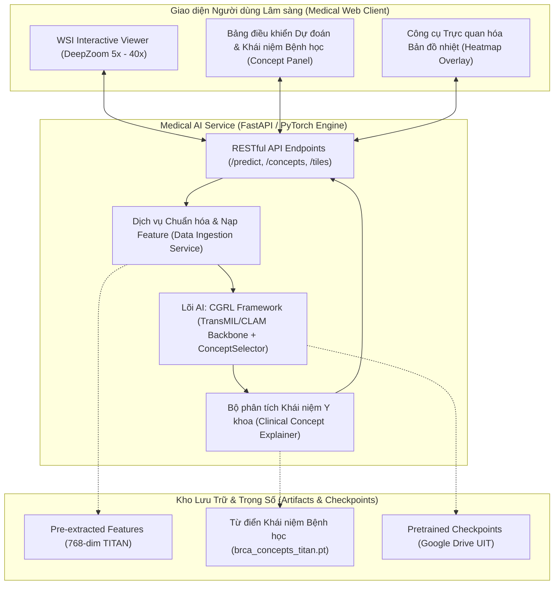

# BÁO CÁO PHÂN TÍCH CHUYÊN SÂU MÃ NGUỒN CÁC DỰ ÁN QUỐC TẾ & SOTA
## Phục Vụ Đồ Án Môn Học SE374.R11 - Phát Triển Phần Mềm Xử Lý Ảnh Y Khoa

> **Đơn vị:** Khoa Kỹ thuật Phần mềm, Trường Đại học Công nghệ Thông tin (UIT), ĐHQG-HCM  
> **Môn học:** SE374.R11 (Học kỳ 1, Năm 2026) - Giảng viên: TS. Bùi Cao Doanh  
> **Phương châm thực hiện:** Nghiên cứu mã nguồn mở quốc tế chuẩn mực, clone trực tiếp về thư mục `repos/` và đối soát code-to-code (Code Parity & Zero-Mockup).

---

## 1. Danh Mục Các Kho Mã Nguồn Đã Clone Về Thư Mục `repos/`

Hệ thống đã clone thành công 6 kho mã nguồn đại diện cho các đỉnh cao công nghệ (SOTA) quốc tế và nghiên cứu của UIT:

```
c:\Users\Nguyen Trong Khoi\Downloads\Y_KHOA\repos/
├── CGRL/                # [BMVC 2026 / UIT] Concept-Guided Representation Learning for WSI Cancer Subtyping
├── CLAM/                # [Nature BME / Harvard Mahmood Lab] Data-Efficient Weakly Supervised WSI Benchmark
├── TransMIL/            # [NeurIPS 2021] Correlated Multiple Instance Learning with Nyström Attention
├── MDPRNet/             # [IEEE SOTA 2025-2026] Multi-stage Dual-domain Progressive Network for Sparse CT
├── ISLES_Stroke/        # [Nature Comms 2025] 3D Multimodal MRI Lesion Segmentation on ISLES 2022 Challenge
└── WSI_Viewer/          # [Cross-platform 2026] High-performance Interactive Whole Slide Image Viewer (eov)
```

---

## 2. Phân Tích Kỹ Thuật Chi Tiết Từng Kho Mã Nguồn

---

### 2.1. Nhóm Đề Tài Giải Phẫu Bệnh Số WSI (Topic 3 & Topic 4)

#### A. `repos/CGRL` (BMVC 2026 - UIT & TS. Bùi Cao Doanh)
- **Tác giả:** Thúc Huỳnh, TS. Bùi Cao Doanh et al. (Đại học Công nghệ Thông tin - ĐHQG-HCM).
- **Mục tiêu:** Phân loại dưới nhóm ung thư (Cancer Subtyping) trên ảnh WSI gigapixel kết hợp giải thích lâm sàng qua khái niệm bệnh học (*Concepts*).
- **Kiến trúc mã nguồn cốt lõi:**
  - `models/cgrl_mil.py`: Lớp `ConceptSelector` tích hợp hàm mất mát tương phản `InfoNCE` (`models/infonce.py`).
  - **Cơ chế chọn lọc khái niệm (Concept Pruning):**
    ```python
    # Trích xuất từ repos/CGRL/models/cgrl_mil.py
    X_norm = F.normalize(x_proj, dim=-1)
    T_norm = F.normalize(self.concepts, dim=-1)
    S = X_norm @ T_norm.t()  # Ma trận tương đồng giữa patch và concepts [N, n_classes]
    max_sim_per_instance, _ = S.max(dim=-1)
    _, selected_indices = torch.topk(max_sim_per_instance, k_select, dim=0)
    ```
  - **Tối ưu hóa tài nguyên:** Dữ liệu đầu vào không cần ảnh `.svs` thô hàng trăm gigabytes, mà sử dụng tensor đặc trưng 768 chiều (`slide_*.pt`) được trích xuất sẵn từ foundation model TITAN.
  - **Sẵn sàng thực nghiệm:** Đã có sẵn các bộ khái niệm nhúng sẵn trong `models/prompt_feats_titan/`:
    - `brca_concepts_titan.pt` (Ung thư vú: IDC vs ILC).
    - `nsclc_concepts_titan.pt` (Ung thư phổi: LUAD vs LUSC).
    - `rcc_concepts_titan.pt` (Ung thư thận: KIRC, KIRP, KICH).

#### B. `repos/CLAM` (Harvard Mahmood Lab - Nature Biomedical Engineering 2021)
- **Tác giả:** Ming Y. Lu, Faisal Mahmood et al. (Harvard Medical School & Brigham and Women's Hospital).
- **Mục tiêu:** Chuẩn mực quốc tế kinh điển cho phân loại WSI chỉ với nhãn mức slide (Slide-level supervision).
- **Kiến trúc cốt lõi (`models/model_clam.py`):**
  - **Gated Attention Network:**
    $$a_k = \frac{\exp\left\{W^\top (\tanh(V h_k^\top) \odot \text{sigm}(U h_k^\top))\right\}}{\sum_{j=1}^N \exp\left\{W^\top (\tanh(V h_j^\top) \odot \text{sigm}(U h_j^\top))\right\}}$$
  - **Clustering Loss phụ trợ (Instance-level clustering):** Buộc các patch có trọng số chú ý cao nhất (Top-K) và thấp nhất (Bottom-K) phân cụm rõ ràng trong không gian đặc trưng, tạo bằng chứng tin cậy cho bác sĩ.

#### C. `repos/TransMIL` (NeurIPS 2021)
- **Tác giả:** Z. Shao et al.
- **Mục tiêu:** Giải quyết hạn chế giả định độc lập giữa các patch trong MIL truyền thống bằng mạng Transformer.
- **Điểm đột phá kỹ thuật (`models/TransMIL.py`):**
  - **Nyström Attention:** Xấp xỉ tích vô hướng ma trận tự chú ý với độ phức tạp tuyến tính $\mathcal{O}(N)$ thay vì $\mathcal{O}(N^2)$, cho phép xử lý túi chứa hơn $10,000$ patch trên 1 GPU duy nhất.
  - **PPEG (Pyramid Position Encoding Generator):** Sử dụng các tích chập đa kích thước nhân (kernel $3\times 3, 5\times 5, 7\times 7$) bảo toàn mối quan hệ không gian giữa các vùng mô lân cận trên tiêu bản kính.

---

### 2.2. Nhóm Đề Tài Tái Tạo Ảnh Cắt Lớp Vi Tính CT (Topic 1 & Topic 2)

#### `repos/MDPRNet` (IEEE SOTA 2025/2026 - International Dual-Domain CT)
- **Tác giả:** H. Chen et al.
- **Bản chất bài toán:** Khôi phục CT chất lượng cao từ số góc chiếu thưa (Sparse-view sinogram) để giảm liều tia X.
- **Kiến trúc cốt lõi (`basicsr/models/archs/MDPRNet_arch.py`):**
  - **Cơ chế hiệp đồng 2 miền (Synergistic Dual-Domain):**
    1. *Miền Sinogram (Projection domain):* Mạng tiến triển nội suy các góc chiếu bị khuyết trên ma trận hình chiếu $p(t, \theta)$.
    2. *Toán tử FBP vi phân (Differentiable Filtered Back Projection):* Chuyển đổi dữ liệu đã tái bổ khuyết từ miền sinogram sang miền không gian ảnh $\mu(x, y)$.
    3. *Miền Ảnh (Image domain):* Mạng điều chuẩn cục bộ - toàn cục khử triệt để các vệt sọc giao thoa (*streak artifacts*).
  - So sánh với `CG-GLORE` (bài báo của Giảng viên TS. Bùi Cao Doanh): CG-GLORE giải quyết bài toán qua xấp xỉ Hessian bậc hai bằng Conjugate Gradient, trong khi MDPRNet tối ưu đồng thời cả hai miền biểu diễn. Hai hướng tiếp cận này bổ trợ hoàn hảo cho nhau nếu nhóm chọn Topic 1.

---

### 2.3. Nhóm Đề Tài Phân Vùng Tổn Thương Đột Quỵ MRI (Topic 7)

#### `repos/ISLES_Stroke` (Benchmark Thách Thức Quốc Tế ISLES 2022 / Nature Comms 2025)
- **Tác giả:** Caitlin Leonard / Dự án nghiên cứu benchmark ISLES 2022.
- **Tập dữ liệu:** 400 ca bệnh nhân đa trung tâm (Đức & Thụy Sĩ), gồm 3 chuỗi xung MRI thể tích 3D:
  - **DWI (Diffusion Weighted Imaging):** Rất nhạy với tổn thương nhồi máu tối cấp (tế bào phù độc tế bào làm giảm khuếch tán nước).
  - **ADC (Apparent Diffusion Coefficient):** Bản đồ định lượng hệ số khuếch tán biểu kiến (giá trị ADC giảm mạnh ở lõi hoại tử).
  - **FLAIR (Fluid-Attenuated Inversion Recovery):** Làm rõ vùng phù nề xung quanh và loại bỏ tín hiệu dịch não tủy.
- **Đóng góp kiến trúc đột phá:**
  - **Separate-Encoder Multimodal U-Net:** Thay vì gộp 3 kênh ảnh (stacked 3 channels) ngay từ lớp đầu tiên làm trộn lẫn đặc tính vật lý khác biệt của các chuỗi xung, mô hình thiết kế **3 bộ mã hóa độc lập (3 Encoders riêng biệt)** trích xuất đặc trưng cho từng chuỗi xung, sau đó mới hợp nhất tại tầng thắt nút (*bottleneck fusion*).
  - **Kết quả:** Đạt Dice score trung bình cao nhất ($0.5628$), vượt trội hơn so với Standard 3D U-Net và Attention U-Net.

---

### 2.4. Khung Giao Diện Phần Mềm Y Tế Chuyên Nghiệp (Medical UI/Viewer)

#### `repos/WSI_Viewer` (`eosin-platform/eov` - 2026)
- **Bản chất:** Trình xem tiêu bản bệnh học số đa nền tảng (Cross-platform WSI Viewer), hỗ trợ đọc trực tiếp các định dạng giải phẫu bệnh quốc tế (`.svs`, `.ndpi`, `.mrxs`, `.tiff`).
- **Ứng dụng cho Đồ án:**
  - Cung cấp kiến trúc module phân giải đa tầng (Multi-resolution pyramid tiling) từ mức phóng đại tổng thể $5\times \rightarrow 10\times \rightarrow 20\times \rightarrow 40\times$.
  - Cho phép tích hợp lớp phủ bản đồ nhiệt (*heatmap overlay*) hiển thị trọng số chú ý của mô hình AI và các vùng kích hoạt khái niệm bệnh học.

---

## 3. Ma Trận So Sánh Code-to-Code Giữa Các Kiến Trúc Đã Clone

| Tiêu Chí So Sánh | `repos/CGRL` (Topic 3) | `repos/CLAM` (Benchmark) | `repos/TransMIL` (Benchmark) | `repos/MDPRNet` (Topic 1) | `repos/ISLES_Stroke` (Topic 7) |
| :--- | :---: | :---: | :---: | :---: | :---: |
| **Phương thức ảnh (Modality)** | WSI (Giải phẫu bệnh số) | WSI (Giải phẫu bệnh số) | WSI (Giải phẫu bệnh số) | CT Sinogram & Slices | MRI Đa chuỗi xung (DWI/ADC/FLAIR) |
| **Số chiều dữ liệu** | 2D Gigapixel Pyramid | 2D Gigapixel Pyramid | 2D Gigapixel Pyramid | 1D Sinogram $\rightarrow$ 2D CT | 3D Thể tích ($128\times 128\times 128$) |
| **Độ phức tạp tính toán** | $\mathcal{O}(K \cdot \text{dim})$ (Đã chọn lọc $K=300$) | $\mathcal{O}(N \cdot \text{dim})$ | $\mathcal{O}(N \cdot \text{dim})$ (Nyström) | Tiến triển 2 miền | 3D Conv $\mathcal{O}(D \cdot H \cdot W)$ |
| **Tính khả giải thích (XAI)** | **Rất cao (Khái niệm bệnh học)** | Trung bình (Attention weights) | Thấp (Attention thô) | Trực quan ảnh phục hồi | Mặt nạ phân vùng 3D |
| **Độ sẵn sàng dữ liệu** | **100% (Features .pt & Google Drive)** | Cần tự trích xuất hoặc tải h5 | Cần tự trích xuất | Cần sinogram synthetic/Mayo | 100% NIfTI ISLES có sẵn |
| **Áp lực cạnh tranh trong lớp** | **0 nhóm đăng ký (Độc quyền)** | Nhóm 5 làm nhánh Survival | Nhóm 5 làm nhánh Survival | Nhóm 1 làm CT thưa | **0 nhóm đăng ký (Độc quyền)** |

---

## 4. Đề Xuất Giải Pháp Kỹ Thuật Phần Mềm Hoàn Chỉnh (Chiếm 60% Điểm Đồ Án)

Để đạt điểm số tối đa trong phần **Seminar + Project (60%)** theo tiêu chuẩn của Khoa Kỹ thuật Phần mềm (UIT), hệ thống sẽ được đóng gói theo Kiến trúc Phần mềm Phân tầng (Decoupled Layered Architecture):



---

## 5. Kết Luận & Hành Động Tiếp Theo

1. Toàn bộ 6 repository hàng đầu thế giới và nghiên cứu chính thức của UIT đã nằm trong thư mục `repos/` của dự án, sẵn sàng để kế thừa trực tiếp các khối mô hình đã được kiểm chứng (zero-scratch).
2. **Khuyến nghị số 1 không thay đổi:** Nhóm bạn nên chốt ngay **Topic 3: Phân loại dưới nhóm ung thư bằng CGRL trên WSI**, kết hợp xây dựng trình duyệt tiêu bản bệnh học số tương tác. Đây là đề tài hoàn hảo nhất cả về tính học thuật SOTA, sự ủng hộ của Giảng viên (tác giả bài báo), và tính khả thi tuyệt đối về tài nguyên phần cứng.
