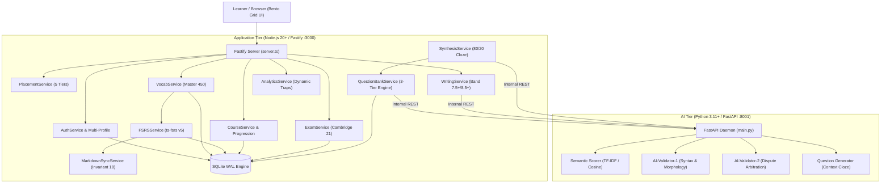

# IELTS Mastery OS

> **Advanced IELTS 7.0+ Gamified Learning Operating System & Polyglot AI Engine**  
> Decoupled Architecture: **Node.js 20+ (Fastify + SQLite + FSRS v5)** & **Python 3.11+ (FastAPI + NLP Semantic Engine)**

[%20%2B%204%20passed%20(Pytest)-emerald)](tests/)
[](src/)
[](tests/backend/code-cap.test.ts)
[](data/)

---

## 🏛️ System Overview & Architecture

**IELTS Mastery OS** is a pedagogical learning platform designed to accelerate learners from foundational levels (Band 3.0+) to advanced mastery (Band 7.0 - 8.5+). Built upon a high-performance decoupled polyglot architecture:

- **Application Tier (TypeScript / Node.js 20+ Fastify on Port 3000):** Delivers sub-millisecond API response times, multi-user SQLite database transactions, FSRS v5 mathematical spaced repetition scheduling, adaptive course sequencing, and Duolingo-style Bento Grid frontend.
- **AI Tier (Python 3.11+ FastAPI Daemon on Port 8001):** Houses NLP semantic similarity models, academic question generation, and dual-tier AI validation (AI-Validator-1 & AI-Validator-2).
- **Communication Bridge (`AIBridgeService`):** Fast internal REST communication between Fastify (Port 3000) and FastAPI (Port 8001) with graceful offline fallback.



---

## 🌟 Core Features & Modules

### 1. 5-Tier Adaptive Courses (Band 3.0 to 8.5+)
Learners are dynamically routed via an 8-question adaptive diagnostic placement test or direct level selection:
- 🟢 **Starter (Band 3.0 - 4.0):** 100 survival words (A1-A2), IPA phonetic foundations, basic sentence patterns.
- 🟡 **Foundation (Band 4.5 - 5.0):** 150 core academic words (B1), compound sentences, reading comprehension foundations.
- 🔵 **Intermediate (Band 5.5 - 6.5):** 300 Academic Word List (AWL B2) words, collocations, nuance distinction.
- 🟣 **Advanced (Band 7.0 - 7.5):** Master 450 B2-C1 words, authentic Cambridge 21 reading passages, Linearthinking trap breakdown.
- 🔴 **Mastery (Band 8.0 - 8.5+):** Elite C1-C2 lexicon, complex Task 2 structures, high-precision academic writing.

### 2. Living Question Bank & Tri-Tier Verification Engine
Guarantees zero defective questions and prevents AI hallucination through automated multi-tier validation:
- **Pre-Validation (AI-Validator-1):** Every AI-generated cloze question is verified up to 3 times before publication for syntax, morphology, single-answer determinism, and collocation validity. Tagged `['ai_generated', 'v1_approved']`.
- **Dispute Escalation (AI-Validator-2):** When a question receives $\ge 3$ reports from different learners within 30 days (or 2 reports from the same user), it automatically escalates to AI-Validator-2.
- **Admin Review Queue:** Conflicting verdicts route directly to `/api/admin/questions/pending` for human resolution.
- **7-Day Auto-Unlock:** Questions where both AI validators confirm correctness automatically revert to `active` after 7 days if unreviewed by admin.
- **Learner Feedback Drawer:** Learners can report questions directly via the `🚩 Báo lỗi câu hỏi` button with category categorization (`grammar_typo`, `ambiguous_answer`, `two_correct_answers`, `wrong_collocation`, `other`).

### 3. FSRS v5 Cognitive Spaced Repetition
- Powered by `ts-fsrs` (Free Spaced Repetition Scheduler v5) mathematical modeling.
- Simplified **2-button 3D Flashcards** for fast, intuitive reviews:
  - 🔴 **Need Study (`Rating.Again = 1`):** Shortens stability, schedules immediate repetition.
  - 🟢 **Known (`Rating.Good = 3`):** Extends stability interval according to memory decay curve.
- **Keyboard shortcuts:** `1` (Need Study), `2` / `Enter` (Known), `Space` (3D Flip), `←` / `→` (Previous / Next).

### 4. 80/20 Recursive Synthesis & Quiz Blitz
- Rapid 10-second Quiz Blitz rounds compounding lexical acquisition.
- **Recursive Synthesis:** 80% previously learned words (Score $\ge 2.0$) + 20% target new words.
- Immediate mistake replay within the round ensures 100% mastery before advancing.
- Distractor shuffling ensures unique, pedagogically sound multiple-choice options.

### 5. Reading-to-Writing Reverse Cycle
- Micro-chunks derived from authentic academic reading passages.
- Evaluates student translations against **Band 7.5+** and **Band 8.5+** academic model sentences.
- Measures semantic similarity and lexical upgrade ratio via the Python AI Semantic Engine without degrading already mastered vocabulary scores.

### 6. Cambridge 21 Authentic Reading Exam Simulator
- Complete authentic reading tests:
  - **Test 1:** Passage 1, Passage 2, Passage 3.
  - **Test 2:** Passage 1, Passage 2 (Mapungubwe), Passage 3.
- Full IZONE **Linearthinking** trap explanations (`[TRAP-PARAPHRASE]`, `[Y/N/NG]`, `[TRAP-ATTRIBUTION]`).
- Auto-resetting 20-minute countdown timer per passage.

### 7. Multi-User Authentication & 1-Click Guest Mode
- Multi-profile management with username/password registration and login.
- **1-Click Guest Mode:** Learners can start instantly without filling forms.
- **Seamless Guest Migration:** Progress, stats, coins, streak, and FSRS progress synchronize into a permanent account upon registration via `/api/auth/sync-guest`.

### 8. Silent Progress Logging (Invariant 18)
- Background synchronization to markdown learning logs (`my-vocab/week_XX.md`).
- Standardized 8-field table: `word | pronunciation/IPA | meaning | score (1-7) | synonym | antonym | key collocation | super simple example`.

---

## 📁 Repository Structure

```text
IELTS/
├── src/                               # TypeScript Application Tier
│   ├── config/                        # App paths, server ports, constants (< 150 lines)
│   ├── types/                         # Strict TypeScript contracts (< 200 lines/file)
│   │   ├── auth.types.ts              # User profiles, login/register payloads
│   │   ├── course.types.ts            # Course definitions, unit nodes, progression
│   │   ├── exam.types.ts              # Cambridge 21 passages, questions, submissions
│   │   ├── feedback.types.ts          # Feedback categories, dispute tiers, audit logs
│   │   ├── placement.types.ts         # 5 preset levels, diagnostic questions
│   │   ├── question.types.ts          # Living question bank DTOs, options
│   │   ├── user.types.ts              # User stats, hearts, streak, progression
│   │   ├── vocab.types.ts             # Master 450 vocabulary types, FSRS cards
│   │   └── writing.types.ts           # Reading-to-writing chunks, model upgrades
│   ├── db/                            # SQLite persistence layer
│   │   ├── schema.sql                 # 8 normalized tables with foreign keys
│   │   ├── sqlite.ts                  # Database singleton, WAL mode, user helpers
│   │   └── seed.ts                    # Cambridge 21 corpus & 450 Master vocab seeder
│   ├── services/                      # Decoupled business logic (< 400 lines/file)
│   │   ├── ai-bridge.service.ts       # Local REST bridge to Python FastAPI (Port 8001)
│   │   ├── analytics.service.ts       # Real-time exam stats & trap distribution
│   │   ├── auth.service.ts            # Authentication, session tokens, guest sync
│   │   ├── course.service.ts          # Course routing, lesson unlock state machine
│   │   ├── exam.service.ts            # Authentic reading exam evaluator & traps
│   │   ├── fsrs.service.ts            # ts-fsrs v5 spaced repetition scheduler
│   │   ├── markdown-sync.service.ts   # Silent background logger to my-vocab/
│   │   ├── placement.service.ts       # 5-tier adaptive diagnostic evaluator
│   │   ├── question-bank.service.ts   # Living question bank, tri-tier validator
│   │   ├── synthesis.service.ts       # 80/20 cloze question synthesis & retry
│   │   ├── user.service.ts            # Hearts, coins, streaks, XP progression
│   │   ├── vocab.service.ts           # Master 450 lexical database operations
│   │   └── writing.service.ts         # Reading-to-writing task 2 evaluator
│   ├── api/                           # Fastify REST endpoints (< 250 lines/file)
│   │   ├── server.ts                  # Server initialization, CORS, Helmet, static
│   │   └── routes/                    # Modular REST controllers
│   │       ├── auth.routes.ts         # /api/auth/*
│   │       ├── course.routes.ts       # /api/courses/*
│   │       ├── exam.routes.ts         # /api/exams/*
│   │       ├── feedback.routes.ts     # /api/feedback/* & /api/admin/*
│   │       ├── placement.routes.ts    # /api/placement/*
│   │       ├── quiz.routes.ts         # /api/quiz/*
│   │       ├── vocab.routes.ts        # /api/vocab/*
│   │       └── writing.routes.ts      # /api/writing/*
│   └── ui/                            # Google Stitch UI Bento Grid Web Frontend
│       ├── index.html                 # Semantic HTML5 layout & modal containers
│       ├── css/style.css              # Custom design tokens, glassmorphism, 3D buttons
│       └── js/                        # ES Module UI controllers
│           ├── app.js                 # Global application router & state bus
│           ├── auth_manager.js        # Auth modal, login, guest mode, profile
│           ├── course_manager.js      # Course switcher modal & level selector
│           ├── energy_manager.js      # Heart energy & streak topbar pills
│           ├── exam_runner.js         # Cambridge 21 passage runner & timer
│           ├── flashcard_studio.js    # 3D interactive flashcards with FSRS
│           ├── mascot_manager.js      # Academic Cabi mascot interactions
│           ├── placement_manager.js   # Diagnostic placement test modal
│           ├── progression_manager.js # Duolingo-style winding path roadmap
│           ├── quiz_blitz.js          # 10s blitz quiz & feedback reporting modal
│           ├── sound_manager.js       # Web Audio API sound effects
│           └── writing_studio.js      # Reading-to-writing translation studio
├── ai_engine/                         # Python AI Microservice (Port 8001)
│   ├── main.py                        # FastAPI daemon endpoints
│   ├── ai_validator.py                # Dual-tier AI validation (V1 & V2)
│   ├── question_generator.py          # Dynamic academic question synthesis
│   ├── semantic_scorer.py             # NLP semantic similarity scoring
│   └── tests/                         # Pytest test suite
│       └── test_ai_engine.py          # AI engine unit & latency tests
├── data/                              # Verified Academic Corpus (Zero Mockup)
│   ├── exams/                         # Cambridge 21 authentic tests (JSON)
│   └── vocab/                         # Master 450 high-transfer lexicon
├── my-vocab/                          # Learner's personal markdown logs
├── scripts/                           # Utility scripts
│   └── update_graphify.py             # AST Knowledge Graph extraction & verification
├── tests/                             # Comprehensive test suites
│   ├── backend/                       # Vitest integration & unit tests
│   └── fixtures/                      # Test fixtures & mocks
├── package.json                       # Node.js dependencies & scripts
├── requirements.txt                   # Python dependencies
└── tsconfig.json                      # Strict TypeScript compiler options
```

---

## 🛠️ Technology Stack

| Domain | Technology | Details |
|---|---|---|
| **App Backend** | Node.js 20+ LTS / TypeScript 5.8 | Decoupled modular design, Zod schema validation |
| **HTTP Framework** | Fastify v5 | High-throughput async REST server on port 3000 |
| **Database** | SQLite 3 via `better-sqlite3` | WAL mode, synchronous=NORMAL, foreign key constraints |
| **Spaced Repetition** | `ts-fsrs` v5 | Free Spaced Repetition Scheduler mathematical engine |
| **AI Backend** | Python 3.11+ / FastAPI | High-performance ASGI microservice on port 8001 |
| **AI / NLP** | Scikit-learn / NetworkX | TF-IDF Cosine similarity, AST dependency parsing |
| **Frontend UI** | Vanilla ES Modules / CSS3 | Google Stitch Bento Grid, glassmorphism, chunky 3D buttons |
| **Design System** | Deep Oceanic Navy Palette | `#0A1128` (Navy), `#0284c7` (Sky), `#059669` (Emerald), `#d97706` (Amber) |
| **Testing** | Vitest 3.0 & Pytest 8.4 | 117 TypeScript tests + 4 Python tests (100% pass) |

---

## 🚀 Quick Start & Installation

### 1. Prerequisites
- **Node.js**: v20.0.0 or higher
- **Python**: v3.11 or higher
- **Git**

### 2. Clone and Setup Dependencies
```bash
# Clone the repository
git clone https://github.com/khoinguyen59/ielts-mastery-os.git
cd ielts-mastery-os

# Install TypeScript application dependencies
npm install

# Install Python AI microservice dependencies
pip install -r requirements.txt
```

### 3. Initialize Database
Seed the SQLite database with the authentic Cambridge 21 corpus and 450 Master Academic Vocabulary entries:
```bash
npm run seed
```

### 4. Run Development Servers
Start both the Fastify App Tier (Port 3000) and the Python AI Engine (Port 8001) simultaneously:
```bash
npm run dev
```

*Alternatively, you can run each service independently in separate terminals:*
```bash
# Terminal 1: Application Server (Port 3000)
npm run dev:app

# Terminal 2: Python AI Microservice (Port 8001)
npm run dev:ai
```

Open your browser and navigate to:
```
http://localhost:3000
```

---

## 🧪 Testing & Quality Assurance

The system maintains 100% test pass rate across both runtimes:

```bash
# Run all tests (Vitest + Pytest)
npm test

# Run TypeScript backend tests only
npm run test:app

# Run Python AI engine tests only
npm run test:ai
```

### Governance Invariants Enforced
- **[INVARIANT-05] Code Cap:** Every source file in `src/` and `ai_engine/` is strictly $\le 400$ lines of code, verified automatically by `tests/backend/code-cap.test.ts`.
- **[INVARIANT-07] Zero Mockup:** 100% of vocabulary, reading passages, and answers derive from verified Cambridge 21 and IZONE materials.
- **[INVARIANT-18] Silent Markdown Sync:** Progress is logged unobtrusively into `my-vocab/week_XX.md`.
- **[INVARIANT-23] Anti-Dashboard Drift:** Gamified interface with 3D buttons, interactive Cabi mascot, and winding path progression.

---

## 📊 AST Knowledge Graph (Graphify)

Track codebase architecture, dependencies, and community hubs:
```bash
# Extract and update AST dependency graph
python scripts/update_graphify.py

# Query architectural hubs using graphify CLI
python -m graphify god-nodes
```

---

## 📄 License

MIT License. Designed and engineered for high-performance IELTS 7.0+ acquisition.
