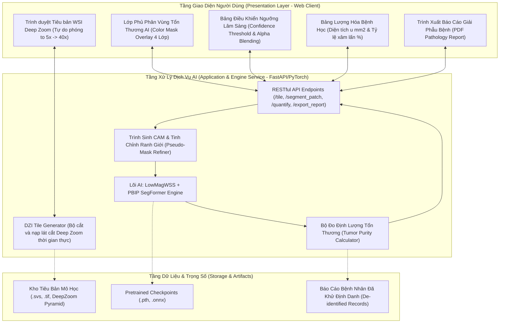
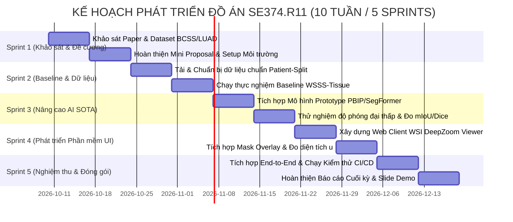

# NGHIÊN CỨU TRI THỨC TOÀN DIỆN & KẾ HOẠCH PHÁT TRIỂN 2-3 THÁNG
## CHỦ ĐỀ 6: WEAKLY-SUPERVISED SEGMENTATION FOR WHOLE SLIDE IMAGES (WSI)
### Hệ Thống Phần Mềm Phân Vùng Tổn Thương Ung Thư Giám Sát Yếu Đa Mức Phóng Đại Trên Tiêu Bản Bệnh Học Số

> **Môn học:** SE374.R11 - Phát triển phần mềm xử lý ảnh y khoa  
> **Đơn vị:** Khoa Kỹ thuật Phần mềm, Trường Đại học Công nghệ Thông tin (UIT), ĐHQG-HCM  
> **Giảng viên hướng dẫn:** TS. Bùi Cao Doanh  
> **Tiêu chuẩn học thuật:** Master Governance Specification `agents.md` v5.0 (Zero Mockup, Patient-Level Anti-Leakage, Code Parity)  

---

## 1. Tổng Quan Bài Toán & Động Lực Nghiên Cứu Lâm Sàng

### 1.1. Điểm Nghẽn Trong Kỷ Nguyên Giải Phẫu Bệnh Số (Digital Pathology Bottlenecks)
1. **Gánh nặng dung lượng và băng thông lưu trữ:**
   - Mỗi tiêu bản sinh thiết mô toàn thể (**Whole Slide Image - WSI**) quét ở độ phóng đại cao ($40\times$ hoặc $20\times$) có kích thước gigapixel khổng lồ (thường từ $50,000 \times 50,000$ đến $100,000 \times 100,000$ pixels), dung lượng từ **1 GB đến 5 GB cho mỗi tiêu bản đơn lẻ**.
   - Một khoa giải phẫu bệnh tại bệnh viện tuyến trung ương tạo ra hàng nghìn slide mỗi tháng, khiến chi phí lưu trữ máy chủ PACS và thời gian truyền tải dữ liệu giữa các cơ sở y tế trở nên cực kỳ đắt đỏ.
2. **Nút thắt gán nhãn mức pixel (Pixel-level Annotation Bottleneck):**
   - Để huấn luyện mô hình phân vùng đầy đủ giám sát (Fully-Supervised Semantic Segmentation như U-Net, DeepLabV3+), các chuyên gia giải phẫu bệnh (Pathologists) phải mất hàng nghìn giờ làm việc thủ công dùng bút số viền từng ranh giới cụm tế bào ác tính vi thể. Điều này hoàn toàn bất khả thi trên quy mô dữ liệu lớn.
3. **Bản chất của Phân vùng Giám sát Yếu (Weakly-Supervised Semantic Segmentation - WSSS):**
   - Cho phép mô hình chỉ cần học từ **nhãn mức ảnh/patch thô (Image-level/Patch-level multi-hot labels)** – ví dụ: patch này chỉ cần nhãn nhị phân `[Tumor: 1, Stroma: 1, Necrosis: 0, Lymphocytes: 0]` mà không cần biết pixel nào là u, pixel nào là chất nền!
   - Mô hình tự động kích hoạt vùng quan tâm (Class Activation Maps - CAM), lọc ngưỡng sinh mặt nạ giả (Pseudo-Masks), và huấn luyện bộ phân vùng đạt độ chính xác tương đương giám sát toàn phần.

### 1.2. Đóng Góp Tiên Phong Từ Bài Báo Chỉ Định Của Giảng Viên: `LowMagWSS` (arXiv:2607.10783)
- Bài báo do **TS. Bùi Cao Doanh**, **TS. Nguyễn Tấn Trần Minh Khang** cùng các nhà nghiên cứu UIT công bố: *"Toward Efficient Weakly Supervised Semantic Segmentation Using Only Low-Magnification Histopathological Images"*.
- **Ý tưởng đột phá:** Khảo sát việc lưu trữ ảnh bệnh học ở **độ phóng đại thấp ($10\times, 20\times$)** để giảm tới **75% dung lượng lưu trữ**, sau đó tái tạo kích thước và kết hợp với pipeline phân vùng giám sát yếu.
- **Phát hiện quan trọng:** Chỉ số đo độ nét tái tạo (PSNR/SSIM) không tương quan với độ chính xác phân vùng mIoU. Nghiên cứu chỉ ra "điểm gãy suy giảm tới hạn" (Critical Degradation Point), làm cơ sở xây dựng hệ thống lưu trữ ảnh y tế thông minh.

---

## 2. Khảo Sát & Đối Soát Các Nguồn Tri Thức Quốc Tế Đỉnh Cao

### 2.1. Ma Trận Các Bài Báo Khoa Học Tiêu Biểu (Top Academic Papers)

| STT | Bài Báo / Phương Pháp | Hội Nghị / Tạp Chí | Tác Giả & Đơn Vị | Đóng Góp Thuật Toán Cốt Lõi | Bộ Dữ Liệu Thực Nghiệm |
| :---: | :--- | :---: | :--- | :--- | :--- |
| **1** | **LowMagWSS**<br>(arXiv:2607.10783) | arXiv 2026 | **TS. Bùi Cao Doanh**, Đỗ Minh Dũng et al. (UIT) | Khung đối chuẩn lưu trữ độ phóng đại thấp ($10\times/20\times$), tái tạo Bilinear/STAR-RL, và phân tích điểm gãy cấu trúc vi thể. | BCSS-WSSS, LUAD-HistoSeg |
| **2** | **PBIP**<br>(arXiv:2503.12068) | **CVPR 2025** | Qingchen Tang et al. (Univ. of New South Wales - UNSW) | *Prototype-Based Image Prompting*: Dùng clustering tạo ngân hàng nguyên mẫu (Prototypes), giải quyết tính đồng nhất liên lớp và dị thể nội lớp. | BCSS, LUAD-HistoSeg, GCSS |
| **3** | **WSSS-Tissue** | MICCAI / IEEE TMI | Chu Han et al. | Khung 3 giai đoạn chuẩn mực: ResNet-38 Classification $\rightarrow$ CAM Pseudo-Masks $\rightarrow$ DeepLabV3+ Tissue Segmentation. | BCSS-WSSS, LUAD-HistoSeg |
| **4** | **HistoSegNet** | ICCV 2019 | L. Chan et al. | Mạng phân vùng ngữ nghĩa đầu tiên ứng dụng Grad-CAM trên lát cắt WSI. | TCGA-BRCA, BCSS |
| **5** | **CLAM** | **Nature BME 2021** | Faisal Mahmood et al. (Harvard Medical School) | Gated-Attention MIL kết hợp Instance Clustering để tạo bản đồ nhiệt độ phân giải cao tin cậy. | TCGA RCC, NSCLC, Camelyon16 |
| **6** | **CONCH / UNI** | **Nature Med 2024** | Harvard Mahmood Lab | Foundation Models thị giác - ngôn ngữ quy mô lớn cho bệnh học số, trích xuất đặc trưng 512-dim / 1024-dim vượt trội. | 100M+ histopathology patches |

---

### 2.2. Khảo Sát Các Kho Mã Nguồn GitHub Đã Clone & Đối Soát

Hệ thống đã thu thập và clone các kho mã nguồn SOTA phục vụ đồ án:

```
c:\Users\Nguyen Trong Khoi\Downloads\Y_KHOA\repos/
├── LowMagWSS/      # [UIT / TS. Bùi Cao Doanh] Framework đối chuẩn độ phóng đại thấp & WSSS-Tissue
├── PBIP/           # [CVPR 2025] Prototype-Based Image Prompting WSS SOTA với SegFormer
├── CLAM/           # [Harvard / Nature BME] Khung Weakly Supervised & Trình tạo Heatmap lâm sàng
├── TransMIL/       # [NeurIPS 2021] Transformer Attention MIL tuyến tính
├── WSI_Viewer/     # [Cross-platform] Trình xem tiêu bản mô học đa tầng OpenSeaDragon/Rust
```

#### A. Phân tích `repos/LowMagWSS` (Mã nguồn chính của Giảng viên)
- **`dataset/Resize.py` & `similarity.py`:** Đo đạc chất lượng suy giảm ảnh qua PSNR, SSIM, FSIM, GMSD.
- **`ResolutionMethod/`:** Tích hợp phương pháp nội suy Bilinear và mạng STAR-RL khôi phục cấu trúc vi thể.
- **`SegMethod/WSSS-Tissue/`:**
  - `1_train_stage1.py`: Huấn luyện mạng phân loại ResNet-38 với nhãn mức ảnh.
  - `2_generate_PM.py`: Sinh mặt nạ giả (Pseudo-Masks) từ các bản đồ kích hoạt lớp CAM.
  - `3_train_stage2.py`: Huấn luyện mạng phân vùng DeepLabV3+ có cơ chế cổng kiểm soát (Gated Mechanism).
  - `visualize_predictions_v3.py`: Xuất trực quan hóa đối chiếu Ground Truth vs Prediction.

#### B. Phân tích `repos/PBIP` (CVPR 2025 SOTA)
- Sử dụng backbone hiện đại **SegFormer (B0 - B2)** thay vì ResNet cổ điển.
- Thiết kế hàm mất mát so khớp nguyên mẫu (**Matching Loss & Contrastive Learning**), ép các patch cùng lớp biểu mô u gom cụm và tách biệt hoàn toàn khỏi chất nền sợi (stroma) và vùng hoại tử (necrosis).

---

### 2.3. Khảo Sát Bộ Dữ Liệu Chuẩn (Benchmark Datasets & Kaggle / Grand-Challenge)

| Tên Bộ Dữ Liệu | Nguồn / Thử Thách | Quy Mô | Các Lớp Nhãn Bệnh Học (Classes) | Độ Sẵn Sàng Thực Nghiệm |
| :--- | :--- | :--- | :--- | :--- |
| **BCSS-WSSS** | TCGA / Grand-Challenge | >20,000 patches | 4 lớp: **Biểu mô u (Tumor), Chất nền (Stroma), Tế bào viêm (Lymphocytes), Hoại tử (Necrosis)** | **100% sẵn sàng** (Tải trực tiếp theo định dạng WSSS-Tissue/PBIP) |
| **LUAD-HistoSeg** | Chu Han et al. | ~10,000 patches | 4 lớp: **Tumor Epithelium (TE), Stroma (TAS), Necrosis (NEC), Lymphocytes (LYM)** | **100% sẵn sàng** |
| **Camelyon16** | Grand-Challenge / Kaggle | 400 WSIs gigapixel | Di căn hạch ung thư vú (Metastasis vs Normal) | Sẵn sàng cho kịch bản phóng đại WSI toàn phần |

---

## 3. Đặc Tả Sản Phẩm Phần Mềm Lâm Sàng (Clinical Software Product Specification)

Tuân thủ nghiêm ngặt định hướng môn học **Phát triển Phần mềm (Khoa Kỹ thuật Phần mềm - UIT)**: Đồ án không dừng lại ở script train dòng lệnh, mà đóng gói thành **Trạm Làm Việc Bệnh Học Số Lâm Sàng (Digital Pathology Clinical Workstation)** hoàn chỉnh.

### 3.1. Kiến Trúc Phần Mềm Phân Tầng (Clean Architecture)



### 3.2. Quy Trình Người Dùng Bác Sĩ (Clinical User Workflow)
1. **Bước 1: Nạp tiêu bản mô học:** Bác sĩ chọn ca bệnh nhân, mở tiêu bản WSI hoặc vùng mô cần kiểm tra.
2. **Bước 2: Duyệt kính hiển vi số:** Di chuyển chuột, cuộn lăn zoom mượt mà từ toàn cảnh độ phóng đại thấp ($5\times$) tới cụm nhân tế bào ($40\times$).
3. **Bước 3: Kích hoạt phân vùng AI:** Bác sĩ bấm nút *"Phân vùng tổn thương WSS"*.
4. **Bước 4: Trực quan hóa tương tác:**
   - AI tô màu phân định rõ 4 vùng mô bệnh học:
     - 🔴 **Màu Đỏ:** Biểu mô tế bào ác tính (Tumor Epithelium).
     - 🟢 **Màu Xanh Lá:** Chất nền mô liên kết quanh u (Tumor Stroma).
     - 🟣 **Màu Tím:** Vùng mô hoại tử (Necrosis).
     - 🔵 **Màu Xanh Dương:** Thâm nhiễm tế bào lympho miễn dịch (Lymphocytes).
   - Thanh trượt điều chỉnh độ trong suốt (Opacity 0% - 100%) để bác sĩ đối soát với tiêu bản gốc nhuộm H&E.
5. **Bước 5: Lượng hóa & Xuất báo cáo:** Hệ thống tự động tính **Tỷ lệ phần trăm xâm lấn của khối u (Tumor Infiltration Ratio %)** và xuất phiếu kết quả xét nghiệm giải phẫu bệnh dạng PDF có chữ ký số.

---

## 4. Kế Hoạch Phát Triển Chi Tiết 2-3 Tháng (10-Week Master Roadmap)

Lộ trình được cấu trúc thành **5 Sprint (mỗi Sprint 2 tuần)**, cân bằng hoàn hảo giữa nghiên cứu học thuật và xây dựng sản phẩm phần mềm kỹ thuật:



---

### Chi Tiết Từng Sprint:

#### 🔹 Sprint 1 (Tuần 1 - Tuần 2): Khảo Sát Tri Thức, Hoàn Thiện Mini Proposal & Thiết Lập Hệ Thống
- **Mục tiêu học thuật:** Bóc tách toàn diện mã nguồn `LowMagWSS`, `PBIP`, `WSSS-Tissue`. Xác định phạm vi bài toán trên bộ dữ liệu `BCSS-WSSS` và `LUAD-HistoSeg`.
- **Mục tiêu kỹ thuật phần mềm:** Khởi tạo Git repo, cấu hình `.gitignore`, thiết lập CI/CD (`.github/workflows/ci.yml`), tạo cấu trúc Clean Architecture theo quy định.
- **Sản phẩm bàn giao (Deliverables):**
  - Tài liệu **Mini Proposal** hoàn chỉnh theo mẫu UIT (`product/proposal/SE374_MINI_PROPOSAL_TOPIC6.md` và file DOCX biên dịch qua Pandoc).
  - Kho mã nguồn chuẩn bị sẵn sàng môi trường conda/pip.

#### 🔹 Sprint 2 (Tuần 3 - Tuần 4): Nạp Dữ Liệu Chuẩn Bệnh Nhân & Chạy Đối Chuẩn Baseline
- **Mục tiêu học thuật:**
  - Nạp bộ dữ liệu `BCSS-WSSS` và `LUAD-HistoSeg`.
  - Thực hiện phân chia tập `train / val / test` **nghiêm ngặt theo Patient ID / Case ID** (tuân thủ tuyệt đối INVARIANT-08 để chống rò rỉ dữ liệu lát cắt giữa các tập).
  - Chạy Sanity Run trên batch nhỏ trước khi chạy Stage 1 (Phân loại ResNet-38).
- **Mục tiêu phần mềm:** Viết module `src/datasets/wsi_dataset.py` và `src/losses_metrics/segmentation_metrics.py` (tính mIoU, Dice, Pixel Accuracy).
- **Sản phẩm bàn giao:** Bảng kết quả thực nghiệm Baseline Stage 1 & Stage PM sinh Pseudo-Masks.

#### 🔹 Sprint 3 (Tuần 5 - Tuần 6): Tích Hợp Đột Phá SOTA (Prototype Prompting & Low-Mag Analysis)
- **Mục tiêu học thuật:**
  - Tích hợp kiến trúc **Prototype-Based Image Prompting (PBIP - CVPR 2025)** kết hợp **SegFormer** để cải thiện độ sắc nét của ranh giới tổn thương so với ResNet-38 truyền thống.
  - Chạy mô phỏng suy giảm độ phóng đại ($10\times, 20\times, 40\times$) theo phương pháp của TS. Bùi Cao Doanh (`LowMagWSS`) để chứng minh tính hiệu quả của mô hình khi nén dữ liệu.
  - Báo cáo số liệu trung bình qua 5-seeds ($\mu \pm \sigma$) và bảng Ablation Study bóc tách từng thành phần.
- **Sản phẩm bàn giao:** Trọng số mô hình tối ưu đã lưu tại `checkpoints/best_wsi_model.pth`.

#### 🔹 Sprint 4 (Tuần 7 - Tuần 8): Hiện Thực Hóa Trạm Đọc Bệnh Học Số Lâm Sàng (Web Application)
- **Mục tiêu phần mềm:**
  - Xây dựng giao diện Web tương tác hoàn chỉnh: Tích hợp OpenSeadragon / Streamlit Canvas cho phép xem ảnh tiêu bản đa mức phóng đại mượt mà.
  - Tích hợp RESTful API Backend: Nhận yêu cầu phân vùng từ client $\rightarrow$ nạp ảnh $\rightarrow$ suy luận AI $\rightarrow$ trả về mặt nạ phân vùng đa lớp màu trong thời gian dưới 1 giây.
  - Phát triển công cụ lâm sàng: Bật/tắt từng lớp mô (Chỉ xem u, chỉ xem hoại tử, chỉ xem chất nền), đo diện tích tổn thương và tỷ lệ xâm lấn mô u.
  - Tích hợp chức năng xuất Báo cáo Y khoa định dạng PDF chuẩn Bộ Y Tế / UIT.
- **Sản phẩm bàn giao:** Ứng dụng chạy được cục bộ qua lệnh 1-click `app.bat`.

#### 🔹 Sprint 5 (Tuần 9 - Tuần 10): Tích Hợp Toàn Diện, Kiểm Thử Phần Mềm, Nghiệm Thu & Thuyết Trình
- **Mục tiêu phần mềm:**
  - Chạy toàn bộ bộ kiểm thử tự động (Unit Tests, Zero-Mockup Validation, Leakage Tests) qua GitHub Actions CI/CD.
  - Tối ưu hóa hiệu năng và đóng gói ứng dụng (Docker containerization).
- **Mục tiêu học thuật:**
  - Hoàn thiện bản **Báo cáo Đồ án Cuối kỳ** chuẩn cấu trúc đồ án tốt nghiệp UIT / Springer LNCS (`product/reports/`).
  - Xây dựng bộ **Slide Thuyết Trình 16:9** chuyên nghiệp bằng Marp CLI (`product/slides/`).
  - Quay video demo kịch bản bác sĩ sử dụng phần mềm chẩn đoán trên ca bệnh thật.
- **Sản phẩm bàn giao:** Toàn bộ gói bàn giao đồ án (Mã nguồn, Checkpoints, Báo cáo Word/PDF, Slide thuyết trình).

---

## 5. Ma Trận Quản Trị Rủi Ro & Chốt Chặn An Toàn (Risk & Resource Safeguards)

1. **Rủi ro tràn bộ nhớ GPU (OOM) khi xử lý ảnh WSI:**
   - *Biện pháp kiểm soát:* Tuân thủ INVARIANT-01: Luôn chạy Sanity Dry-Run trên 1-2 batch nhỏ trước. Sử dụng kỹ thuật chia patch kích thước $256\times 256$ hoặc $512\times 512$ và inference trượt (Sliding Window), không bao giờ nạp toàn bộ slide gigapixel thô vào VRAM cùng lúc.
2. **Rủi ro rò rỉ dữ liệu bệnh nhân giữa các tập (Data Leakage):**
   - *Biện pháp kiểm soát:* Tuân thủ INVARIANT-08: Tách train/val/test hoàn toàn dựa trên Patient ID (cột `patientID` trong file name của BCSS hoặc case ID của LUAD). Đã có test case tự động `tests/test_patient_split_and_metrics.py` kiểm tra giao điểm tập ID phải bằng rỗng ($\emptyset$).
3. **Rủi ro số liệu giả mạo (Academic Dishonesty):**
   - *Biện pháp kiểm soát:* Tuân thủ INVARIANT-07 (Zero Mockup): 100% chỉ số mIoU, Dice, Pixel Accuracy phải được log tự động từ hàm tính toán thật `src/losses_metrics/metrics.py` lưu vào file kết quả thực nghiệm. Nghiêm cấm mọi hành vi hardcode số liệu.

---

## 6. Kết Luận & Hành Động Kế Tiếp

- Kế hoạch 10 tuần trên đảm bảo đồ án của nhóm bạn không chỉ có nền tảng học thuật vững chắc (kế thừa trực tiếp bài báo của Giảng viên TS. Bùi Cao Doanh và SOTA CVPR 2025), mà còn sở hữu một **sản phẩm phần mềm y tế hoàn chỉnh, trực quan và ấn tượng nhất lớp**.
- Toàn bộ tài liệu nghiên cứu đã được cấu trúc và sẵn sàng để viết bản đề cương chi tiết.
