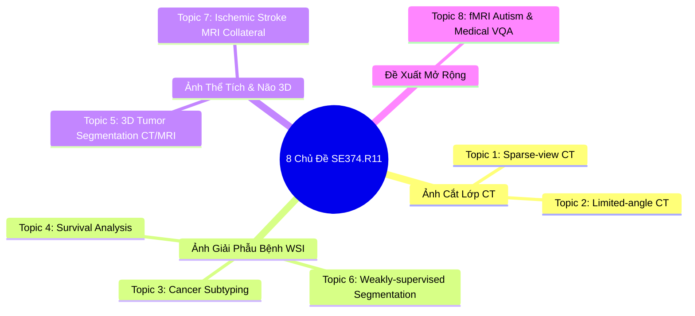

# CẨM NANG PHÂN TÍCH CHUYÊN SÂU 8 CHỦ ĐỀ ĐỒ ÁN MÔN HỌC SE374.R11
## Phát Triển Phần Mềm Xử Lý Ảnh Y Khoa (Medical Image Processing Software Development)

> **Môn học:** SE374.R11 - Phát triển phần mềm xử lý ảnh y khoa  
> **Trường:** Đại học Công nghệ Thông tin (UIT), ĐHQG-HCM  
> **Nguồn tài liệu:** [Bài giảng 01: Nhập môn Xử lý ảnh Y khoa](file:///c:/Users/Nguyen%20Trong%20Khoi/Downloads/Y_KHOA/docs/lectures/Lecture_01_Introduction_to_Medical_Image.md), `topic.md` (Giảng viên) & `SE374.R11 - Đồ án cuối kỳ.xlsx` (Danh sách đăng ký của lớp)

---

## 1. Phân Tích Thực Trạng Đăng Ký Lớp Học (Từ File Excel)

File Excel `SE374.R11 - Đồ án cuối kỳ.xlsx` ghi nhận hiện trạng đăng ký của các nhóm (quy định tối đa 4 bạn/nhóm):

| STT Nhóm | Thành Viên Đã Đăng Ký (MSSV & Họ tên) | Tên Đề Tài Đăng Ký | Thuộc Topic Số | Ghi Chú & Định Hướng |
| :---: | :--- | :--- | :---: | :--- |
| **Nhóm 1** | *(Chưa điền tên thành viên)* | **Sparse-view CT reconstruction** | **Topic 1** | Chủ đề được Giảng viên nhấn mạnh ở Buổi 2; có bài báo SOTA tháng 8/2026 (CG-GLORE). |
| **Nhóm 2** | 24520554 - Nguyễn Huy Hoàng | **Tumor segmentation using CT/MRI** | **Topic 5** | Phân vùng khối u thể tích 3D (BraTS dataset). |
| **Nhóm 3** | 24520336 - Huỳnh Đức Dũng | *Tên đề tài gì cho hay nhỉ* | *(Chưa chốt)* | Đang tìm kiếm định hướng đề tài. |
| **Nhóm 4** | *(Trống)* | *(Trống)* | - | Vị trí nhóm còn trống. |
| **Nhóm 5** | 23520922 - Hà Nhật Minh 23521267 - Nguyễn Việt Kỳ Quân | **Whole-Slide Image-Based Survival Risk Analysis Using Attention Multiple Instance Learning** | **Topic 4** | Phân tích thời gian sống sót bằng WSI giải phẫu bệnh số (TCGA cohorts). |
| **Nhóm 6** | 23521262 - Nguyễn Hồng Quân 23521214 - Phạm Hoàng Phúc | **Weakly-supervised segmentation for whole slide images** | **Topic 6** | Phân vùng bán giám sát trên WSI (LowMagWSS). |
| **Nhóm 7** | 23520707 - Phạm Tuấn Khang Phạm Hùng Nguyễn Đình Tri | **Ứng dụng hỏi đáp dành cho bác sĩ chẩn đoán hình ảnh** | **Topic 8 (Tự do)** | Hướng đề tài Medical Visual Question Answering (VQA) / Multimodal LLM. |
| **Nhóm 8** | 23520826 - Võ Tuấn Kiệt | **Ứng dụng phát hiện người mắc rối loạn phổ tự kỉ dựa trên ảnh fMRI** | **Topic 8 (Tự do)** | Sử dụng ảnh fMRI tận dụng functional connectivity của não; dataset ABIDE I; xây dựng web demo. |
| **Nhóm 9** | 24520601 - Nguyễn Đại Hưng 24521489 - Dương Nguyễn Phú Quý 25520115 - Vũ Xuân Bách 25521929 - Bảo Trình | **Limited-angle CT reconstruction** | **Topic 2** | Nhóm đủ 4 bạn; bài toán tái tạo CT góc hạn chế. |

---

## 2. Bóc Tách Chi Tiết Toàn Bộ 8 Chủ Đề Nghiên Cứu

---

### Topic 1: Sparse-view CT Reconstruction (Trọng Tâm Buổi 2)

- **Động lực Y khoa:** Giảm liều tia X chiếu vào cơ thể bệnh nhân khi chụp CT bằng cách giảm số góc chiếu đầu thu (ví dụ: chỉ chụp 32, 64 hoặc 128 góc thay vì 720 góc tiêu chuẩn).
- **Thách thức kỹ thuật:** Bài toán nghịch đảo (inverse problem) thiếu điều kiện nghiêm trọng (severely ill-posed). Thuật toán kinh điển FBP (Filtered Back Projection) sẽ tạo ra các vệt nhiễu sọc (streak artifacts) che khuất tổn thương giải phẫu.
- **Tài liệu Giảng viên cung cấp:**
  1. *Machine Vision and Applications (MVAP 2026):* [Link Springer](https://link.springer.com/epdf/10.1007/s00138-026-01901-1)
  2. *arXiv:2608.15246 (Tháng 8/2026):* **CG-GLORE: A Conjugate Gradient-Based Global-Local Regularization Network for Sparse-View CT Reconstruction**.
     - Điểm đột phá: Khung deep unrolling lấy cảm hứng từ tối ưu hóa bậc hai (second-order Hessian surrogate) kết hợp mạng điều chuẩn Global-Local dùng Nyström attention và CNN.
- **Bộ dữ liệu tiêu chuẩn:** AAPM Low-Dose CT Grand Challenge (Mayo Clinic), DeepLesion.
- **Chỉ số đánh giá:** PSNR (Peak Signal-to-Noise Ratio $\ge 35$ dB), SSIM ($\ge 0.95$), NRMSE.
- **Yêu cầu tài nguyên:** GPU 8GB - 16GB VRAM (khả thi thực hiện trên 2D slices hoặc 2.5D).

---

### Topic 2: Limited-angle CT Reconstruction

- **Động lực Y khoa:** Trong một số hệ thống chẩn đoán đặc biệt (như chụp CT răng hàm mặt C-arm, CT tại giường cấp cứu, hoặc chụp X-quang tuyến vú Tomosynthesis), đầu thu chỉ có thể quay trong một dải góc giới hạn (ví dụ: quét trong khoảng $\pm 60^\circ$ thay vì $360^\circ$).
- **Thách thức kỹ thuật:** Dữ liệu bị thiếu nguyên một vùng quạt (missing wedge artifact). Lỗi hình học kéo dài làm mờ ranh giới cấu trúc giải phẫu theo phương góc thiếu.
- **Phương pháp tiếp cận:**
  1. Phục hồi trong miền Sinogram (Sinogram inpainting bằng CNN / Diffusion).
  2. Mạng miền kép (Dual-domain networks: kết hợp đồng thời miền Sinogram và miền Ảnh).
- **Bộ dữ liệu:** LoDoPaB-CT, AAPM CT.

---

### Topic 3: Cancer Subtyping Using Whole Slide Images (WSI)

- **Động lực Y khoa:** Phân loại chính xác các phân nhóm mô bệnh học của ung thư (ví dụ: ung thư vú thể ống xâm lấn IDC vs thể tiểu thùy ILC; ung thư phổi LUAD vs LUSC) để bác sĩ quyết định phác đồ hóa trị / đích.
- **Thách thức kỹ thuật:** Mỗi tiêu bản giải phẫu bệnh có kích thước siêu lớn (gigapixel, $100,000 \times 100,000$ pixels). Nhãn chỉ có ở cấp độ slide (slide-level label), không có khoanh vùng vi thể của bác sĩ.
- **Tài liệu Giảng viên cung cấp:**
  - *arXiv:2607.12556 (Tháng 7/2026):* **CGRL: Concept-Guided Pruning and Representation Learning for Whole-Slide Image Classification**.
    - Cơ chế: Đưa các concept ngữ nghĩa bệnh học vào để tỉa bớt các patch không mang thông tin bệnh lý (top-K selection) và học biểu diễn tương phản.
- **Bộ dữ liệu:** TCGA-BRCA, TCGA-NSCLC (The Cancer Genome Atlas).
- **Chỉ số:** Balanced Accuracy, Macro-F1, AUC-ROC.

---

### Topic 4: Survival Analysis Using Whole Slide Images (WSI)

- **Động lực Y khoa:** Dự đoán tiên lượng sống (thời gian sống sót không bệnh hoặc thời gian sống thêm toàn bộ - Overall Survival) giúp cá nhân hóa điều trị ung thư.
- **Thách thức kỹ thuật:** Dữ liệu kiểm duyệt (censored data - bệnh nhân ngừng theo dõi hoặc còn sống tại thời điểm kết thúc nghiên cứu) và tính không đồng nhất giữa các nhóm ung thư.
- **Tài liệu Giảng viên cung cấp:**
  - *arXiv:2607.04747 (Tháng 7/2026):* **MergeSurv: Merging-Based Continual Learning for Survival Analysis on Whole-Slide Images**.
    - Cơ chế: Fine-tune tuần tự trên từng nhóm ung thư rồi hợp nhất tham số (model merging) không làm suy giảm trí nhớ bệnh học cũ (anti-catastrophic forgetting).
- **Bộ dữ liệu:** TCGA (BLCA, LUAD, KIRC, GBM/LGG).
- **Chỉ số:** C-Index (Concordance Index $\ge 0.65-0.75$), Brier Score.

---

### Topic 5: Tumor Segmentation Using CT / fMRI (hoặc MRI)

- **Động lực Y khoa:** Tự động khoanh vùng chính xác ranh giới khối u não, u gan hoặc u thận để hỗ trợ lập kế hoạch xạ trị và phẫu thuật.
- **Thách thức kỹ thuật:** Khối u có ranh giới thâm nhiễm phức tạp, kích thước thay đổi lớn, mất cân bằng nhãn nghiêm trọng giữa voxel u và voxel mô não lành.
- **Tài liệu Giảng viên cung cấp:**
  - *arXiv:1804.10484:* 3D Brain Tumor Segmentation using Deep Learning.
  - *GitHub Repository:* `DBC-Lab/Brain_MRI_Enhancement`.
- **Mô hình SOTA:** MONAI Swin-UNETR, DynUNet, nnU-Net, 3D U-Net.
- **Bộ dữ liệu:** BraTS 2021 / BraTS 2023 (Brain Tumor Segmentation Challenge), LiTS (Liver Tumor).
- **Chỉ số:** Dice Similarity Coefficient (DSC $\ge 0.85-0.90$), HD95 (Hausdorff Distance 95%).

---

### Topic 6: Weakly-Supervised Segmentation for Whole Slide Images

- **Động lực Y khoa:** Khoanh vùng ranh giới tế bào ung thư chính xác ở mức pixel mà không cần tốn hàng ngàn giờ của bác sĩ giải phẫu bệnh để gán nhãn pixel-level.
- **Tài liệu Giảng viên cung cấp:**
  - *arXiv:2607.10783 (Tháng 7/2026):* **Toward Efficient Weakly Supervised Semantic Segmentation Using Only Low-Magnification Histopathological Images**.
  - *Mã nguồn chính thức:* [GitHub Dung-Dx/LowMagWSS](https://github.com/Dung-Dx/LowMagWSS).
- **Bộ dữ liệu:** Camelyon16, BCSS.
- **Chỉ số:** mIoU, Dice Score.

---

### Topic 7: Collateral Imaging in Acute Ischemic Stroke Using MRI

- **Động lực Y khoa:** Đánh giá tuần hoàn bàng hệ (hệ thống mạch máu cứu nguy khi mạch máu chính bị tắc) trong đột quỵ thiếu máu não cấp. Đây là yếu tố sống còn để quyết định xem bệnh nhân còn cơ hội can thiệp lấy huyết khối (thrombectomy) hay không.
- **Tài liệu Giảng viên cung cấp:**
  - *Springer International Journal of Computer Assisted Radiology and Surgery (IJCARS):* [10.1007/s11548-024-03229-5](https://link.springer.com/content/pdf/10.1007/s11548-024-03229-5.pdf).
- **Bộ dữ liệu:** ISLES 2022 (Ischemic Stroke Lesion Segmentation Challenge), chuỗi xung DWI, PWI, FLAIR.
- **Chỉ số:** Lượng hóa thể tích lõi nhồi máu ($cm^3$), chỉ số tuần hoàn bàng hệ.

---

### Topic 8: Tự Do Đề Xuất (Nhóm 7 & Nhóm 8 Đã Đăng Ký)

1. **Hướng 1: Nhóm 8 - Ứng Dụng Phát Hiện Phổ Tự Kỷ (ASD) Dựa Trên Ảnh fMRI (ABIDE I)**
   - Khai thác chuỗi thời gian hoạt động chức năng của các vùng não (ROIs) để xây dựng ma trận tương quan kết nối chức năng (Functional Connectivity Matrix).
   - Áp dụng Graph Neural Networks (BrainGNN, GCN) hoặc CNN 1D/2D để phân loại người mắc rối loạn phổ tự kỷ với độ chính xác cao.
2. **Hướng 2: Nhóm 7 - Ứng Dụng Hỏi Đáp Dành Cho Bác Sĩ Chẩn Đoán Hình Ảnh (Medical VQA / Radiology AI Assistant)**
   - Xây dựng hệ thống tiếp nhận ảnh y tế (X-ray, CT, MRI) kèm câu hỏi lâm sàng của bác sĩ và sinh câu trả lời đối chiếu giải phẫu.

---

## 3. Khuyến Nghị Chọn Đề Tài & Lộ Trình Triển Khai Cho Nhóm

Nếu nhóm của bạn chưa chốt đề tài, đây là các gợi ý tối ưu nhất:
- **Lựa chọn 1 (Khuyên dùng mạnh mẽ nhất - Trọng tâm của lớp): Topic 1: Sparse-view CT Reconstruction.**
  - *Lý do:* Giảng viên đã dành riêng Buổi 2 để giảng sâu về chủ đề này. Đã có sẵn 2 paper uy tín (đặc biệt CG-GLORE vừa công bố tháng 8/2026). Dễ thực nghiệm trên dữ liệu AAPM CT có sẵn. Đồ án sẽ nhận được sự quan tâm và đánh giá rất cao từ Giảng viên.
- **Lựa chọn 2: Topic 5: Tumor Segmentation (BraTS).**
  - *Lý do:* Thư viện MONAI hỗ trợ tận răng (có sẵn tutorial và pretrained weights Swin-UNETR). Dễ xây dựng Web Demo tương tác cắt lát 3D trực quan.
- **Lựa chọn 3: Tiếp tục phát triển theo đề tài nhóm đã đăng ký trong file Excel.**
