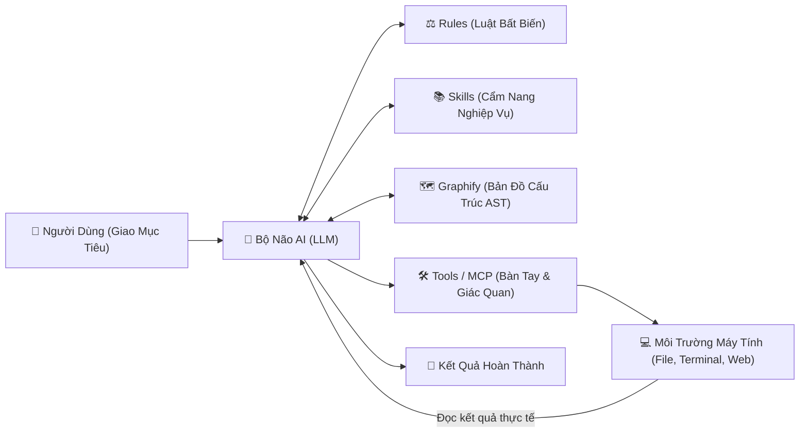
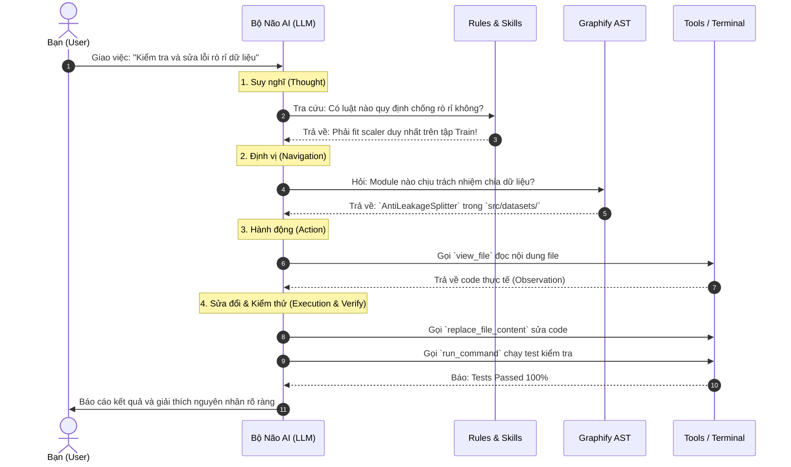

# CƠ CHẾ HOẠT ĐỘNG CỦA HỆ THỐNG AI AGENT
## Bản Chất Kỹ Thuật: Cách AI Sử Dụng Agent, Rules, Skills, MCP Tools & Graphify

---

### 1. Khác Biệt Giữa "Chatbot Thụ Động" và "AI Agent Tự Trị"

Một mô hình ngôn ngữ lớn (LLM) thông thường chỉ tiếp nhận văn bản và sinh ra văn bản tiếp theo (Hỏi - Đáp đơn thuần). Khi được phát triển thành **AI Agent**, mô hình được trang bị một hệ sinh thái hoàn chỉnh gồm:
* **Bộ não (Brain / LLM):** Suy luận, phân tích logic và lập kế hoạch.
* **Quy tắc ứng xử (Rules):** Định hình tính cách, phạm vi đạo đức và các chốt chặn an toàn bất biến.
* **Cẩm nang nghiệp vụ (Skills):** Hướng dẫn quy trình từng bước, chỉ nạp vào bộ nhớ khi cần dùng (Just-In-Time Loading).
* **Bàn tay & Giác quan (Tools & MCPs):** Thực thi lệnh terminal, đọc/ghi file, lướt web, kiểm soát Git.
* **Bản đồ nhận thức không gian (Graphify AST):** Đồ thị tri thức giúp AI nắm bắt toàn bộ kiến trúc code mà không bị tràn bộ nhớ Context Window.

---

### 2. Chi Tiết 5 Thành Phần Cốt Lõi

#### 1. Bộ Não AI (Agent Core / LLM)
* Là mô hình nền tảng (Gemini, Claude, GPT).
* Chịu trách nhiệm tư duy logic, chia nhỏ yêu cầu của người dùng thành các bài toán con và quyết định xem bước tiếp theo cần dùng công cụ gì.

#### 2. Luật Quản Trị (Rules)
* **Vị trí:** Được găm cố định vào **System Prompt** trong mọi lượt tương tác (như `AGENTS.md` hoặc `.cursorrules`).
* **Vai trò:** Ngăn chặn AI hành xử bừa bãi. Ví dụ:
  * Không được tự ý bịa đặt số liệu (Zero Mockup).
  * Phải hỏi ý kiến người dùng trước khi chạy các lệnh tốn tiền hoặc tốn nhiều giờ.
  * Phải chạy qua `cmd /c` trên môi trường Windows.

#### 3. Cẩm Nang Kỹ Năng (Skills)
* **Vị trí:** Lưu trữ trong thư mục `skills/` (mỗi kỹ năng có file `SKILL.md`).
* **Cơ chế nạp:** AI **không đọc hết toàn bộ kỹ năng ngay từ đầu** (vì sẽ làm nghẽn Context Window). Khi gặp bài toán liên quan (ví dụ: vẽ đồ thị, viết báo cáo Springer, phân chia chống rò rỉ), AI mới mở file `SKILL.md` tương ứng để học quy trình chuẩn và làm theo.

#### 4. Đôi Tay & Giác Quan (Tools & MCP Servers)
* **Tools gốc:** Các hàm hệ thống như `run_command` (chạy shell), `view_file` (đọc file), `replace_file_content` (sửa code).
* **MCP (Model Context Protocol):** Giao thức mở rộng kết nối AI với các máy chủ bên ngoài:
  * `firecrawl`: Tìm kiếm và cào tài liệu từ web, arXiv, GitHub.
  * `repomix`: Tải và đóng gói code từ xa để học kiến trúc.
  * `context7`: Tra cứu tài liệu API chính xác của thư viện.
  * `github`: Tạo branch, commit, tạo pull request.

#### 5. Bản Đồ Nhận Thức (Graphify AST Knowledge Graph)
* **Bài toán:** Dự án có hàng trăm file code. Context window của AI có giới hạn (token limit). Nếu đọc hết code, AI sẽ bị "ngộ độc thông tin", tốn chi phí và sinh ảo giác (*hallucination*).
* **Giải pháp của Graphify:** Quét cây cú pháp trừu tượng (AST) của toàn bộ dự án để dựng thành một **Đồ thị tri thức (Graph)**:
  * Xác định các **"God-Nodes"** (những file/class quan trọng nhất có nhiều liên kết).
  * Biết chính xác hàm nào gọi hàm nào, class nào kế thừa class nào.
  * Nhờ vậy, khi bạn bảo sửa một lỗi, AI chỉ cần tra Graphify là biết chính xác cần mở đúng 1 - 2 file nào để sửa, không cần đọc bừa bãi toàn bộ thư mục.

---

### 3. Vòng Lặp Tư Duy ReAct (Reasoning - Action - Observation)

Khi bạn giao một việc, AI Agent vận hành theo chu trình lặp:

---
The above content does NOT show the entire file contents. If you need to view any lines of the file which were not shown to complete your task, call this tool again to view those lines.