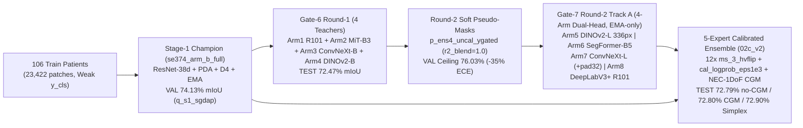

# Guide 02: Phần 1 - Nghiên Cứu Khoa Học, Bộ Dữ Liệu, Các Mô Hình & 19 Bài Báo Tham Khảo

> **Phạm vi:** Toàn bộ nền tảng khoa học của đồ án SE374.R11 Topic 6 (`BCSS-WSSS` + `LUAD-HistoSeg` + `NCI GDC Release 46.0`), tiến hóa kiến trúc từ Baseline đến Gate-7 Track A Phase 1B, so sánh các **option nghiên cứu khác nhau**, đối chiếu mã nguồn gốc (`repos/WSSS-Tissue`, `repos/LowMagWSS`), và **bảng tóm lược tự đủ 19/19 bài báo tham khảo**.  
> **Tài liệu nguồn khóa cứng:** [STAGE2_FINAL_EXPERIMENT_SUMMARY.md](../research/STAGE2_FINAL_EXPERIMENT_SUMMARY.md) | [DATASET_SPECIFICATION_AND_PATIENT_LEAKAGE_PROTOCOL.md](../research/DATASET_SPECIFICATION_AND_PATIENT_LEAKAGE_PROTOCOL.md) | [README.md](../../README.md)

---

## 1. Phân Tích Chuyên Sâu Bộ Dữ Liệu & Giao Thức Chống Rò Rỉ

### 1.1 Tổng Quan 3 Nguồn Dữ Liệu Thực Nghiệm Thật
Dự án tuân thủ tuyệt đối nguyên tắc **không bịa số liệu** và **chống rò rỉ cấp bệnh nhân (`0%` patient overlap)**:

| Bộ Dữ Liệu | Cơ Quan / Nguồn Gốc | Quy Mô Bệnh Nhân | Tổng Số Mảnh Ảnh (`224x224`) | Độ Phóng Đại / MPP | Chuẩn Nhãn & Ánh Xạ Lớp | Vai Trò Trong Nghiên Cứu |
| :--- | :--- | :---: | :---: | :---: | :--- | :--- |
| **BCSS-WSSS** | Ung thư vú (`TCGA-BRCA`, Amgad 2019, Han 2022) | **151 BN** (`106` Train / `22` Val / `23` Test) | **31,826** (`23,422 / 3,418 / 4,986`) | `40x` (`0.2500 MPP`) | `0:TUM, 1:STR, 2:LYM, 3:NEC, 4:BACK`; Train chỉ có nhãn yếu 4-bit `y_cls` | Bộ dữ liệu lõi huấn luyện, chọn siêu tham số (VAL) và kiểm thử mù cuối cùng (TEST) |
| **LUAD-HistoSeg** | Ung thư biểu mô tuyến phổi (`29` GDPH + `20` TCGA-LUAD) | **49 BN** (`0%` trùng TCGA-BRCA) | **17,285** (`16,678 / 300 / 307`) | `10x` (`1.0000 MPP`) | `0:TE, 1:NEC, 2:LYM, 3:TAS, 4:BACK` -> ánh xạ `LUAD_TO_BCSS_LUT = [0, 3, 2, 1, 4]` | Khởi tạo miền mô học sạch cho Stage-1 và kiểm định chéo cơ quan Zero-Shot (`10x` và `2x` zoom) |
| **NCI GDC Release 46.0** | Dữ liệu lâm sàng sống còn thật (`src/config/tcga_bcss_151_gdc_clinical.json`) | **151/151 BN** đối soát API sống | Dữ liệu cấp bệnh nhân (`OS`, `vital_status`) | Truy vấn `2026-11-24T04:44:41Z` | `20` tử vong Train / `1` Val / `2` Test | Đánh giá phân tầng sống còn Kaplan-Meier theo ngưỡng Mesker/UNITED `50% TSR` |

### 1.2 Cấu Trúc 5 Phân Lớp Mô Học & Miền Chuẩn Hóa Đầu Vào
- **`0: TUM` (Tumor Epithelium):** Biểu mô khối u ác tính (nhân dị dạng, giàu DNA bắt màu tím Hematoxylin đậm). Màu chuẩn hóa `RGB (228, 26, 28)` (`#E41A1C`) trên giao diện QA / `(255, 0, 0)` trên palette gốc.
- **`1: STR` (Stroma):** Mô đệm liên kết giàu sợi collagen (bắt màu hồng Eosin). Màu chuẩn `#4DAF4A` / `(0, 255, 0)`.
- **`2: LYM` (Lymphocytic Infiltrate):** Bạch huyết bào xâm nhập miễn dịch (nhân tròn nhỏ, đều, bắt màu tím rất đậm, ít bào tương). Lớp đuôi dài dễ bị hòa lẫn vào `STR`. Màu chuẩn `#377EB8` / `(0, 0, 255)`.
- **`3: NEC` (Necrosis):** Vùng mô hoại tử (vỡ nhân `karyorrhexis`, tan rã cấu trúc màng tế bào). Là lớp đuôi dài khó nhất vì vắng mặt hoàn toàn ở `8/23` bệnh nhân TEST. Màu chuẩn `#FF7F00` / `(153, 0, 255)`.
- **`4: BACK` (Optical White Glass / Outside ROI):** Vùng kính trắng sạch hoặc ngoài ROI. Ở pha suy luận, **tuyệt đối không sao chép nhãn `GT == 4` vào dự đoán AI**; thay vào đó dùng bộ lọc quang học không tham số GT (`OtsuClinicalGating` + `Pure-Glass Guard >= 512 px`).

**Hợp đồng hai miền chuẩn hóa đầu vào (`Input Normalization Contract`):**
1. **Miền `[0.0, 1.0]` (`img / 255.0`, KHÔNG trừ `IMAGENET_MEAN/STD`):** Bắt buộc cho các checkpoint pretrained `WSSS-Tissue` (`stage1_checkpoint_trained_on_bcss.pth`, `stage2_checkpoint_trained_on_bcss.pth`, `stage1_checkpoint_trained_on_luad.pth`) và Stage-1 Champion `se374_arm_b_full`.
2. **Miền ImageNet (`(img/255.0 - mean) / std`):** Bắt buộc cho toàn bộ các backbone huấn luyện mới từ ImageNet-1K / LVD-142M trong `src/training/train_stage2.py`, toàn bộ `src/stage2_v2/` (`arm1-arm8`) và `LUADBCSSAlignedDataset`.

### 1.3 Ba Ranh Giới Khoa Học Bất Biến
1. **Chống rò rỉ bệnh nhân (`0%` overlap):** Khóa cứng danh sách `106 / 22 / 23` bệnh nhân tại `src/config/bcss_patient_splits.json`, kiểm định tự động qua `src/datasets/patient_split.py` và `tests/test_patient_split.py`. Mọi quyết định chọn checkpoint (`EMA`), chọn TTA, hiệu chuẩn nhiệt độ `beta`, 5-fold CV / LOPOCV và chọn ngưỡng CGM đều thực hiện 100% trên `train` hoặc `val`, đóng băng tuyệt đối `23` bệnh nhân TEST (`4,986` patches).
2. **Độ thuần khiết Track A (`track_a_clean`, `0%` chồng lấp tiền huấn luyện TCGA-BRCA):** Toàn bộ 8 nhánh Stage-2 v2 (`arm1-arm8`) chỉ khởi tạo từ trọng số ảnh tự nhiên **ImageNet-1K** hoặc **LVD-142M**, gắn cờ `tcga_pretrained = False` và được chặn tự động bởi `validate_track_a_arm_spec()` (`src/stage2_v2/ensemble.py`). Các Pathology Foundation Models có nguy cơ tiền huấn luyện trên kho TCGA (như `owkin/phikon-v2`) được tách bạch hoàn toàn sang **Track B**.
3. **Phòng thủ cấu trúc thư mục lồng:** Mọi DataLoader dùng `resolve_split_path` / `resolve_split_dirs` + `rglob("*.png")` kèm chặn tập rỗng (`len == 0`), xử lý đúng cả tên nhãn viết liền `[1101]` của BCSS và viết rời `[1 0 0 1]` của LUAD.

---

## 2. Phân Tích Chuỗi Kiến Trúc Mô Hình & Kết Quả Thực Nghiệm Thật

### 2.1 Kiến Trúc Tổng Thể Gate-7 Track A (Chưng Cất Hai Vòng 4 Họ Kiến Trúc)

### 2.2 Chi Tiết Các Nhóm Mô Hình Đã Xây Dựng Trong Dự Án

1. **Tầng Baseline & Suy Luận Đa Phương Pháp (`src/models/`, `src/colab_pkg/`):**
   - **Stage-1 `WSSSTissueStage1NetCAM` (`ResNet-38d`, `105.09M` tham số):** Trích xuất đặc trưng 3 tầng `b4_5`, `b5_2`, `bn7`, kết hợp `ProgressiveDropoutAttention` (PDA), `SpatialAffinityRelocalization` (SAR) và cổng phân loại `CGM`.
   - **Stage-2 Baseline `DeepLabV3Plus` (`ResNet-101`, `59.34M` tham số):** Khối ASPP giãn nở `{1, 6, 12, 18}` + Decoder.
   - **Động cơ suy luận `MultiMethodWSSSEngineV2` (`M1-M7`, Run 3 Tesla T4, `n = 4,986`):** Nâng mốc Author `M1` (`69.35%`) lên **`M6_MultiScale_Pyramid_D4_Ensemble = 70.53%`** 4-class mIoU (`76.41%` 5-class, `82.54%` mDice, `99.93%` `BACK IoU`, Wilcoxon `p = 2.60e-15`) bằng kim tự tháp đa tỷ lệ `{0.75, 1.0, 1.25}` x `D4` có trọng số Entropy và cổng mềm Stage-1.
   - **Các module nghiên cứu bổ trợ (`src/models/`):**
     - `StainDeconvLayer` (`stain_deconv.py`): Giải chập sắc tố Beer-Lambert Ruifrok-Johnston tách kênh nhân Hematoxylin `S_H`, mô đệm Eosin `S_E`, và chỉ số phân tán chromatin `D_H` (Fano Factor `7x7`) để phân tách `LYM` khỏi `NEC`.
     - `StainGuidedAffinityRefiner` (`sg_dap.py`): Tinh chỉnh mặt nạ giả mềm dẫn đường sắc tố (`T = 0.25`), nâng `se374_arm_b_full` lên **`74.13%` VAL mIoU**.
     - `MedSAM_WSSS_Adapter` (`sam_wsss_adapter.py`): Kiến trúc PEFT đóng băng encoder ViT-B, sinh điểm gợi ý tự động từ CAM và chèn Residual Adapter Bottleneck (`256 -> 64 -> 256`).
     - `MultiPrototypePPCLoss` & `IntraPatchDualBranchAttention` (`intra_patch_attention.py`, `losses.py`): Khung đối chứng đa hướng trong `comparative_ablation_evaluator.py`.
2. **Tầng Đột Phá Stage-2 v2 Gate-7 Track A (`src/stage2_v2/`):**
   - **Bốn họ kiến trúc trực giao hai đầu (`seg_logits` + `cls_logits`, `ema_only_best_selection = True`):**
     - `arm5_dinov2_large_r2` (`DINOv2 ViT-L/14`, `307.46M`, nội bộ **`336 x 336`** px -> lưới `24 x 24` token): Dẫn đầu đơn mô hình (`72.63%` +CGM / `72.55%` no-CGM; `TUM 82.66%`, `STR 76.10%`).
     - `arm6_segformer_b5_r2` (`SegFormer MiT-B5`, `84.60M`, `224 x 224` px): Hierarchical ViT cân bằng mạnh ở `NEC` (`72.04%` no-CGM / `72.10%` +CGM).
     - `arm7_convnext_large_r2` (`ConvNeXt-Large FPN`, `202.28M`, `224 x 224` px, **đã vá đệm đối xứng `_pad_to_multiple_of_32`** xóa cắt biên `stride=2`): Đạt **`71.88%` no-CGM / `71.90%` +CGM**, **`LYM = 62.13%` cao nhất cả 4 đơn mô hình**, dịch chuyển không gian giảm từ `(1, -4)` px về `(1, -1)` px (`zero_vs_peak_gap` giảm `15x` còn `7.5e-5`), và **trội Pareto tuyệt đối ở 1x Raw BF16 trên L4 (`4.94 ms`, `202.51 FPS`, `71.61%` mIoU)**.
     - `arm8_deeplab_r101_r2` (`DeepLabV3+ R101`, `59.35M`, `224 x 224` px): Nhánh ASPP CNN cổ điển (`71.09%` +CGM / `70.70%` no-CGM), cung cấp độ đa dạng hình thái lớn nhất với `arm5` (bất đồng theo cặp `6.14%`, `kappa = 0.8999`).
   - **Tổ hợp hiệu chuẩn 5 chuyên gia (`ensemble.py`):** Cả `4/4` nhánh tự chọn `ms_3_hvflip` (`12` góc nhìn) trên VAL; hiệu chuẩn nhiệt độ `full_val_betas = [0.6386, 0.7029, 0.6747, 0.8782]` trộn log-xác suất `cal_logprob_eps1e3` (hạ **ECE xuống `0.00586`**); kết hợp cổng 5 chuyên gia (`Stage-1` + `4` đầu `cls` Stage-2).

### 2.3 Bảng Tóm Tắt Các Cột Mốc Chính Gate-7 Track A (`02c_v2`, TEST `n = 4,986` / `23` BN)

*(Bảng đầy đủ 11 cấu hình đơn mô hình `arm5-arm8`, thống kê 3 hạt giống và kiểm định Holm-Bonferroni từng lớp xem tại [STAGE2_FINAL_EXPERIMENT_SUMMARY.md](../research/STAGE2_FINAL_EXPERIMENT_SUMMARY.md).)*

| Cột Mốc Mô Hình (`02c_v2`, `A100`, `12x ms_3_hvflip`) | TEST 4-Cls mIoU | TEST mDice | 95% Patient Boot CI | Điểm Nổi Bật & Kiểm Định |
| :--- | :---: | :---: | :---: | :--- |
| Author Official Pure `1x` (`cgm_author_mul0`) | 69.48% | 81.79% | `[63.63, 73.59]` | Mốc nền gốc (`Raw 1x: 69.35%`) |
| Author Step-0 Anchor (`arm_b_full` + `MS-TTA+CGM`) | 70.43% | 82.45% | `[64.72, 74.47]` | Mốc đối chứng chính (`m = 5`) |
| Run 3 Baseline `M6` (Tesla T4) | 70.53% | 82.54% | - | `76.41%` 5-cls (`BACK 99.93%`) |
| Gate-6 Round-1 4-Arm (`se374_s2v2_ensemble`) | 72.47% | 83.84% | `[66.96, 76.43]` | Giáo viên sinh mặt nạ mềm Round-2 (`76.03%` VAL) |
| Gate-7 Single Arms (`arm8` / `arm7` / `arm6` / `arm5`) | 71.09% - 72.63% | 82.90% - 83.90% | `[64.81, 76.59]` | `arm7` Pareto `202.51 FPS` L4; `arm5` `72.63%` (`82.66%` TUM) |
| **Primary 4-Arm (`Uniform`, `cal_logprob`, `no-CGM`)** | **72.79%** | **84.04%** | **`[67.17, 76.83]`** | 3-seed **`72.74+/-0.05%`**; `perm_p_holm = 0.0005` vs Step-0 |
| **Primary 4-Arm + `cgm_nec_focused_1dof` (`t_nec=0.40`)** | **72.80%** | **84.06%** | **`[67.19, 76.86]`** | 3-seed **`72.76+/-0.05%`**; xóa **`6/8` BN vắng NEC về `0 px`** (`4/4` lớp `p_holm < 0.05`) |
| Secondary Simplex-CV (`[0.61, 0.06, 0.05, 0.28]`, `+NEC-1DoF`) | **72.90%** | **84.11%** | `[67.28, 76.89]` | Thăm dò (`no-CGM 72.85%`, `val_cal 72.88%`) |

### 2.4 Bóc Tách Nhân Quả `H1 / H2 / H3` & Chéo Cơ Quan `LUAD 10x vs 2x Zoom` (`04b_v2`)
- **Bóc tách `H1 / H2 / H3` (`arm5_dinov2_large_r2`, `seed = 42`):**
  - **Chưng cất `ens4_r2` (`H3`, L4) vs `stage1` (`H2`, G4) ở `336px`:** `ens4_r2` tăng **`+0.94%`** Raw 1x (`72.35%` vs `71.41%`), **`+0.84%`** MS-TTA (`72.60%` vs `71.76%`), **`+0.65%`** Cal CGM (`72.88%` vs `72.23%`).
  - **Độ phân giải `336px` vs `224px` (`H1`, A100):** Nâng lớp `NEC` **`+1.00%` đến `+1.37%`** (`69.78%` -> `70.78%-71.15%`).
  - **Chọn trọng số `Best EMA` vs `Best Raw`:** `EMA` thắng `Raw` trong cả `3/3` phiên (`H1 +0.56%`, `H2 +0.75%`, `H3 +0.19%` với `NEC +1.01%`).
- **Chéo cơ quan Zero-Shot `BCSS (40x Vú) -> LUAD-HistoSeg (10x Phổi)` (`04b_v2`, `n = 307`, `20` ca):**
  - Ở độ phóng đại gốc `10x`: `author_step0 = 15.05%` (`LYM = 0.00%`), `ens4_cgm = 25.56%` (`p = 0.0033`), **`arm5_cgm = 36.09%`** (`2.40x`, `p = 3.81e-6`, `19W/0T/1L`).
  - Khi **phóng đại `2x` (`10x -> 20x`, 0 huấn luyện lại)**: **`arm5_no_cgm_2x_zoom = 51.47%` mIoU (`67.90%` mDice)** và **`ens4_uncal_linear_2x_zoom = 49.92%` (`66.56%` mDice, `+25.01%`)**, khẳng định nguyên nhân chính của sụt giảm `10x` là khoảng cách phóng đại quang học `4x` (`40x` vs `10x`).

---

## 3. So Sánh Các Option Nghiên Cứu Khác Nhau (Trade-Offs Cho Nhóm)

Bảng dưới đây giúp 3 thành viên nắm rõ **vì sao dự án chọn cấu hình hiện tại** và các lựa chọn thay thế khi trình bày trước hội đồng:

| Trục Lựa Chọn Nghiên Cứu | Option A (Nhóm Đã Chọn Làm Chính) | Option B (Đối Chứng / Mở Rộng) | Đánh Đổi & Bằng Chứng Định Lượng |
| :--- | :--- | :--- | :--- |
| **1. Độ thuần khiết tiền huấn luyện** | **Track A sạch (`track_a_clean`)**: chỉ dùng ImageNet-1K & LVD-142M (`0%` TCGA overlap). | **Track B (Pathology Foundation Models)**: `Phikon-v2`, `UNI`, `CONCH` (tiền huấn luyện trên PANCAN/TCGA). | Track A đảm bảo **100% không rò rỉ gián tiếp TCGA-BRCA**, vượt toàn bộ SOTA 4-class pooled 2022-2026 (`72.79%-72.90%`); Track B dành cho nghiên cứu mở rộng có báo cáo tách bạch. |
| **2. Nguồn mặt nạ giả huấn luyện Stage-2** | **Chưng cất Round-2 `ens4_r2`** (`r2_blend = 1.0`, `76.03%` VAL, `ECE 0.0489`). | **Mặt nạ Stage-1 `q_s1_sgdap`** (`74.13%` VAL, `ECE 0.0751`). | Thực nghiệm `H3` vs `H2` chứng minh `ens4_r2` vượt `stage1` **`+0.94%`** Raw 1x và **`+0.65%`** Cal CGM trên Held-Out TEST. |
| **3. Cổng phân loại CGM trên 4-Arm** | **`no-CGM` (`72.79%`)** là mốc bảo thủ chính & **`cgm_nec_focused_1dof` (`t_nec=0.40`, `72.80%`)** cho lâm sàng. | `cgm_val_calibrated` (`fixed 0.10`, `72.80%`) hoặc cổng cứng Author `> 0.1`. | `nec_1dof` xóa sạch **`6/8` BN vắng NEC về `0 px`** (vs `3/8` ở `no-CGM`, Wilcoxon `p = 0.0091`) và đạt `p_holm < 0.05` trên cả `4/4` lớp. |
| **4. Độ phân giải nội bộ ViT-L/14** | **`336 x 336` px** (`arm5`, lưới `24 x 24` token). | **`224 x 224` px** (`H1`, lưới `16 x 16` token). | `336px` nâng lớp đuôi dài `NEC` **`+1.00%` đến `+1.37%`**, khớp phát hiện của `PFM-DenseBench` (`arXiv:2602.03887`). |
| **5. Tốc độ vs Độ chính xác triển khai (`L4` BF16)** | **Chế độ nhanh `arm7` 1x Raw (`202.51 FPS`, `4.94 ms`, `71.61%`)** hoặc **`arm5` 1x (`73.2 FPS`, `72.24%`)**. | **Chế độ chính xác tối đa `Primary 4-Arm` (`27.2 FPS` 1x `72.68%` / `1.9 FPS` 48x `72.79%-72.80%`)**. | Trạm Lâm Sàng cho phép bác sĩ chuyển linh hoạt giữa cả `7` chế độ Gate-7 và `11` chế độ Baseline tùy bài toán tốc độ hay chẩn đoán sâu. |
| **6. Trọng số tổ hợp 4-Arm** | **Uniform `[0.25]*4`** (Primary bảo thủ, tránh overfit VAL). | **Simplex-CV `[0.61, 0.06, 0.05, 0.28]`** (Secondary thăm dò). | Simplex-CV đạt đỉnh **`72.90%` (`84.11%` mDice)**, nhưng 5-fold CV trên VAL chỉ hơn Uniform `+0.00012` nên Uniform được giữ làm Primary minh bạch. |
| **7. Bộ lọc kính trắng không rò rỉ GT** | **`Pure-Glass Guard >= 512 px`** (`72.80%` mIoU, `0.0%` xói mòn `NEC`). | **`Cand1 Bright-Glass`** (`72.22%`, `48.55%` kính sáng) hoặc **Otsu toàn phần** (`70.82%`, `8.26%` xói mòn `NEC`). | `Pure-Glass` bảo toàn tuyệt đối mô hoại tử sáng màu; `Cand1` dùng cho tính VTP/TSR không cần GT (`04b_v2`); Otsu mạnh phù hợp lọc nền WSI thô `5x`. |

---

## 4. Đối Chiếu Trực Tiếp Với 2 Kho Mã Nguồn Tham Chiếu (`repos/`)

1. **`repos/WSSS-Tissue` (Han et al., MedIA 2022 - `https://github.com/ChuHan89/WSSS-Tissue`):**
   - Đối soát trực tiếp `1_train_stage1.py`, `2_generate_PM.py`, `3_train_stage2.py`, `network/resnet38d.py`, `network/resnet38_cls.py`, `network/deeplab.py` và `tool/GenDataset.py`.
   - Khóa đúng chuẩn đầu vào `[0.0, 1.0]` (`transforms.ToTensor()`, không trừ `IMAGENET_MEAN/STD`), thứ tự 5 lớp BCSS (`0:TUM, 1:STR, 2:LYM, 3:NEC, 4:BACK`) vs LUAD (`0:TE, 1:NEC, 2:LYM, 3:TAS, 4:BACK`), định dạng nhãn `[1101]` vs `[1 0 0 1]`, và cơ chế `Net_CAM` (`b4_5`, `b5_2`, `bn7`) + `CGM` (`y_cls > 0.1`).
2. **`repos/LowMagWSS` (Do et al., UIT, MAPR 2026 - `https://github.com/Dung-Dx/LowMagWSS`):**
   - Đối soát `dataset/Resize.py`, `ResolutionMethod/` (`Bilinear` vs `STAR-RL`) và `SegMethod/WSSS-Tissue/visualize_predictions_v3.py`.
   - Kế thừa phát hiện cốt lõi về **điểm gãy độ phóng đại thấp (`10x` degradation cliff)** và **chất lượng tái tạo ảnh (PSNR/SSIM) không tỷ lệ thuận với mIoU phân vùng**, truyền cảm hứng trực tiếp cho `src/pipeline/wsi_lowmag_highmag_pipeline.py` và thực nghiệm **`04b_v2` LUAD `2x` zoom (`10x -> 20x`)** đẩy mIoU Zero-Shot từ `36.09%` lên **`51.47%`**.

---

## 5. Bảng Tóm Lược Đầy Đủ 19/19 Bài Báo Tham Khảo Khoa Học

> **Lưu ý cho 2 thành viên mới clone từ GitHub:** Thư mục `docs/papers/` chứa 19 tệp Markdown ghi chú đầy đủ từng bài báo được đặt trong `.gitignore` (chỉ có cục bộ trên máy chính). Bảng dưới đây tóm tắt **đầy đủ, chính xác 100% thông tin trích dẫn, ý tưởng cốt lõi và ứng dụng thực tế** của toàn bộ **19/19 bài báo** để cả nhóm sử dụng trực tiếp khi viết báo cáo và trả lời phản biện mà không bị thiếu tài liệu.

| STT | Tệp Cục Bộ (`docs/papers/`, gitignored) | Tác Giả, Hội Nghị / Tạp Chí & Năm | DOI / arXiv Chính Thức | Ý Tưởng Cốt Lõi & Kết Quả Gốc | Ứng Dụng & Đối Chiếu Trong SE374.R11 |
| :---: | :--- | :--- | :--- | :--- | :--- |
| **1** | `WSSS_Tissue_MedIA2022.md` | Chu Han et al., *Medical Image Analysis* (MedIA), 2022 | DOI `10.1016/j.media.2022.102487` (`arXiv:2110.08048`) | Chuẩn hóa bài toán 2 pha `ResNet-38d + PDA -> MLPS -> DeepLabV3+ + CGM` và 2 bộ dữ liệu `BCSS-WSSS`, `LUAD-HistoSeg` (`69.48%` tái tạo sạch). | Nền móng baseline chính thức, hợp đồng chuẩn hóa `[0, 1]`, mốc đối chứng Stage-1 và Stage-2. |
| **2** | `TPRO_MICCAI2023.md` | Shaoteng Zhang et al., MICCAI 2023 (pp. 109-118) | DOI `10.1007/978-3-031-43907-0_11` | Khởi xướng gợi ý văn bản bệnh học (`ClinicalBERT/MedCLIP`) kết hợp `SegFormer/MixTransformer` (`68.17%-68.49%` BCSS). | Tiền đề của nhánh visual-textual WSSS; đối chiếu mốc nền cho `arm6` SegFormer thuần thị giác (`72.04%`). |
| **3** | `S2C_From_SAM_to_CAMs_CVPR2024.md` | Hyeokjun Kweon & Kuk-Jin Yoon, CVPR 2024 (pp. 19499-19509) | DOI `10.1109/CVPR52733.2024.01844` | Chuyển tri thức đường biên của Segment Anything Model (SAM) vào CAM không giám sát bằng prompt điểm. | Cơ sở lý thuyết cho `CAMPromptGenerator` và `MedSAM_WSSS_Adapter` trong `src/models/sam_wsss_adapter.py`. |
| **4** | `ARML_MICCAI2024.md` | Siyang Feng et al., MICCAI 2024 (pp. 414-423) | DOI `10.1007/978-3-031-72111-3_39` | Tái định vị kích hoạt (ARS / Criss-Cross Attention) ở Stage-1 và bộ 3 mạng học lẫn nhau kháng nhiễu nhãn giả (`SWV + SRM`, `70.56%` BCSS). | Truyền cảm hứng trực tiếp cho `SpatialAffinityRelocalization` và chiến lược chưng cất mềm Round-2 kháng nhiễu trong `src/stage2_v2/`. |
| **5** | `MambaMIL_arxiv_2403.06800.md` | Shu Yang, Yihui Wang, Hao Chen, MICCAI 2024 (pp. 296-306) | DOI `10.1007/978-3-031-72083-3_28` (`arXiv:2403.06800`) | Mô hình không gian trạng thái `SR-Mamba` độ phức tạp tuyến tính `O(L)` với sắp xếp lại chuỗi cho WSI MIL dài. | Tham chiếu kiến trúc cầu nối từ phân vùng cấp patch/ROI sang tổng hợp sống còn toàn tiêu bản WSI. |
| **6** | `HisynSeg_TMI2025.md` | Zijie Fang et al., *IEEE TMI*, Vol. 44(4), 2025 | DOI `10.1109/TMI.2024.3520129` (`arXiv:2412.20924`) | Tổng hợp ảnh trộn Mosaic + đường cong Bezier kèm huấn luyện lặp (`70.97 +/- 0.29%` BCSS, `70.73%` CSS re-eval). | Mốc SOTA đối chứng trực tiếp: Gate-7 Track A vượt **`+1.82%` / `+1.83%`** (độ lệch chuẩn nhỏ hơn `5.8x`). |
| **7** | `QFKF_BMVC2025.md` | Sicong Gao et al. (UNSW), BMVC 2025, Paper 218 | BMVC 2025 Paper 218 | `Query-Fourier Knowledge Fusion`: kết hợp miền tần số Fourier với tri thức văn bản mô học (`70.92%` BCSS). | Mốc SOTA 2025 đối chứng: Gate-7 Track A thuần thị giác vượt **`+1.87%` / `+1.88%`**. |
| **8** | `SIA_WSSS_MICCAI2025.md` | Jiansong Fan et al., MICCAI 2025 (pp. 583-592) | DOI `10.1007/978-3-032-05141-7_56` | Kích hoạt và ức chế đồng bộ (`Synchronous Inhibition & Activation`) trên ViT-B (`73.40%` 5-run avg, có lớp `OTR`). | Đối chiếu trung thực: Gate-7 thấp hơn `-0.61% / -0.60% / -0.50%` ở mIoU; **không so mDice trực tiếp** vì SIA-WSSS dùng định nghĩa Dice lệch `~5.1 pp` trên cùng mốc `WSSS-Tissue`. |
| **9** | `D_CAM_MICCAI2025.md` | Jingjun Yi et al., MICCAI 2025 (pp. 122-132) | DOI `10.1007/978-3-032-04971-1_12` | Học CAM bất biến miền bằng biến đổi tần số FFT cho phân vùng chéo miền 2 lớp (`BCSS <-> LUAD`). | Khung tham chiếu phương pháp luận cho thực nghiệm Zero-Shot chéo cơ quan `BCSS (vú) -> LUAD (phổi)` tại `04b_v2`. |
| **10** | `DBDC_WSL_MICCAI2025.md` | Xiaoyan Hong et al., MICCAI 2025 (pp. 149-158) | DOI `10.1007/978-3-032-05127-1_15` | `DDCWISS`: ghép động hai nhánh CNN + Swin cho bài toán học tăng dần lớp trên `CPATH 3-2` (`512x512`). | Củng cố nguyên lý ghép đa họ kiến trúc CNN + Transformer (khác benchmark nên không so trực tiếp mIoU). |
| **11** | `KMG_Mamba_MICCAI2025.md` | Minghong Duan et al., MICCAI 2025 (pp. 437-447) | DOI `10.1007/978-3-032-05162-2_42` | Đồ thị Mamba đa độ phóng đại (`10x + 20x`) có tri thức dẫn đường cho phân loại WSI. | Tham chiếu mở rộng liên kết pipeline đa độ phóng đại `wsi_lowmag_highmag_pipeline.py` sang chẩn đoán toàn slide. |
| **12** | `M3amba_CVPR2025.md` | Tingting Zheng et al., CVPR 2025 (pp. 15601-15610) | DOI `10.1109/CVPR52734.2025.01454` | Kết hợp cục bộ `ConvBlock` + toàn cục `BiMamba` + trộn động `MoE` cho phân loại WSI cấp túi (bag-level MIL). | Gợi ý thiết kế lai cục bộ - toàn cục cho hướng mở rộng tổng hợp bản đồ phân vùng thành dự đoán cấp slide. |
| **13** | `DualProtoSeg_arxiv_2512.10314.md` | Anh M. Vu, Khang P. Le et al. (UH, HCMUT, UIT), 2025 | `arXiv:2512.10314` | Học nguyên mẫu kép văn bản + ảnh trên nền `CONCH ViT-B/16` + DenseCRF (`71.35%` mIoU / `83.14%` mDice BCSS). | Mốc SOTA nền PFM đối chứng: Gate-7 Track A (0% TCGA pretraining, không cần CRF/text) vượt **`+1.44%` / `+1.45%`**. |
| **14** | `ConStruct_MIDL2026.md` | Khang Le, Ha Thach et al. (HCMUT, UIT, UH), MIDL 2026 | `arXiv:2512.10316` | Chưng cất cấu trúc từ Foundation Model `CONCH` sang `SegFormer MiT-B1` gọn nhẹ (`70.96%` mIoU / `82.83%` mDice). | Khẳng định lợi ích chưng cất xuyên họ ViT -> SegFormer; Gate-7 Track A vượt **`+1.83%` / `+1.84%`**. |
| **15** | `PFM_DenseBench_arxiv_2602.03887.md` | Weiming Chen et al. (Tsinghua, CUHK-SZ, PKU), 2026 | `arXiv:2602.03887` | Đánh giá biểu diễn cấp token của các Pathology Foundation Models cho dự đoán dày đặc (dense prediction). | Cơ sở khoa học trực tiếp cho việc tăng độ phân giải token `arm5` lên **`336px` (`24x24` grid)** và kết hợp bổ trợ CNN + ViT trong Gate-7. |
| **16** | `PLIMSeg_BSPC2026.md` | Meidan Ding et al., *Biomedical Signal Processing & Control*, Vol. 112, 2026 | DOI `10.1016/j.bspc.2025.108669` | Khớp ngôn ngữ - hình ảnh giải phẫu bệnh cho WSSS (`71.07%` BCSS). | Mốc SOTA tạp chí 2026 đối chứng: Gate-7 Track A vượt **`+1.72%` / `+1.73%`**. |
| **17** | `CSS_Bioinformatics2026.md` | Xu Zhang et al., *Bioinformatics* (Oxford), Vol. 42(9), 2026 | DOI `10.1093/bioinformatics/btag674` (`PMC13614711`) | `Causal Spectral Segmenter`: suy luận đồ thị phản thực tế trên ViT-S/16 (`71.72%` BCSS / `76.91%` LUAD). | Mốc SOTA tạp chí mạnh nhất đầu 2026 đối chứng: Gate-7 Track A vượt **`+1.07%` / `+1.08%` / `+1.18%`**. |
| **18** | `C2RM_Seg_arxiv_2606.25508.md` | Hualong Zhang, Siyang Feng et al., MICCAI 2026, Paper 4147 | `arXiv:2606.25508` | Suy luận nhân quả phản thực tế (C2RM) + hai nhánh `ResNeSt-200e` & `DINOv3-Base` đóng băng + UGM Loss (`72.17 +/- 0.83%` BCSS / `79.62%` LUAD). | Mốc SOTA 4-class pooled mạnh nhất 2026: Gate-7 Track A vượt **`+0.62%` / `+0.63%` / `+0.73%`** với độ lệch chuẩn nhỏ hơn **`16.6x`** (`0.05%` vs `0.83%`). |
| **19** | `LowMagWSS_MAPR2026.md` | Dung Minh Do, Nhat-Thanh Huynh, Duc Minh Huynh, **Doanh C. Bui**, Khang Nguyen (UIT), MAPR 2026 | DOI `10.1109/MAPR72750.2026.11685691` (`arXiv:2607.10783`) | Phân vùng WSSS chỉ dùng ảnh độ phóng đại thấp (`20x/10x`), chứng minh PSNR/SSIM không đồng biến với mIoU và điểm gãy `10x`. | Công trình chỉ định trực tiếp của giảng viên hướng dẫn; định hướng `wsi_lowmag_highmag_pipeline.py` và thực nghiệm **`04b_v2` LUAD `2x` zoom (`51.47%`)**. |

---

## 6. Tài Liệu Liên Quan Trong Phần 1

- **Tổng kết thực nghiệm khóa SHA256:** [STAGE2_FINAL_EXPERIMENT_SUMMARY.md](../research/STAGE2_FINAL_EXPERIMENT_SUMMARY.md)
- **Đặc tả dataset & chống rò rỉ bệnh nhân:** [DATASET_SPECIFICATION_AND_PATIENT_LEAKAGE_PROTOCOL.md](../research/DATASET_SPECIFICATION_AND_PATIENT_LEAKAGE_PROTOCOL.md)
- **Giải mã ảnh nghiên cứu `N1-N5` và `02d_v2`:** [Guide 04 - Hướng Dẫn Đọc Ảnh Trực Quan](04_HUONG_DAN_DOC_ANH_TRUC_QUAN_N1_N5_VA_P1_P5.md)
- **Báo cáo kỹ thuật cuối kỳ chính thức:** [SE374_FINAL_TECHNICAL_REPORT_WSSS.md](../../product/reports/SE374_FINAL_TECHNICAL_REPORT_WSSS.md) ([Word DOCX](../../product/reports/SE374_FINAL_TECHNICAL_REPORT_WSSS.docx))
