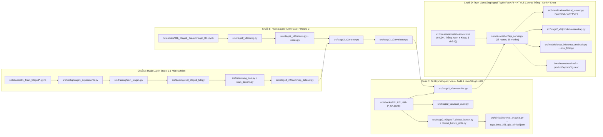

# Guide 03: Phần 2 - Kiến Trúc Phần Mềm, Bản Đồ AST, Colab Thuần Đĩa, Trạm Lâm Sàng & Vận Hành

> **Phạm vi:** Bản đồ mã nguồn toàn bộ dự án theo đồ thị **Python AST**, 12 module trung tâm (Hub Modules), 4 chuỗi gọi hàm đầu-cuối (End-to-End Call Chains), gói thực nghiệm **`src/colab_pkg/`** & phân biệt notebook **`ThinDriveRunner_v2` vs `01-04b`**, đặc tả **Trạm Làm Việc Lâm Sàng FastAPI + HTML5 Canvas Trắng - Xanh Y Khoa 100% Offline**, đóng gói Docker, lệnh biên dịch **Pandoc/Marp**, và **các option kiểm tra & kiểm định chất lượng phần mềm**.  
> **Tài liệu kỹ thuật kèm theo:** [Guide 01 - Tổng quan, Trạng thái & Minh bạch sự cố](01_TONG_QUAN_TRANG_THAI_VA_PHAN_CONG_NHOM_3_NGUOI.md) | [README.md](../../README.md)

---

## 1. Bản Đồ Mã Nguồn & Cách Sử Dụng Python AST (`graphify` Fallback)

### 1.1 Tình Trạng Thực Tế & Giải Pháp Dựng Đồ Thị AST Cục Bộ
- **Minh bạch hiện trạng:** Công cụ `graphify` CLI không cài đặt sẵn trong môi trường Windows mặc định và thư mục `graphify-out/` nằm trong `.gitignore` để không phình kho git.
- **Giải pháp thay thế chính thức tích hợp sẵn trong repo:** Dự án cung cấp công cụ phân tích AST chuẩn Python `scripts/build_ast_code_graph.py` giúp 3 thành viên tự dựng lại đồ thị tri thức mã nguồn chỉ trong `< 2` giây mà không cần cài thêm bất kỳ gói ngoài nào:

```powershell
# Chạy 1 lệnh duy nhất để sinh graphify-out/graph.json và graphify-out/GRAPH_REPORT.md:
.\.venv\Scripts\python.exe scripts/build_ast_code_graph.py
```

### 1.2 Tổng Quan Quy Mô Mã Nguồn Python Theo Tầng (`Clean Architecture`)

Toàn bộ mã nguồn nghiệp vụ và kiểm thử được tách bạch theo nguyên lý Trách nhiệm Đơn nhất (SRP) gồm `11` gói con trong `src/`, bộ script tự động hóa `scripts/` và `30` bộ kiểm thử đơn vị/tích hợp trong `tests/`:

| Khu Vực Mã Nguồn | Số Module Python | Vai Trò & Phạm Vi Chịu Trách Nhiệm | Tệp Tiêu Biểu Cần Đọc Trước |
| :--- | :---: | :--- | :--- |
| **`src/config/`** | 2 (+ 2 JSON) | Khóa danh sách `151` bệnh nhân BCSS (`bcss_patient_splits.json`), sống còn GDC 46.0 (`tcga_bcss_151_gdc_clinical.json`), cấu hình Stage-1 | `stage1_experiments.py` |
| **`src/datasets/`** | 4 | Nạp ảnh H&E BCSS, xác thực chống rò rỉ bệnh nhân, lọc nền kính trắng `OtsuClinicalGating` | `patient_split.py`, `otsu_filter.py`, `bcss_dataset.py` |
| **`src/models/`** | 11 | Baseline `WSSSTissueStage1NetCAM`, `DeepLabV3Plus`, `MultiMethodWSSSEngineV2` (`M1-M7`), `StainDeconvLayer`, `SG-DAP`, `MedSAM_WSSS_Adapter`, `PDA`, `CoarseToFineRouter` | `wsss_inference_methods.py`, `sg_dap.py`, `stain_deconv.py`, `sam_wsss_adapter.py` |
| **`src/stage2_v2/`** | 11 | Toàn bộ hệ thống đột phá **Gate-7 Track A**: 4-Arm Dual-Head, EMA, memmap mềm, 5-expert ensemble, visual audit `02d`, benchmark lâm sàng + LUAD `04b` | `config.py`, `models.py`, `trainer.py`, `ensemble.py`, `visual_audit.py`, `gate7_clinical_bench.py` |
| **`src/losses_metrics/`** | 3 | Hàm mất mát MLPS, Uncertainty Regularization, MP-PPC và thước đo mIoU/mDice/BF1/VTP/TSR | `losses.py`, `metrics.py` |
| **`src/training/`** | 7 | DataLoader đa tầng phòng thủ, huấn luyện Stage-1, sinh pseudo-mask, huấn luyện Stage-2 & MedSAM | `dataset_loader.py`, `train_stage1.py`, `eval_stage1_full.py`, `train_stage2.py` |
| **`src/clinical/`** | 4 | Đánh giá đối chứng đa hướng, đánh giá 3 chiều, phân tích sống còn Kaplan-Meier & Log-Rank | `survival_analysis.py`, `comparative_ablation_evaluator.py`, `exhaustive_evaluator.py` |
| **`src/pipeline/`** | 4 | Điều phối chạy so sánh đa seed, Colab runner, luồng WSI đa độ phóng đại (`5x -> 40x`) | `wsi_lowmag_highmag_pipeline.py`, `comparative_runner.py` |
| **`src/colab_pkg/`** | 6 | Gói gọn cho Colab thuần đĩa cục bộ `/content/`: dò tìm dữ liệu `resolve_split_dirs`, tải HF/GDrive, nạp mô hình, đánh giá streaming, trực quan hóa | `downloader.py`, `model_loader.py`, `evaluator.py`, `visualizer.py`, `colab_runner.py` |
| **`src/visualization/`** | 6 (+ `index.html`) | Máy chủ **FastAPI** (`api_server.py`), bộ dựng QA (`clinical_viewer.py`), giao diện HTML5 Canvas Trắng - Xanh Y Khoa ngoại tuyến, vẽ hình 300-DPI B&W | `api_server.py`, `clinical_viewer.py`, `draw_gate7_monochrome_figures.py`, `static/index.html` |
| **`src/utils/`** | 2 | Bộ kiểm định ấn phẩm học thuật độc lập 4 tầng (`DeliverableAuditor`) | `deliverable_auditor.py` |
| **`scripts/`** | 4 (sạch trên GitHub) | Dựng đồ thị AST (`build_ast_code_graph.py`), đóng gói `src/` (`build_drive_package.py`), sinh biến thể notebook (`build_t4_l4_notebook_suites.py`, `generate_thin_colab_notebooks.py`) | `build_ast_code_graph.py`, `build_drive_package.py` |
| **`tests/`** | 30 | Bộ kiểm thử tự động toàn diện (`501` ca: anti-leakage, Gate-7, visual audit, API, chuẩn màu UI y khoa, chống rò rỉ nội bộ, `DeliverableAuditor`) | `test_governance_invariants.py`, `test_patient_split.py`, `test_api_server.py`, `test_stage2_v2_gate7.py` |

*(Ghi chú: Dữ liệu gốc `graphify-out/GRAPH_REPORT.md` quét trên `src/`, `scripts/` và `tests/` ghi nhận `0` lỗi cú pháp AST; riêng các script tạo ảnh showcase cục bộ đã được chuyển sang nhánh lưu trữ `local-archive/full-workspace` để giữ nhánh GitHub gọn nhẹ.)*

### 1.3 Top 12 Hub Modules (Phân Tích Fan-In Bằng Python AST)

Khi cần sửa lỗi hoặc hiểu tác động dây chuyền, hãy bắt đầu từ các module trung tâm có `Fan-In` cao nhất theo phân tích Python AST:

| Hạng | Module Trung Tâm (Hub) | Fan-In | LOC | Vai Trò Cốt Lõi Trong Đồ Thị Phụ Thuộc |
| :---: | :--- | :---: | :---: | :--- |
| **1** | `src.models.wsss_inference_methods` | **30** | 1,932 | Xây dựng mạng Stage-1/Stage-2, động cơ `MultiMethodWSSSEngineV2` (`M1-M7`), `Pure-Glass Guard` |
| **2** | `src.training.dataset_loader` | **24** | 1,146 | `resolve_split_path`, `find_image_files`, đọc mask palette `mode="P"`, bộ nạp `BCSSStage1/2` chống rò rỉ |
| **3** | `src.datasets.otsu_filter` | **15** | 141 | `compute_otsu_tissue_mask`, `apply_otsu_gating_to_prediction` tách kính trắng độc lập không rò rỉ GT |
| **4** | `src.training.train_stage2` | **13** | 759 | `infer_stage1_norm_mode`, `prepare_stage1_input`, vòng huấn luyện Stage-2 ResNet-101 |
| **5** | `src.colab_pkg.evaluator` | **12** | 2,134 | Bộ đánh giá streaming an toàn VRAM, thống kê Wilcoxon và bảng ablation M1-M7 |
| **6** | `src.stage2_v2.models` | **12** | 1,153 | 4 họ kiến trúc Dual-Head (`DeepLabV3+`, `SegFormer`, `ConvNeXt` + `_pad_to_multiple_of_32`, `DINOv2`) & `Stage2ModelEMA` |
| **7** | `src.losses_metrics.metrics` | **11** | 525 | `MedicalSegmentationMetrics`, tính chuẩn xác `mIoU`, `mDice`, `BF1`, `VTP`, `TSR`, `VTP_RCB` |
| **8** | `src.losses_metrics.losses` | **11** | 394 | Hàm mất mát MLPS, Uncertainty Regularization (`.detach()`) và `MultiPrototypePPCLoss` |
| **9** | `src.colab_pkg.model_loader` | **10** | 1,942 | Nạp trọng số Stage-1/Stage-2, quản lý hợp đồng chuẩn hóa `[0, 1]` và `Pure-Glass Guard` |
| **10** | `src.colab_pkg.downloader` | **10** | 836 | `resolve_split_dirs` dò tìm đệ quy đa tầng, tải dữ liệu `BCSS-WSSS` / `LUAD-HistoSeg` từ HF/GDrive |
| **11** | `src.training.eval_stage1_full` | **10** | 450 | Nạp nghiêm ngặt `load_stage1_strict`, kiểm tra SHA256 và đánh giá VAL Stage-1 |
| **12** | `src.stage2_v2.visual_audit` | **8** | 3,454 | Bộ `6/6` assertion không rò rỉ GT, đo dịch chuyển không gian, ghép Whole-ROI Hann-50%, ablation lọc kính |

*(Các module lõi khác thuộc nhóm fan-in `7-8`: `src.stage2_v2.evaluator` (`8`), `src.stage2_v2.config` (`8`), `src.datasets.patient_split` (`8`), và `src.stage2_v2.ensemble` (`7`, `3,867` LOC).)*

---

## 2. Bốn Chuỗi Gọi Hàm Đầu-Cuối (4 End-to-End Call Chains)

Sơ đồ dưới đây cho thấy toàn bộ luồng dữ liệu từ huấn luyện GPU tới Trạm Lâm Sàng và kiểm định tự động:



---

## 3. Thực Nghiệm Cloud Colab Thuần Đĩa Cục Bộ (`src/colab_pkg/` & `notebooks/`)

### 3.1 Gói Mã Nguồn `src/colab_pkg/` (Chuẩn SSD Cục Bộ `/content/`, Không Gắn OAuth Drive)
Toàn bộ logic chạy thực nghiệm Benchmark Baseline (`M1-M7`) được tách khỏi `.ipynb` vào 6 module sạch trong `src/colab_pkg/`:

| Tên Module | Chức Năng Cốt Lõi |
| :--- | :--- |
| `__init__.py` | Điểm xuất (`entry-point`) cung cấp toàn bộ hàm và lớp của gói `colab_pkg`. |
| `downloader.py` | Tải tự động `BCSS-WSSS.zip`, `LUAD-HistoSeg.zip` và 2 bộ trọng số `stage1_checkpoint_trained_on_bcss.pth`, `stage2_checkpoint_trained_on_bcss.pth` qua HuggingFace CDN kèm dự phòng Google Drive; kiểm định toàn vẹn (`is_valid_zip_archive`, `is_valid_torch_checkpoint`); dò tìm thư mục lồng `resolve_split_dirs`. |
| `model_loader.py` | Nạp `DeepLabV3Plus` (`ResNet-101`, `59.34M`), `WSSSTissueStage1NetCAM` (`ResNet-38d`, `105.09M`), `OtsuClinicalGating`, và `MultiMethodWSSSEngine` / `MultiMethodWSSSEngineV2` (`M1-M7`, D4 8-View TTA + Beer-Lambert H&E OD). |
| `evaluator.py` | Tính ma trận nhầm lẫn `4x4` và `5x5`, mIoU, mDice, Macro F1, Pixel Accuracy, VTP, TSR, kiểm định Wilcoxon signed-rank & Student t-test, và xuất JSON/Markdown/CSV (`allow_nan=False`). |
| `visualizer.py` | Vẽ ảnh so sánh lâm sàng 5 cột `300 DPI`, ma trận nhầm lẫn `5x5`, biểu đồ cột Ablation (`M1-M7`), và đóng gói tệp `.zip` kết quả để tải về máy qua `google.colab.files.download`. |
| `colab_runner.py` | Bộ điều phối cấp cao `run_bcss_wsss_experiment(...)` (`mode="smoke"|"quick"|"sanity"|"full"`, `include_v2=True`) và `run_streaming_evaluation(...)`. |

**Cách chạy trên Google Colab thuần đĩa cục bộ VM (`/content/`, không bật cửa sổ OAuth popup):**

```python
# Clone trực tiếp mã nguồn từ GitHub vào SSD cục bộ VM (/content/)
!git clone https://github.com/khoinguyen59/medical-wsss.git /content/medical-wsss
import sys
sys.path.insert(0, "/content/medical-wsss/src")

from colab_pkg import run_bcss_wsss_experiment

# Dữ liệu và checkpoint lưu trực tiếp trên /content/ (đặt mode="sanity" cho 150 ảnh hoặc "full" cho 4,986 ảnh)
results = run_bcss_wsss_experiment(mode="full", include_v2=True, mode_tag="T4_Full4986")
```

### 3.2 Phân Biệt Hai Hệ Notebook Trong `notebooks/` (`ThinDriveRunner_v2` vs `01-04b`)
1. **Nhóm Notebook Baseline Benchmark `M1-M7` (`SE374_Colab_WSSS_*_ThinDriveRunner_v2.ipynb`):**
   - Gồm 4 biến thể GPU (`T4_Sanity150`, `T4_Full4986`, `L4_Full4986`, `A100_Full4986`) đặt trực tiếp trong `notebooks/` (thư mục trùng lặp cũ `notebooks/modular_drive/` đã được dọn gọn sang nhánh lưu trữ cục bộ).
   - Mỗi ô code ngắn gọn, gọi `src/colab_pkg/` để đánh giá `7` phương pháp `M1-M7` trên mốc WSSS-Tissue (`M1` Single-Scale -> `M2` D4 TTA + CGM -> `M3` Long-Tail Prior -> `M4` Bilateral Refinement -> `M5` Proposed V1 -> `M6` Multi-Scale Pyramid D4 đạt `70.53%` -> `M7` Beer-Lambert OD + Edge Refinement).
   - Lịch sử thực thi thật nằm tại [notebooks/history_runs/README.md](../../notebooks/history_runs/README.md).
2. **Nhóm Notebook Nghiên Cứu Chính Gate-7 Track A (`01`, `02b`, `02c`, `02d`, `04b`):**
   - `01_Train_Stage1_Classifier*.ipynb`: Huấn luyện Stage-1 Champion `se374_arm_b_full` và sinh mặt nạ mềm `SG-DAP`.
   - `02b_Stage2_Breakthrough_G4.ipynb`: Huấn luyện 4 họ kiến trúc Dual-Head (`arm5-arm8`) ở độ phân giải đến `336px` với lựa chọn `EMA-only`.
   - `02c_Stage2_Ensemble_Eval_G4.ipynb`: Đánh giá tổ hợp 5 chuyên gia (`12x ms_3_hvflip`, `cal_logprob_eps1e3`, `cgm_nec_focused_1dof`), kiểm định 3 hạt giống và Holm-Bonferroni (`72.79% / 72.80% / 72.90%`).
   - `02d_Stage2_Visual_Overlay_Audit_G4.ipynb`: Kiểm chứng trực quan `6/6` assertion không rò rỉ GT vào `BACK=4`, `Boundary F1@2px`, `Whole-ROI Hann-50%` và sàng lọc `Entropy`.
   - `04b_Stage2_Gate7_Clinical_LUAD_Bench_G4.ipynb`: Sống còn thật `NCI GDC 46.0`, Pareto đồng chuẩn `torch.bfloat16` trên `L4`, và `LUAD-HistoSeg` Zero-Shot (`10x` -> `2x` zoom đạt `51.47%`).

---

## 4. Đặc Tả Trạm Làm Việc Lâm Sàng (FastAPI + HTML5 Canvas Trắng - Xanh Y Khoa + Docker)

### 4.1 Thiết Kế Công Thái Học Y Khoa & Kiến Trúc Giao Diện (`src/visualization/static/index.html`)
- **Hệ màu chuẩn bệnh viện & quang học thị giác (Trắng Lâm Sàng + Xanh Y Khoa / Phẫu Thuật):**
  - Bác sĩ giải phẫu bệnh liên tục quan sát **máu đỏ và tiêu bản nhuộm Eosin hồng-đỏ** (`TUM` đỏ). Theo hiệu ứng dư ảnh màu bổ túc (*Complementary Afterimage*), nền tối xanh đen gây mỏi mắt còn trắng gắt tạo dư ảnh xanh lơ lửng; do đó giao diện được chuẩn hóa bằng **Trắng Lâm Sàng** (`#FFFFFF` thẻ nội dung, `#F4FAFA` nền dịu chống chói) kết hợp **Xanh Y Khoa / Xanh Phẫu Thuật** (`#0E7C86` Deep Surgical Teal, `#00957E` Standard OR Surgical Green, `#2A9D8F` Medical Scrub Green, `#14313A` chữ tương phản WCAG AAA).
  - Giữ nguyên 100% bảng màu sinh học chuẩn 4 lớp BCSS + BACK (`TUM #E41A1C`, `STR #4DAF4A`, `LYM #377EB8`, `NEC #FF7F00`, `BACK #999999`) trên khung soi trung tính `#EAF3F1`.
- **100% Ngoại tuyến (Zero CDN) & Cảnh báo RUO thường trực:** Không tải phông chữ hay thư viện JavaScript từ Internet; hiển thị dải khuyến cáo **RUO (Research Use Only)** trực tiếp trên màn hình chính.
- **Tách rạch ròi 3 chế độ làm việc trên thanh điều hướng:**
  1. **`Chẩn đoán Lâm sàng` (Dành cho Bác sĩ - KHÔNG có bảng GT):** Ẩn hoàn toàn khung đối chiếu GT, slider debug và nút ablation; chỉ tập trung vào nạp ảnh H&E, phân vùng AI, dấu ấn VTP/TSR, phân tầng CAP, Split-Curtain (Ảnh gốc vs AI) và xuất **CAP PDF 2 trang**.
  2. **`Kiểm chứng Nghiên cứu (GT)` (Dành cho Nghiên cứu & Kiểm toán):** Mở mặc định góc nhìn **`0. Đối chiếu 4 Khung`** (Ảnh gốc H&E | Đáp án Bác sĩ GT | Dự đoán AI | Chồng lớp Đúng/Sai) cùng `9` góc nhìn QA chuyên sâu (`1. Đúng vs Sai`, `2. Dual QA làm mờ`, `3. Mặt nạ AI`, `4. Pha GT+AI`, `5. Đường viền`, `6. Bất định Entropy` kèm thang màu `0 -> ln(4)`, `7. CAM Stage-1`, `8. Soi riêng lớp`, `9. Đáp án GT`) và thẻ **KPI cộng đủ 100%** (`Trùng khớp + Lệch biên <= 2px + Lỗi lõi = 100%`).
  3. **`Ghép lát cắt WSI` (Không GT):** Tự động ẩn thẻ chọn mô hình đơn mảnh (không trùng dropdown) và ẩn toàn bộ tab/slider GT; ghép tối đa 64 tiles.
- **18 Chế Độ Suy Luận Khả Dụng (`available_methods`, ưu tiên mặc định `gate7_arm5`):** `7` chế độ Gate-7 Track A (`gate7_arm5`, `gate7_arm5_tta`, `gate7_4arm_cgm`, `gate7_4arm`, `gate7_arm6`, `gate7_arm7`, `gate7_arm8`) và `11` chế độ Baseline/Ablation (`m6`, `m1-m5`, `m7`, `od_prior`, `sg_dap`, `mpppc`, `combined`).
- **Công cụ soi vi trường chuyên sâu:** Thanh trượt **Split-Curtain (`S`)**, kính lúp **Magnifier Loupe (`L`)**, **Pixel Inspector HUD**, **Zoom/Pan** mượt kèm thanh tỷ lệ vật lý động `[2-200] um (0.25 MPP)`, **Compare Modal** (so song song GT + tối đa 6 mô hình), và xuất **CAP PDF 2 trang / PNG 300 DPI / JSON / CSV**.
- **An toàn Fail-Closed:** Khi `strict_weights=True` mà thiếu tệp trọng số `.pth`, máy chủ trả **HTTP `503`** minh bạch thay vì suy luận giả bằng trọng số ngẫu nhiên.

### 4.2 Toàn Bộ 15 HTTP Routes Của Máy Chủ FastAPI (`src/visualization/api_server.py`)

| Nhóm | Method | Route | Chức Năng Chính |
| :--- | :---: | :--- | :--- |
| **Giao diện & Tài liệu** | `GET` | `/`, `/viewer`, `/favicon.ico` | Trả về ứng dụng HTML5 Canvas ngoại tuyến (`static/index.html`) |
| **Sức khỏe & Trạng thái** | `GET` | `/health`, `/api/v1/health` | Báo cáo thiết bị CPU/GPU, danh sách trọng số Gate-7 / Baseline đã nạp (`checkpoint_verified`), `18` chế độ khả dụng |
| **Duyệt Tập Test** | `GET` | `/api/v1/samples`, `/api/v1/samples/{sample_id}` | Liệt kê và tải lát cắt thật trong Held-Out Test kèm đáp án bác sĩ và `gt_biomarkers` |
| **Suy Luận Patch** | `POST` | `/api/v1/predict/patch` | Suy luận 5 lớp (kèm `Pure-Glass Guard`), trả về 9 lớp ảnh QA, `VTP`, `TSR`, `agreement_summary`, `pixel_map` |
| **So Sánh Song Song** | `POST` | `/api/v1/compare` | Chạy song song tối đa `6` phương pháp trên cùng một mảnh ảnh cho `Compare Modal` |
| **Xuất Báo Cáo** | `POST` | `/api/v1/export/report` | Xuất báo cáo kiểm định `4` định dạng: `pdf` (CAP 2 trang có RUO), `png` (2x4 300 DPI), `json`, `csv` |
| **Ghép Lát Cắt WSI** | `POST` | `/api/v1/predict/wsi` | Ghép tối đa `64` tiles (`8192 x 8192`), lọc nền Otsu và trả về bản đồ nhiệt ghép + tóm tắt vùng mô |
| **API Lâm Sàng Rút Gọn** | `POST` / `GET` | `/segment`, `/biomarkers`, `/splits`, `/tile/{z}/{x}/{y}.png` | Phục vụ phân vùng rút gọn, tính dấu ấn sinh học, danh sách tách `151` bệnh nhân và ô gạch DeepZoom |

### 4.3 Triển Khai Đóng Gói Docker (`Dockerfile`, `docker-compose.yml`)
- Base image `python:3.11-slim`, chạy dưới tài khoản không đặc quyền **`appuser`** (bảo mật non-root).
- Cấu hình tự động `WSSS_GATE7_DIR=/app/checkpoints/vps_evidence`, gắn chỉ đọc (`ro`) thư mục `./checkpoints` và `./data`, kèm `HEALTHCHECK` thăm dò `/health` mỗi `30` giây.

```bash
docker compose up --build -d
docker compose ps
curl http://localhost:8000/api/v1/health
```

---

## 5. Biên Dịch Ấn Phẩm Học Thuật (`docs/templates/SE374_Reference_Template.docx`, Pandoc & Marp)

Trong kho GitHub sạch, tệp `docs/templates/SE374_Reference_Template.docx` được giữ lại làm chuẩn kiểu chữ in ấn học thuật (mực đen `#000000`, phân cấp tiêu đề chuẩn UIT; các biểu mẫu LaTeX/Word gốc tham khảo nặng hơn được lưu tại nhánh cục bộ `local-archive/full-workspace`). Lệnh biên dịch chính thức cho `4` ấn phẩm bàn giao trong `product/`:

```powershell
# 1. Biên dịch Mini Proposal (.docx)
pandoc product/proposal/SE374_MINI_PROPOSAL_WSSS_WSI.md `
  --reference-doc=docs/templates/SE374_Reference_Template.docx `
  --syntax-highlighting=none `
  "--resource-path=product/proposal;product/proposal/assets;." `
  -o product/proposal/SE374_MINI_PROPOSAL_WSSS_WSI.docx

# 2. Biên dịch Báo cáo kỹ thuật cuối kỳ (.docx)
pandoc product/reports/SE374_FINAL_TECHNICAL_REPORT_WSSS.md `
  --reference-doc=docs/templates/SE374_Reference_Template.docx `
  --syntax-highlighting=none `
  "--resource-path=product/reports;product/reports/figures;." `
  -o product/reports/SE374_FINAL_TECHNICAL_REPORT_WSSS.docx

# 3. Biên dịch Biên bản kiểm định & khắc phục lỗi (.docx)
pandoc product/reports/SE374_MULTI_AGENT_AUDIT_AND_DEFECT_RESOLUTION_REPORT.md `
  --reference-doc=docs/templates/SE374_Reference_Template.docx `
  --syntax-highlighting=none `
  "--resource-path=product/reports;product/reports/figures;." `
  -o product/reports/SE374_MULTI_AGENT_AUDIT_AND_DEFECT_RESOLUTION_REPORT.docx

# 4. Biên dịch Slide bảo vệ 16:9 (Marp CLI -> PPTX)
marp product/slides/SE374_FINAL_DEFENSE_SLIDES_WSSS_WSI.md --pptx --no-stdin --allow-local-files -o product/slides/SE374_FINAL_DEFENSE_SLIDES_WSSS_WSI.pptx
```

---

## 6. Các Option Kiểm Tra Phần Mềm & Cổng Kiểm Định Chất Lượng

Nhóm có thể lựa chọn 5 cấp độ kiểm định tùy theo ngữ cảnh (phát triển nhanh hàng ngày vs nghiệm thu trước khi nộp):

| Cấp Độ / Option Kiểm Định | Lệnh Thực Thi Chính Xác | Thời Gian | Mục Đích & Tiêu Chuẩn Đạt |
| :--- | :--- | :---: | :--- |
| **Option Q1: Kiểm tra nhanh quản trị, chống rò rỉ & UI Y khoa** | `.\.venv\Scripts\python.exe -m pytest tests/test_governance_invariants.py tests/test_patient_split.py tests/test_api_server.py -q` | `~5 giây` | Xác nhận `0` dấu gạch ngang sai chuẩn, `0` rò rỉ tài khoản/tool cá nhân trong repo git, `0%` rò rỉ 151 bệnh nhân, API & UI chuẩn y khoa hoạt động đúng |
| **Option Q2: Toàn bộ bộ kiểm thử tự động + Linter** | `.\.venv\Scripts\python.exe -m pytest tests -q` & `.\.venv\Scripts\ruff.exe check src tests` | `~1-2 phút` | Kiểm định toàn bộ **`501` bài kiểm thử phần mềm y khoa** trên `30` module `tests/` và `0` lỗi lint |
| **Option Q3: Kiểm định ấn phẩm học thuật 4 tầng (`16` tệp `.md`)** | `.\.venv\Scripts\python.exe -m src.utils.deliverable_auditor README.md "docs/guides/*.md" "docs/research/*.md" "experiments/benchmarks/*.md" "experiments/colab_run_*/*.md" notebooks/history_runs/README.md product/proposal/SE374_MINI_PROPOSAL_WSSS_WSI.md "product/reports/*.md" product/slides/SE374_FINAL_DEFENSE_SLIDES_WSSS_WSI.md` | `~5 giây` | Bắt buộc **`0 CRITICAL, 0 WARNING`** về đồ họa B&W 300 DPI, chữ đen `#000000`, dấu gạch ngang ASCII, không rò rỉ tên/rubric |
| **Option Q4: Kiểm chứng trực quan không rò rỉ GT & Trạm Lâm Sàng** | Chạy `notebooks/02d_Stage2_Visual_Overlay_Audit_G4.ipynb` (`src/stage2_v2/visual_audit.py`) và kiểm tra live tại `http://localhost:8000/viewer` | `~3-5 phút` | Xác nhận `6/6` assertion không rò rỉ GT vào `BACK=4`, `Boundary F1@2px`, `Whole-ROI Hann-50%` và hiển thị sống 3 chế độ (Lâm sàng / 4 Khung GT / WSI Stitch) |
| **Option Q5: Kiểm định chéo nhiều luồng độc lập & Thang điểm nghiệm thu 40+40** | Đối chiếu quy trình tại [Guide 01 (Mục 5.1)](01_TONG_QUAN_TRANG_THAI_VA_PHAN_CONG_NHOM_3_NGUOI.md#5-lich-su-kiem-toan-minh-bach-su-co--gioi-han-khoa-hoc-mo) & [Biên bản kiểm định](../../product/reports/SE374_MULTI_AGENT_AUDIT_AND_DEFECT_RESOLUTION_REPORT.md) | Theo đợt lớn | Kiểm tra chéo 2 vòng dựa trên bằng chứng mã nguồn/log trực tiếp; chỉ nghiệm thu khi Nghiên cứu `>= 39/40` và Phần mềm `>= 39/40` (`0` cờ đỏ) |

---

## 7. Tài Liệu Liên Quan Trong Phần 2

- **Xem minh họa sống Trạm Lâm Sàng Trắng - Xanh Y Khoa (`P1-P5`):** [Guide 04 - Hướng Dẫn Đọc Ảnh Trực Quan](04_HUONG_DAN_DOC_ANH_TRUC_QUAN_N1_N5_VA_P1_P5.md)
- **Biên bản kiểm định & khắc phục lỗi:** [SE374_MULTI_AGENT_AUDIT_AND_DEFECT_RESOLUTION_REPORT.md](../../product/reports/SE374_MULTI_AGENT_AUDIT_AND_DEFECT_RESOLUTION_REPORT.md) ([Word DOCX](../../product/reports/SE374_MULTI_AGENT_AUDIT_AND_DEFECT_RESOLUTION_REPORT.docx))
- **Nhật ký kiểm toán, minh bạch sự cố & lỗi mở:** [Guide 01 - Tổng Quan & Minh Bạch Sự Cố](01_TONG_QUAN_TRANG_THAI_VA_PHAN_CONG_NHOM_3_NGUOI.md#5-lich-su-kiem-toan-minh-bach-su-co--gioi-han-khoa-hoc-mo)
