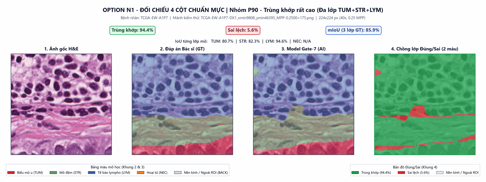
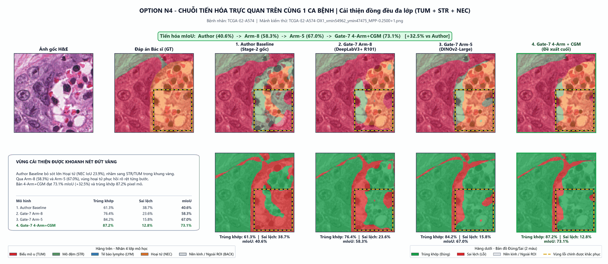
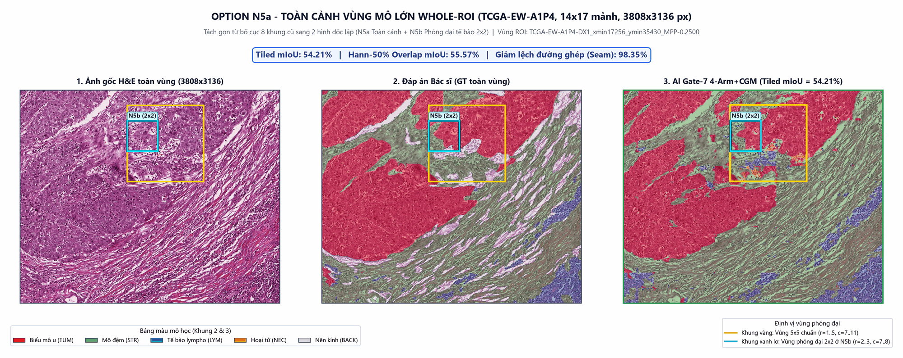
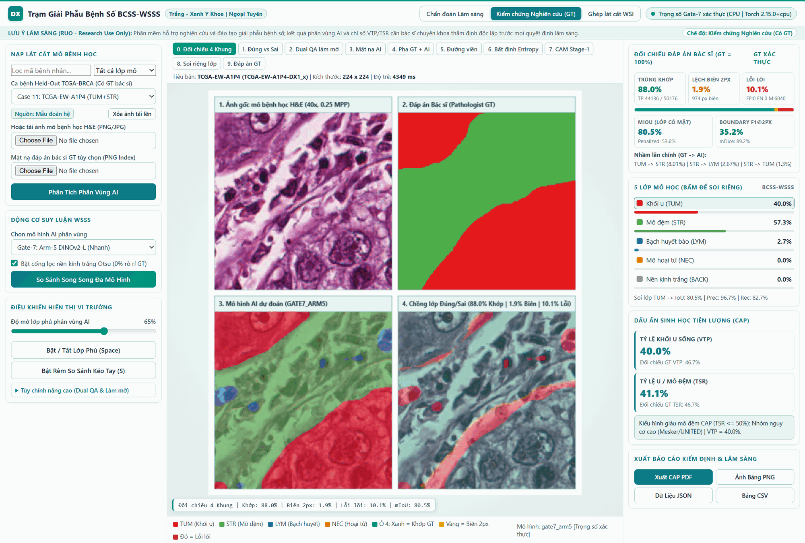
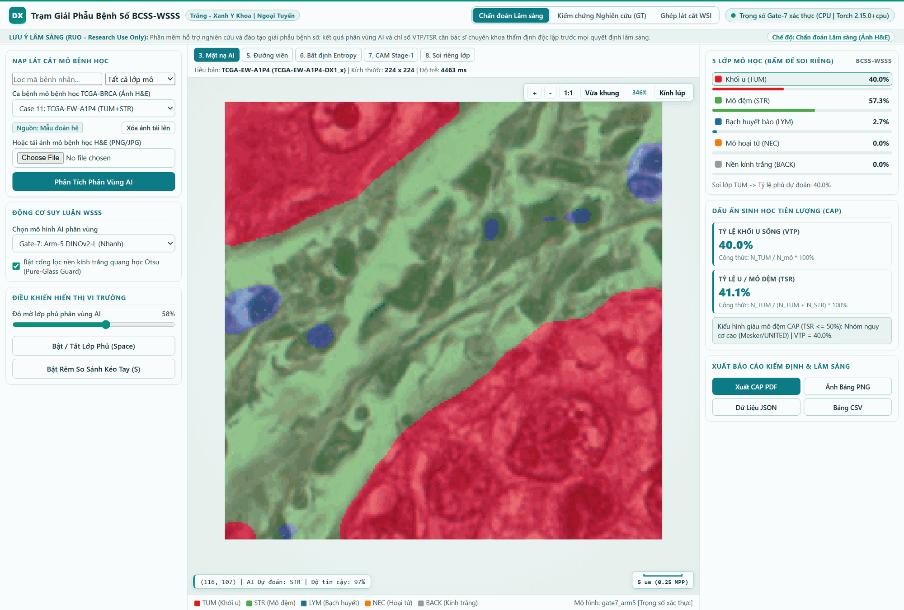
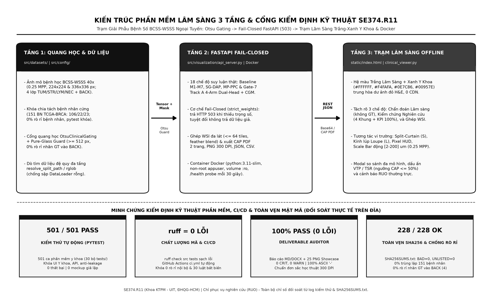

# Guide 04: Cẩm Nang Đọc Hiểu Toàn Bộ Các Loại Ảnh Trực Quan (`N1-N5`, `P1-P5`, `02d_v2`, `fig1-fig9`)

> **Mục tiêu:** Giúp cả 3 thành viên nhìn vào **bất kỳ bức ảnh nào** trong dự án đều giải thích trôi chảy cho giảng viên và hội đồng: ảnh đó là loại ảnh gì, từng màu sắc có ý nghĩa sinh học/toán học gì, cách đọc các con số trên ảnh, và khác biệt giữa các **option ảnh nghiên cứu (`N1-N5`)** với **option ảnh phần mềm (`P1-P5`)**.  
> **Quay về trang chủ:** [README.md](../../README.md) | **Tổng quan nhóm 3 người:** [Guide 01](01_TONG_QUAN_TRANG_THAI_VA_PHAN_CONG_NHOM_3_NGUOI.md)

---

## 1. Giải Mã 13 Loại Hình Ảnh Trong Toàn Bộ Dự Án

### 1.1 Nhóm Ảnh Sinh Học Gốc & Nhãn Cơ Bản (Nền Tảng Phải Biết)

1. **Ảnh gốc mô bệnh học H&E (`Raw H&E`):**
   - Là lát cắt mô ung thư vú thật kích thước **`224 x 224` pixels** quét ở độ phóng đại **`40x` (`0.2500 MPP`, tương đương `56 x 56 um`)**.
   - **Hematoxylin (màu tím xanh đậm):** Nhuộm nhân tế bào (DNA). Vùng có nhiều nhân to, dị dạng, xếp dày đặc thường là biểu mô khối u (**`TUM`**); vùng có nhiều hạt nhân nhỏ tròn đồng đều rất đậm là bạch huyết bào (**`LYM`**).
   - **Eosin (màu hồng):** Nhuộm bào tương và sợi collagen mô đệm liên kết (**`STR`**) hoặc mảnh vụn tế bào chết vỡ nhân (**`NEC`**).
   - **Nền trắng tinh:** Vùng lam kính quang học không có mô vật lý (**`BACK`**).
2. **Ảnh Đáp án Bác sĩ (`Pathologist GT` / Ground Truth Mask):**
   - Lưu dưới dạng PNG 8-bit chế độ bảng màu **`mode='P'`** với giá trị nguyên `{0, 1, 2, 3, 4}` (`0: TUM`, `1: STR`, `2: LYM`, `3: NEC`, `4: BACK / Outside ROI`).
   - **Lưu ý quan trọng để không trả lời sai trước hội đồng:** Tập **Train (`23,422` ảnh)** **KHÔNG có ảnh GT pixel này** (chỉ có 4 bit nhãn yếu trong tên tệp). Chỉ tập **Val (`3,418` ảnh)** và **Held-Out Test (`4,986` ảnh)** mới có mặt nạ đáp án bác sĩ để chấm điểm khách quan.
3. **Ảnh Model AI vẽ (`AI Prediction Overlay`):**
   - Tô phủ bán trong suốt 4 lớp mô học lên ảnh H&E gốc theo bảng màu chuẩn: **Đỏ (`#E41A1C`) = `TUM`**, **Xanh lá (`#4DAF4A`) = `STR`**, **Xanh dương (`#377EB8`) = `LYM`**, **Cam/Tím (`#FF7F00` / `#9900FF`) = `NEC`**, **Xám/Trắng (`#999999`) = `BACK`**.
   - Ở pha suy luận, nền kính trắng được tách độc lập bằng **`OtsuClinicalGating` + `Pure-Glass Guard >= 512 px`** (`gt_parameter_free = True`). Hệ thống đã chứng minh **`0%` rò rỉ nhãn `BACK = 4` từ đáp án bác sĩ** trên toàn bộ `4,986` ảnh Test (`02d_v2`).

### 1.2 Nhóm Ảnh Phân Tích Độ Chính Xác & Lỗi Không Gian (Phần 1 - Nghiên Cứu `N1-N5`)

4. **Ảnh Đối chiếu Đúng/Sai 2 màu (`Match vs Error` - Option `N1`):**
   - **Cách đọc cực nhanh:** Trên toàn bộ điểm ảnh mô tiền cảnh (`fg_px`), mọi điểm AI đoán khớp bác sĩ tô **Xanh lá (Match)**, mọi điểm đoán lệch tô **Đỏ (Error)** (vùng `BACK` ngoài mô giữ màu trung tính).
   - Bất biến số học bắt buộc khớp 100%: **`Trùng khớp (%) + Sai lệch (%) = 100.0%`**. Ví dụ mẫu `N1 P90` (`TCGA-EW-A1P7`): `94.4%` trùng khớp + `5.6%` sai lệch (`mIoU = 85.9%`); mẫu `N1 P50` (`TCGA-E2-A573`): `89.3% + 10.7%` (`mIoU = 66.8%`); mẫu `N1 P10` ca khó minh bạch (`TCGA-E2-A1LL`): `73.4% + 26.6%` (`mIoU = 37.9%`).
5. **Ảnh Đường viền không che tế bào (`Contours` - Option `N2`):**
   - Thay vì tô kín mặt nạ làm mờ cấu trúc nhân tế bào, chỉ vẽ **đường bao GT (nét liền / Cyan)** chồng với **đường bao AI (nét đứt / Vàng)** ngay trên ảnh H&E gốc.
   - Đọc kèm 2 chỉ số hình học: **`Boundary F1@2px`** (độ khớp biên trong dung sai `2 px`: Gate-7 `4-Arm+CGM` đạt **`53.30%`** vs Author `50.67%`, `p = 0.000298`) và **`TUM Centroid Offset`** (khoảng cách tâm khối u dự đoán so với GT: giảm từ `8.93 px` xuống **`7.60 px`** ở `4-Arm` và **`7.13 px`** ở `arm5`).
6. **Ảnh Tách từng lớp (`Per-Class TP / FP / FN` 3 màu - Option `N3`):**
   - Tách riêng từng lớp `TUM`, `STR`, `LYM`, `NEC` thành 4 bảng trên cùng một mảnh ảnh phức tạp đủ 4 lớp, mỗi bảng dùng 3 màu chuẩn: **Xanh lá = `TP` (Đoán đúng)**, **Đỏ = `FP` (Báo nhầm thừa)**, **Vàng/Xanh dương = `FN` (Bỏ sót)**.
   - Nếu một lớp có `pred_px = 0`, chỉ số `Precision` được ghi trung thực là **`N/A`** (không tự gán `0%` hay `100%`). Giúp bác sĩ thấy rõ trên ca 4 lớp khó (`TCGA-E2-A150`, `TCGA-E2-A14N`), AI bắt rất tốt `TUM` (`IoU 86.5%`) nhưng dễ bỏ sót cụm `LYM`/`NEC` nhỏ xen kẽ.
7. **Ảnh Tiến hóa 4 mốc mô hình (`4-Model Evolution` - Option `N4`):**
   - Đặt cạnh nhau theo thứ tự tiến hóa: **Raw H&E -> Pathologist GT -> Author Baseline -> Gate-7 Arm 8 (CNN) -> Gate-7 Arm 5 (DINOv2-L) -> Gate-7 4-Arm + CGM**, kèm khung chữ nhật phóng tiêu điểm vùng cải thiện.
   - Minh họa trực quan hai bước nhảy cốt lõi: (a) trên `TCGA-EW-A1P4+61`, `4-Arm+CGM` nâng `mIoU` từ `50.2%` (Author) -> `63.1%` (Arm 8) -> `63.8%` (Arm 5, còn `3,273 px` báo động giả `NEC FP`) -> **`66.8%` và xóa sạch `NEC FP` về `0 px`**; (b) trên `TCGA-E2-A574+1`, `mIoU` tăng đều từ `40.6%` -> `58.3%` -> `67.0%` -> **`73.1%`** (`NEC IoU` nhảy từ `23.9%` lên **`77.6%`**).
8. **Ảnh đại thể `Whole-ROI` (`N5a`) & Phóng đại tế bào `2x2` (`N5b`):**
   - **`N5a` (Whole-ROI Overview):** Ghép toàn bộ lưới hàng trăm mảnh ảnh liên tiếp của 1 vùng khối u lớn (`TCGA-EW-A1P4`: `14 x 17 = 238` tiles = `3808 x 3136 px`; `TCGA-EW-A1P1`: `16 x 18 = 288` tiles = `4032 x 3584 px`). Chứng minh suy luận `Native Tiled 224x224` vượt trội hoàn toàn so với hạ độ phân giải 1 lượt (`0.5421` vs `0.2020`), và ghép chồng lấp **`Hann-50%`** đẩy lên **`0.5557` / `0.6779`** đồng thời giảm **`-98.35%` / `-97.99%`** lỗi lật nhãn dọc đường nối giữa các ô.
   - **`N5b` (2x2 Zoom Check):** Cắt phóng đại cụm `2 x 2` tiles (`448 x 448 px`) ngay tại vùng ranh giới khó của `Whole-ROI` để kiểm tra từng đường biên nhân tế bào.
9. **Ảnh Glass-Guard Ablation (`02d_v2` ảnh `06` & `07`, cục bộ trong `checkpoints/vps_evidence/`):**
   - So sánh `none`, `pure_glass` (`72.80%`, `0.0%` xói mòn `NEC`), `cand1_bright_glass` (`72.22%`, `48.55%` kính sáng) và `otsu` (`70.82%`, `8.26%` xói mòn `NEC`) trên các mảnh chứa nhiều nền kính trắng vs ngoài ROI (`outside_roi`).
10. **Ảnh Bất định Shannon Entropy & Stage-1 CAM:**
    - **Bản đồ nhiệt Entropy:** Màu càng nóng (vàng/đỏ) thể hiện xác suất phân bổ giữa các lớp càng phân vân (tập trung ở rìa chuyển tiếp `TUM <-> STR` hoặc vùng mô hoại tử mờ). Tương quan nghịch chặt với độ chính xác (**`Spearman rho = -0.5599`** trên `4,986` patch: nhóm `20%` entropy thấp nhất đạt **`91.15%`**, nhóm `20%` cao nhất chỉ **`53.59%`**).
    - **Bản đồ `Stage-1 CAM`:** Bản đồ nhiệt định vị thô chỉ từ nhãn yếu 4-bit trước khi chưng cất sang Stage-2.
11. **Ảnh Kiểm định chéo cơ quan Phổi `LUAD-HistoSeg` (`10x` vs `2x` zoom, `04b_v2`):**
    - Cho thấy mô hình huấn luyện 100% trên ung thư vú `40x` khi chấm zero-shot trên ung thư phổi `10x` bị thu nhỏ cấu trúc tế bào `4` lần (`arm5 = 36.09%`, Author sập `15.05%` với `LYM = 0%`), và ngay khi phóng đại `2x` (`10x -> 20x`, không train lại) biên tế bào khớp rõ rệt (`arm5 = 51.47%`, `ens4 = 49.92%`).

### 1.3 Nhóm Ảnh Phần Mềm Sống (`P1-P5`) & Chuẩn Ảnh Báo Cáo Đơn Sắc (`fig1-fig8` vs `fig9`)

12. **Ảnh Sống Trạm Lâm Sàng Trắng - Xanh Y Khoa (`P1-P5`, chụp live từ máy chủ FastAPI thật):**
    - **`P1` (Split-Curtain + Magnifier Loupe + Live Pixel HUD):** Giao diện Trắng Lâm Sàng (`#FFFFFF`, `#F4FAFA`) + Xanh Phẫu Thuật (`#0E7C86`, `#00957E`) với thanh kéo rèm so trực tiếp Raw H&E hoặc Doctor GT với AI Overlay, kính lúp soi chi tiết và hộp tọa độ pixel sống `(x, y, GT, Pred, Conf%)`.
    - **`P2` (Kiểm chứng 4 Khung Song Song & QA Triage):** Góc nhìn **`0. Đối chiếu 4 Khung`** (Ảnh gốc H&E | Đáp án Bác sĩ GT | Dự đoán AI | Chồng lớp Đúng/Sai) kèm thanh KPI cộng đủ **`100.0%`** (`Trùng khớp + Lệch biên 2px + Lỗi lõi`), bản đồ bất định `Shannon Entropy` có thang màu `0 -> ln(4)` và đối chiếu `Match vs Error` minh bạch trên ca khó.
    - **`P3` (Compare Modal):** Cửa sổ so sánh song song 4 ô (`Đáp án Bác sĩ GT` vs `M6` vs `Gate-7 Arm-5` vs `Gate-7 4-Arm+CGM`) trên cùng ca bệnh kèm độ trễ và KPI đủ 3 thành phần Khớp/Biên/Lỗi.
    - **`P4` (WSI Multi-Tile Stitch Sạch + CAP PDF 2 trang):** Ảnh `P4_sample1` cho thấy chế độ `Ghép lát cắt WSI` sạch không trùng dropdown và ẩn hoàn toàn tab GT (`448 x 448 px`, `VTP 15.2%`, `TSR 15.3%`); `P4_sample2` và `P4_sample3` là 2 trang kết xuất thật `300 DPI` từ tệp PDF chuẩn CAP 2 trang.
    - **`P5` (Chế độ Chẩn đoán Lâm sàng Thuần cho Bác sĩ & Sơ đồ Kiến trúc 3 Tầng B&W):** `P5_sample1` là giao diện sống của tab **`Chẩn đoán Lâm sàng`** (100% không có bảng GT hay slider debug, hiển thị trực tiếp phân vùng AI, VTP/TSR, phân tầng CAP và dải cảnh báo RUO trên nền Trắng - Xanh Y Khoa); `P5_sample2` là sơ đồ kiến trúc phần mềm y khoa 3 tầng + cổng kiểm thử `501` tests vẽ chuẩn **Đơn sắc Học thuật 300 DPI**.
13. **Phân biệt chuẩn ảnh Báo cáo Đơn sắc B&W (`fig1-fig8`) vs Ngoại lệ H&E (`fig9`, `N1-N5`, `P1-P5`):**
    - **Toàn bộ sơ đồ kiến trúc và biểu đồ định lượng đưa vào báo cáo/slide (`fig1-fig8`, `P5_sample2`):** Bắt buộc nền trắng tinh **`#FFFFFF`**, độ phân giải **`>= 300 DPI`** (hoặc vector `SVG`), **Đơn sắc Học thuật Trắng-Đen / Thang Xám (`max_rgb_spread = 0`)**, không nền tối, không màu lòe loẹt, không ảnh chụp điện thoại/màn hình tùy tiện.
    - **Ngoại lệ chuyên môn y khoa duy nhất:** Ảnh hiển vi mô bệnh học **H&E thật** và lớp phủ phân vùng tế bào ung thư (`fig9`, `N1-N5`, `02d_v2`, ảnh QA giao diện phần mềm `P1-P4` & `P5_sample1`) được giữ đúng bảng màu mô học và màu nhãn lớp chuẩn để bác sĩ và hội đồng đối chiếu trực quan.

---

## 2. Bộ 6 Ảnh Showcase Đại Diện Nhẹ Trong `docs/assets/readme/`

Để giữ kho mã nguồn GitHub gọn nhẹ và tải nhanh, **`6` ảnh đại diện tiêu biểu nhất** (`N1`, `N4`, `N5a`, `P2`, `P5`) đã được đặt trực tiếp tại `docs/assets/readme/`. Toàn bộ **`25` ảnh PNG đầy đủ (`N1-N5` 13 ảnh + `P1-P5` 12 ảnh) cùng tệp CAP PDF 2 trang (`P4_sample2_3_cap_report.pdf`)** được lưu nguyên vẹn trong nhánh Git cục bộ `local-archive/full-workspace` (`experiments/visual_option_showcase/`).

### 2.1 Ba Ảnh Nghiên Cứu Đại Diện (`N1`, `N4`, `N5a`)

### 2.2 Ba Ảnh Phần Mềm Sống & Kiến Trúc B&W Đại Diện (`P2`, `P5`)

---

## 3. Bảng Tra Cứu Đầy Đủ 10 Option Showcase (`25` Ảnh + CAP PDF Trong Nhánh Lưu Trữ Cục Bộ)

Bảng dưới đây giúp cả 3 thành viên tra cứu đầy đủ số liệu của toàn bộ `25` ảnh trong `local-archive/full-workspace` (`experiments/visual_option_showcase/`) để chọn bộ ảnh đưa vào slide bảo vệ:

### 3.1 Nhóm Nghiên Cứu `N1-N5` (`13` Ảnh PNG)

| Option | Tên Tệp Gốc (`local-archive/full-workspace`) | Ca Bệnh / Lát Cắt Thật | Chỉ Số Chính Xác | Gợi Ý Sử Dụng Trong Báo Cáo / Slide |
| :---: | :--- | :--- | :--- | :--- |
| **N1** | `N1_sample1_P90_high_match.png` *(có bản nhẹ `docs/assets/readme/N1_sample1.png`)* | `TCGA-EW-A1P7+175` (3 lớp) | Match `94.4%` / Error `5.6%`, mIoU **`85.9%`**, BF1 `62.7%` | Chứng minh độ khớp cao ở phân vị P90 |
| **N1** | `N1_sample2_P50_median.png` | `TCGA-E2-A573+51` (3 lớp) | Match `89.3%` / Error `10.7%`, mIoU **`66.8%`**, BF1 `44.3%` | Đại diện mức trung vị thực tế (P50) |
| **N1** | `N1_sample3_P10_hard_error.png` | `TCGA-E2-A1LL+123` (3 lớp) | Match `73.4%` / Error `26.6%`, mIoU **`37.9%`**, BF1 `22.6%` | Minh bạch ca khó P10 (`LYM` bỏ sót trong `STR`) |
| **N2** | `N2_sample1_tumor_stroma_contour.png` | `TCGA-D8-A27F+40` (`TUM+STR`) | mIoU **`96.9%`**, BF1 **`84.0%`**, Centroid Offset `1.84 px` | Slide giải thích độ sắc nét đường biên u - mô đệm |
| **N2** | `N2_sample2_multiclass_contour.png` | `TCGA-E2-A14N+44` (3 lớp) | mIoU **`74.1%`**, BF1 `42.5%`, Centroid Offset `6.04 px` | Đường viền đa lớp không che nhân tế bào |
| **N3** | `N3_sample1_4class_complex_A.png` | `TCGA-E2-A150+208` (đủ 4 lớp) | Match `62.6%`, mIoU `35.4%`, `TUM IoU 86.5%`, `LYM Prec: N/A` | Phân tích lỗi chi tiết TP/FP/FN từng lớp |
| **N3** | `N3_sample2_4class_complex_B.png` | `TCGA-E2-A14N+30` (đủ 4 lớp) | Match `50.8%`, mIoU `28.5%`, `LYM IoU 54.5%`, `NEC Prec: N/A` | Minh bạch thách thức ở patch cực khó `k = 4` |
| **N4** | `N4_sample1_nec_fp_and_gain.png` | `TCGA-EW-A1P4+61` | Author `50.2%` -> Arm8 `63.1%` -> Arm5 `63.8%` -> **4-Arm `66.8%` (`NEC FP = 0 px`)** | Chứng minh khử dương tính giả hoại tử |
| **N4** | `N4_sample2_multiclass_evolution.png` *(có bản nhẹ `docs/assets/readme/N4_sample2.png`)* | `TCGA-E2-A574+1` | Author `40.6%` -> Arm8 `58.3%` -> Arm5 `67.0%` -> **4-Arm `73.1%` (`NEC 77.6%`)** | **Ứng viên số 1 cho slide tiến hóa mô hình** |
| **N5a** | `N5a_TCGA_EW_A1P4_whole_roi_overview.png` *(có bản nhẹ `docs/assets/readme/N5a_TCGA_EW_A1P4.png`)* | `TCGA-EW-A1P4` (`14x17=238` tiles) | Tiled `54.21%` -> **Hann-50% `55.57%`** (`-98.35%` đường nối) | Toàn cảnh đại thể Whole-ROI (`3808 x 3136 px`) |
| **N5b** | `N5b_TCGA_EW_A1P4_zoom_check.png` | `TCGA-EW-A1P4` (`2x2` tiles) | Match `78.5%`, mIoU **`63.1%`**, `TUM IoU 73.0%` | Phóng đại vi thể kiểm tra ranh giới trên Whole-ROI |
| **N5a** | `N5a_TCGA_EW_A1P1_whole_roi_overview.png` | `TCGA-EW-A1P1` (`16x18=288` tiles) | Tiled `67.06%` -> **Hann-50% `67.79%`** (`-97.99%` đường nối) | Toàn cảnh đại thể Whole-ROI (`4032 x 3584 px`) |
| **N5b** | `N5b_TCGA_EW_A1P1_zoom_check.png` | `TCGA-EW-A1P1` (`2x2` tiles) | Match `89.0%`, mIoU **`56.9%`**, `TUM 86.0%`, `NEC 81.5%` | Phóng đại vi thể ranh giới u - hoại tử |

### 3.2 Nhóm Phần Mềm Sống `P1-P5` (`12` Ảnh PNG + CAP PDF 2 Trang)

| Option | Tên Tệp Gốc (`local-archive/full-workspace`) | Ca Bệnh / Endpoint Thật | Nội Dung Hiển Thị Sống Trên Màn Hình |
| :---: | :--- | :--- | :--- |
| **P1** | `P1_sample1_split_curtain_loupe_hud_caseA.png` | `TCGA-EW-A1P4+0` (`/viewer`) | Trắng - Xanh Y Khoa: Split-Curtain 50% Raw H&E vs `gate7_arm5` (`88.0%` Khớp + `1.9%` Biên + `10.1%` Lỗi = `100%`) + Loupe + HUD |
| **P1** | `P1_sample2_split_curtain_loupe_hud_caseB.png` | `TCGA-EW-A1OW+89` (`/viewer`) | Trắng - Xanh Y Khoa: Split-Curtain 50% Doctor GT vs `gate7_arm5` (ca khó `mIoU 30.2%`) + Loupe + HUD |
| **P2** | `P2_sample1_agreement_match_error_qa.png` *(có bản nhẹ `docs/assets/readme/P2_sample1.png`)* | `TCGA-EW-A1P4+0` (`quad_4panel`) | Chế độ **0. Đối chiếu 4 Khung** (Ảnh gốc \| GT \| AI \| Đúng/Sai) + KPI đủ `100%` + VTP `40.0%` / TSR `41.1%` |
| **P2** | `P2_sample2_uncertainty_entropy_triage.png` | `TCGA-EW-A1P4+0` (`entropy`) | Bản đồ bất định Shannon Entropy kèm thang màu `0.00 -> 1.39 ln(4)` & Scale Bar `5 um` |
| **P2** | `P2_sample3_agreement_hard_case_qa.png` | `TCGA-EW-A1OW+89` (`agreement`) | Cờ đỏ minh bạch trên ca khó đa lớp (`54.3%` Khớp + `4.6%` Biên 2px + `41.1%` Lỗi lõi = `100%`) |
| **P3** | `P3_sample1_compare_modal_caseA.png` | `TCGA-EW-A1P4+0` (`/api/v1/compare`) | So song song 4 ô: GT vs `M6` (`65.8%`) vs `Arm-5` (`80.5%`) vs **`4-Arm+CGM` (`83.9%`)** |
| **P3** | `P3_sample2_compare_modal_caseB.png` | `TCGA-EW-A1OW+89` (`/api/v1/compare`) | So song song 4 ô trên ca khó (`M6 21.7%`, `Arm-5 30.2%`, `4-Arm+CGM 27.3%`) |
| **P4** | `P4_sample1_wsi_multitile_stitch_live.png` | `TCGA-EW-A1P1` `2x2` (`/api/v1/predict/wsi`) | Ghép sống `448 x 448 px` (`VTP 15.2%`, `TSR 15.3%`, ẩn toàn bộ tab GT & dropdown trùng) |
| **P4** | `P4_sample2_3_cap_report.pdf` (`page1` & `page2`) | `TCGA-EW-A1P4+0` (`/api/v1/export/report`) | **Tệp PDF lâm sàng chuẩn CAP 2 trang** (`300 DPI`: Synoptic Biomarkers, RUO, lưới `2x4`) |
| **P5** | `P5_sample1_clinical_mode_doctor_view_live.png` *(có bản nhẹ `docs/assets/readme/P5_sample1.png`)* | `TCGA-EW-A1P4+0` (`tabClinical`) | **Chế độ Chẩn đoán Lâm sàng cho Bác sĩ (Không GT)** trên giao diện Trắng - Xanh Y Khoa + Banner RUO |
| **P5** | `P5_sample2_se374_architecture_and_ci_gate_bw.png` *(có bản nhẹ `docs/assets/readme/P5_sample2.png`)* | Sơ đồ B&W `300 DPI` | Kiến trúc phần mềm lâm sàng 3 tầng & cổng kiểm thử `501` tests đơn sắc học thuật `#FFFFFF` |

---

## 4. Kho Hình Báo Cáo Chính Thức (`fig1-fig9`) & Hình Minh Họa Trong Repo

### 4.1 Bộ 9 Hình Khoa Học 300-DPI Trong Báo Cáo Cuối Kỳ (`product/reports/figures/`)
- [fig1_gate7_test_miou_ci_bw.png](../../product/reports/figures/fig1_gate7_test_miou_ci_bw.png) ([SVG](../../product/reports/figures/fig1_gate7_test_miou_ci_bw.svg)) - Held-Out TEST mIoU & Patient Bootstrap 95% CI (B&W 300 DPI).
- [fig2_gate7_per_class_evolution_bw.png](../../product/reports/figures/fig2_gate7_per_class_evolution_bw.png) ([SVG](../../product/reports/figures/fig2_gate7_per_class_evolution_bw.svg)) - Tiến hóa IoU từng lớp `TUM / STR / LYM / NEC` (B&W 300 DPI).
- [fig3_patient_gt0_sensitivity_bw.png](../../product/reports/figures/fig3_patient_gt0_sensitivity_bw.png) ([SVG](../../product/reports/figures/fig3_patient_gt0_sensitivity_bw.svg)) - Phân tích độ nhạy `23` bệnh nhân `GT = 0` & khử `NEC FP` (B&W 300 DPI).
- [fig4_gate7_pipeline_architecture_bw.png](../../product/reports/figures/fig4_gate7_pipeline_architecture_bw.png) ([SVG](../../product/reports/figures/fig4_gate7_pipeline_architecture_bw.svg)) - Kiến trúc tổng thể 6 tầng Gate-7 Track A (B&W 300 DPI).
- [fig5_spatial_alignment_bw.png](../../product/reports/figures/fig5_spatial_alignment_bw.png) - Kiểm chứng căn chỉnh không gian `02d_v2`, Boundary F1@2px & TUM Centroid Offset (B&W 300 DPI).
- [fig6_bland_altman_tsr_vtp_bw.png](../../product/reports/figures/fig6_bland_altman_tsr_vtp_bw.png) - Tương quan & Bland-Altman cho VTP và TSR trên `23` BN (B&W 300 DPI).
- [fig7_km_survival_tsr_bw.png](../../product/reports/figures/fig7_km_survival_tsr_bw.png) - Đường cong sống còn Kaplan-Meier từ dữ liệu thật NCI GDC Release 46.0 (B&W 300 DPI).
- [fig8_gpu_pareto_efficiency_bw.png](../../product/reports/figures/fig8_gpu_pareto_efficiency_bw.png) - Đường biên Pareto 2 bảng đồng chuẩn `torch.bfloat16` trên `NVIDIA L4` (B&W 300 DPI).
- [fig9_whole_roi_he_overlay_audit.png](../../product/reports/figures/fig9_whole_roi_he_overlay_audit.png) - Ngoại lệ H&E: Kiểm chứng trực quan lớp phủ Whole-ROI `TCGA-EW-A1P4` (`14x17` tiles) + phóng đại `5x5`.

### 4.2 Hình Minh Họa Nhẹ Tại `docs/assets/readme/`
- `N1_sample1.png`, `N4_sample2.png`, `N5a_TCGA_EW_A1P4.png` (3 ảnh nghiên cứu đại diện) & `P2_sample1.png`, `P5_sample1.png`, `P5_sample2.png` (3 ảnh phần mềm & kiến trúc đại diện).
- Các ảnh nội bộ `02d_v2` đầy đủ (`01_quantile_P90.png` đến `11_spatial_alignment_monochrome_300dpi.png`): nằm cục bộ tại `checkpoints/vps_evidence/se374_g7_phase1b_02d_v2/extracted/` (gitignored, khóa `SHA256SUMS.txt`).
