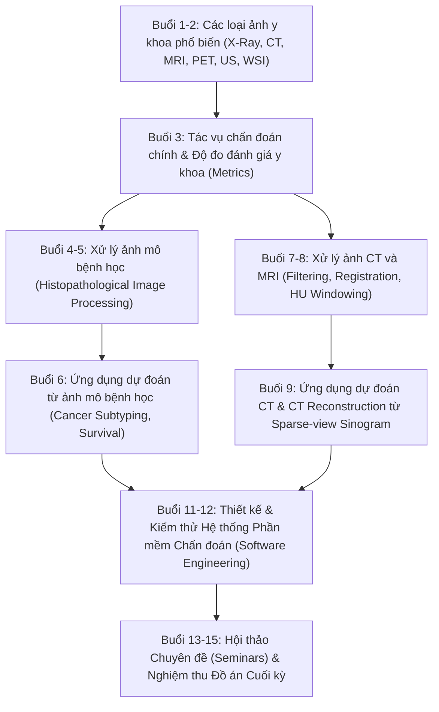

# SE374.R11: Bài Giảng 01 - Nhập Môn Xử Lý Ảnh Y Khoa (Introduction to Medical Imaging)

> **Thông tin môn học:** SE374.R11 - Phát triển phần mềm xử lý ảnh y khoa, Học kỳ 1, Năm học 2026  
> **Khoa:** Khoa Kỹ thuật Phần mềm, Trường Đại học Công nghệ Thông tin (UIT), ĐHQG-HCM  
> **Giảng viên phụ trách:** TS. Bùi Cao Doanh (`doanhbc@uit.edu.vn`)  
> **Tài liệu gốc:** `docs/lectures/Lecture_01_Introduction_to_Medical_Image.pdf` (49 slides)  
> **Chuẩn lưu trữ & Quản trị tri thức:** Invariant-19 (Vision-to-Markdown Ingestion Protocol)

---

## 1. Tổng Quan Môn Học & Cơ Cấu Đánh Giá (Course Evaluation)

Cơ cấu điểm số chính thức của môn học SE374.R11 (Slide 2):

| Thành phần đánh giá | Tỷ trọng | Bản chất & Yêu cầu trọng tâm |
| :--- | :---: | :--- |
| **Điểm danh & Quiz (Attendance & Quiz)** | **10%** | Kiểm tra nhanh kiến thức lý thuyết đầu giờ, mức độ chuyên cần trên lớp. |
| **Thực hành Lab (Lab Assignments)** | **30%** | Các bài tập lập trình cơ bản về xử lý ảnh y tế (đọc DICOM/NIfTI/SVS, tiền xử lý, trích xuất đặc trưng, huấn luyện mô hình cơ bản). |
| **Báo cáo Chuyên đề & Đồ án cuối kỳ (Seminar + Project)** | **60%** | **Thành phần quyết định điểm số môn học:** Nghiên cứu bài toán SOTA, thiết kế kiến trúc phần mềm y tế hoàn chỉnh, huấn luyện trên tập dữ liệu chuẩn, đánh giá lâm sàng và báo cáo nghiệm thu. |

> [!IMPORTANT]
> **Đồ án cuối kỳ chiếm tới 60% tổng điểm.** Vì vậy, việc lựa chọn đề tài có tính học thuật cao, bám sát chuyên môn của Giảng viên (CT Reconstruction và Digital Pathology WSI), kết hợp hoàn thiện phần mềm ứng dụng lâm sàng là yếu tố tiên quyết để đạt kết quả xuất sắc.

---

## 2. Kế Hoạch Giảng Dạy 15 Buổi (15-Session Syllabus)

Kế hoạch học tập 15 buổi được thiết kế phân tầng từ cơ sở vật lý ảnh đến thuật toán chuyên sâu và phát triển phần mềm (Slide 4):

### Ánh xạ Syllabus tới 8 Chủ Đề Đồ Án Cuối Kỳ:

1. **Buổi 4-6 (Giải phẫu bệnh số - Digital Pathology / WSI):**
   - Trực tiếp nuôi dưỡng **Topic 3** (Cancer subtyping using WSI - CGRL).
   - Trực tiếp nuôi dưỡng **Topic 4** (Survival analysis using WSI - MergeSurv).
   - Trực tiếp nuôi dưỡng **Topic 6** (Weakly-supervised segmentation for WSI - LowMagWSS).
2. **Buổi 7-9 (Ảnh cắt lớp CT và MRI):**
   - Trực tiếp nuôi dưỡng **Topic 1** (Sparse-view CT reconstruction - CG-GLORE).
   - Trực tiếp nuôi dưỡng **Topic 2** (Limited-angle CT reconstruction).
   - Trực tiếp nuôi dưỡng **Topic 5** (Tumor segmentation CT/MRI - BraTS/LiTS).
   - Trực tiếp nuôi dưỡng **Topic 7** (Collateral imaging in stroke - ISLES).
3. **Buổi 11-12 (Kỹ thuật phần mềm y tế - Medical Software Engineering):**
   - Đáp ứng chuẩn đầu ra của Khoa Kỹ thuật Phần mềm (UIT): Xây dựng giao diện tương tác chuyên nghiệp (DICOM/WSI Viewer), xử lý bất đồng bộ, kiến trúc module phân tầng (Clean Architecture), API RESTful và kiểm thử tự động (Unit Test, CI/CD).

---

## 3. Bản Chất Vật Lý & Toán Học 6 Phương Thức Ảnh Y Khoa (Modality Deep-Dives)

### 3.1. Tia X (X-Rays - Plain Radiography)
- **Bản chất vật lý (Slide 8-9):**
  - Chùm photon mang năng lượng cao sinh ra khi dòng electron gia tốc va chạm và hãm đột ngột trong bia kim loại (bức xạ hãm *Bremsstrahlung* và bức xạ đặc trưng).
  - Bệnh nhân nằm giữa nguồn phát tia X và phim/đầu thu (Detector) $\rightarrow$ tạo ảnh chụp X-quang (Radiograph).
- **Cơ chế tương tác & Độ tương phản mô (Slide 10):**
  - Xương chứa các nguyên tố nặng (Canxi, Phốt pho) có số hiệu nguyên tử $Z$ cao $\rightarrow$ hấp thụ tia X mạnh $\rightarrow$ vùng xương có màu trắng (cản quang).
  - Mô mềm (cơ, mỡ, dịch) có hệ số suy giảm tương đương nhau $\rightarrow$ khó phân biệt chi tiết giải phẫu bên trong các tạng.
  - Phổi chứa không khí $\rightarrow$ tia X xuyên qua tối đa $\rightarrow$ vùng phổi có màu đen.
  - Kim loại hấp thụ tia X cực mạnh $\rightarrow$ phát hiện dị vật kim loại rất rõ ràng.
- **Ưu / Nhược điểm:**
  - *Ưu điểm:* Chi phí rẻ, tốc độ chụp tức thì, máy móc phổ biến ở mọi tuyến y tế.
  - *Nhược điểm:* Ảnh chụp là hình chiếu chồng lấp 2D (mất thông tin chiều sâu 3D); sử dụng bức xạ ion hóa có hại cho tế bào sống.

---

### 3.2. Cắt Lớp Vi Tính (Computed Tomography - CT / CAT)
- **Lịch sử & Nguyên lý (Slide 13-14):**
  - Được Godfrey Hounsfield và Allan Cormack phát minh năm 1972 (Giải Nobel Y học 1979).
  - Dựa trên nguyên lý toán học: Một vật thể 3 chiều có thể được tái tạo chính xác từ tập hợp vô số các hình chiếu 2 chiều (hoặc 1 chiều) ở nhiều góc độ khác nhau thông qua **Biến đổi Radon (Radon Transform)**.

#### Định luật Beer-Lambert & Mô hình Suy giảm (Slide 22-25)
Cường độ chùm tia X sau khi truyền qua môi trường có độ dày $s$ và hệ số suy giảm tuyến tính $\mu$:
$$I = I_0 \cdot \exp(-\mu s) \iff \mu s = \ln\left(\frac{I_0}{I}\right) = -\ln\left(\frac{I}{I_0}\right)$$

**Bài toán mẫu $2 \times 2$ pixel (Slide 23-25):**
Cho ma trận hệ số suy giảm $2 \times 2$ với kích thước pixel $s = 1$, cường độ nguồn $I_0 = 1000$:
$$\begin{bmatrix} \mu_1 & \mu_2 \\ \mu_3 & \mu_4 \end{bmatrix} = \begin{bmatrix} 3 & 2 \\ 5 & 4 \end{bmatrix}$$
1. *Chiếu theo hàng ngang:*
   - Hàng 1: $I_{12} = I_0 e^{-(\mu_1 + \mu_2)s} = 1000 \cdot e^{-(3+2)} = 1000 \cdot e^{-5} \approx 6.738$
   - Hàng 2: $I_{34} = I_0 e^{-(\mu_3 + \mu_4)s} = 1000 \cdot e^{-(5+4)} = 1000 \cdot e^{-9} \approx 0.1234$
2. *Chiếu theo cột dọc:*
   - Cột 1: $I_{13} = I_0 e^{-(\mu_1 + \mu_3)s} = 1000 \cdot e^{-(3+5)} = 1000 \cdot e^{-8} \approx 0.3355$
   - Cột 2: $I_{24} = I_0 e^{-(\mu_2 + \mu_4)s} = 1000 \cdot e^{-(2+4)} = 1000 \cdot e^{-6} \approx 2.4788$
3. *Giải hệ phương trình khôi phục $\mu$ (Slide 25):*
   $$\begin{cases} \mu_1 + \mu_2 = -\ln(I_{12}/I_0) = 5 \\ \mu_3 + \mu_4 = -\ln(I_{34}/I_0) = 9 \\ \mu_1 + \mu_3 = -\ln(I_{13}/I_0) = 8 \\ \mu_2 + \mu_4 = -\ln(I_{24}/I_0) = 6 \end{cases}$$
   Hệ có vô số nghiệm nếu chỉ có 4 phương trình phụ thuộc tuyến tính; cần bổ sung góc chiếu chéo ($45^\circ$) như bài tập Slide 26 ($\mu_1 + \mu_4$, $\mu_2 + \mu_3$) để hệ có nghiệm duy nhất.

#### Biến đổi Radon liên tục & Sinogram (Slide 19, 27)
Trên không gian liên tục 2 chiều, hình chiếu song song $p(t, \theta)$ tại góc xoay $\theta$ và khoảng cách pháp tuyến $t$:
$$p(t, \theta) = -\ln\left(\frac{I(t, \theta)}{I_0}\right) = \mathcal{R}\{\mu\}(t, \theta) = \int_{-\infty}^\infty \mu(t \cos\theta - s \sin\theta,\; t \sin\theta + s \cos\theta)\, ds$$
- Ma trận $p(t, \theta)$ với trục hoành là góc xoay $\theta \in [0, 180^\circ]$ và trục tung là khoảng cách $t$ được gọi là **Sinogram** (vì một điểm cố định $(x_0, y_0)$ trong ảnh thực sẽ vạch ra một đường hình sin trên đồ thị này).

#### Tái tạo ảnh bằng FBP & Định lý Lát cắt Fourier (Fourier Slice Theorem - Slide 16, 28-30)
- **Định lý Lát cắt Fourier (Central Slice Theorem):** Biến đổi Fourier 1D của hình chiếu $p(t, \theta)$ chính là một lát cắt xuyên qua gốc tọa độ nghiêng góc $\theta$ trên biến đổi Fourier 2D của hàm ảnh gốc $\mu(x, y)$:
  $$\mathcal{F}_{1D}\{p(t, \theta)\}(\omega) = P(\omega, \theta) = F(\omega \cos\theta, \omega \sin\theta)$$
- **Tại sao cần Bộ lọc Ram-Lak / Ramping Filter? (Slide 29-30):**
  - Khi chiếu ngược trực tiếp (Backprojection đơn thuần), các đường chiếu chồng chéo dày đặc ở vùng tần số thấp (gần gốc tọa độ $(0, 0)$) theo hàm $1/r$. Điều này dẫn đến ảnh tái tạo bị mờ nhòe nghiêm trọng (*blurred image* - Slide 30 bên trái).
  - Thuật toán **Filtered Back Projection (FBP)** nhân phổ hình chiếu với bộ lọc dốc (Ramp Filter $| \omega |$) để bù trừ mật độ mẫu dày ở tần số thấp, sau đó mới chiếu ngược, mang lại ảnh cắt lớp sắc nét hoàn hảo (Slide 30 bên phải).

#### Thách thức Tái Tạo Sinogram Thưa (Sparse-View CT - Slide 31-32)
- **Bối cảnh y khoa:** Giảm số góc chiếu tia X từ hàng nghìn góc xuống còn 30 - 64 góc nhằm giảm liều bức xạ (Low-Dose CT), bảo vệ bệnh nhân khỏi nguy cơ ung thư.
- **Hệ quả toán học:** Sinogram bị thiếu dữ liệu nghiêm trọng $\rightarrow$ FBP truyền thống sinh ra các vệt nhiễu sọc (*streak artifacts*) che khuất tổn thương.
- **Đóng góp của Giảng viên TS. Bùi Cao Doanh (Slide 32):**
  1. *Long-Sequence Modeling for Sparse-View Computed Tomography Reconstruction*, Machine Vision and Applications (MVAP).
  2. *CG-GLORE: A Conjugate Gradient–Based Global-Local Regularization Network for Sparse-View CT Reconstruction*, BMVC 2026.

---

### 3.3. Cộng Hưởng Từ (Magnetic Resonance Imaging - MRI / NMR)
- **Bản chất vật lý (Slide 37-39):**
  - Dựa trên hiện tượng cộng hưởng từ hạt nhân của các nguyên tử có số proton lẻ (chủ yếu là Hydro $^1H$, chiếm lượng lớn trong nước và mỡ của cơ thể người).
  - Trong từ trường ngoài cực mạnh $B_0$ (1.5T hoặc 3.0T), mômen từ của proton hydro định hướng song song hoặc đối song.
  - Chiếu sóng xung tần số vô tuyến (RF pulse) kích thích proton quay lệch góc $\rightarrow$ khi tắt xung RF, proton hồi phục (*relaxation*) phát ra tín hiệu điện từ.
  - Tín hiệu được mã hóa không gian bằng cuộn gradient ($G_x, G_y, G_z$) và thu nhận trực tiếp trên miền tần số (**k-space**). Tái tạo ảnh bằng biến đổi Fourier ngược 2D/3D.
- **Đặc điểm lâm sàng:**
  - Cực kỳ an toàn (không dùng tia bức xạ ion hóa).
  - Độ tương phản mô mềm vượt trội (não, tủy sống, sụn, dây chằng, khối u nội tạng).
  - Không nhạy với cấu trúc xương (do xương chứa rất ít hydro tự do).

---

### 3.4. Y Học Hạt Nhân (PET / SPECT)
- **Bản chất (Slide 40-41):**
  - **PET (Positron Emission Tomography):** Tiêm dược chất phóng xạ phát positron (như $^{18}F$-FDG). Khi positron gặp electron trong mô, xảy ra hiện tượng hủy hạt (*annihilation*), sinh ra cặp photon gamma 511 keV bay ngược chiều $180^\circ$. Vòng cảm ứng ghi nhận hiện tượng trùng phùng (*coincidence detection*).
  - **SPECT (Single Photon Emission Computed Tomography):** Dược chất phát trực tiếp photon gamma đơn lẻ, thu nhận bằng camera gamma có ống chuẩn trực (Collimator).
- **Ý nghĩa lâm sàng:**
  - Khảo sát chức năng chuyển hóa tế bào (Functional / Metabolic imaging). Tế bào ung thư tiêu thụ nhiều đường glucose sẽ bắt thuốc phóng xạ cực mạnh $\rightarrow$ phát hiện di căn ung thư từ giai đoạn sớm.
  - Kỹ thuật tái tạo tương tự CT (FBP và các thuật toán lặp OSEM, MLEM).

---

### 3.5. Siêu Âm (Ultrasound - US)
- **Bản chất vật lý (Slide 43-45):**
  - Đầu dò chứa tinh thể áp điện (Piezoelectric crystal) phát sóng âm thanh tần số cao (> 1 MHz).
  - Sóng âm truyền qua cơ thể; khi gặp ranh giới giữa các mô có trở kháng âm (*acoustic impedance* $Z = \rho \cdot c$) khác nhau, một phần sóng bị phản xạ trở lại.
  - Đầu dò thu nhận sóng phản xạ; thời gian trễ $\Delta t$ xác định độ sâu của mô: $d = \frac{c \cdot \Delta t}{2}$; biên độ sóng phản xạ xác định độ cản âm (sáng/tối trên ảnh siêu âm).
- **Đặc tính:** Rất an toàn, giá thành thấp nhất, khảo sát thời gian thực (thai nhi, tim mạch), nhưng nhiễu đốm (*speckle noise*) rất cao và phụ thuộc lớn vào tay nghề bác sĩ.

---

### 3.6. Ảnh Giải Phẫu Bệnh Số (Microscopy / Whole Slide Images - WSI)
- **Khái niệm (Slide 47):**
  - Hình ảnh hóa cấu trúc mô và tế bào ở cấp độ vi mô thông qua sinh thiết (*biopsy*).
  - Ảnh WSI có kích thước khổng lồ (*gigapixel*, thường từ $50,000 \times 50,000$ đến $150,000 \times 150,000$ pixels).
  - Lưu trữ dưới dạng cấu trúc kim tự tháp đa độ phân giải (*pyramid structure*): từ độ phóng đại thấp ($5\times, 10\times$) đến độ phóng đại cao ($20\times, 40\times$).

#### Quy trình Xử lý Mô & Thu nhận WSI trong Phòng Xét nghiệm (Slide 48)

```mermaid
flowchart LR
    subgraph Phase1["Giai đoạn 1: Xử lý mô bệnh phẩm (Tissue Processing)"]
        B["1. Sinh thiết (Biopsy)"] --> F["2. Cố định (Fixation - Formalin)"]
        F --> E["3. Đúc khối (Embedding - Paraffin)"]
        E --> TB["4. Khối mô sáp (Tissue Block)"]
        TB --> AS["5. Cắt lát mỏng (Automatic Sectioning 4-5 µm)"]
        AS --> AF["6. Trải lát cắt (Automatic Flotation)"]
        AF --> AST["7. Nhuộm màu (Automatic Staining - H&E)"]
        AST --> GS["8. Tiêu bản kính (Glass Slide)"]
    end

    subgraph Phase2["Giai đoạn 2: Số hóa WSI & Phân tích AI"]
        GS --> WS["9. Máy quét tự động (WSI Scanning)"]
        WS --> WV["10. Trình xem tiêu bản số (WSI Viewer)"]
        WV --> AIA["11. Phân tích AI (Automated Image Analysis)"]
        AIA --> LIS["12. Hệ thống thông tin xét nghiệm (LIS)"]
    end
```

- **Tác vụ AI trọng tâm trên WSI:**
  - Phân loại dưới nhóm ung thư (*Cancer Classification & Subtyping* - **Topic 3**).
  - Phân vùng cấu trúc mô/tuyến/nhân tế bào (*Segmentation* - **Topic 6**).
  - Dự đoán thời gian sống sót và nguy cơ tử vong (*Survival Analysis* - **Topic 4**).

---

## 4. Tổng Hợp Chiến Lược Cho Đồ Án Cuối Kỳ SE374.R11

Từ phân tích chuyên sâu Slide Bài giảng 01 của TS. Bùi Cao Doanh, định hướng đồ án cần đảm bảo các tiêu chí cốt lõi:

| Tiêu chí | Đánh giá & Khuyến nghị chiến lược |
| :--- | :--- |
| **Sự quan tâm của Giảng viên** | **Cực kỳ cao ở Topic 1 (Sparse-view CT)** và **Topic 3 / 4 / 6 (WSI)**. Giảng viên trực tiếp đưa bài báo của chính mình về CG-GLORE (BMVC 2026) và MVAP vào slide bài giảng (Slide 32). |
| **Khoảng trống đề tài của lớp** | **Topic 3 (Cancer Subtyping bằng WSI - CGRL)** hiện **chưa có nhóm nào đăng ký** (theo bảng theo dõi `SE374.R11 - Đồ án cuối kỳ.xlsx`). Đây là cơ hội vàng để tạo sự đột phá và khác biệt hoàn toàn với phần còn lại của lớp. |
| **Tính công nghệ phần mềm (60% điểm đồ án)** | Cần hiện thực hóa giao diện web chuyên nghiệp: Trình duyệt lát cắt CT tương tác đa mặt phẳng (MPR) hoặc Trình xem tiêu bản mô bệnh học WSI đa tầng zoom ($5\times \rightarrow 40\times$) với bản đồ nhiệt giải thích (Concept / Attention Heatmap), tích hợp API và Docker container. |

---

## 5. Tham Khảo Tài Liệu & Liên Kết Hệ Thống

- **Tệp bài giảng PDF gốc:** [`docs/lectures/Lecture_01_Introduction_to_Medical_Image.pdf`](file:///c:/Users/Nguyen%20Trong%20Khoi/Downloads/Y_KHOA/docs/lectures/Lecture_01_Introduction_to_Medical_Image.pdf)
- **Tài liệu phân tích 8 chủ đề môn học:** [`docs/SE374_TOPIC_MATRIX_AND_GUIDE.md`](file:///c:/Users/Nguyen%20Trong%20Khoi/Downloads/Y_KHOA/docs/SE374_TOPIC_MATRIX_AND_GUIDE.md)
- **Đề xuất chiến lược đồ án nhóm:** [`docs/PROPOSAL_TOPIC_RECOMMENDATION.md`](file:///c:/Users/Nguyen%20Trong%20Khoi/Downloads/Y_KHOA/docs/PROPOSAL_TOPIC_RECOMMENDATION.md)
- **Tài liệu bài báo tác giả (Paper Dossiers):**
  - CG-GLORE (Topic 1): [`docs/papers/CG_GLORE_arxiv_2608.15246.md`](file:///c:/Users/Nguyen%20Trong%20Khoi/Downloads/Y_KHOA/docs/papers/CG_GLORE_arxiv_2608.15246.md)
  - CGRL (Topic 3): [`docs/papers/CGRL_arxiv_2607.12556.md`](file:///c:/Users/Nguyen%20Trong%20Khoi/Downloads/Y_KHOA/docs/papers/CGRL_arxiv_2607.12556.md)
  - MergeSurv (Topic 4): [`docs/papers/MergeSurv_arxiv_2607.04747.md`](file:///c:/Users/Nguyen%20Trong%20Khoi/Downloads/Y_KHOA/docs/papers/MergeSurv_arxiv_2607.04747.md)
  - LowMagWSS (Topic 6): [`docs/papers/LowMagWSS_arxiv_2607.10783.md`](file:///c:/Users/Nguyen%20Trong%20Khoi/Downloads/Y_KHOA/docs/papers/LowMagWSS_arxiv_2607.10783.md)
