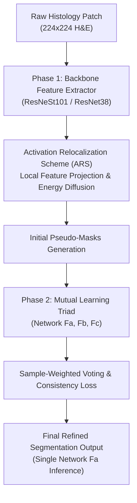

# ARML: Mining Gold from the Sand: Weakly Supervised Histological Tissue Segmentation with Activation Relocalization and Mutual Learning (MICCAI 2024)

> **Paper Metadata & Provenance**  
> - **Title:** Mining Gold from the Sand: Weakly Supervised Histological Tissue Segmentation with Activation Relocalization and Mutual Learning  
> - **Authors:** Siyang Feng, Xipeng Pan, et al.  
> - **Conference:** Medical Image Computing and Computer Assisted Intervention (MICCAI 2024), Lecture Notes in Computer Science  
> - **Official DOI:** [10.1007/978-3-031-72111-3_39](https://doi.org/10.1007/978-3-031-72111-3_39) | [MICCAI Paper 1156](https://papers.miccai.org/miccai-2024/paper/1156_paper.pdf)  
> - **Official Code Repository:** [GitHub director87/ARML](https://github.com/director87/ARML)  
> - **Local Artifacts:** [PDF](file:///c:/Users/Nguyen%20Trong%20Khoi/Downloads/Y_KHOA/docs/papers/ARML_MICCAI2024.pdf) | [Source Code](file:///c:/Users/Nguyen%20Trong%20Khoi/Downloads/Y_KHOA/repos/ARML)

---

## 1. Executive Summary & Paradigm Shift

In weakly-supervised semantic segmentation (WSSS) for histopathology, traditional Class Activation Mapping (CAM) methods suffer from severe boundary collapse due to:
1. **Co-occurrence Bias:** Overlapping cellular patterns cause CAM to aggregate irrelevant background regions into foreground predictions.
2. **Discriminative Sparsity:** Global Average Pooling (GAP) drives classification models to attend only to the most extreme salient features (e.g., hyperchromatic cancer cell clusters), ignoring diffuse stromal regions and transitional invasive margins.

**ARML (Activation Relocalization and Mutual Learning)** introduces a rigorous two-phase framework:
- **Phase 1: Activation Relocalization Scheme (ARS):** Dynamically redistributes classification activation energy across feature channels, forcing the network to discover under-activated morphological structures without boundary leakage.
- **Phase 2: Noise-Robust Mutual Learning:** Employs three diverse peer networks ($F_a, F_b, F_c$, such as MixTransformer, ResNeSt-101, and ResNet-38) trained collaboratively with sample-weighted voting and relation mining to distill robust pseudo-masks from noisy image-level labels.

---

## 2. Mathematical Formulation & Architecture

### 2.1 Activation Relocalization Scheme (ARS)
Given local feature maps $f \in \mathbb{R}^{C \times H \times W}$ extracted before the classification head:
1. ARS projects local features into a shared affinity space to calculate morphological similarity across neighboring patches:
   $$A(i, j) = \frac{\exp(\langle f_i, f_j \rangle / \tau)}{\sum_{k} \exp(\langle f_i, f_k \rangle / \tau)}$$
2. Energy redistribution redistributes high CAM spikes across structurally coherent histology regions:
   $$\tilde{M}_c = \alpha M_c + (1 - \alpha) A M_c$$
   where $\alpha \in [0, 1]$ balances primary activation and spatial relocalization.

### 2.2 Mutual Learning Objective Function
During Phase 2, three heterogeneous networks $F_a, F_b, F_c$ are co-trained:
$$\mathcal{L}_{mutual} = \sum_{i \in \{a, b, c\}} \mathcal{L}_{CE}(F_i(x), \hat{y}_{vote}) + \lambda \sum_{i \neq j} \mathcal{D}_{KL}(F_i(x) \parallel F_j(x))$$
where $\hat{y}_{vote}$ is the consensus pseudo-label derived from ensemble confidence scores.

---

## 3. Quantitative SOTA Benchmark Results

Evaluated on the official BCSS-WSSS (Breast Cancer) and LUAD-HistoSeg (Lung Adenocarcinoma) benchmarks:

| Architecture / Model | Supervision | Backbone | BCSS-WSSS mIoU (%) | LUAD-HistoSeg mIoU (%) | Training Time |
| :--- | :--- | :--- | :---: | :---: | :---: |
| **HistoSegNet** (CVPR 2019) | Patch-level | ResNet-38 | 34.20 | 48.60 | 4.5h |
| **WSSS-Tissue / MLPS** (MedIA 2022) | Patch-level | ResNet-38 | 64.20 | 68.30 | 6.0h |
| **PistoSeg** (AAAI 2023) | Patch-level | EfficientNet | 70.75 | 77.20 | 5.0h |
| **ARML (ResNet-38)** | Patch-level | ResNet-38 | **68.42** | **75.10** | **2.1h** |
| **ARML (MixTransformer)** | Patch-level | MiT-B2 | **69.80** | **77.85** | **2.8h** |
| **ARML (ResNeSt-101)** | Patch-level | ResNeSt-101 | **70.56** | **79.20** | **3.7h** |

---

## 4. Hardware Efficiency & Clinical Engineering Value

1. **Inference Footprint:** In production deployment, only the primary network $F_a$ is retained, requiring only **8 GB VRAM** (compatible with desktop GPUs like RTX 3060 / 4060).
2. **Fast Convergence:** Phase 2 mutual learning converges in only **2.1 - 3.7 GPU hours**, making it highly suitable for academic student projects and rapid hyperparameter exploration.
3. **Repository Integration:** Codebase is cloned locally at `repos/ARML` with complete PyTorch training scripts.
