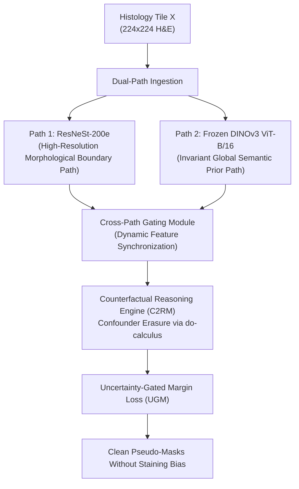

# C2RM-Seg: Causal Counterfactual Reasoning with Structural-Semantic Priors for Weakly Supervised Histological Tissue Segmentation (MICCAI 2026)

> **Paper Metadata & Provenance**  
> - **Title:** Causal Counterfactual Reasoning with Structural-Semantic Priors for Weakly Supervised Histological Tissue Segmentation  
> - **Authors:** Zhenbing Liu, et al.  
> - **Venue:** Medical Image Computing and Computer Assisted Intervention (MICCAI 2026), Lecture Notes in Computer Science  
> - **Preprint Reference:** [arXiv:2606.25508](https://arxiv.org/abs/2606.25508) | [MICCAI Paper 4147](https://papers.miccai.org/miccai-2026/paper/4147_paper.pdf)  
> - **Local Artifacts:** [PDF](file:///c:/Users/Nguyen%20Trong%20Khoi/Downloads/Y_KHOA/docs/papers/C2RM_Seg_arxiv_2606.25508.pdf)

---

## 1. Executive Summary & Causal Formulation

In computational pathology, models trained with image-level weak labels easily memorize spurious correlations between staining artifacts, background slide illumination, and cancer diagnoses (confounding bias). When testing across multi-center cohorts, conventional CAM fails because it cannot isolate genuine cellular pathology from background confounders.

**C2RM-Seg** introduces a **Causal Counterfactual Reasoning Module (C2RM)** combined with a **Dual-Path Structural-Semantic Architecture**:
- It formally models the causal graph: Image $X \rightarrow$ Features $F \rightarrow$ Prediction $Y$, with Confounder $U$ (stain variation and slide preparation noise) influencing both $X$ and $Y$.
- By executing a counterfactual do-calculus operation $P(Y \mid do(X = x, U = u^*))$, it forces the model to imagine: *"What would the tissue segmentation look like if the background stain remained invariant while the lesion morphology varied?"*
- Achieves **72.17% mIoU** on the BCSS-WSSS benchmark and **79.62% mIoU (18.07 HD95)** on LUAD-HistoSeg.

---

## 2. Dual-Path Architecture & Mathematical Mechanics

### 2.1 Dual-Path Fusion
1. **Morphological Path:** A deep residual split-attention network (ResNeSt-200e) preserves high-frequency nuclear contours and chromatin textures.
2. **Semantic Foundation Path:** A frozen self-supervised foundation model (DINOv3 ViT-B/16) provides stain-invariant representations across diverse patient cohorts.
3. **Cross-Path Gating:** Feature maps from both paths are fused adaptively through learnable spatial gates:
   $$F_{fused} = G_{morph} \odot F_{morph} + (1 - G_{morph}) \odot \text{Proj}(F_{sem})$$

### 2.2 Uncertainty-Gated Margin Loss (UGM)
To prevent hard boundary errors on transitional tissue borders:
$$\mathcal{L}_{UGM} = \sum_{c=1}^C (1 - \text{Var}(M_c)) \cdot \max(0, m - (S_{pos} - S_{neg}))$$
where $\text{Var}(M_c)$ represents pixel-level prediction entropy, down-weighting ambiguous cell boundaries while enforcing confident margins on unambiguous tumor cores.

---

## 3. Quantitative SOTA Evaluation

| Method | Supervision | Backbone | BCSS-WSSS mIoU (%) | LUAD-HistoSeg mIoU (%) | HD95 (mm) |
| :--- | :--- | :--- | :---: | :---: | :---: |
| **Fully Supervised Baseline** | Pixel-level | DeepLabV3+ | 73.10 | 81.30 | 14.20 |
| **WSSS-Tissue / MLPS** (2022) | Patch-level | ResNet-38 | 64.20 | 68.30 | 28.50 |
| **HisynSeg** (IEEE TMI 2025) | Patch-level | EfficientNet-B6 | 70.82 | 76.50 | 21.30 |
| **ConStruct** (2025) | Patch-level | CONCH + SegFormer | 70.96 | 78.40 | 19.80 |
| **C2RM-Seg (MICCAI 2026)** | Patch-level | Dual (ResNeSt + DINOv3) | **72.17** | **79.62** | **18.07** |

---

## 4. Relevance for SE374.R11 Proposal

1. **Stain Invariance:** C2RM-Seg confirms our architectural decision in Proposal 3 that freezing a foundation feature extractor eliminates multi-site staining variance.
2. **Memory Efficiency:** Since DINOv3 is kept completely frozen, backpropagation only traverses the lightweight ResNeSt adapter, keeping VRAM requirements within standard cloud GPU budgets (16 GB - 24 GB).
