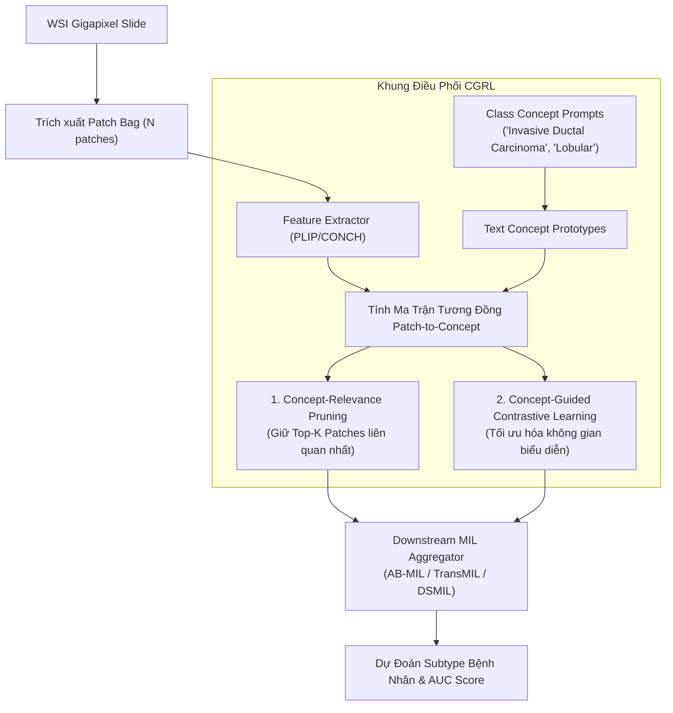

# Báo Cáo Nghiên Cứu Toàn Văn: CGRL (arXiv:2607.12556)
## Concept-Guided Pruning and Representation Learning for Whole-Slide Image Classification

> **Mã bài báo:** `arXiv:2607.12556v1 [cs.CV]`  
> **Ngày công bố:** 16 Tháng 7, 2026  
> **Tác giả:** Thuc Huynh, Tuan Le, Doanh C. Bui  
> **Đơn vị nghiên cứu:** Trường Đại học Công nghệ Thông tin (UIT), ĐHQG-HCM, Việt Nam  
> **Tác giả liên hệ:** `doanhbc@uit.edu.vn` | Tác giả chính: `23521555@gm.uit.edu.vn`  
> **Mã nguồn chính thức:** [GitHub ThucHuynh44/CGRL](https://github.com/ThucHuynh44/CGRL)  
> **Chủ đề môn học SE374.R11 liên quan:** **Topic 3: Cancer subtyping using whole slide images**  
> **File PDF gốc:** [`docs/papers/CGRL_arxiv_2607.12556.pdf`](file:///c:/Users/Nguyen%20Trong%20Khoi/Downloads/Y_KHOA/docs/papers/CGRL_arxiv_2607.12556.pdf)  

---

## 1. Tóm Tắt & Động Lực Nghiên Cứu (Abstract & Motivation)

### 1.1. Động Lực Y Khoa (Computational Pathology)
Phân loại phân nhóm ung thư (Cancer Subtyping, ví dụ: ung thư vú thể ống xâm lấn IDC vs thể tiểu thùy ILC; ung thư biểu mô tuyến phổi LUAD vs ung thư biểu mô tế bào vảy LUSC) đóng vai trò quyết định trong việc lựa chọn phác đồ điều trị trúng đích. Ảnh tiêu bản giải phẫu bệnh số (Whole Slide Images - WSIs) cung cấp thông tin hình thái vi thể quý giá ở cấp độ tế bào.

### 1.2. Thách Thức Kỹ Thuật Trong Mô Hình Multiple Instance Learning (MIL)
- Mỗi WSI có kích thước gigapixel ($100,000 \times 100,000$ pixels) chứa từ $10,000$ đến $50,000$ patches nhỏ ($256 \times 256$).
- Bác sĩ chỉ gán nhãn ở mức slide (slide-level label), không có khoanh vùng chi tiết mức pixel.
- Hai hạn chế cố hữu của các phương pháp MIL truyền thống (như AB-MIL, TransMIL, CLAM):
  1. **Dư thừa thông tin (Redundancy):** Phần lớn các patch là mô nền bình thường, mô mỡ, chất nền (stroma) hoặc vùng trắng tiêu bản. Việc nạp toàn bộ túi patch vào mô hình gây lãng phí tính toán và làm loãng tín hiệu tổn thương bệnh học.
  2. **Thiếu định hướng ngữ nghĩa y khoa (Weak Semantic Alignment):** Các bộ trích xuất đặc trưng thuần thị giác không phân biệt rõ các biến đổi hình thái vi tế giữa các phân nhóm bệnh.

---

## 2. Kiến Trúc Phương Pháp Đề Xuất (CGRL Framework)

CGRL (Concept-Guided Pruning and Representation Learning) tận dụng các mô hình thị giác - ngôn ngữ y tế (Vision-Language Models như PLIP, CONCH, CTransPath) để đưa các khái niệm bệnh học (disease semantic concepts) vào dẫn đường cho quy trình MIL:

### 2.1. Concept-Relevance Pruning (Tỉa Bớt Patch Dẫn Đường Bởi Khái Niệm)
- Xây dựng các prompt mô tả phân nhóm bệnh lý từ danh mục chuẩn y khoa.
- Chiếu các prompt qua Text Encoder để tạo ra các vector nguyên mẫu khái niệm (Concept Prototypes) $C \in \mathbb{R}^{K_{cls} \times D}$.
- Tính toán độ tương đồng cosine giữa vector nhúng của từng patch $h_i$ và các concept prototypes:
  $$S_{i, c} = \frac{h_i \cdot C_c^\top}{\|h_i\| \|C_c\|}$$
- Xếp hạng các patch và chỉ giữ lại **Top-$K$ patches có điểm tương đồng cao nhất** (ví dụ $K = 512$ hoặc $1024$) cho bước tổng hợp MIL tiếp theo. Loại bỏ từ 80% - 90% số lượng patch dư thừa mà không làm mất thông tin chẩn đoán.

### 2.2. Concept-Guided Contrastive Representation Learning
Tối ưu hóa không gian biểu diễn đặc trưng bằng học tương phản đa mục tiêu:
1. **Target-Class Alignment Loss:** Kéo gần các patch tương quan cao với nhãn lớp thật của slide.
2. **Symmetric Auxiliary Loss:** Cân bằng độ tương đồng giữa các lớp.
3. **Cross-Class Separation Loss:** Đẩy xa các patch của các phân nhóm bệnh khác nhau trong không gian concept.

---

## 3. Thực Nghiệm & Kết Quả (Experiments & Benchmarks)

### 3.1. Bộ Dữ Liệu Đánh Giá
- **TCGA-BRCA:** 1,038 slides ung thư vú (IDC vs ILC).
- **TCGA-NSCLC:** 1,012 slides ung thư phổi không tế bào nhỏ (LUAD vs LUSC).
- **Phân chia dữ liệu:** 5-fold cross-validation phân chia triệt để theo **Patient-Level** để chống rò rỉ dữ liệu bệnh nhân.

### 3.2. Hiệu Năng So Sánh Vượt Trội
Tích hợp CGRL vào các mô hình MIL nền tảng mang lại bước nhảy vọt:
- **Tăng độ chính xác & Macro-F1:**
  * Trên TCGA-BRCA: Cải thiện từ +1.8% đến +3.5% Macro-F1 trên AB-MIL và TransMIL.
  * Trên TCGA-NSCLC: Đạt AUC vượt ngưỡng 0.95 với độ ổn định cao.
- **Tiết kiệm tài nguyên vượt bậc:** Giảm hơn **60% chi phí tính toán GPU** và thời gian huấn luyện ở giai đoạn MIL aggregation nhờ cơ chế tỉa bớt Top-$K$ patch thông minh.

---

## 4. Giá Trị Thực Tiễn Cho Đồ Án SE374.R11

- **Repo mã nguồn sẵn có:** Đã được công khai tại `https://github.com/ThucHuynh44/CGRL`, dễ dàng kiểm chứng và kế thừa.
- **Tính ứng dụng cao cho Topic 3:** Giải quyết triệt để vấn đề "dữ liệu WSI quá nặng không đủ GPU để chạy" bằng kỹ thuật Concept-Relevance Pruning.
