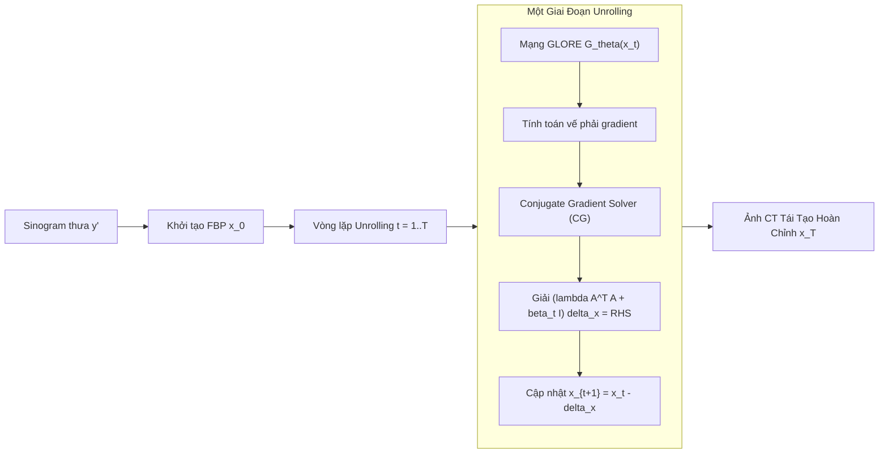

# Báo Cáo Nghiên Cứu Toàn Văn: CG-GLORE (arXiv:2608.15246)
## A Conjugate Gradient–Based Global-Local Regularization Network for Sparse-View CT Reconstruction

> **Mã bài báo:** `arXiv:2608.15246v1 [cs.CV]`  
> **Ngày công bố:** 15 Tháng 8, 2026  
> **Tác giả:** Tran Xuan Hieu Le, Doanh C. Bui, Vu Trung Duong Le, Hoai Luan Pham, Khang Nguyen, Maï K. Nguyen, Tu Bao Ho, Yasuhiko Nakashima  
> **Đơn vị nghiên cứu:**  
> - Trường Đại học Công nghệ Thông tin (UIT), ĐHQG-HCM, Việt Nam (`doanhbc@uit.edu.vn`, `khangnttm@uit.edu.vn`)  
> - Viện Khoa học và Công nghệ Nara (NAIST), Nhật Bản  
> - Phòng thí nghiệm ETIS (UMR 8051), Đại học CY Cergy Paris, CNRS, Pháp  
> - Viện Nghiên cứu Cao cấp về Toán (VIASM), Hà Nội, Việt Nam  
> **Chủ đề môn học SE374.R11 liên quan:** **Topic 1: Sparse-view CT reconstruction** *(Trọng tâm Buổi 2)* & **Topic 2: Limited-angle CT reconstruction**.  
> **File PDF gốc:** [`docs/papers/CG_GLORE_arxiv_2608.15246.pdf`](file:///c:/Users/Nguyen%20Trong%20Khoi/Downloads/Y_KHOA/docs/papers/CG_GLORE_arxiv_2608.15246.pdf)  

---

## 1. Tóm Tắt & Động Lực Nghiên Cứu (Abstract & Motivation)

### 1.1. Động Lực Lâm Sàng
Chụp cắt lớp vi tính (CT) là công cụ chẩn đoán hình ảnh cốt lõi trong y tế. Tuy nhiên, việc phơi nhiễm tia X lặp đi lặp lại làm tăng nguy cơ ung thư do phóng xạ. **Sparse-view CT** (chụp CT góc chiếu thưa) nhằm giảm liều chiếu xạ bằng cách thu nhận ít góc chiếu hơn (ví dụ: chỉ chụp 32, 64 hoặc 128 góc thay vì 720 góc tiêu chuẩn). 

### 1.2. Thách Thức Kỹ Thuật
- Việc giảm góc chiếu khiến bài toán tái tạo trở thành **bài toán nghịch đảo thiếu điều kiện nghiêm trọng (severely ill-posed inverse problem)**.
- Thuật toán kinh điển FBP (Filtered Back Projection) sinh ra nhiễu vệt (streak artifacts) nặng nề làm che khuất các cấu trúc giải phẫu nhỏ và tổn thương.
- Các mạng Deep Unrolling hiện tại (như LPD, LEARN) chủ yếu dựa trên **bước cập nhật đạo hàm cấp một (first-order gradient descent)**:
  * Tốc độ hội tụ chậm trong các bài toán điều kiện xấu.
  * Phải sử dụng mạng điều chuẩn (regularization network) quá cồng kềnh để bù đắp cho hướng tối ưu hóa kém chính xác.

---

## 2. Cơ Sở Toán Học & Bài Toán Nghịch Đảo (Mathematical Formulation)

### 2.1. Mô Hình Xuôi (Forward Model)
Quá trình chiếu tạo ảnh sinogram:
$$y = Ax + \varepsilon$$
Trong đó:
- $x \in \mathbb{R}^n$ ($n = H \times W$): Ảnh CT lát cắt cần tái tạo (đơn vị Hounsfield Units - HU).
- $y \in \mathbb{R}^m$ ($m = n_v \times n_d$): Ảnh sinogram thu nhận, với $n_v$ là số góc chiếu và $n_d$ là số phần tử đầu thu. Với Sparse-view CT, $n'_v \ll n_v$.
- $A \in \mathbb{R}^{m \times n}$: Toán tử biến đổi Radon (ma trận hệ thống CT).
- $\varepsilon$: Nhiễu đo lường thực tế.

### 2.2. Hàm Mục Tiêu Tối Ưu (Objective Function)
$$\hat{x} = \arg\min_{x} J(x) = \frac{\lambda}{2} \|Ax - y\|_2^2 + \mathcal{R}(x)$$
Trong đó $\frac{\lambda}{2} \|Ax - y\|_2^2$ là thành phần ràng buộc dữ liệu đo (data-fidelity term), và $\mathcal{R}(x)$ là thành phần điều chuẩn tiên nghiệm ảnh (image prior regularizer).

---

## 3. Kiến Trúc Phương Pháp Đề Xuất (CG-GLORE)

CG-GLORE kết hợp hai thành phần đột phá:
1. **Bước cập nhật lấy cảm hứng từ đạo hàm cấp hai (Second-Order-Inspired Update via Conjugate Gradient).**
2. **Mạng điều chuẩn toàn cục - cục bộ (Alternative Global-Local Regularization Network - GLORE).**

### 3.1. Structured Hessian Surrogate & Giải Bằng Conjugate Gradient (CG)
- Thay vì sử dụng Hessian chính xác (không khả thi để tính và lưu trữ với ma trận ảnh kích thước lớn), bài báo đề xuất **Hessian đại diện có cấu trúc (Structured Hessian Surrogate)**:
  * Giữ nguyên độ cong giải tích của thành phần data-fidelity: $\nabla^2 ( \frac{\lambda}{2} \|Ax - y\|_2^2 ) = \lambda A^T A$.
  * Xấp xỉ Hessian của thành phần điều chuẩn học được bằng ma trận đơn vị nhân vô hướng: $\nabla^2 \mathcal{R}(x) \approx \beta_t I$.
- Ma trận Hessian surrogate:
  $$H_t = \lambda A^T A + \beta_t I$$
- Hệ phương trình tuyến tính cần giải tại mỗi bước unrolling:
  $$(\lambda A^T A + \beta_t I) \Delta x_t = \lambda A^T(A x_t - y) + G_\theta(x_t)$$
- Do ma trận $H_t$ là ma trận **đối xứng xác định dương (Symmetric Positive Definite - SPD)**, thuật toán **Conjugate Gradient (CG)** giải nghiệm $\Delta x_t$ cực kỳ nhanh chóng và ổn định mà không cần nghịch đảo ma trận trực tiếp.

### 3.2. Mạng Điều Chuẩn GLORE (Global-Local Regularization)
Gồm 3 tầng tích chập kết hợp khối mô hình phụ thuộc tầm xa LORAD ở giữa:
1. **Conv1:** Trích xuất đặc trưng cục bộ (local anatomical features) $F_1 \in \mathbb{R}^{H \times W \times C_1}$.
2. **LORAD (Long-Range Dependency Representation):**
   - **Sparse Patchification:** Áp dụng sliding window kích thước $k \times k$ với hệ số giãn (dilation factor) $H/k$ để nhóm các điểm ảnh ở xa nhau mà không chồng lấn. Giảm độ phức tạp tự chú ý (self-attention) từ $\mathcal{O}(N^2)$ xuống $\mathcal{O}(N^2 / k^4)$.
   - **Nyström Approximate Attention:** Thay vì tính toán toàn bộ ma trận chú ý $\tilde{N} \times \tilde{N}$, chọn ra $L$ landmark tokens đại diện theo thuật toán Nyström để tính toán ma trận chú ý xấp xỉ với chi phí tuyến tính.
3. **Conv2 & Conv3:** Tổng hợp đặc trưng mức cao và xuất ra tensor điều chuẩn $G_\theta(x_t) \approx \nabla_x \mathcal{R}(x_t)$.

---

## 4. Thiết Lập Thực Nghiệm & Kết Quả (Experiments & Benchmarks)

### 4.1. Bộ Dữ Liệu Thực Nghiệm
- **AAPM Low-Dose CT Grand Challenge (Mayo Clinic):** Dữ liệu chụp cắt lớp lâm sàng chuẩn của Hiệp hội Vật lý Y tế Hoa Kỳ.
- **DeepLesion:** Tập dữ liệu chụp cắt lớp tổn thương diện rộng của NIH.
- **Thiết lập góc chiếu:** Thử nghiệm trên các mức thưa khác nhau: 32 views, 64 views, 128 views.

### 4.2. Kết Quả Định Lượng So Sánh (Quantitative Performance)
CG-GLORE vượt trội so với các phương pháp Baseline hàng đầu:
- **FBP:** Bị suy giảm chất lượng nghiêm trọng, PSNR thấp (~22-26 dB) do streak artifacts dày đặc.
- **FBPConvNet / U-Net post-processing:** Khử nhiễu cục bộ nhưng làm mờ ranh giới mô mềm.
- **Learned Primal-Dual (LPD):** Baseline unrolling tốt nhưng hội tụ chậm và tốn tham số.
- **CG-GLORE:**
  * Đạt **PSNR cao nhất** (vượt trội từ 1.2 - 2.5 dB so với LPD và các mô hình cùng kích thước).
  * Đạt **SSIM $\ge 0.96 - 0.98$**, phục hồi độ tương phản sắc nét các tổn thương nhỏ.
  * Đường cong suy giảm hàm mục tiêu (convergence curve) mượt mà và ổn định hơn hẳn các mạng gradient descent bậc một.

---

## 5. Giá Trị Kế Thừa & Ứng Dụng Cho Đồ Án SE374.R11

1. **Ý nghĩa học thuật:** Đây là công trình mới nhất (8/2026) do chính các thầy cô tại UIT tham gia nghiên cứu. Việc kế thừa kiến trúc này cho Topic 1 hoặc Topic 2 sẽ tạo điểm nhấn học thuật rất lớn.
2. **Kế thừa kiến trúc:**
   - Sử dụng giải thuật CG unrolling để đảm bảo tính đúng đắn về mặt vật lý chụp CT (data-fidelity qua toán tử Radon $A$ và $A^T$).
   - Sử dụng khối GLORE nhẹ gọn thay vì các mạng Transformer khổng lồ, phù hợp với tài nguyên GPU sinh viên (8GB - 16GB VRAM).
3. **Chỉ số đo lường chuẩn:** PSNR (dB), SSIM, NRMSE.
