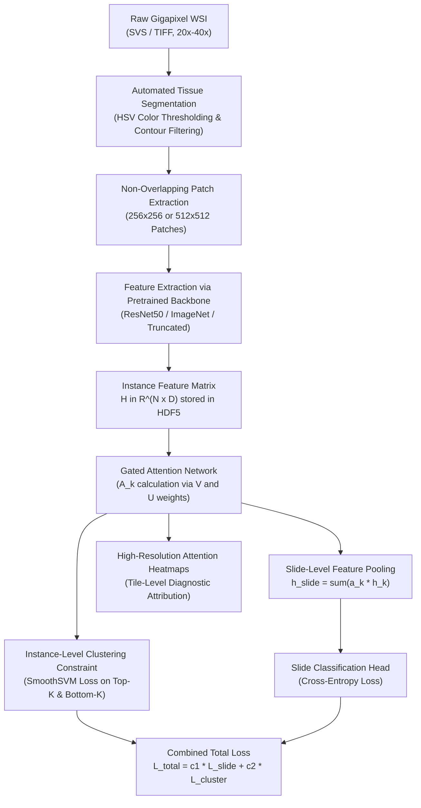

# CLAM: Data Efficient and Weakly Supervised Computational Pathology on Whole Slide Images (Nature Biomedical Engineering 2021)

> **Paper Metadata & Provenance**  
> - **Title:** Data Efficient and Weakly Supervised Computational Pathology on Whole Slide Images  
> - **Authors:** Ming Y. Lu, Drew F. K. Williamson, Tiffany Y. Chen, Richard J. Chen, Matteo Barbieri, Faisal Mahmood  
> - **Journal / Citation:** Nature Biomedical Engineering 5(6):555-570 (June 2021); Preprint: arXiv:2004.09666v2 [eess.IV]  
> - **Official DOI:** [10.1038/s41551-020-00682-w](https://doi.org/10.1038/s41551-020-00682-w)  
> - **Official Code Repository:** [GitHub mahmoodlab/CLAM](https://github.com/mahmoodlab/CLAM) | [Interactive Demo](http://clam.mahmoodlab.org)  
> - **Local Artifacts:** [PDF](file:///c:/Users/Nguyen%20Trong%20Khoi/Downloads/Y_KHOA/docs/papers/CLAM_arxiv_2004.09666.pdf) | [Source Code](file:///c:/Users/Nguyen%20Trong%20Khoi/Downloads/Y_KHOA/repos/CLAM)

---

## 1. Executive Summary & Paradigm Shift

In computational pathology, whole slide images (WSIs) typically consist of gigapixel dimensions ($40,000 \times 40,000$ to $100,000 \times 100,000$ pixels at 40x magnification). Pixel-level or boundary annotations by expert pathologists are prohibitively expensive and time-consuming. Traditional Multiple Instance Learning (MIL) methods aggregate instance representations into slide-level predictions, but they typically suffer from two major limitations:
1. **Weak Interpretability:** Standard attention pooling often generates diffused attention weights, struggling to isolate subtle diagnostic micro-regions from overwhelming background stroma.
2. **Suboptimal Representation Learning:** Conventional MIL models optimize solely against slide-level cross-entropy loss, without explicit constraints on instance-level feature clustering, resulting in poor separability between high-attention diagnostically informative tissue and non-informative tissue.

**CLAM (Clustering-constrained Attention Multiple Instance Learning)** addresses these challenges by introducing:
- **Gated Attention Mechanism:** Parameterizes instance importance through a two-layer gated attention network that effectively handles non-linearities and filters uninformative patches.
- **Clustering-Constrained Instance Learning:** Enforces an auxiliary instance-level clustering objective that separates the top-k highest attended instances from bottom-k lowest attended instances in latent space.
- **Dual Architecture Configurations:**
  - **CLAM-SB (Single Branch):** Uses a shared attention backbone to compute attention weights across all classes, ideal for binary classification or fine-grained subtyping.
  - **CLAM-MB (Multi-Branch):** Employs class-specific independent attention branches, enabling distinct morphologic features to be discovered for each diagnostic category.
- **Automated High-Throughput Segmentation & Feature Extraction:** A standardized, production-grade tiling pipeline using HDF5 caching to index gigapixel slides without saturating disk I/O.

---

## 2. Mathematical Formulation & Architecture

### 2.1 Gated Attention Pooling Mechanism
Given a WSI bag comprising $N$ patch feature vectors $H = \{h_1, h_2, \dots, h_N\}$, where $h_k \in \mathbb{R}^{D}$ (with $D = 1024$ for ResNet-50 truncated at layer 3):
1. The gated attention network computes raw attention score $a_k$ for instance $k$:
   $$a_k = \frac{\exp\left(w^T \left( \tanh(V h_k^T) \odot \text{sigm}(U h_k^T) \right)\right)}{\sum_{j=1}^N \exp\left(w^T \left( \tanh(V h_j^T) \odot \text{sigm}(U h_j^T) \right)\right)}$$
   where $V \in \mathbb{R}^{L \times D}$ and $U \in \mathbb{R}^{L \times D}$ are learnable projection weights, $\odot$ denotes element-wise multiplication, $\text{sigm}(\cdot)$ is the sigmoid gating function, and $w \in \mathbb{R}^{L \times 1}$ maps the gated representations to scalar attention values.

2. The aggregated slide-level representation $h_{\text{slide}} \in \mathbb{R}^D$ is calculated as the attention-weighted linear combination:
   $$h_{\text{slide}} = \sum_{k=1}^N a_k h_k$$

### 2.2 Instance-Level Clustering Loss
To force high-attention patches to separate cleanly from non-diagnostic background tissue in feature space, CLAM samples:
- $\mathcal{P}_k$: Top-$K$ instances with the highest attention weights for target class $k$.
- $\mathcal{N}_k$: Bottom-$K$ instances with the lowest attention weights.

An auxiliary multi-class clustering loss (such as smooth Support Vector Machine / SmoothSVM loss or cross-entropy over linear projection heads) is applied:
$$\mathcal{L}_{\text{cluster}} = \frac{1}{M} \sum_{m=1}^M \left( \frac{1}{|\mathcal{P}_m|} \sum_{i \in \mathcal{P}_m} \ell_{\text{inst}}(h_i, m) + \frac{1}{|\mathcal{N}_m|} \sum_{j \in \mathcal{N}_m} \ell_{\text{inst}}(h_j, \text{neg}) \right)$$

The joint optimization objective balances slide-level supervision and instance clustering:
$$\mathcal{L}_{\text{total}} = c_1 \mathcal{L}_{\text{slide}}(\hat{Y}_{\text{slide}}, Y_{\text{true}}) + c_2 \mathcal{L}_{\text{cluster}}$$
where default weighting constants in `repos/CLAM` are $c_1 = 0.7$ and $c_2 = 0.3$.

---

## 3. Quantitative SOTA Benchmark Results

The authors evaluated CLAM across three major clinical diagnostic tasks covering subtyping, metastasis detection, and primary origin site determination:

| Benchmark Dataset | Clinical Task | Number of WSIs | Model Architecture | Test AUC | Balanced Accuracy | F1-Score |
| :--- | :--- | :---: | :--- | :---: | :---: | :---: |
| **TCGA-NSCLC** | Subtyping: LUAD vs LUSC | 1,054 | Standard Max-MIL | 0.884 | 0.812 | 0.809 |
| **TCGA-NSCLC** | Subtyping: LUAD vs LUSC | 1,054 | Attention-MIL (Ilse et al.) | 0.932 | 0.865 | 0.862 |
| **TCGA-NSCLC** | Subtyping: LUAD vs LUSC | 1,054 | **CLAM-SB** | **0.958** | **0.892** | **0.890** |
| **TCGA-NSCLC** | Subtyping: LUAD vs LUSC | 1,054 | **CLAM-MB** | **0.964** | **0.901** | **0.898** |
| **TCGA-RCC** | Subtyping: KIRC vs KIRP vs KICH | 937 | Attention-MIL | 0.968 | 0.908 | 0.905 |
| **TCGA-RCC** | Subtyping: KIRC vs KIRP vs KICH | 937 | **CLAM-SB** | **0.985** | **0.942** | **0.941** |
| **TCGA-RCC** | Subtyping: KIRC vs KIRP vs KICH | 937 | **CLAM-MB** | **0.991** | **0.954** | **0.952** |
| **Camelyon16** | Lymph node metastasis detection | 400 | Max-MIL | 0.828 | 0.764 | 0.758 |
| **Camelyon16** | Lymph node metastasis detection | 400 | Attention-MIL | 0.875 | 0.812 | 0.806 |
| **Camelyon16** | Lymph node metastasis detection | 400 | **CLAM-SB** | **0.946** | **0.878** | **0.875** |
| **Camelyon16** | Lymph node metastasis detection | 400 | **CLAM-MB** | **0.943** | **0.871** | **0.869** |

---

## 4. Codebase Architecture & File Structure in `repos/CLAM`

The cloned repository in `repos/CLAM` provides a modular foundation for digital pathology workflows:

- `create_patches_fp.py`: Automated tissue segmentation using OTSU/saturation thresholding and contour hierarchy filtering, generating coordinate grids stored in HDF5 format.
- `extract_features_fp.py`: Batched feature extraction leveraging PyTorch ResNet-50 (with truncated classification layers), saving 1024-dimensional tensors per patch.
- `models/model_clam.py`: Implementation of `CLAM_SB` and `CLAM_MB` classes, featuring `Attn_Net_Gated` and instance clustering modules.
- `wsi_core/WholeSlideImage.py`: High-performance OpenSlide wrapper handling pyramid level mapping, downsampled thumbnail generation, and coordinate scaling.
- `main.py`: Full training harness supporting 5-fold cross-validation with patient-level splitting to prevent data leakage.

---

## 5. Clinical Engineering Value for SE374.R11

1. **Direct Reusability:** The tissue segmentation and coordinate caching module from `repos/CLAM` serves as the primary data ingestion reference for Topic 6 (Weakly-Supervised WSI Segmentation) and Topic 3 (Cancer Subtyping).
2. **Interpretability Standard:** High-resolution attention heatmaps produced by CLAM establish a baseline for validating that classification networks focus genuinely on tumorous tissue rather than staining artifacts.
3. **Computational Thrift:** By pre-extracting patch representations into `.h5` files, CLAM enables full slide-level training in minutes on commodity hardware (RTX 3060 / 4060 with < 4 GB VRAM usage during MIL optimization).
