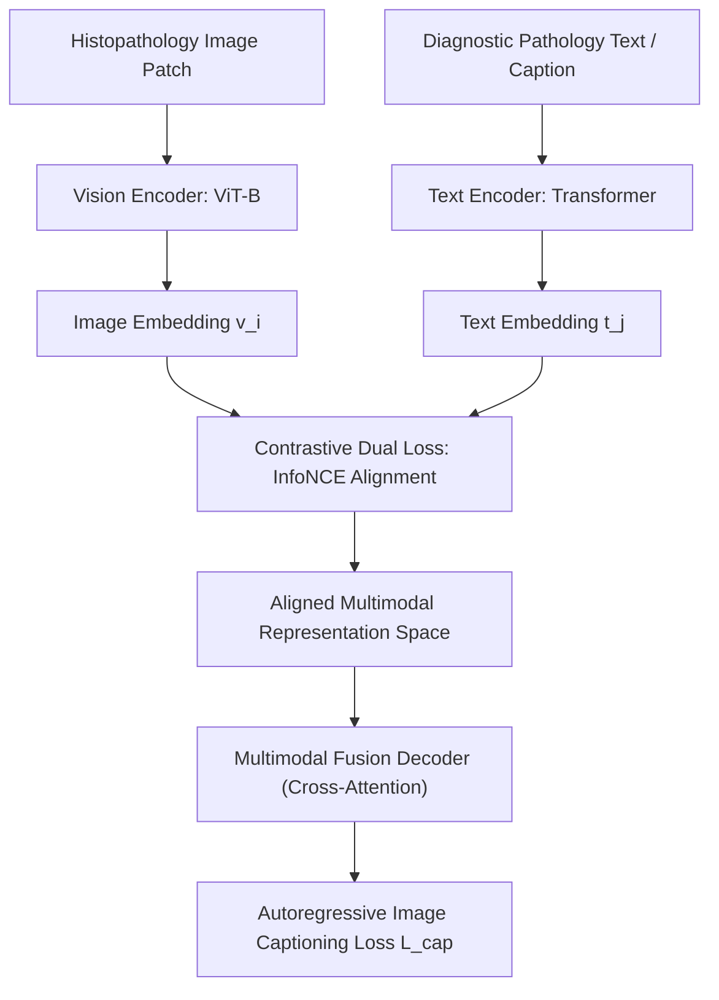

# CONCH: Visual-Language Foundation Model for Computational Pathology (Nature Medicine 2024)

> **Paper Metadata & Provenance**  
> - **Title:** Towards a Visual-Language Foundation Model for Computational Pathology (CONCH)  
> - **Authors:** Ming Y. Lu, Bowen Chen, Drew F. K. Williamson, Richard J. Chen, Ivy Liang, Tong Ding, Guillaume Jaume, Igor Odintsov, Andrew Zhang, Long Phi Le, Georg Gerber, Anil V. Parwani, Faisal Mahmood  
> - **Affiliation:** Department of Pathology, Brigham and Women's Hospital, Harvard Medical School; Massachusetts General Hospital; Broad Institute of MIT and Harvard; Dana-Farber Cancer Institute  
> - **Journal:** Nature Medicine (2024), Volume 30, Pages 833-846  
> - **Preprint DOI:** [arXiv:2307.12914](https://arxiv.org/abs/2307.12914) | [Nature Medicine DOI](https://doi.org/10.1038/s41591-024-02856-4)  
> - **Official Code Repository:** [GitHub: mahmoodlab/CONCH](https://github.com/mahmoodlab/CONCH)  
> - **HuggingFace Models:** `hf.co/mahmoodlab/conch`  
> - **Local Artifacts:** [PDF](file:///c:/Users/Nguyen%20Trong%20Khoi/Downloads/Y_KHOA/docs/papers/CONCH_arxiv_2307.12914.pdf) | [Figures Directory](file:///c:/Users/Nguyen%20Trong%20Khoi/Downloads/Y_KHOA/docs/papers/figures/CONCH_arxiv_2307.12914)

---

## 1. Executive Summary & Paradigm Shift

Historically, computational pathology models were strictly unimodal (processing image tiles or WSI gigapixel arrays) and narrowly trained on closed-set supervised tasks. In contrast, clinical pathology is inherently multimodal: pathologists interpret morphological tissue patterns through medical text, diagnostic criteria, and structured pathology reports.

**CONCH (CONtrastive learning from Captions for Histopathology)** is the landmark visual-language foundation model for pathology, pretrained on **over 1.17 million curated histopathology image-caption pairs** from medical literature and educational archives. Built on a Contrastive Captioner (CoCa) architecture, CONCH enables:
1. **Zero-Shot & Few-Shot WSI Classification:** Prompt-based subtyping without task-specific training.
2. **Zero-Shot Whole Slide Segmentation:** Segmenting tumor vs. benign tissue across WSIs using language prompts.
3. **Cross-Modal Retrieval:** Text-to-image and image-to-text case search across pathology archives.
4. **Automated Pathology Report Captioning:** Generative text descriptions of histological morphology.

---

## 2. Core Architecture & Pretraining Formulation

### 2.1 Contrastive Alignment & Generative Captioning Dual Objective
CONCH jointly optimizes two distinct objective functions:
1. **Contrastive Loss ($\mathcal{L}_{con}$):** Aligns vision and text feature embeddings by maximizing cosine similarities of matched pairs while minimizing non-matched pairs:
   $$\mathcal{L}_{i2t} = -\frac{1}{B} \sum_{i=1}^B \log \frac{\exp(\langle v_i, t_i \rangle / \tau)}{\sum_{j=1}^B \exp(\langle v_i, t_j \rangle / \tau)}$$
2. **Autoregressive Captioning Loss ($\mathcal{L}_{cap}$):** Generates diagnostic captions conditioned on image features via cross-attention layers in the multimodal decoder:
   $$\mathcal{L}_{cap} = -\sum_{k=1}^T \log P(w_k \mid w_{<k}, v)$$
The above content does NOT show the entire file contents. If you need to view any lines of the file which were not shown to complete your task, call this tool again to view those lines.