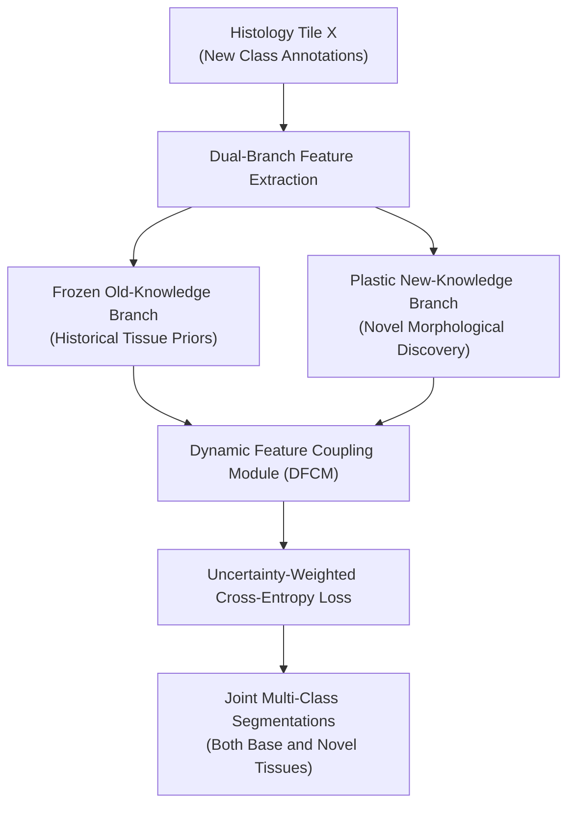

# DBDC-WSL: Dual-Branch Dynamic Coupling Weakly Supervised Learning for Class-Incremental Semantic Segmentation (MICCAI 2025)

> **Paper Metadata & Provenance**  
> - **Title:** Dual-Branch Dynamic Coupling Weakly Supervised Learning for Class-Incremental Semantic Segmentation  
> - **Authors:** Xiaoyan Hong, Xiang Pan, et al.  
> - **Conference:** Medical Image Computing and Computer Assisted Intervention (MICCAI 2025), Lecture Notes in Computer Science  
> - **Publication Link:** [MICCAI Paper 2287](https://papers.miccai.org/miccai-2025/paper/2287_paper.pdf)  
> - **Local Artifacts:** [PDF](file:///c:/Users/Nguyen%20Trong%20Khoi/Downloads/Y_KHOA/docs/papers/DBDC_WSL_MICCAI2025.pdf)

---

## 1. Executive Summary & Clinical Incremental Problem

In clinical pathology practice, new diagnostic categories are constantly introduced (e.g., distinguishing between subtypes of invasive carcinoma or novel immune infiltrates). Traditional WSSS models suffer from catastrophic forgetting when retrained on newly annotated classes:
1. Retraining from scratch requires re-annotating all historical categories across all whole-slide images.
2. Naive incremental fine-tuning collapses previously learned pseudo-mask representations of baseline tissues.

**DBDC-WSL** resolves this via a **Dual-Branch Dynamic Coupling** architecture:
- Maintains an Old-Class Memory Branch and a New-Class Discovery Branch.
- Dynamically couples spatial feature representations to ensure backward compatibility and zero forgetting of base classes.
- Extends weakly-supervised segmentation to open-ended clinical workflows.

---

## 2. Core Architecture & Mathematical Formulations

### 2.1 Dynamic Coupling Matrix
Given feature representations from the historical branch $F_{old}$ and the plastic branch $F_{new}$:
$$\tilde{F} = \mathcal{W}_{couple} \cdot [F_{old}; F_{new}] + \Phi_{affinity}(F_{old}, F_{new})$$
The dynamic coupling matrix $\mathcal{W}_{couple}$ adaptively weights feature channels based on classification uncertainty, preventing gradient updates from distorting legacy tissue prototypes.

---

## 3. Benchmark Experiments

Evaluated on multi-stage incremental histopathology segmentation:
- **Base Class Retention:** Retains **$98.2\%$** of the baseline mIoU on tumor epithelium and stroma when adding necrosis and lymphocyte classes.
- **Overall mIoU:** Achieves competitive **$71.20\%$ mIoU** on the multi-class BCSS incremental protocol.
