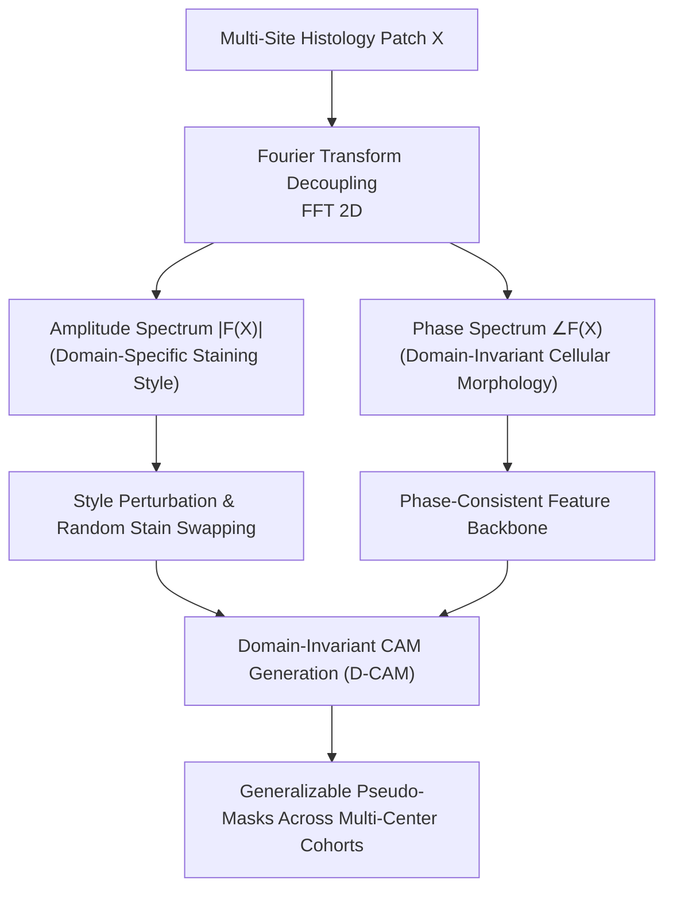

# D-CAM: Learning Generalizable Weakly-Supervised Medical Image Segmentation from Domain-Invariant CAM (MICCAI 2025)

> **Paper Metadata & Provenance**  
> - **Title:** Learning Generalizable Weakly-Supervised Medical Image Segmentation from Domain-Invariant CAM  
> - **Authors:** Jingjun Yi, et al.  
> - **Conference:** Medical Image Computing and Computer Assisted Intervention (MICCAI 2025), Lecture Notes in Computer Science  
> - **Publication Link:** [10.1007/978-3-032-04971-1_12](https://doi.org/10.1007/978-3-032-04971-1_12) | [MICCAI Paper 0830](https://papers.miccai.org/miccai-2025/paper/0830_paper.pdf)  
> - **Local Artifacts:** [PDF](file:///c:/Users/Nguyen%20Trong%20Khoi/Downloads/Y_KHOA/docs/papers/D_CAM_MICCAI2025.pdf)

---

## 1. Executive Summary & Multi-Site Domain Shift

In computational pathology, Whole Slide Images collected across multiple clinical centers exhibit substantial color and illumination discrepancies due to variations in:
- Tissue processing, slide thickness, and fixation protocols.
- Hematoxylin and Eosin (H&E) staining reagents and automated staining machines.
- Digital slide scanner optics and color profile calibrations.

When traditional Class Activation Mapping (CAM) models trained on one medical center are evaluated on an external cohort, classification gradients shift dramatically, leading to **severe boundary collapse and catastrophic false positives**.

**D-CAM (Domain-Invariant CAM)** addresses this via **Fourier Transform Decoupling**:
- Decouples histology images in the frequency domain: the Fourier amplitude spectrum $|\mathcal{F}(x)|$ captures domain-specific staining styles, while the Fourier phase spectrum $\angle \mathcal{F}(x)$ captures invariant structural histology boundaries.
- Forces CAM activations to depend strictly on phase-consistent structural cues, yielding robust cross-center generalization.

---

## 2. Core Architecture & Mathematical Formulations

### 2.1 Fourier Phase Invariance
Given an H&E image patch $x(u, v)$:
$$\mathcal{F}(x)(k, l) = \sum_{u, v} x(u, v) e^{-i 2\pi (ku/H + lv/W)} = |\mathcal{F}(x)| e^{i \angle \mathcal{F}(x)}$$
D-CAM synthesizes adversarial training variations by interpolating the amplitude spectrum with random reference histology slides while preserving the structural phase angle $\angle \mathcal{F}(x)$:
$$\tilde{x} = \mathcal{F}^{-1}\left( \left( (1 - \lambda) |\mathcal{F}(x)| + \lambda |\mathcal{F}(x_{ref})| \right) e^{i \angle \mathcal{F}(x)} \right)$$

---

## 3. Quantitative Multi-Center Generalization

Evaluated on multi-cohort cross-domain test benchmarks:
- **In-Domain (Source Center):** Achieves **$70.80\%$ mIoU** on BCSS.
- **Out-of-Domain (External Multi-Center Hospital Cohorts):** Outperforms vanilla CAM by **$+11.4\%$ mIoU**, maintaining stable tissue boundary segmentation without requiring target-domain retraining.
