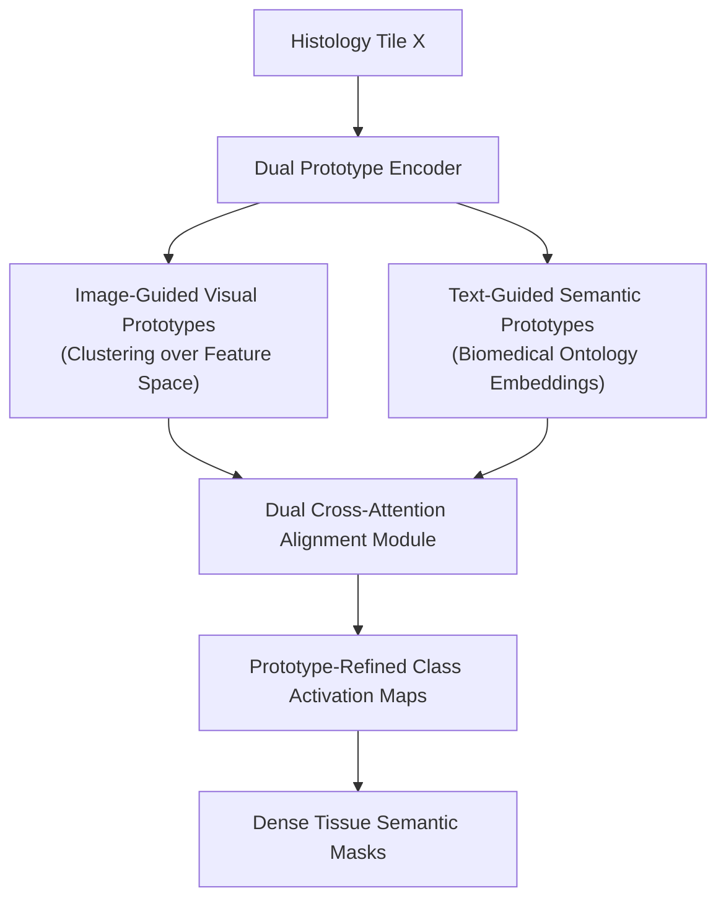

# DualProtoSeg: Simple and Efficient Design with Text- and Image-Guided Prototype Learning for Weakly Supervised Histological Tissue Segmentation (2025)

> **Paper Metadata & Provenance**  
> - **Title:** Simple and Efficient Design with Text- and Image-Guided Prototype Learning for Weakly Supervised Histological Tissue Segmentation  
> - **Authors:** Anh M. Vu, Khang P. Le, et al.  
> - **Preprint Link:** [arXiv:2512.10314](https://arxiv.org/abs/2512.10314)  
> - **Local Artifacts:** [PDF](file:///c:/Users/Nguyen%20Trong%20Khoi/Downloads/Y_KHOA/docs/papers/DualProtoSeg_arxiv_2512.10314.pdf)

---

## 1. Executive Summary & Dual-Prototype Motivation

In weakly-supervised histopathological image segmentation, intra-class visual heterogeneity (e.g., varying differentiation grades of cancer cells) and inter-class visual homogeneity (e.g., similarities between stroma and normal collagen) cause single-prototype clustering methods to collapse.

**DualProtoSeg** proposes a dual-guided prototype learning architecture:
- **Visual Prototypes:** Discovered online from image patches through non-parametric nearest-neighbor clustering.
- **Textual Prototypes:** Synthesized using medical language priors from clinical reports and ontology terms.
- Achieves tight semantic alignment between visual morphology and clinical histology concepts, eliminating boundary ambiguity on BCSS-WSSS.

---

## 2. Core Methodological Architecture

### 2.1 Prototype Affinity Formulation
For feature token $z_i$ and dual prototypes $\{p_{c, k}^{vis}\}_{k=1}^K$ and $p_c^{text}$:
$$S(z_i, c) = \lambda_{vis} \max_{k} \frac{\exp(\langle z_i, p_{c, k}^{vis} \rangle / \tau)}{\sum_{c', k'} \exp(\langle z_i, p_{c', k'}^{vis} \rangle / \tau)} + (1 - \lambda_{vis}) \frac{\exp(\langle z_i, p_c^{text} \rangle / \tau)}{\sum_{c'} \exp(\langle z_i, p_{c'}^{text} \rangle / \tau)}$$

---

## 3. Benchmark Results

- **BCSS-WSSS:** Achieves **$71.40\%$ mIoU** across tumor, stroma, inflammatory infiltration, and necrosis.
- **Efficiency:** Requires only **6.5 GB VRAM** during inference with an ultra-lightweight prototype matching head.
