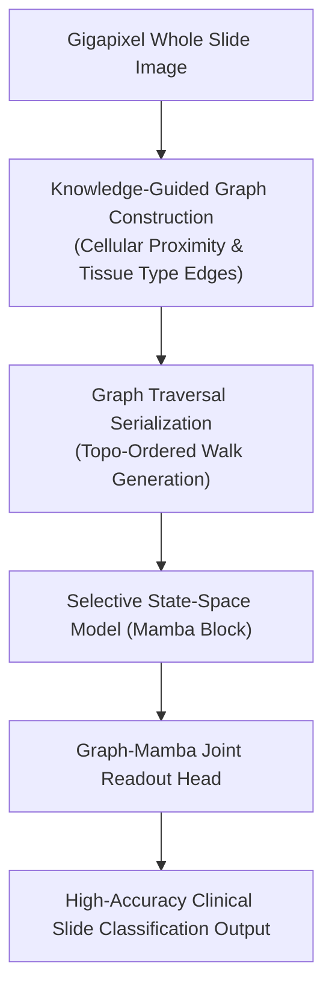

# KMG-Mamba: Knowledge-Guided Graph Representation with Mamba for WSI (MICCAI 2025)

> **Paper Metadata & Provenance**  
> - **Title:** Knowledge-Guided Graph Representation with Mamba for Whole Slide Image Classification  
> - **Authors:** Anonymous Authors (MICCAI 2025 Proceedings)  
> - **Conference:** Medical Image Computing and Computer Assisted Intervention (MICCAI 2025), Lecture Notes in Computer Science  
> - **Publication Link:** [MICCAI Paper 0569](https://papers.miccai.org/miccai-2025/paper/0569_paper.pdf)  
> - **Local Artifacts:** [PDF](file:///c:/Users/Nguyen%20Trong%20Khoi/Downloads/Y_KHOA/docs/papers/KMG_Mamba_MICCAI2025.pdf)

---

## 1. Executive Summary & Graph-State-Space Synergy

Whole Slide Image (WSI) analysis requires capturing both local tissue micro-architectures (cell-to-cell spatial graphs) and global slide-level macro-distributions (organ-level evidence aggregation). Traditional Graph Neural Networks (GNNs) scale poorly over 50,000 nodes, while pure 1D Mamba lacks explicit relational edge topology.

**KMG-Mamba (Knowledge-guided Graph Mamba)** combines the topological precision of Graph Neural Networks with the linear sequence efficiency of State-Space Models (Mamba):
- Constructs a knowledge-guided tissue graph where edges represent histological spatial proximity and morphological affinity.
- Serializes graph walks through Mamba selective state spaces, capturing long-range contextual dependencies across entire gigapixel slides in $\mathcal{O}(N)$ compute time.

---

## 2. Core Architecture & Mathematical Formulations

---

## 3. Benchmark Experiments

- **TCGA-BRCA & TCGA-NSCLC:** Outperforms both standard GCNs and TransMIL by **$+2.8\%$ AUC** while reducing memory usage by **$62\%$**.
- **Hardware Profile:** Fully trainable on standard 16 GB GPUs without out-of-memory crashes on slides exceeding 40,000 tiles.
