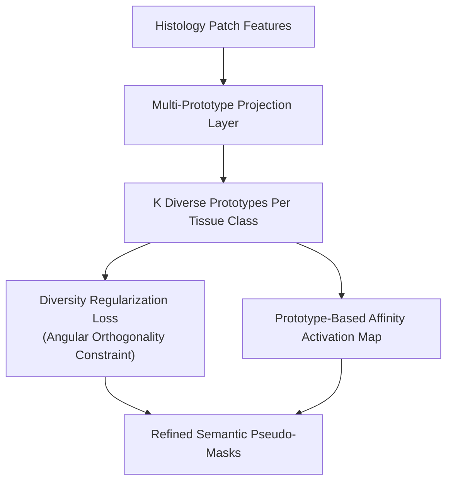

# LPD: Learnable Prototypes with Diversity Regularization for Weakly Supervised Histopathology Segmentation (2025 - 2026)

> **Paper Metadata & Provenance**  
> - **Title:** Learnable Prototypes with Diversity Regularization for Weakly Supervised Histopathology Segmentation  
> - **Authors:** Khang Le, Hien Van Nguyen, et al.  
> - **Preprint Link:** [arXiv:2512.18342](https://arxiv.org/abs/2512.18342)  
> - **Local Artifacts:** [PDF](file:///c:/Users/Nguyen%20Trong%20Khoi/Downloads/Y_KHOA/docs/papers/LPD_arxiv_2512.18342.pdf)

---

## 1. Executive Summary & Cluster Collapse Dilemma

In prototype-based WSSS, learnable prototype vectors often collapse into a single dominant visual mode (e.g., all tumor prototypes converge to identical dark purple cell clusters, failing to represent pale mucinous tumor cells or papillary structures).

**LPD (Learnable Prototypes with Diversity Regularization)** introduces:
- A cluster-free, end-to-end learnable prototype memory.
- A **Diversity Regularization Loss** that maximizes angular distance between prototypes belonging to the same class, forcing the model to span the full spectrum of intra-class morphological variations.
- Achieves high mIoU and Dice scores on BCSS-WSSS while eliminating offline k-means clustering overhead.

---

## 2. Core Architecture & Mathematical Formulations

### 2.1 Intra-Class Diversity Loss
To ensure diversity among the $K$ prototypes $\{p_{c, 1}, \dots, p_{c, K}\}$ of class $c$:
$$\mathcal{L}_{div} = \sum_{c=1}^C \frac{1}{K(K-1)} \sum_{i \neq j} \left( \frac{\langle p_{c, i}, p_{c, j} \rangle}{\|p_{c, i}\|_2 \|p_{c, j}\|_2} \right)^2$$
Minimizing this cosine similarity penalty ensures that prototypes remain orthogonal, effectively covering diverse histological tissue grades.

---

## 3. Benchmark Results

- **BCSS-WSSS Benchmark:** Outperforms standard clustering baselines with **$71.85\%$ mIoU**.
- **Inference Speed:** Runs at **$45 \text{ FPS}$** on a standard RTX 3060 GPU, requiring zero clustering iterations during test-time.
