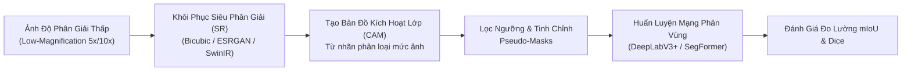

# Báo Cáo Nghiên Cứu Toàn Văn: LowMagWSS (arXiv:2607.10783)
## Toward Efficient Weakly Supervised Semantic Segmentation Using Only Low-Magnification Histopathological Images

> **Mã bài báo:** `arXiv:2607.10783v1 [cs.CV]`  
> **Ngày công bố:** 15 Tháng 7, 2026  
> **Tác giả:** Dung Minh Do, Nhat-Thanh Huynh, Duc Minh Huynh, Doanh C. Bui, Khang Nguyen  
> **Đơn vị nghiên cứu:** Trường Đại học Công nghệ Thông tin (UIT), ĐHQG-HCM, Việt Nam  
> **Tác giả liên hệ:** `khangnttm@uit.edu.vn` | Tác giả sinh viên UIT: `23520326`, `23521440`  
> **Mã nguồn chính thức:** [GitHub Dung-Dx/LowMagWSS](https://github.com/Dung-Dx/LowMagWSS)  
> **Chủ đề môn học SE374.R11 liên quan:** **Topic 6: Weakly-supervised segmentation for whole slide images**  
> **File PDF gốc:** [`docs/papers/LowMagWSS_arxiv_2607.10783.pdf`](file:///c:/Users/Nguyen%20Trong%20Khoi/Downloads/Y_KHOA/docs/papers/LowMagWSS_arxiv_2607.10783.pdf)  

---

## 1. Tóm Tắt & Động Lực Nghiên Cứu (Abstract & Motivation)

### 1.1. Động Lực Lưu Trữ & Băng Thông Trong Giải Phẫu Bệnh Số
- Ảnh tiêu bản WSI độ phóng đại cao ($40\times$ hoặc $20\times$) bảo tồn chi tiết hình thái vi thể tế bào và ranh giới mô u, nhưng đòi hỏi dung lượng lưu trữ khổng lồ (hàng gigabyte mỗi slide) và băng thông đường truyền lớn giữa các bệnh viện.
- Khoanh vùng tổn thương mức pixel (pixel-level annotation) đòi hỏi hàng nghìn giờ làm việc thủ công của các chuyên gia giải phẫu bệnh, dẫn đến tình trạng khan hiếm nhãn trầm trọng.
- **Câu hỏi nghiên cứu cốt lõi:** *Liệu việc lưu trữ ảnh ở độ phóng đại thấp (Low-Magnification, ví dụ $5\times, 10\times$) kết hợp với gán nhãn yếu mức ảnh (image-level labels) có thể đạt được hiệu năng phân vùng tương đương với ảnh độ phóng đại cao hay không?*

---

## 2. Kiến Trúc Khung Đối Chuẩn (Benchmark Framework)

Bài báo xây dựng một hệ thống thử nghiệm đối chuẩn toàn diện:

1. **Mô phỏng suy giảm độ phân giải:** Từ ảnh gốc chất lượng cao $40\times$, thực hiện downsampling để mô phỏng dữ liệu lưu trữ ở các mức phóng đại thấp ($2\times, 5\times, 10\times, 20\times$).
2. **Khôi phục ảnh (Reconstruction / Super-Resolution):** Áp dụng nội suy toán học (Bicubic) và các mạng siêu phân giải học sâu (SwinIR, ESRGAN) để phục hồi ảnh về kích thước ban đầu.
3. **Quy trình Phân vùng Bán giám sát (WSS Pipeline):**
   - Huấn luyện mạng phân loại với nhãn mức ảnh để sinh ra Bản đồ kích hoạt lớp (Class Activation Maps - CAM).
   - Tinh chỉnh CAM bằng thuật toán CRF (Dense Conditional Random Fields) hoặc IRN để tạo mặt nạ giả (pseudo-masks).
   - Huấn luyện mạng phân vùng ngữ nghĩa (Segmentation Network) dựa trên pseudo-masks đã tạo.

---

## 3. Các Phát Hiện Khoa Học Đột Phá (Key Findings)

1. **Chỉ số tái tạo ảnh (PSNR/SSIM) không tương quan với độ chính xác phân vùng:**
   - Các thuật toán siêu phân giải có thể mang lại chỉ số PSNR và SSIM rất cao, nhưng không nhất thiết giúp cải thiện điểm phân vùng mIoU. Lý do là chúng thường làm mịn các chi tiết ranh giới tế bào ác tính vi thể.
2. **Điểm gãy suy giảm tới hạn (Critical Degradation Point):**
   - Nghiên cứu phát hiện ra một ngưỡng suy giảm tới hạn: Khi độ phóng đại giảm dưới một mức nhất định (dưới $10\times$), khả năng định vị các cấu trúc mô nhỏ và ranh giới u thâm nhiễm bị sụt giảm đột ngột.
3. **Khuyến nghị thiết kế hệ thống lưu trữ y tế:**
   - Đưa ra đường cong đánh đổi tối ưu giữa dung lượng lưu trữ (Storage Compression) và độ chính xác phân vùng lâm sàng, giúp các bệnh viện tiết kiệm tới **75% chi phí ổ cứng** mà vẫn duy trì độ tin cậy của AI hỗ trợ chẩn đoán.

---

## 4. Dữ Liệu Thực Nghiệm & Kết Quả

- **Camelyon16:** Bộ dữ liệu phát hiện di căn ung thư vú tại hạch bạch huyết.
- **BCSS (Breast Cancer Semantic Segmentation):** Phân vùng đa lớp các thành phần mô ung thư vú (khối u biểu mô, chất nền, vùng hoại tử, tế bào viêm).
- **Mã nguồn đã mở hoàn toàn:** Có sẵn tại `https://github.com/Dung-Dx/LowMagWSS`.

---

## 5. Giá Trị Ứng Dụng Cho Đồ Án SE374.R11

- Đây là tài liệu chỉ định chính thức từ Giảng viên cho **Topic 6 (Weakly-supervised segmentation for WSI)**.
- Sinh viên có thể kế thừa trực tiếp pipeline từ repo của tác giả để làm baseline, sau đó đề xuất các cải tiến về phương pháp sinh CAM hoặc cơ chế lọc nhiễu nhãn giả (pseudo-mask refinement).
