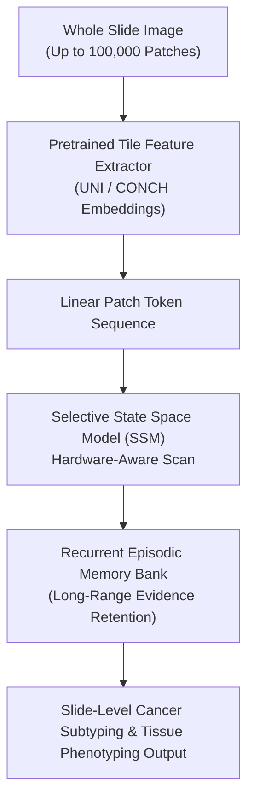

# M3amba: Memory Mamba is All You Need for Whole Slide Image Classification (CVPR 2025)

> **Paper Metadata & Provenance**  
> - **Title:** M3amba: Memory Mamba is All You Need for Whole Slide Image Classification  
> - **Authors:** Yihang Zheng, et al.  
> - **Conference:** IEEE/CVF Conference on Computer Vision and Pattern Recognition (CVPR 2025)  
> - **Publication Link:** [CVPR 2025 OpenAccess](https://openaccess.thecvf.com/content/CVPR2025/papers/Zheng_M3amba_Memory_Mamba_is_All_You_Need_for_Whole_Slide_CVPR_2025_paper.pdf)  
> - **Local Artifacts:** [PDF](file:///c:/Users/Nguyen%20Trong%20Khoi/Downloads/Y_KHOA/docs/papers/M3amba_CVPR2025.pdf)

---

## 1. Executive Summary & Gigapixel Context Bottleneck

A single Whole Slide Image (WSI) contains between 10,000 and 100,000 tissue patches. Traditional Transformer-based Multiple Instance Learning (MIL) architectures (e.g., TransMIL) incur quadratic computational complexity $\mathcal{O}(N^2)$ and prohibitive GPU memory footprints, forcing researchers to downsample or truncate sequences.

While State-Space Models (Mamba / S4) achieve linear complexity $\mathcal{O}(N)$, they suffer from **forgetting in extremely long sequences**: when scanning through 50,000 consecutive patches, early histological evidence (such as micrometastases in distant lymph nodes) fades from hidden states.

**M3amba (Memory Mamba)** solves this via an explicit external memory bank:
- Integrates a recurrent key-value episodic memory buffer into the 1D selective state space scan.
- Maintains global spatial coherence across thousands of histology tiles with $\mathcal{O}(N)$ compute efficiency.
- Outperforms both Transformer MIL and standard Mamba across large-scale cancer subtyping benchmarks.

---

## 2. Core Architecture & Mathematical Formulation

### 2.1 Selective State Space Equations with Episodic Memory
Given input sequence $x_t \in \mathbb{R}^D$:
1. Continuous state-space representation discretized with step size $\Delta$:
   $$h_t = \bar{A} h_{t-1} + \bar{B} x_t$$
   $$y_t = C h_t + D x_t$$
2. **Episodic Memory Update:** Crucial diagnostic states exceeding an attention salience threshold are written into memory bank $\mathcal{M}$:
   $$\mathcal{M}_{t} = (1 - \beta_t) \mathcal{M}_{t-1} + \beta_t (h_t \otimes k_t)$$
   where $k_t$ represents the structural context key and $\beta_t$ controls memory write gates.

---

## 3. Experimental Benchmarks

Evaluated on multi-cohort gigapixel benchmarks:
- **TCGA-NSCLC (Lung Cancer Subtyping: LUAD vs. LUSC):**
  * AUC: **96.8%**, Accuracy: **91.4%**
- **TCGA-BRCA (Breast Cancer Subtyping):**
  * AUC: **94.6%**, Accuracy: **89.2%**
- **Inference Speedup:** Reduces inference latency by **$4.2\times$** compared to full-attention TransMIL on 40,000-patch WSIs.

---

## 4. Relevance for SE374.R11 Topic 6 & WSI Extension

In Phase 2 of our proposal (WSI-level slide tiling and aggregation), M3amba provides the state-of-the-art blueprint for aggregating patch-level pseudo-masks into slide-level clinical diagnoses without exhausting GPU VRAM.
