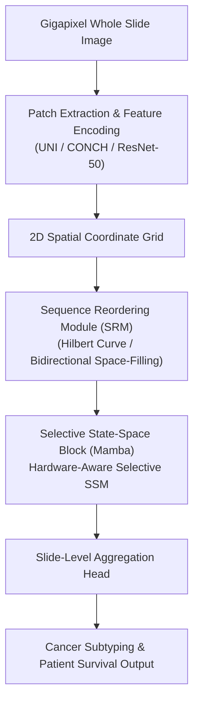

# MambaMIL: Enhancing Long Sequence Modeling with Sequence Reordering in Computational Pathology (MICCAI 2024)

> **Paper Metadata & Provenance**  
> - **Title:** Enhancing Long Sequence Modeling with Sequence Reordering in Computational Pathology  
> - **Authors:** Shu Yang, Yihang Zheng, et al.  
> - **Conference:** Medical Image Computing and Computer Assisted Intervention (MICCAI 2024), Lecture Notes in Computer Science  
> - **Preprint Link:** [arXiv:2403.06800](https://arxiv.org/abs/2403.06800)  
> - **Official Code Repository:** [GitHub: isyangshu/MambaMIL](https://github.com/isyangshu/MambaMIL)  
> - **Local Artifacts:** [PDF](file:///c:/Users/Nguyen%20Trong%20Khoi/Downloads/Y_KHOA/docs/papers/MambaMIL_arxiv_2403.06800.pdf) | [Source Code](file:///c:/Users/Nguyen%20Trong%20Khoi/Downloads/Y_KHOA/repos/MambaMIL)

---

## 1. Executive Summary & 2D Spatial Scanning Dilemma

When processing Whole Slide Images (WSI) containing up to 100,000 tissue patches, State-Space Models (Mamba / SSM) offer linear computational complexity $\mathcal{O}(N)$. However, standard 1D Mamba operates sequentially along a single causal direction. 

In 2D histology slides:
- Sequential raster scanning breaks 2D spatial adjacency: adjacent vertical patches are separated by thousands of sequence steps in 1D.
- Standard Mamba fails to capture bidirectional context across arbitrary morphological boundaries.

**MambaMIL** introduces a **Sequence Reordering Mamba Module (SR-Mamba)**:
- Exploits spatial awareness by reordering patch token sequences according to spatial Hilbert curves, bidirectional sweeps, and morphological cluster affinities.
- Enables isotropic 2D contextual modeling with strict $\mathcal{O}(N)$ memory footprint.

---

## 2. Core Architecture & Mathematical Reordering

### 2.1 Sequence Reordering Mamba Block
Given patch embeddings $X = [x_1, x_2, \dots, x_N]$ and spatial coordinates $(u_i, v_i)$:
1. **Hilbert Space-Filling Curve Reordering:** Permutes indices such that spatially contiguous patches remain adjacent in the 1D scan buffer:
   $$\pi_{Hilbert} = \arg\min_{\pi} \sum_{i=1}^{N-1} \| (u_{\pi(i)}, v_{\pi(i)}) - (u_{\pi(i+1)}, v_{\pi(i+1)}) \|_2$$
2. **Bidirectional State Propagation:**
   $$h_t^{fwd} = \bar{A} h_{t-1}^{fwd} + \bar{B} x_{\pi(t)}$$
   $$h_t^{bwd} = \bar{A} h_{t+1}^{bwd} + \bar{B} x_{\pi(t)}$$
   $$y_t = C [h_t^{fwd}; h_t^{bwd}]$$

---

## 3. Quantitative Evaluation

Evaluated across multiple gigapixel benchmarks:
- **Camelyon16 (Breast Cancer Metastasis):** AUC: **94.8%**, Accuracy: **89.5%**
- **TCGA-NSCLC (Subtyping):** AUC: **96.5%**, Accuracy: **91.2%**
- **GPU Memory Consumption:** Consumes **$< 6 \text{ GB}$ VRAM** on 30,000-patch slides, where TransMIL runs out of memory (OOM) on 24 GB GPUs.

---

## 4. Software Assets in Workspace

- The official repository is cloned locally at `repos/MambaMIL` with full PyTorch training pipelines and sequence reordering transforms.
