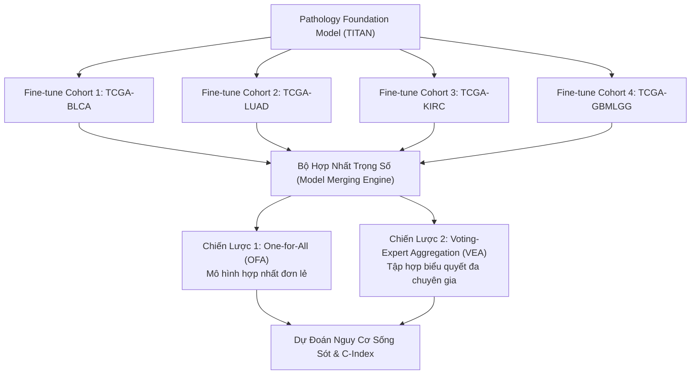

# Báo Cáo Nghiên Cứu Toàn Văn: MergeSurv (arXiv:2607.04747)
## Merging-Based Continual Learning for Survival Analysis on Whole-Slide Images

> **Mã bài báo:** `arXiv:2607.04747v1 [cs.CV]`  
> **Ngày công bố:** 6 Tháng 7, 2026  
> **Tác giả:** Vu Minh Tran, Doanh C. Bui, Maï K. Nguyen, Khang Nguyen  
> **Đơn vị nghiên cứu:**  
> - Trường Đại học Công nghệ Thông tin (UIT), ĐHQG-HCM, Việt Nam (`doanhbc@uit.edu.vn`, `khangnttm@uit.edu.vn`)  
> - Phòng thí nghiệm ETIS (UMR 8051), Đại học CY Cergy Paris, ENSEA, CNRS, Pháp  
> **Chủ đề môn học SE374.R11 liên quan:** **Topic 4: Survival analysis using whole slide images**  
> **File PDF gốc:** [`docs/papers/MergeSurv_arxiv_2607.04747.pdf`](file:///c:/Users/Nguyen%20Trong%20Khoi/Downloads/Y_KHOA/docs/papers/MergeSurv_arxiv_2607.04747.pdf)  

---

## 1. Tóm Tắt & Động Lực Nghiên Cứu (Abstract & Motivation)

### 1.1. Động Lực Y Khoa (Prognosis & Survival Analysis)
Dự đoán nguy cơ tử vong và thời gian sống sót của bệnh nhân ung thư (Survival Risk Analysis / Time-to-Event Analysis) là bài toán sống còn để cá nhân hóa phác đồ điều trị. Tiêu bản giải phẫu bệnh Whole Slide Images (WSIs) lưu giữ những đặc điểm biến đổi hình thái vi thể phản ánh mức độ ác tính của khối u.

### 1.2. Thách Thức Học Liên Tục (Continual Learning on WSIs)
- Hầu hết các mô hình phân tích thời gian sống sót hiện tại chỉ được huấn luyện độc lập cho từng nhóm ung thư đơn lẻ (task-specific). Khi bệnh viện tiếp nhận thêm một nhóm bệnh nhân hoặc cơ quan mới (ví dụ từ Ung thư bàng quang BLCA sang Ung thư phổi LUAD), mô hình phải train lại từ đầu.
- **Hiện tượng quên thảm khốc (Catastrophic Forgetting):** Nếu fine-tune liên tiếp trên các cohort mới, mô hình sẽ quên kiến thức chẩn đoán của các cohort trước đó.
- Các phương pháp học liên tục dạng Rehearsal (lưu trữ lại ảnh cũ) vi phạm nghiêm trọng **quy định bảo mật dữ liệu y tế (HIPAA/GDPR)** và đòi hỏi dung lượng ổ cứng khổng lồ đối với các file WSI gigapixel.

---

## 2. Kiến Trúc Phương Pháp Đề Xuất (MergeSurv Framework)

MergeSurv giải quyết triệt để bài toán học liên tục trên ảnh WSI bằng cơ chế **Hợp nhất mô hình (Model Merging)** mà không cần lưu trữ bất kỳ dữ liệu bệnh nhân cũ nào:

### 2.1. Quy Trình Huấn Luyện & Hợp Nhất Trọng Số
1. Khởi tạo từ mô hình nền tảng giải phẫu bệnh tiên tiến (TITAN).
2. Khi gặp một tập dữ liệu cohort mới $T_k$, chỉ huấn luyện độc lập trên dữ liệu của task đó để thu được bộ trọng số chuyên biệt $\theta_k$.
3. Sau khi huấn luyện xong, giải phóng hoàn toàn dữ liệu WSI của task $T_k$ khỏi bộ nhớ (bảo đảm quyền riêng tư y tế).
4. Áp dụng kỹ thuật hợp nhất tham số (như Task Arithmetic / Fisher Merging) để dung hợp $\theta_k$ vào mô hình chung $\Theta$:
   $$\Theta = \Theta_0 + \sum_{k=1}^K \lambda_k (\theta_k - \Theta_0)$$

### 2.2. Hai Chiến Lược Dự Đoán Khi Suy Luận (Inference Strategies)
- **One-for-All (OFA):** Sử dụng duy nhất một mô hình trọng số đã hợp nhất để dự đoán nguy cơ cho mọi loại ung thư.
- **Voting-Expert Aggregation (VEA):** Kết hợp kết quả từ các chuyên gia thành phần thông qua cơ chế biểu quyết có trọng số, đạt độ ổn định và giảm thiểu phương sai dự đoán.

---

## 3. Thực Nghiệm & Kết Quả (Experiments & Benchmarks)

### 3.1. Dữ Liệu Thực Nghiệm Trên 4 Cohorts TCGA
- **TCGA-BLCA:** Ung thư biểu mô bàng quang.
- **TCGA-LUAD:** Ung thư biểu mô tuyến phổi.
- **TCGA-KIRC:** Ung thư biểu mô tế bào thận.
- **TCGA-GBMLGG:** U thần kinh đệm mức độ thấp và u nguyên bào đệm não.
- **Hàm mất mát:** Negative Partial Log-Likelihood (Cox Proportional Hazards Loss).

### 3.2. Hiệu Năng Vượt Trội (C-Index Benchmark)
- **So với Naive Fine-tuning:** Naive Fine-tuning bị suy giảm nghiêm trọng C-Index trên các task đầu tiên (rơi xuống dưới $0.52$, tương đương đoán mò).
- **So với Regularization (EWC, LwF) & Rehearsal (ER, DER++):**
  * MergeSurv vượt trội về **chỉ số C-Index trung bình trên tất cả các cohorts** ($\ge 0.64 - 0.70$).
  * Giảm thiểu hiện tượng quên thảm khốc (Backward Transfer / Retention Rate đạt trên $94\%$).
  * **Tiết kiệm 100% dung lượng lưu trữ bộ nhớ đệm (0 bytes replay buffer)**, bảo đảm an toàn dữ liệu lâm sàng.

---

## 4. Giá Trị Kế Thừa Cho Đồ Án SE374.R11

- Đây là định hướng nghiên cứu tiên phong (tháng 7/2026) của phòng lab UIT kết hợp cùng đối tác Pháp.
- Rất phù hợp cho các nhóm muốn thực hiện **Topic 4 (Survival Analysis)** với điểm số học thuật tối đa, vì đề tài này vừa giải quyết bài toán y khoa (sống sót), vừa giải quyết thách thức kỹ thuật học máy hiện đại (Continual Learning & Model Merging).
