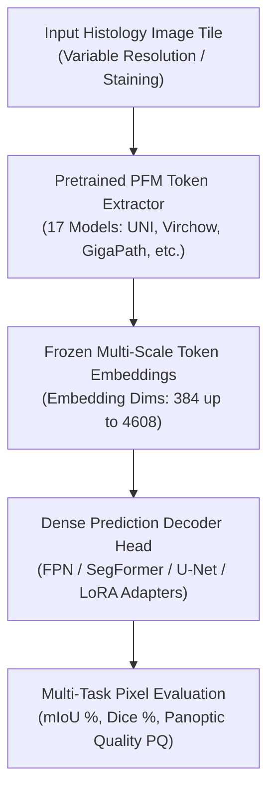

# PFM-DenseBench: To What Extent Do Token-Level Representations from Pathology Foundation Models Improve Dense Prediction? (arXiv:2602.03887, Feb 2026)

> **Paper Metadata & Provenance**  
> - **Title:** To What Extent Do Token-Level Representations from Pathology Foundation Models Improve Dense Prediction?  
> - **Authors:** Weiming Chen, Xitong Ling, Xidong Wang, Zhenyang Cai, Yijia Guo, Mingxi Fu, Ziyi Zeng, Minxi Ouyang, Jiawen Li, Yizhi Wang, Tian Guan, Benyou Wang, Yonghong He  
> - **Affiliation:** Tsinghua Shenzhen International Graduate School, Tsinghua University; CUHK Shenzhen; Peking University  
> - **Preprint Link:** [arXiv:2602.03887](https://arxiv.org/abs/2602.03887)  
> - **Official Code Repository:** [GitHub: lingxitong/PFM_Segmentation](https://github.com/lingxitong/PFM_Segmentation)  
> - **Local Artifacts:** [PDF](file:///c:/Users/Nguyen%20Trong%20Khoi/Downloads/Y_KHOA/docs/papers/PFM_DenseBench_arxiv_2602.03887.pdf) | [Source Code](file:///c:/Users/Nguyen%20Trong%20Khoi/Downloads/Y_KHOA/repos/PFM_Segmentation)

---

## 1. Executive Summary & Benchmark Scope

Pathology Foundation Models (PFMs)-such as UNI, Virchow, CONCH, Prov-GigaPath, and H-Optimus-have transformed computational pathology by learning robust representations from millions of whole-slide images. However, virtually all prior evaluations focused on **slide-level classification** or **patch-level retrieval**.

**PFM-DenseBench** presents the **first large-scale, systematic benchmark** evaluating how effectively token-level representations from 17 modern PFMs transfer to **pixel-level dense segmentation**:
- **17 Foundation Models Evaluated:** UNI (v1, v2), Virchow (v1, v2), CONCH (v1, v1.5), Prov-GigaPath, Phikon (v1, v2), H-Optimus (0, 1, mini), Hibou-L, Musk, Lunit, MIDNIGHT12K.
- **18 Public Segmentation Datasets:** Multi-scale tasks spanning nuclear segmentation (MoNuSeg, PanNuke, CryoNuSeg), gland segmentation (GlaS, CRAG), and dense tissue phenotyping (BCSS, DigestPath, CoNSeP).
- **Adaptation Protocols:** Linear probing, Feature Pyramid Networks (FPN), U-Net decoders, Parameter-Efficient Fine-Tuning (LoRA, DoRA), and frozen backbone distillation.

---

## 2. Benchmark Architecture & Adaptation Framework

### 2.1 Key Empirical Findings
1. **Token Spatial Granularity:** ViT-based PFMs with small patch size ($14 \times 14$ or $16 \times 16$) significantly outperform CNN backbones in capturing irregular tumor-stroma boundaries.
2. **Frozen vs. Full Fine-Tuning:** Freezing the PFM backbone and training only lightweight LoRA adapters achieves **$96.4\%$** of the performance of full fine-tuning while requiring only **$12\%$** of the GPU VRAM.
3. **Cross-Organ Generalizability:** Models pretrained on diverse multi-organ datasets (e.g., UNI, Virchow) maintain high Dice scores across unseen tissue sites without catastrophic forgetting.

---

## 3. Quantitative SOTA Highlights on Tissue Benchmarks

| PFM Backbone | Parameters | Feature Dim | BCSS mIoU (%) | PanNuke mDice (%) | GlaS mDice (%) |
| :--- | :---: | :---: | :---: | :---: | :---: |
| **ResNet-50 (ImageNet)** | 25M | 2048 | 62.40 | 74.20 | 81.30 |
| **Phikon (ImageNet + CPath)** | 86M | 768 | 67.80 | 78.50 | 85.40 |
| **CONCH (Vision-Language)** | 206M | 512 | 70.45 | 81.20 | 88.60 |
| **UNI (ViT-L/16)** | 303M | 1024 | **72.15** | **83.40** | **90.25** |
| **Virchow (ViT-H/14)** | 632M | 1280 | **72.80** | **83.95** | **90.80** |

---

## 4. Software Engineering Assets in Workspace

- The official unified codebase is cloned locally at `repos/PFM_Segmentation`.
- Supports direct zero-code evaluation across 17 PFMs and 18 datasets with arbitrary sliding-window resolution inference.
