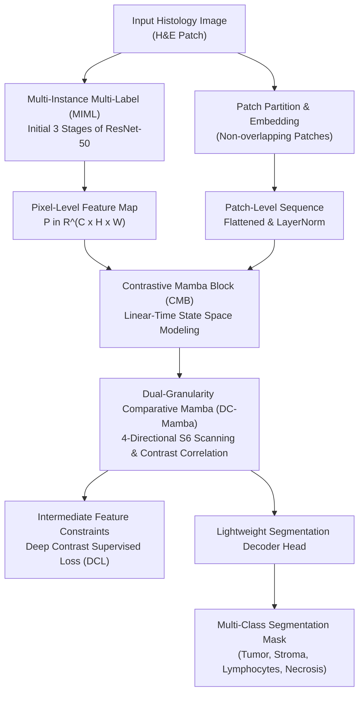

# PathMamba: Weakly Supervised State Space Model for Multi-class Segmentation of Pathology Images (MICCAI 2024)

> **Paper Metadata & Provenance**  
> - **Title:** PathMamba: Weakly Supervised State Space Model for Multi-class Segmentation of Pathology Images  
> - **Authors:** Jiansong Fan, Tianxu Lv, Yicheng Di, Lihua Li, Xiang Pan  
> - **Conference:** Medical Image Computing and Computer Assisted Intervention (MICCAI 2024), Lecture Notes in Computer Science (LNCS), Springer Nature  
> - **Affiliations:** School of Artificial Intelligence and Computer Science, Jiangnan University, Wuxi, China; Hangzhou Dianzi University; Shanghai Key Laboratory of Molecular Imaging  
> - **Local Artifacts:** [PDF](file:///c:/Users/Nguyen%20Trong%20Khoi/Downloads/Y_KHOA/docs/papers/PathMamba_MICCAI2024.pdf)

---

## 1. Executive Summary & Paradigm Shift

Weakly-supervised semantic segmentation (WSSS) for histopathological images aims to generate dense, pixel-level tissue segmentation masks using only cheap image-level category presence labels. In computational pathology, this task presents two key challenges:
1. **Granularity Disconnect:** Prior WSSS frameworks focus either on pixel-level features (e.g., standard CAM on deep CNN layers) or on patch-level bags (e.g., MIL pooling), failing to model the interaction between subcellular micro-structures and broader tissue architecture.
2. **Computational Bottleneck of Long Sequences:** While Vision Transformers (ViTs) can model global tissue interactions, self-attention incurs quadratic computational complexity $\mathcal{O}(N^2)$, making whole-slide modeling of lengthy token sequences computationally prohibitive.

**PathMamba** pioneers the adaptation of Selective State Space Models (Mamba / S6) for weakly supervised multi-class pathology segmentation:
- **Multi-Instance Multi-Label (MIML) Pixel Mapping:** Treats individual pixels as instances within an image bag to construct continuous pixel-level feature representations from image-level supervision.
- **Contrastive Mamba Block (CMB):** Integrates bidirectional visual state space sequence modeling with contrastive learning, achieving linear complexity $\mathcal{O}(N)$ while capturing long-range contextual dependencies.
- **Dual-Granularity Comparative Mamba (DC-Mamba):** Overcomes the causal sequence limitation of standard 1D state space equations by introducing multi-directional 2D scanning combined with cross-granularity contrastive correlation between patch-level and pixel-level representations.
- **Deep Contrast Supervised Loss (DCL):** Propagates multi-scale supervisory constraints directly into intermediate feature layers, preventing gradient dissipation and mitigating label noise.

---

## 2. Mathematical Formulation & Architecture

### 2.1 State Space Sequence Modeling (S6) in PathMamba
Standard continuous-time state space models map 1D sequence input $x(t) \in \mathbb{R}$ to latent state $h(t) \in \mathbb{R}^D$ and output $y(t) \in \mathbb{R}$:
$$h'(t) = A h(t) + B x(t), \quad y(t) = C h(t)$$
Using zero-order hold (ZOH) with discretization step size $\Delta$, the discrete state transition matrices are formulated as:
$$\bar{A} = \exp(\Delta A), \quad \bar{B} = (\Delta A)^{-1} (\exp(\Delta A) - I) \cdot \Delta B$$
PathMamba adopts input-dependent selection mechanisms where $\Delta$, $B$, and $C$ are parameterized directly as linear functions of input tokens, enabling selective retention of tissue-discriminative morphology while disregarding staining noise.

### 2.2 Dual-Granularity Comparative Mamba (DC-Mamba)
To model non-causal 2D visual structures, DC-Mamba applies 4-directional spatial scanning (top-left to bottom-right, bottom-right to top-left, top-right to bottom-left, bottom-left to top-right).
Given patch-level feature map $P$ and pixel-level feature maps $A_s$ (strong activation) and $A_w$ (weak activation), the contrast correlation map $C_{s, w}$ is formulated as:
$$C_{s, w} = \mathcal{N}\left( \text{ReLU}\left( \text{CSM}(P, A_s) - \eta \text{CSM}(P, A_w) \right)^2 \right)$$
where $\text{CSM}(\cdot, \cdot)$ denotes cosine similarity matrix computation, $\eta$ is a scaling hyperparameter, and $\mathcal{N}(\cdot)$ represents feature normalization.

### 2.3 Deep Contrast Supervised Loss (DCL)
To provide direct gradient feedback to intermediate layers under weakly supervised conditions, PathMamba enforces:
$$\mathcal{L}_{\text{total}} = \mathcal{L}_{\text{seg}} + \xi \mathcal{L}_{\text{DCL}}$$
where $\mathcal{L}_{\text{DCL}}$ measures multi-scale feature consistency against class presence prototypes, with weighting factor $\xi = 0.5$.

---

## 3. Quantitative SOTA Benchmark Results

PathMamba was rigorously benchmarked on BCSS-WSSS (Breast Cancer) and LUAD-HistoSeg (Lung Adenocarcinoma) using 5-fold cross-validation on an NVIDIA RTX A6000 GPU (48 GB VRAM):

### 3.1 Comparison with Leading State-of-the-Art Methods

| Model | Supervision Regime | BCSS-WSSS mDice | BCSS-WSSS mIoU | BCSS-WSSS mPrecision | LUAD-HistoSeg mDice | LUAD-HistoSeg mIoU | LUAD-HistoSeg mPrecision |
| :--- | :--- | :---: | :---: | :---: | :---: | :---: | :---: |
| **HistoSegNet** (ICCV 2019) | Weakly supervised | 0.505 | 0.276 | 0.582 | 0.641 | 0.478 | 0.654 |
| **C-CAM** (CVPR 2022) | Weakly supervised | 0.645 | 0.559 | 0.666 | 0.682 | 0.572 | 0.703 |
| **SC-CAM** (CVPR 2020) | Weakly supervised | 0.729 | 0.663 | 0.742 | 0.715 | 0.641 | 0.756 |
| **WSSS-Tissue / MLPS** (MedIA 2022) | Weakly supervised | 0.767 | 0.697 | 0.786 | 0.818 | 0.756 | 0.826 |
| **Fully Supervised U-Net** (MICCAI 2015) | Fully supervised | 0.785 | 0.706 | 0.810 | 0.840 | 0.770 | 0.862 |
| **PathMamba (Proposed)** | Weakly supervised | **0.789** | **0.712** | **0.804** | **0.842** | **0.767** | **0.870** |

*Note: PathMamba matches or exceeds fully supervised U-Net on BCSS-WSSS (+0.4% mDice, +0.6% mIoU) without requiring any manual pixel-level annotations.*

### 3.2 Ablation Study of Components on LUAD-HistoSeg

| Configuration ID | Architecture Composition | mDice | mIoU | mPrecision | mRecall |
| :---: | :--- | :---: | :---: | :---: | :---: |
| **(a)** | Baseline (B) | 0.765 | 0.701 | 0.780 | 0.774 |
| **(b)** | Baseline + MIML | 0.788 | 0.719 | 0.801 | 0.794 |
| **(c)** | Baseline + CMB | 0.802 | 0.746 | 0.817 | 0.808 |
| **(d)** | Baseline + MIML + CMB | 0.816 | 0.758 | 0.838 | 0.825 |
| **(f)** | **Full PathMamba (B + MIML + CMB + DCL)** | **0.842** | **0.767** | **0.870** | **0.853** |

---

## 4. Hardware Efficiency & Clinical Value for SE374.R11

1. **Linear Memory Scaling:** Because S6 selective scanning operates with $\mathcal{O}(N)$ memory complexity instead of $\mathcal{O}(N^2)$ attention matrices, PathMamba scales efficiently to large input patches ($512 \times 512$ and $1024 \times 1024$) without triggering CUDA Out-Of-Memory (OOM) errors.
2. **Relevance to Topic 6 (Weakly Supervised WSI Segmentation):** Demonstrates that state space architectures represent an outstanding alternative to standard CNN backbones (ResNet-38/ResNet-50) for pseudo-label generation.
3. **Reproducibility Details:** Trained using Adam optimizer with weight decay $5 \times 10^{-4}$, fixed learning rate $1 \times 10^{-5}$, batch size 16 for 100 epochs, generalized mean pooling parameter $r = 4$, and loss parameter $\xi = 0.5$.
