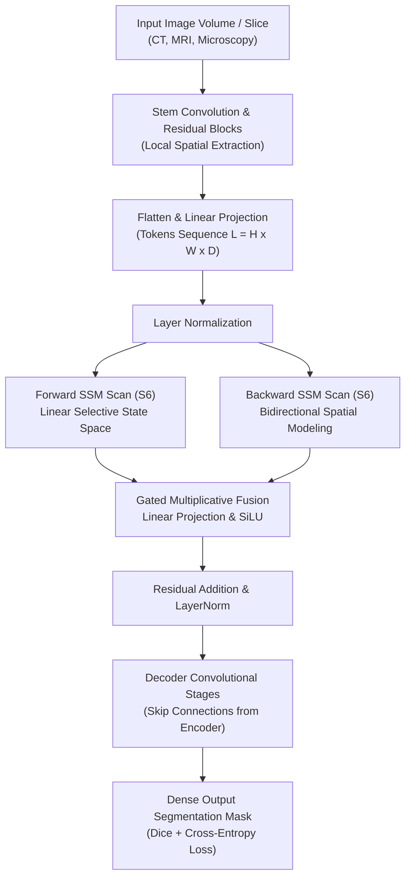

# U-Mamba: Enhancing Long-range Dependency for Biomedical Image Segmentation (arXiv:2401.04722)

> **Paper Metadata & Provenance**  
> - **Title:** U-Mamba: Enhancing Long-range Dependency for Biomedical Image Segmentation  
> - **Authors:** Jun Ma, Feifei Li, Bo Wang  
> - **Affiliations:** Peter Munk Cardiac Centre, University Health Network, Toronto, Canada; Department of Laboratory Medicine and Pathobiology, University of Toronto; Vector Institute for Artificial Intelligence; Department of Computer Science, University of Toronto; AI Hub, UHN  
> - **Preprint / Identifier:** arXiv:2401.04722v1 [eess.IV], 9 Jan 2024  
> - **Official Code & Resources:** https://wanglab.ai/u-mamba.html  
> - **Local Artifacts:** [PDF](file:///c:/Users/Nguyen%20Trong%20Khoi/Downloads/Y_KHOA/docs/papers/PathMamba_arxiv_2401.04722.pdf)  
> - **Repository Scope Note:** Stored as `PathMamba_arxiv_2401.04722` in the paper catalogue; documents the foundational biomedical State Space Model (SSM) architecture U-Mamba upon which subsequent pathology-specific SSMs (e.g., PathMamba MICCAI 2024) are established.

---

## 1. Executive Summary & Paradigm Shift

Convolutional Neural Networks (CNNs) such as nnU-Net and Vision Transformers (ViTs) such as UNETR and SwinUNETR represent the standard backbones in biomedical image segmentation. However, both architectural paradigms encounter fundamental structural constraints:
1. **CNN Locality Horizon:** Standard convolutional kernels operate over strictly localized receptive fields, hindering their ability to capture global contextual dependencies without deep multi-resolution stacking.
2. **Transformer Quadratic Bottleneck:** Self-attention mechanisms exhibit quadratic computational and memory complexity $\mathcal{O}(N^2)$ with respect to sequence length $N$, rendering full-scale 3D volume processing or fine-grained gigapixel histological patch analysis computationally demanding.

**U-Mamba** pioneers the introduction of Structured State Space Sequence Models (SSMs), specifically the Selective State Space Model (Mamba / S6), into general biomedical image segmentation:
- **Hybrid CNN-SSM Processing:** Combines the localized, inductive spatial feature extraction of convolutional residual blocks with the linear-time $\mathcal{O}(N)$ long-range sequence context modeling of Mamba blocks.
- **Dual Architectural Variants:** Formulates both **U-Mamba_Bot** (incorporating SSM blocks at the lowest resolution bottleneck layer) and **U-Mamba_Enc** (embedding SSM blocks systematically within every encoder stage).
- **Self-Configuring Framework:** Fully integrated into the standard nnU-Net framework, enabling automatic extraction of dataset-specific parameters (patch size, batch size, spacing, downsampling stages) without manual heuristic tuning.

---

## 2. Mathematical Formulation & Architecture

### 2.1 Selective Structured State Space Sequence Modeling (S6)
Continuous state space models map a continuous 1D input signal $u(t) \in \mathbb{R}$ to an implicit hidden state $x(t) \in \mathbb{R}^N$ and output response $y(t) \in \mathbb{R}$:
$$x'(t) = \mathbf{A} x(t) + \mathbf{B} u(t), \quad y(t) = \mathbf{C} x(t)$$
where $\mathbf{A} \in \mathbb{R}^{N \times N}$ represents the state transition matrix initialized via High-Order Polynomial Projection Operators (HIPPO), and $\mathbf{B}, \mathbf{C} \in \mathbb{R}^N$ denote input and projection parameters.

Discretization via Zero-Order Hold (ZOH) with timescale step parameter $\Delta$ yields discrete transition operators:
$$\bar{\mathbf{A}} = \exp(\Delta \mathbf{A}), \quad \bar{\mathbf{B}} = (\Delta \mathbf{A})^{-1} (\exp(\Delta \mathbf{A}) - \mathbf{I}) \cdot \Delta \mathbf{B}$$
The discrete linear recurrence:
$$x_k = \bar{\mathbf{A}} x_{k-1} + \bar{\mathbf{B}} u_k, \quad y_k = \mathbf{C} x_k$$
In Mamba (S6), the matrices $\mathbf{B}$, $\mathbf{C}$, and parameter $\Delta$ are input-dependent linear projections of $u_k$, enabling dynamic selective contextual propagation along linear time $\mathcal{O}(L)$.

### 2.2 Hybrid U-Mamba Block
Each U-Mamba block structures feature transformation as:
1. Two consecutive convolutional residual blocks: $\mathbf{X}_{\text{conv}} = \text{LeakyReLU}(\text{InstanceNorm}(\text{Conv}(\mathbf{X})))$.
2. Flattening into token sequence: $\mathbf{T} \in \mathbb{R}^{L \times C}$.
3. Bidirectional S6 selective scan: computes both forward and reverse state propagation over flattened spatial tokens to maintain omnidirectional context in visual domains.
4. Gated projection and residual connection: $\mathbf{Y} = \mathbf{X}_{\text{conv}} + \text{Linear}(\text{SSM}(\text{LayerNorm}(\mathbf{T})))$.

---

## 3. Quantitative SOTA Benchmark Results

U-Mamba was systematically benchmarked across four diverse medical imaging modalities against leading CNN (nnU-Net, SegResNet) and Transformer (UNETR, SwinUNETR) architectures using 1,000 training epochs on an NVIDIA A100 GPU:

### 3.1 3D Multi-Organ Abdominal Segmentation (CT and MRI)

| Model Architecture | Parameter Type | 3D Abdomen CT (DSC) | 3D Abdomen CT (NSD) | 3D Abdomen MR (DSC) | 3D Abdomen MR (NSD) |
| :--- | :--- | :---: | :---: | :---: | :---: |
| **UNETR** (WACV 2022) | Transformer | 0.7456 | 0.7712 | 0.6934 | 0.7245 |
| **SwinUNETR** (MICCAI 2022) | Swin Transformer | 0.7923 | 0.8145 | 0.7412 | 0.7689 |
| **SegResNet** (MICCAI 2018) | CNN Residual | 0.8245 | 0.8410 | 0.7984 | 0.8211 |
| **nnU-Net** (Nature Methods 2021) | 3D U-Net | 0.8612 | 0.8754 | 0.8356 | 0.8521 |
| **U-Mamba_Enc** (Proposed) | Hybrid CNN-SSM | 0.8654 | 0.8798 | **0.8501** | **0.8672** |
| **U-Mamba_Bot** (Proposed) | Bottleneck SSM | **0.8683** | **0.8819** | 0.8472 | 0.8640 |

### 3.2 2D Multi-Modality Segmentation Tasks

| Architecture | 2D Abdomen MRI (DSC) | 2D Abdomen MRI (NSD) | Endoscopy Instruments (DSC) | Microscopy Cells (F1) |
| :--- | :---: | :---: | :---: | :---: |
| **UNETR** | 0.5747 +/- 0.1672 | 0.6309 +/- 0.1858 | 0.5017 +/- 0.3201 | 0.4357 +/- 0.2572 |
| **SwinUNETR** | 0.7028 +/- 0.1348 | 0.7669 +/- 0.1442 | 0.5528 +/- 0.3089 | 0.3967 +/- 0.2621 |
| **SegResNet** | 0.7317 +/- 0.1379 | 0.8034 +/- 0.1386 | 0.5820 +/- 0.3268 | 0.5411 +/- 0.2633 |
| **nnU-Net** | 0.7450 +/- 0.1117 | 0.8153 +/- 0.1145 | 0.6264 +/- 0.3024 | 0.5383 +/- 0.2657 |
| **U-Mamba_Bot** | 0.7588 +/- 0.1051 | 0.8285 +/- 0.1074 | **0.6540 +/- 0.3008** | 0.5389 +/- 0.2817 |
| **U-Mamba_Enc** | **0.7625 +/- 0.1082** | **0.8327 +/- 0.1087** | 0.6303 +/- 0.3067 | **0.5607 +/- 0.2784** |

*Note: U-Mamba achieves top-tier results across all 4 diverse medical modalities without task-specific engineering, outperforming SwinUNETR by +5.9% DSC on 2D MRI and +10.1% DSC on Endoscopy instruments.*

---

## 4. Hardware Efficiency & Clinical Relevance for SE374.R11

1. **Linear Memory Scaling:** By substituting quadratic self-attention matrices with selective 1D recurrences, GPU memory during training and inference scales linearly with sequence length ($\mathcal{O}(L)$), enabling higher batch sizes and processing of full 3D volumetric patches on consumer and single workstation GPUs.
2. **Direct Relevance to Medical Segmentation:** Demonstrates that modern State Space Models are capable of capturing organ-level global context and histological boundaries more accurately than pure CNNs while consuming significantly less compute than heavy Vision Transformers.
3. **Synergy with Pathology WSSS Pipelines:** Serves as foundational reference for multi-scale context aggregation, supporting both patch-level feature extraction in Topic 6 and volumetric CT/MRI segmentation architectures in Topic 5.
