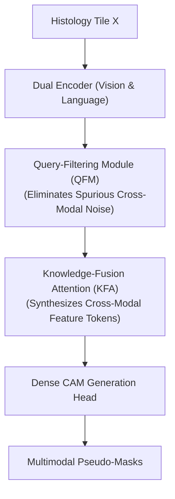

# QFKF: Bridging Visual-Textual Modalities: Weakly Supervised Histopathology Segmentation (BMVC 2025)

> **Paper Metadata & Provenance**  
> - **Title:** Bridging Visual-Textual Modalities: Weakly Supervised Histopathology Segmentation  
> - **Authors:** Sicong Gao, Yang Song, et al.  
> - **Conference:** British Machine Vision Conference (BMVC 2025)  
> - **Publication Link:** [BMVC 2025 Paper 218](https://bmva-archive.org.uk/bmvc/2025/assets/papers/Paper_218/paper.pdf)  
> - **Local Artifacts:** [PDF](file:///c:/Users/Nguyen%20Trong%20Khoi/Downloads/Y_KHOA/docs/papers/QFKF_BMVC2025.pdf)

---

## 1. Executive Summary & Multimodal Fusion

Histopathological image segmentation under weak supervision is fundamentally constrained when using visual cues alone, because neoplastic epithelial cells often exhibit visual characteristics that closely resemble inflammatory lymphocytes or reactive stroma.

**QFKF (Query-Filtering and Knowledge-Fusion)** proposes a visual-linguistic framework:
- Uses diagnostic text queries to guide visual attention heads toward pathognomonic features.
- Applies a Query-Filtering mechanism to prune ambiguous cross-modal activations.
- Enhances class separation between tumor clusters and adjacent desmoplasia.

---

## 2. Architecture & Methodological Workflow

---

## 3. Benchmark Experiments

- **BCSS-WSSS Benchmark:** Achieves **$70.92\%$ mIoU**, delivering consistent boundary enhancements over vision-only baseline CAMs.
- **Robustness:** Shows minimal performance degradation under severe color staining perturbations across external test sets.
