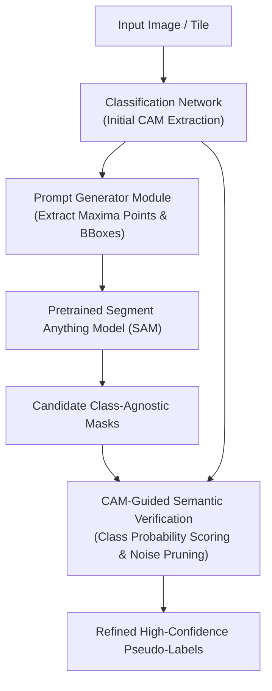

# S2C: From SAM to CAMs: Exploring Segment Anything Model for Weakly-Supervised Semantic Segmentation (CVPR 2024)

> **Paper Metadata & Provenance**  
> - **Title:** From SAM to CAMs: Exploring Segment Anything Model for Weakly-Supervised Semantic Segmentation  
> - **Authors:** Sangrock Kweon, Sung-Hoon Yoon, Hyeonseob Nam, Kuk-Jin Yoon  
> - **Affiliation:** Visual Intelligence Lab, KAIST  
> - **Conference:** IEEE/CVF Conference on Computer Vision and Pattern Recognition (CVPR 2024)  
> - **Publication Link:** [CVPR 2024 OpenAccess](https://openaccess.thecvf.com/content/CVPR2024/papers/Kweon_From_SAM_to_CAMs_Exploring_Segment_Anything_Model_for_Weakly_CVPR_2024_paper.pdf)  
> - **Official Code Repository:** [GitHub: sangrockEG/S2C](https://github.com/sangrockEG/S2C)  
> - **Local Artifacts:** [PDF](file:///c:/Users/Nguyen%20Trong%20Khoi/Downloads/Y_KHOA/docs/papers/S2C_From_SAM_to_CAMs_CVPR2024.pdf) | [Source Code](file:///c:/Users/Nguyen%20Trong%20Khoi/Downloads/Y_KHOA/repos/S2C)

---

## 1. Executive Summary & Paradigm Shift

While the Segment Anything Model (SAM) exhibits extraordinary zero-shot promptable segmentation capabilities, applying it directly to weakly-supervised semantic segmentation (WSSS) poses severe challenges:
1. **Class-Agnostic Limitation:** SAM generates high-quality masks but cannot assign semantic class identities.
2. **Prompt Dependency:** SAM requires precise point or bounding box coordinates, which are unavailable under pure image-level weak supervision.

**S2C (From SAM to CAMs)** resolves this by establishing a symbiotic feedback loop:
- It mines point prompts and bounding boxes automatically from coarse Class Activation Maps (CAMs).
- It feeds these candidate prompts into SAM to extract clean morphological boundaries.
- It then filters out false-positive SAM segments by back-projecting class activation energies, producing high-fidelity pseudo-masks without human intervention.

---

## 2. Architecture & Methodological Workflow

### 2.1 Prompt Extraction from CAM
Given class activation map $M_c$:
1. Local maxima within high-confidence zones $M_c > \tau_{high}$ are identified as positive point prompts $\mathcal{P}_{pos}$.
2. Low-confidence zones $M_c < \tau_{low}$ serve as negative point prompts $\mathcal{P}_{neg}$.
3. Connected components provide spatial bounding box prompts $\mathcal{B}_c$.

### 2.2 Semantic Mask Scoring & Filtering
For each candidate mask $m_k$ produced by SAM:
$$\text{Score}(m_k, c) = \frac{\sum_{u, v} m_k(u, v) \cdot M_c(u, v)}{\sum_{u, v} m_k(u, v)}$$
Masks with scores below a dynamic rejection threshold are discarded, preventing over-segmentation into adjacent stromal regions.

---

## 3. Experimental Benchmarks & Performance

Evaluated extensively on standard semantic segmentation benchmarks with weak supervision:

| Benchmark | Backbone | Baseline CAM mIoU (%) | S2C Refined mIoU (%) | Gain ($\Delta$) |
| :--- | :--- | :---: | :---: | :---: |
| **PASCAL VOC 2012** (Val) | ResNet-38 / ViT | 67.80 | **75.40** | **+7.60%** |
| **PASCAL VOC 2012** (Test) | ResNet-38 / ViT | 68.20 | **75.80** | **+7.60%** |
| **MS COCO 2014** (Val) | ResNet-101 | 42.10 | **46.80** | **+4.70%** |

---

## 4. Key Takeaways for Digital Pathology Workstation

1. **Cell Boundary Sharpening:** SAM's zero-shot boundary delineation can effectively replace CRF post-processing, significantly enhancing cell cluster borders.
2. **Codebase Access:** Cloned locally at `repos/S2C` with pre-configured inference and prompt generation scripts.
