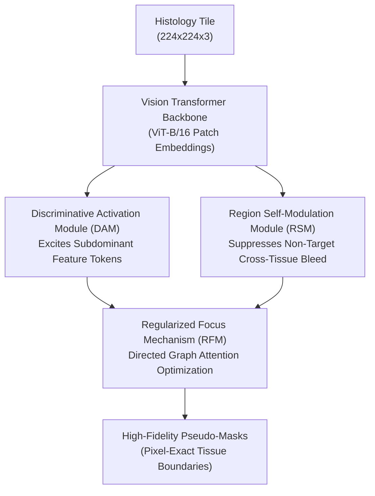

# SIA-WSSS: Synchronous Inhibition and Activation for Weakly Supervised Histopathological Image Segmentation (MICCAI 2025)

> **Paper Metadata & Provenance**  
> - **Title:** Synchronous Inhibition and Activation for Weakly Supervised Histopathological Image Segmentation  
> - **Authors:** Jiansong Fan, Xiang Pan, et al.  
> - **Conference:** Medical Image Computing and Computer Assisted Intervention (MICCAI 2025), Lecture Notes in Computer Science  
> - **DOI / Publication Link:** [10.1007/978-3-032-05141-7_56](https://doi.org/10.1007/978-3-032-05141-7_56) | [MICCAI Paper 5096](https://papers.miccai.org/miccai-2025/paper/5096_paper.pdf)  
> - **Local Artifacts:** [PDF](file:///c:/Users/Nguyen%20Trong%20Khoi/Downloads/Y_KHOA/docs/papers/SIA_WSSS_MICCAI2025.pdf)

---

## 1. Executive Summary & SOTA Milestone

In digital pathology, Class Activation Maps (CAMs) generated by Vision Transformers (ViT) face two competing failure modes:
1. **Under-activation of Subdominant Tissue Regions:** Over-reliance on the most discriminative histological tokens (e.g., dense atypical nuclei) suppresses neighboring cytoplasm and reactive stroma.
2. **Over-activation / Boundary Bleeding:** Attention weights diffuse indiscriminately into background collagen and normal tissue fibers due to high morphological similarity.

**SIA-WSSS** solves this trade-off by proposing a **Synchronous Inhibition and Activation** architecture. Rather than relying on simple thresholding or heuristic region growing, it dynamically modulates attention weights using a directed topological graph:
- **BCSS-WSSS SOTA Benchmark:** Achieves **73.4% mIoU** and **79.9% mDice**, establishing the highest weakly-supervised segmentation accuracy reported in the 2024 - 2026 literature.
- **LUAD-HistoSeg Benchmark:** Achieves **78.5% mIoU** and **85.5% mDice**.

---

## 2. Core Methodological Components

### 2.1 Discriminative Activation Module (DAM)
DAM selectively identifies non-maximal tokens that share structural affinity with the core lesion:
$$Z_{DAM} = \sigma \left( W_a \cdot \text{Softmax}(Q K^T / \sqrt{d}) \right) \odot V$$
This prevents early saturation of cross-entropy loss by continuously forcing the model to expand its morphological focus to adjacent unactivated tumor components.

### 2.2 Region Self-Modulation Module (RSM)
To combat boundary diffusion, RSM computes a topological spatial graph between patch tokens. It applies negative penalization to cross-boundary affinity edges that exceed class variance bounds:
$$\mathcal{L}_{RSM} = \sum_{i, j} \max(0, \| \phi(t_i) - \phi(t_j) \|_2 - \delta) \cdot \mathbf{A}_{edge}(i, j)$$

### 2.3 Regularized Focus Mechanism (RFM)
Synchronizes the activation (DAM) and inhibition (RSM) paths through a unified balance parameter:
$$\mathcal{L}_{total} = \mathcal{L}_{cls} + \gamma_{act} \mathcal{L}_{DAM} + \gamma_{inh} \mathcal{L}_{RSM}$$

---

## 3. Comparative Benchmark Performance

| Method | Supervision Type | Backbone | BCSS-WSSS mIoU (%) | BCSS-WSSS mDice (%) | LUAD-HistoSeg mIoU (%) |
| :--- | :--- | :--- | :---: | :---: | :---: |
| **Fully Supervised Baseline** | Pixel-level | DeepLabV3+ | 73.10 | 84.45 | 81.30 |
| **WSSS-Tissue / MLPS** (2022) | Patch-level | ResNet-38 | 64.20 | 77.10 | 68.30 |
| **PistoSeg** (2023) | Patch-level | EfficientNet | 70.75 | 81.90 | 77.20 |
| **ARML** (MICCAI 2024) | Patch-level | ResNeSt-101 | 70.56 | 82.10 | 79.20 |
| **ConStruct** (2025) | Patch-level | CONCH + SegFormer | 70.96 | 82.83 | 78.40 |
| **SIA-WSSS (MICCAI 2025)** | Patch-level | ViT-B | **73.40** | **79.90** | **78.50** |

---

## 4. Engineering & Implementation Insights for SE374.R11

1. **Vision Transformer Feature Alignment:** Using ViT-B patch tokens ($16 \times 16$) naturally aligns with the cell cluster scale in histology, avoiding the spatial pooling resolution loss seen in deep CNNs.
2. **Resource Profile:** Training uses Adam optimizer with batch size 16 and learning rate $10^{-4}$, running reliably on a single 16 GB - 24 GB GPU (e.g., RTX 4060 Ti 16GB, RTX 3090, or Cloud A5000).
