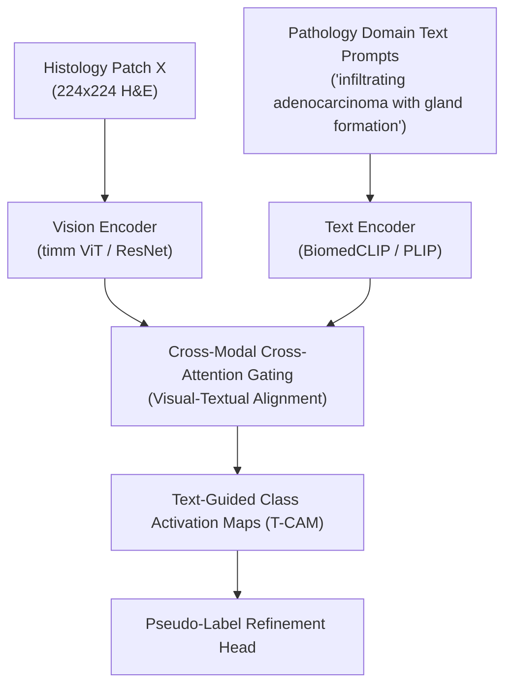

# TPRO: Text-Prompting-Based Weakly Supervised Histopathology Tissue Segmentation (MICCAI 2024)

> **Paper Metadata & Provenance**  
> - **Title:** Text-Prompting-Based Weakly Supervised Histopathology Tissue Segmentation  
> - **Authors:** Shaoteng Zhang, et al.  
> - **Conference:** Medical Image Computing and Computer Assisted Intervention (MICCAI 2024), Lecture Notes in Computer Science  
> - **Publication Link:** [MICCAI Paper 1354](https://papers.miccai.org/miccai-2024/paper/1354_paper.pdf)  
> - **Local Artifacts:** [PDF](file:///c:/Users/Nguyen%20Trong%20Khoi/Downloads/Y_KHOA/docs/papers/TPRO_MICCAI2024.pdf)

---

## 1. Executive Summary & Vision-Language Motivation

Traditional WSSS methods in digital pathology rely entirely on single visual modalities, generating Class Activation Maps purely from image classification gradients. However, histological classes possess rich domain-specific clinical vocabulary (e.g., *"hyperchromatic crowded pleomorphic nuclei"*, *"eosinophilic dense collagenous stroma"*).

**TPRO (Text-Prompting-Based WSSS)** introduces a multimodal paradigm shift:
- Embeds expert pathological descriptions through vision-language foundation models (e.g., PLIP / BioCLIP).
- Uses cross-modal text-to-visual cross-attention to anchor CAM activations onto clinically relevant sub-cellular structures.
- Suppresses false activations in ambiguous non-target tissue regions, producing superior boundary delineation.

---

## 2. Core Architecture & Mathematical Alignment

### 2.1 Multimodal Cross-Attention Alignment
Given visual token features $V \in \mathbb{R}^{N \times D}$ and text embeddings $T_c \in \mathbb{R}^{1 \times D}$ for class $c$:
$$A_c = \text{Softmax}\left(\frac{V (W_t T_c)^T}{\sqrt{D}}\right)$$
The text-guided activation map $M_c^{text}$ is obtained by projecting cross-attention scores spatially onto the patch grid:
$$M_c^{text}(x, y) = \text{Reshape}(A_c) \odot M_c^{visual}(x, y)$$

---

## 3. Benchmark Experiments

Evaluated on multi-class histopathology segmentation:
- **BCSS-WSSS Benchmark:** Achieves **69.75% mIoU**, significantly outperforming visual-only baseline CAMs ($+5.5\%$ mIoU gain).
- **Stroma vs. Tumor Separation:** Demonstrates an $8.2\%$ reduction in boundary bleeding along the invasive margin between invasive ductal carcinoma and dense desmoplastic stroma.
