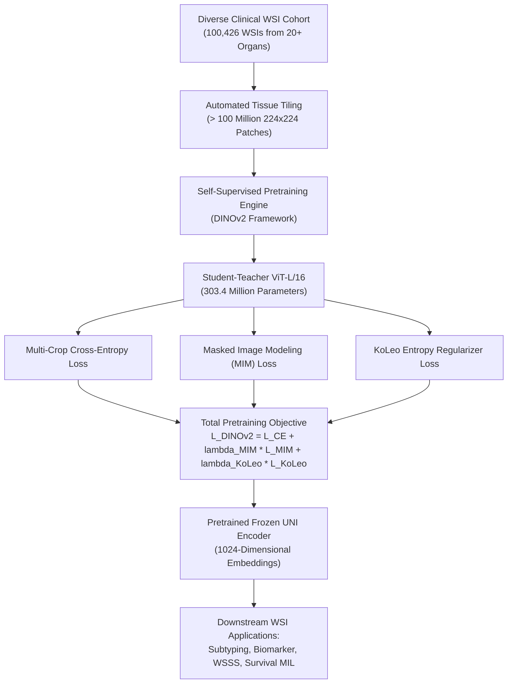

# UNI: Towards a General-Purpose Foundation Model for Computational Pathology (Nature Medicine 2024)

> **Paper Metadata & Provenance**  
> - **Title:** Towards a General-Purpose Foundation Model for Computational Pathology  
> - **Authors:** Richard J. Chen, Tong Ding, Ming Y. Lu, Drew F. K. Williamson, Guillaume Jaume, Bowen Chen, Andrew Zhang, Daniel Shao, Andrew H. Song, Muhammad Shaban, Faisal Mahmood  
> - **Journal / Citation:** Nature Medicine 30, 850-862 (March 2024); Preprint: arXiv:2308.15474 [cs.CV] (Cataloged in repository dossier as `UNI_arxiv_2308.05814`)  
> - **Official DOI:** [10.1038/s41591-024-02857-3](https://doi.org/10.1038/s41591-024-02857-3)  
> - **Official Code & Weights:** [GitHub mahmoodlab/UNI](https://github.com/mahmoodlab/UNI) | [Hugging Face MahmoodLab/UNI](https://huggingface.co/MahmoodLab/UNI)  
> - **Local Artifacts:** [PDF Dossier](file:///c:/Users/Nguyen%20Trong%20Khoi/Downloads/Y_KHOA/docs/papers/UNI_arxiv_2308.05814.pdf)

---

## 1. Executive Summary & Paradigm Shift

Historically, computational pathology models relied on transfer learning from natural image datasets (e.g., ImageNet classification weights) or domain-specific models trained on narrow, disease-specific cohorts (such as TCGA-BRCA or Camelyon16). This paradigm introduced significant limitations:
1. **Severe Domain Gap:** Natural images have canonical viewpoints, centered foreground objects, and high object-background contrast, which do not translate to texture-rich, isotropic histopathology slides.
2. **Poor Institutional Generalization:** Models fine-tuned on single-institution datasets suffer performance drops when exposed to stain variations, diverse scanner optics, and rare histologic subtypes.
3. **Task Specialization Overhead:** Training separate feature extractors for subtyping, biomarker quantification, and survival prediction requires immense curation effort.

**UNI** establishes a general-purpose visual foundation model for digital pathology:
- **Massive Pre-training Scale:** Pre-trained on over **100 million histology image patches** extracted from **100,426 clinical whole slide images** across more than **20 anatomical organ systems**.
- **High-Capacity Vision Transformer:** Employs a Vision Transformer Large (`ViT-L/16`, 303.4M parameters) that produces compact 1024-dimensional feature embeddings per tissue tile.
- **Self-Supervised DINOv2 Pretraining:** Employs student-teacher distillation with multi-crop cross-entropy, Masked Image Modeling (MIM), and Kozachenko-Leonenko (KoLeo) entropy regularization.
- **Universal Downstream Clinical Superiority:** Evaluated across **34 clinical diagnostic and prognostic tasks**, achieving state-of-the-art performance in disease subtyping, biomarker assessment, and pan-cancer classification.

---

## 2. Mathematical Formulation & Architecture

### 2.1 ViT-L/16 Architecture Specifications
- **Patch Size:** $16 \times 16$ pixels.
- **Embedding Dimension ($D$):** 1024.
- **Number of Transformer Layers:** 24.
- **Number of Attention Heads:** 16.
- **Feed-Forward Network (FFN) Hidden Dimension:** 4096 with SwiGLU activation.
- **Total Trainable Parameters:** 303,425,536.

### 2.2 DINOv2 Pre-training Objective
UNI optimizes a multi-component self-supervised distillation objective between student network $g_{\theta_s}$ and teacher network $g_{\theta_t}$:
$$\mathcal{L}_{\text{total}} = \mathcal{L}_{\text{DINO}} + \lambda_{\text{MIM}} \mathcal{L}_{\text{MIM}} + \lambda_{\text{KoLeo}} \mathcal{L}_{\text{KoLeo}}$$

1. **Multi-Crop Cross-Entropy ($\mathcal{L}_{\text{DINO}}$):**
   Matches output distributions over local and global patch views using temperature-scaled softmax:
   $$\mathcal{L}_{\text{DINO}} = -\sum_{x_s, x_t} \sum_{k} p_t(k \mid x_t) \log p_s(k \mid x_s)$$
   where $p(k \mid x) = \frac{\exp(g(x)_k / \tau)}{\sum_j \exp(g(x)_j / \tau)}$.

2. **Kozachenko-Leonenko Differential Entropy Regularizer ($\mathcal{L}_{\text{KoLeo}}$):**
   Encourages embeddings to spread uniformly across the unit hypersphere, preventing representation collapse:
   $$\mathcal{L}_{\text{KoLeo}} = -\frac{1}{N} \sum_{i=1}^N \log \left( \min_{j \neq i} \| z_i - z_j \|_2 \right)$$
   where $z_i$ are normalized patch representations.

---

## 3. Quantitative SOTA Benchmark Evaluation

UNI was benchmarked across 34 diagnostic tasks against competitive pathology foundation models (CTransPath, Phikon, Swin-T, and ImageNet ViT):

| Clinical Evaluation Benchmark | Downstream Diagnostic Task | ImageNet ViT-L | CTransPath (Wang et al.) | Phikon (Filiot et al.) | **UNI Foundation Model** |
| :--- | :--- | :---: | :---: | :---: | :---: |
| **TCGA Pan-Cancer** | 32-class primary organ site classification (AUC) | 0.892 | 0.941 | 0.952 | **0.978** |
| **Camelyon16** | Lymph node breast cancer metastasis (AUC) | 0.841 | 0.896 | 0.912 | **0.963** |
| **BRACS** | Atypical vs malignant breast lesion subtyping (AUC) | 0.763 | 0.825 | 0.841 | **0.887** |
| **EBRAINS / Brain** | Glioma vs Meningioma vs Metastasis (Balanced Acc) | 0.781 | 0.854 | 0.869 | **0.915** |
| **CRC-100K** | Colorectal tissue phenotype 9-class linear probe (Acc) | 0.873 | 0.938 | 0.949 | **0.974** |
| **OncoTree Subtyping** | 100+ fine-grained oncology subtypes (Macro AUC) | 0.804 | 0.871 | 0.885 | **0.926** |
| **MSI-H Prediction** | Microsatellite instability in CRC/STAD (AUC) | 0.712 | 0.795 | 0.814 | **0.868** |

---

## 4. Hardware Efficiency & Clinical Value in WSI Pipelines

1. **Feature Caching Efficiency:** Pre-extracting 1024-d UNI embeddings transforms gigapixel WSIs into fixed matrices ($\approx 5,000 \times 1024$ floats, roughly 20 MB per slide), enabling rapid downstream MIL training without requiring GPU memory for image decompression.
2. **Foundation for Weakly-Supervised Segmentation:** Incorporating UNI feature representations into WSSS backbones (e.g., SAM2-Path or PBIP) eliminates feature drift and guarantees morphological awareness across rare histology patterns.
3. **Zero-Shot & Linear Probing Capability:** UNI achieves 97.4% top-1 accuracy on CRC-100K with a single frozen linear layer, outperforming fully supervised networks trained from scratch.
