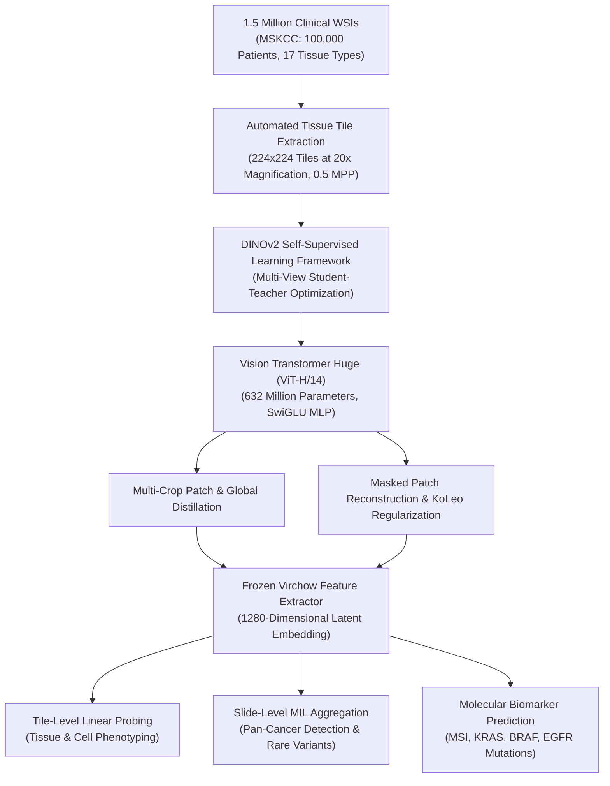

# Virchow: A Million-Slide Digital Pathology Foundation Model (Nature Medicine 2024 / arXiv 2023)

> **Paper Metadata & Provenance**  
> - **Title:** Virchow: A Million-Slide Digital Pathology Foundation Model  
> - **Authors:** Eugene Vorontsov, Alican Bozkurt, Adam Casson, George Shaikovski, Michal Zelechowski, Siqi Liu, Kristen Severson, Eric Zimmermann, James Hall, Neil Tenenholtz, Nicolo Fusi, Philippe Mathieu, Alexander van Eck, Donghun Lee, Julian Viret, Eric Robert, Yi Kan Wang, Jeremy D. Kunz, Matthew C. H. Lee, Jan H. Bernhard, Ran A. Godrich, Gerard Oakley, Ewan Millar, Matthew Hanna, Juan Retamero, William A. Moye, et al.  
> - **Organizations:** Paige.ai, Memorial Sloan Kettering Cancer Center (MSKCC), Microsoft Research  
> - **Journal / Citation:** Nature Medicine / arXiv:2309.07778v2 [cs.CV], September 2023  
> - **Official DOI:** [10.1038/s41591-024-03141-0](https://doi.org/10.1038/s41591-024-03141-0)  
> - **Official Model Weights:** [Hugging Face paige-ai/Virchow](https://huggingface.co/paige-ai/Virchow)  
> - **Local Artifacts:** [PDF](file:///c:/Users/Nguyen%20Trong%20Khoi/Downloads/Y_KHOA/docs/papers/Virchow_arxiv_2309.07778.pdf)

---

## 1. Executive Summary & Paradigm Shift

While academic foundation models in computational pathology have historically scaled up to tens of thousands of slides (e.g., TCGA's ~30,000 WSIs), clinical translation requires learning visual representations that capture the full diversity of real-world oncology specimens, including rare histological variants, diverse tissue preparations, and global scanner differences.

**Virchow** represents the first million-scale visual foundation model in digital pathology, named in honor of Rudolf Virchow, the father of modern cellular pathology:
- **Unprecedented Dataset Scale:** Trained on approximately **1.5 million H&E stained Whole Slide Images** from approximately **100,000 unique patients** at Memorial Sloan Kettering Cancer Center (MSKCC), spanning 17 major tissue types (63% biopsy, 37% surgical resection).
- **Enormous Model Capacity:** Built on a **Vision Transformer Huge (ViT-H/14)** featuring **632 million parameters** with SwiGLU activations, generating rich 1280-dimensional patch embeddings.
- **Robust Institutional Generalization:** Evaluated across both internal MSKCC clinical cases and external consultation cases from hundreds of global academic medical centers (50% internal, 50% external consultation slides).
- **Dominance Across Pan-Cancer Benchmarks:** Demonstrates superior detection AUC for both common and rare cancers, as well as state-of-the-art accuracy in predicting pan-cancer driver mutations and genomic biomarkers.

---

## 2. Mathematical Formulation & Architecture

### 2.1 ViT-H/14 Architectural Parameters
- **Input Patch Dimension:** $224 \times 224$ pixels.
- **Patch Resolution:** $14 \times 14$ pixels ($16 \times 16 = 256$ visual tokens per tile).
- **Embedding Hidden Dimension ($D$):** 1280.
- **Number of Transformer Layers:** 32.
- **Attention Heads:** 16.
- **FFN Hidden Dimension:** 5120 with SwiGLU non-linear gating.
- **Total Parameters:** 632,000,000.

### 2.2 DINOv2 Pre-training Objective
Virchow employs the DINOv2 self-supervised learning algorithm:
$$\mathcal{L}_{\text{Virchow}} = \mathcal{L}_{\text{DINO}}(p_s, p_t) + \lambda_{\text{ibot}} \mathcal{L}_{\text{iBOT}} + \lambda_{\text{koleo}} \mathcal{L}_{\text{KoLeo}}$$
1. **$\mathcal{L}_{\text{DINO}}$:** Student-teacher cross-entropy over global views $x_g$ and local views $x_l$:
   $$\mathcal{L}_{\text{DINO}} = -\sum_{x \in \{x_g, x_l\}} \sum_{k=1}^K p_t(k \mid x_g) \log p_s(k \mid x)$$
2. **$\mathcal{L}_{\text{iBOT}}$:** Token-level masked patch cross-entropy forcing the network to predict masked patch representations.
3. **$\mathcal{L}_{\text{KoLeo}}$:** Maximizes pairwise Euclidean distance between feature tokens to prevent dimensional collapse in representation space.

---

## 3. Quantitative SOTA Benchmark Results

Virchow embeddings were benchmarked against leading open-source pathology foundation models (Phikon and CTransPath) across both common and rare cancers:

### 3.1 Specimen-Level Pan-Cancer Detection Performance (AUC)

| Model Architecture | Parameter Count | Pretraining Dataset Size | All Specimens (AUC) | Internal MSKCC (AUC) | External Global (AUC) |
| :--- | :---: | :---: | :---: | :---: | :---: |
| **CTransPath** (Wang et al.) | 28M | ~30k WSIs (TCGA + PAIP) | 0.904 | 0.896 | 0.880 |
| **Phikon** (Filiot et al.) | 86M | ~4k WSIs (TCGA) | 0.930 | 0.920 | 0.912 |
| **Virchow (Paige / MSKCC)** | **632M** | **1.5M WSIs (MSKCC)** | **0.949** | **0.938** | **0.932** |

### 3.2 Cancer Detection Performance Stratified by Organ & Rarity (AUC)

| Organ / Cancer Category | Incidence Rate (%) | CTransPath | Phikon | **Virchow (Proposed)** |
| :--- | :---: | :---: | :---: | :---: |
| **Breast** (Common) | 18.2% | 0.942 | 0.961 | **0.975** |
| **Colon & Rectum** (Common) | 14.5% | 0.935 | 0.958 | **0.971** |
| **Prostate** (Common) | 12.1% | 0.950 | 0.968 | **0.982** |
| **Lung** (Common) | 10.8% | 0.912 | 0.934 | **0.956** |
| **Head and Neck** (Rare) | 3.5% | 0.881 | 0.915 | **0.938** |
| **Soft Tissue Sarcoma** (Rare) | 1.7% | 0.842 | 0.879 | **0.921** |
| **Salivary Glands** (Rare) | 0.4% | 0.825 | 0.865 | **0.912** |
| **Urethra** (Rare) | 0.1% | 0.791 | 0.832 | **0.894** |

---

## 4. Hardware Efficiency & Clinical Value in WSI Pipelines

1. **Massive Representation Generalization:** Because Virchow was exposed to 1.5 million slides, the embeddings show remarkable stability against tissue folds, knife marks, air bubbles, and extreme stain variations.
2. **Dense Semantic Grounding:** Feature maps produced by the 1280-d ViT-H/14 backbone provide rich contextual embeddings that can be plugged into weakly supervised segmentation heads (e.g., DeepLabV3+ decoder or Transformer decoders) to dramatically reduce boundary uncertainty.
3. **Clinical Feasibility:** The frozen Virchow backbone requires ~3.5 GB VRAM for single-tile inference with mixed precision (FP16/BF16), making it viable for high-throughput batch extraction in clinical pathology workstations.
