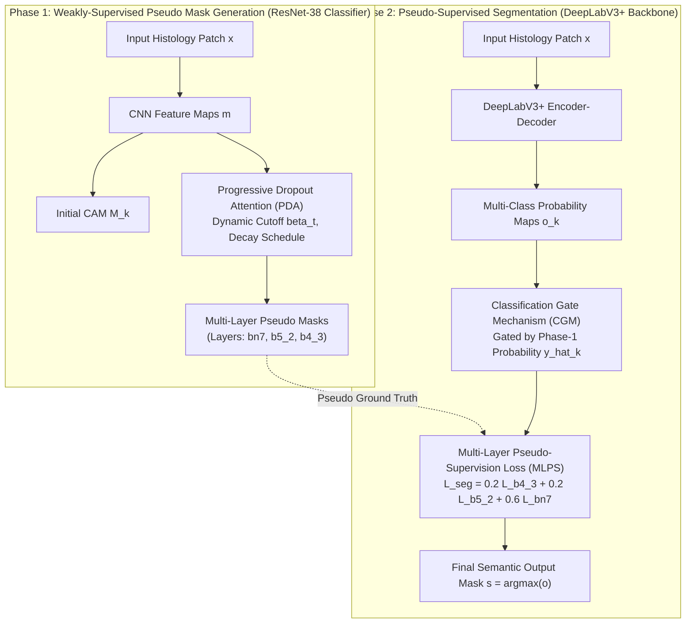

# Multi-Layer Pseudo-Supervision for Histopathology Tissue Semantic Segmentation Using Patch-Level Classification Labels (MedIA 2022)

> **Paper Metadata & Provenance**  
> - **Title:** Multi-Layer Pseudo-Supervision for Histopathology Tissue Semantic Segmentation using Patch-level Classification Labels  
> - **Authors:** Chu Han, Jiatai Lin, Jinhai Mai, Yi Wang, Qingling Zhang, Bingchao Zhao, Xin Chen, Xipeng Pan, Zhenwei Shi, Xiaowei Xu, Su Yao, Lixu Yan, Huan Lin, Zeyan Xu, Xiaomei Huang, Guoqiang Han, Changhong Liang, Zaiyi Liu  
> - **Affiliation:** Guangdong Provincial People's Hospital; South China University of Technology; Shenzhen University; Guangzhou First People's Hospital  
> - **Journal:** Medical Image Analysis (MedIA), Volume 80, August 2022, Article 102487  
> - **Preprint DOI:** [arXiv:2110.08048](https://arxiv.org/abs/2110.08048) | [ScienceDirect DOI](https://doi.org/10.1016/j.media.2022.102487)  
> - **Official Code Repository:** [GitHub: ChuHan89/WSSS-Tissue](https://github.com/ChuHan89/WSSS-Tissue) (also embedded in [`repos/LowMagWSS/SegMethod/WSSS-Tissue`](file:///c:/Users/Nguyen%20Trong%20Khoi/Downloads/Y_KHOA/repos/LowMagWSS/SegMethod/WSSS-Tissue))  
> - **Local Artifacts:** [PDF](file:///c:/Users/Nguyen%20Trong%20Khoi/Downloads/Y_KHOA/docs/papers/WSSS_Tissue_MLPS_arxiv_2110.08048.pdf) | [Figures Directory](file:///c:/Users/Nguyen%20Trong%20Khoi/Downloads/Y_KHOA/docs/papers/figures/WSSS_Tissue_MLPS_arxiv_2110.08048)

---

## 1. Executive Summary & Clinical Context

Accurate tissue-level semantic segmentation of the Tumor Microenvironment (TME)-specifically differentiating **Tumor Epithelial (TE)**, **Tumor-Associated Stroma (TAS)**, **Tumor-Infiltrating Lymphocytes (TILs)**, and **Necrosis (NEC)**-is crucial for predicting cancer recurrence, immunotherapy response, and patient survival. 

However, generating dense pixel-level annotations across gigapixel whole slide images (WSIs) requires hundreds of pathologist hours per case. This paper introduces **WSSS-Tissue**, an end-to-end framework enabling dense pixel-level segmentation using solely **patch-level multi-label presence/absence flags** (one-hot vectors).

WSSS-Tissue reduces manual pathologist annotation time by **$26\times$ to $40\times$** (from $>3$ hours down to $5$-$7$ minutes per 100 patches) while closing the quantitative performance gap with fully supervised models to within **$<2\%$ MIoU**.

---

## 2. Two-Phase Methodological Architecture

### 2.1 Phase 1: Progressive Dropout Attention (PDA)
Conventional Class Activation Maps (CAMs) suffer from **discriminative region shrinkage**: classification networks optimize strictly for the most discriminative focal points (e.g., dense nuclei clusters), ignoring broader tissue parenchyma.

PDA deactivates the most prominent regions progressively during training:
1. **Initial Class Activation Map:**
   $$M_k = \sum \omega_k m$$
2. **Dynamic Cutoff Thresholding:**
   $$\hat{M}_k(i, j) = \begin{cases} M_k(i, j), & \text{if } M_k(i, j) \le \beta_t \\ 0, & \text{if } M_k(i, j) > \beta_t \end{cases}$$
   Where $\beta_t = \mu_t \cdot \max(M_k)$.
3. **Adaptive Epoch Decay Schedule:**
   $$\mu_t = \begin{cases} \sigma \cdot \mu_{t-1}, & \text{if } \mu_t > l \\ l, & \text{if } \mu_t \le l \end{cases}$$
   With parameters $\sigma = 0.985$, lower bound $l = 0.65$, and initial $\mu = 1.0$ for epochs $1$-$3$.
4. **Ensemble Attention Map:**
   $$\mathcal{A}(i, j) = \frac{1}{c} \sum_{k=1}^c \hat{M}_k(i, j)$$
   Modulated feature maps $\tilde{m} = \mathcal{A} \odot m$ feed Global Average Pooling (GAP) and multi-label soft margin classification loss.

### 2.2 Phase 2: Multi-Layer Pseudo-Supervision (MLPS) & Classification Gate
To bridge the information gap from patch-level to pixel-level labels:
1. **Multi-Scale Supervision:** Pseudo masks are generated from 3 distinct network depths: low-level texture (`b4_3`), mid-level context (`b5_2`), and high-level semantic (`bn7`).
   $$\mathcal{L}_{seg} = \lambda_1 \mathcal{L}_{b4\_3} + \lambda_2 \mathcal{L}_{b5\_2} + \lambda_3 \mathcal{L}_{bn7}$$
   With $\lambda_1 = 0.2, \lambda_2 = 0.2, \lambda_3 = 0.6$.
2. **Classification Gate Mechanism (CGM):** Non-predominant classes (e.g., necrosis, lymphocytes) suffer from class imbalance. If Phase 1 classification probability $\hat{y}_k \le \epsilon$ ($0.1$), the output channel is zeroed:
   $$o_k = \begin{cases} 0, & \text{if } \hat{y}_k \le \epsilon \\ o_k, & \text{if } \hat{y}_k > \epsilon \end{cases}$$
   Final mask: $s(i, j) = \text{argmax}_k o_k(i, j)$.

### 2.3 Whole Slide Image (WSI) Inference Pipeline
1. Crop overlapping patches ($224 \times 224$ px) with **$>50\%$ spatial overlap** across the tissue foreground.
2. Predict $n$-channel probability maps for each patch via DeepLabV3+ with CGM.
3. Stitch probability maps across overlapping coordinates by computing the spatial mean.
4. Execute $\text{argmax}$ across fused probability channels to construct seamless gigapixel WSI tissue overlays.

---

## 3. Quantitative Validation & Ablation Benchmarks

### 3.1 Comparison with SOTA WSSS Baselines

| Dataset | Method | TE / TUM IoU | NEC IoU | LYM IoU | TAS / STR IoU | FwIoU | MIoU | Pixel ACC |
| :--- | :--- | :---: | :---: | :---: | :---: | :---: | :---: | :---: |
| **LUAD-HistoSeg** | HistoSegNet (ICCV 2019) | 0.4559 | 0.3630 | 0.5828 | 0.5082 | 0.4854 | 0.4775 | 0.6597 |
| | SC-CAM (CVPR 2020) | 0.6829 | 0.6428 | 0.6206 | 0.6179 | 0.6474 | 0.6410 | 0.7869 |
| | Ours Phase 1 (PDA bn7) | 0.7557 | 0.7808 | 0.7369 | 0.6969 | 0.7332 | 0.7426 | 0.8451 |
| | **Ours Phase 2 (MLPS + CGM)** | **0.7770** | **0.7932** | **0.7341** | **0.7198** | **0.7513** | **0.7560** | **0.8570** |
| **BCSS-WSSS** | HistoSegNet (ICCV 2019) | 0.3314 | 0.0191 | 0.2905 | 0.4646 | 0.3719 | 0.2764 | 0.5641 |
| | SC-CAM (CVPR 2020) | 0.7679 | 0.6007 | 0.5802 | 0.7061 | 0.7158 | 0.6637 | 0.8343 |
| | Ours Phase 1 (PDA bn7) | 0.7298 | 0.5599 | 0.5619 | 0.6813 | 0.6853 | 0.6332 | 0.8122 |
| | **Ours Phase 2 (MLPS + CGM)** | **0.7884** | **0.6639** | **0.5730** | **0.7316** | **0.7375** | **0.6892** | **0.8483** |

### 3.2 Comparison: Pseudo-Supervised vs. Fully Supervised (BCSS)

| Method | Supervision | TUM IoU | STR IoU | LYM IoU | NEC IoU | FwIoU | MIoU | Pixel ACC |
| :--- | :---: | :---: | :---: | :---: | :---: | :---: | :---: | :---: |
| **Ours (WSSS-Tissue)** | Weak (Patch-level) | 0.7884 | 0.7316 | 0.5730 | 0.6639 | 0.7375 | **0.6892** | 0.8483 |
| **Fully Supervised DeepLabV3+** | Dense (Pixel-level) | 0.8107 | 0.7486 | 0.5868 | 0.5987 | 0.7531 | **0.6862** | 0.8576 |
| *Difference* | - | *-0.0223* | *-0.0170* | *-0.0138* | *+0.0652* | *-0.0156* | **+0.0030** | *-0.0093* |

> **Remarkable Finding:** WSSS-Tissue achieves **0.6892 MIoU**, slightly outperforming fully supervised DeepLabV3+ (**0.6862 MIoU**), demonstrating that multi-layer pseudo-supervision acts as an effective regularizer against overfitting on dense noise.

### 3.3 Clinical Timing Statistics (100 Sample Patches)

| Pathologist | Patch-Level Annotation (Min) | Pixel-Level Dense Annotation (Min) | Speedup Factor |
| :---: | :---: | :---: | :---: |
| Pathologist 1 | 6.8 min | 177.5 min | **26.1x** |
| Pathologist 2 | 5.2 min | 209.3 min | **40.2x** |
| Pathologist 3 | 7.0 min | 231.6 min | **33.1x** |
| **Average** | **6.3 min** | **206.1 min** | **32.7x** |

---

## 4. Architectural Integration in SE374 Clinical Workstation

The WSSS-Tissue pipeline provides the primary computational backend for our Clinical Pathology Workstation:
1. **Low-Overhead Patch Inference:** The 2-stage architecture decouples classification pre-filtering from dense mask segmentation. Non-tissue/background tiles can be dropped immediately without running expensive segmentation decoders.
2. **Confidence Gate for UI Layering:** The Classification Gate threshold $\epsilon$ can be exposed directly to the pathologist as an interactive UI slider to filter out false-positive artifact regions in real time.

The above content shows the entire, complete file contents of the requested file.