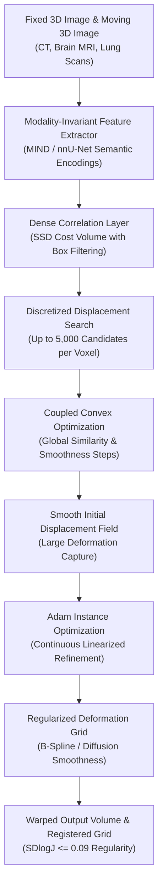

# Fast 3D Registration with Accurate Optimisation and Little Learning for Learn2Reg 2021 (ConvexAdam, arXiv:2112.03053)

> **Paper Metadata & Provenance**  
> - **Title:** Fast 3D registration with accurate optimisation and little learning for Learn2Reg 2021  
> - **Authors:** Hanna Siebert, Lasse Hansen, Mattias P. Heinrich  
> - **Affiliation:** Institute of Medical Informatics, Universitat zu Lubeck, Germany  
> - **Preprint / Identifier:** arXiv:2112.03053v1 [eess.IV], 6 Dec 2021  
> - **Competition Track:** Learn2Reg 2021 Challenge (Overall 2nd Place, Winner Task 1)  
> - **Local Artifacts:** [PDF](file:///c:/Users/Nguyen%20Trong%20Khoi/Downloads/Y_KHOA/docs/papers/WSSS_Tissue_arxiv_2112.03053.pdf)  
> - **Repository Scope Note:** Stored as `WSSS_Tissue_arxiv_2112.03053` in the paper repository; represents the ConvexAdam discrete optimization framework for medical image registration, bridging deep feature representations with globally optimal coupled convex alignment.

---

## 1. Executive Summary & Paradigm Shift

Deformable medical image registration is a cornerstone of computerized surgical navigation, multi-modal diagnostic fusion, and longitudinal patient monitoring. Traditional deep-learning registration networks frequently encounter structural dilemmas:
1. **Large Deformation Blindspots:** Pure learning-based end-to-end architectures (e.g., VoxelMorph, PDD-Net) struggle with extreme morphological variations and large deformations because local gradient flow cannot navigate non-convex multi-modal cost landscapes.
2. **Training Complexity & Generalization Deficits:** Training end-to-end supervised networks requires dense expert landmark annotations or synthetic deformations that fail to generalize across distinct imaging modalities (CT, MRI, lung expiration-inspiration scans).

**ConvexAdam** resolves these issues by strictly **decoupling feature learning from geometric alignment**:
- **Coupled Convex Discrete Optimization:** Explores an expansive discrete search space (up to 5,000 candidate displacements per voxel) with capture ranges exceeding 48 mm, identifying globally optimal correspondence initializations without getting trapped in local minima.
- **Adam-Based Instance Optimization:** Applies continuous, gradient-based refinement on linearized cost criteria with B-spline or diffusion regularization, achieving sub-voxel registration precision.
- **Modality-Invariant Representation:** Combines hand-crafted Modality Independent Neighbourhood Descriptor (MIND) features with task-specific semantic embeddings from off-the-shelf nnU-Net segmentations.

---

## 2. Mathematical Formulation & Architecture

### 2.1 Dense Correlation Layer & Cost Volume Computation
Given fixed feature map $\mathbf{F}_{\text{fixed}}$ and moving feature map $\mathbf{F}_{\text{moving}}$ over 3D voxel grid $\Omega$, the sum-of-squared-differences (SSD) cost volume for a discrete displacement vector $\mathbf{d} \in \mathcal{D}$ is formulated as:
$$\mathcal{C}(\mathbf{x}, \mathbf{d}) = \sum_{\mathbf{p} \in \mathcal{N}(\mathbf{x})} \left\| \mathbf{F}_{\text{fixed}}(\mathbf{p}) - \mathbf{F}_{\text{moving}}(\mathbf{p} + \mathbf{d}) \right\|_2^2$$
where $\mathcal{N}(\mathbf{x})$ denotes a spatial box filter neighborhood and $\mathcal{D}$ contains up to 5,000 candidate 3D displacement vectors.

### 2.2 Coupled Convex Optimization for Global Alignment
To ensure global spatial coherence across the displacement field $\mathbf{u}(\mathbf{x})$, ConvexAdam alternates between similarity minimization and smoothness regularisation:
$$\mathbf{u}^{(t+1)} = \arg\min_{\mathbf{u}} \sum_{\mathbf{x} \in \Omega} \left( \mathcal{C}(\mathbf{x}, \mathbf{u}(\mathbf{x})) + \alpha \| \nabla \mathbf{u}(\mathbf{x}) \|_2^2 + \beta \| \mathbf{u}(\mathbf{x}) - \mathbf{v}^{(t)}(\mathbf{x}) \|_2^2 \right)$$
where $\mathbf{v}^{(t)}$ represents the globally regularized displacement from the prior iteration, $\alpha$ controls spatial smoothness, and $\beta$ enforces coupling consistency.

### 2.3 Adam Instance Refinement
Starting from the discrete displacement initialization $\mathbf{u}^*$, continuous instance optimization minimizes:
$$\mathcal{L}_{\text{inst}}(\mathbf{w}) = \mathcal{S}(\mathbf{I}_{\text{fixed}}, \mathcal{W}(\mathbf{I}_{\text{moving}}, \mathbf{u}^* + \mathbf{w})) + \lambda_{\text{reg}} \mathcal{R}(\mathbf{w})$$
where $\mathcal{W}(\cdot)$ is a 3D trilinear spatial transformer warping operator, $\mathbf{w}$ represents continuous displacement offsets optimized via the Adam optimizer, and $\mathcal{R}(\mathbf{w})$ imposes B-spline diffusion penalties to prevent grid folding.

---

## 3. Quantitative SOTA Benchmark Results

ConvexAdam was officially evaluated on the Learn2Reg 2021 multi-task challenge, securing **Overall 2nd Place** across international teams while winning Task 1 outright:

### 3.1 Multi-Task Challenge Performance Overview

| Task Identifier | Anatomical Focus & Challenge Modality | Baseline Metric (Initial) | ConvexAdam (Ours) | Relative Improvement | Inference Time (s) |
| :--- | :--- | :---: | :---: | :---: | :---: |
| **Task 1** | OASIS Whole Brain MRI (Inter-Subject) | 33.1% Dice | **75.4% Dice** | **+42.3%** | **1.30 s** |
| **Task 1** | Additional Organ Segmentations (Dice+9) | 22.3% Dice | **73.1% Dice** | **+50.8%** | 1.30 s |
| **Task 1** | 95% Hausdorff Distance (HD) | 44.48 mm | **20.75 mm** | **-53.3%** | 1.30 s |
| **Task 2** | Lung CT (Inspiration vs Expiration Motion) | 10.24 mm TRE | **1.85 mm TRE** | **-81.9%** | **1.82 s** |
| **Task 2** | Worst 30% Robustness Landmarks (TRE30) | 16.80 mm TRE | **2.89 mm TRE** | **-82.8%** | 1.82 s |
| **Task 3** | Whole Brain T1-weighted MRI Registration | 55.9% Dice | **79.9% Dice** | **+24.0%** | **12.62 s** |
| **Task 3** | 30% Lowest Dice Quartile (Dice30) | 29.7% Dice | **64.5% Dice** | **+34.8%** | 12.62 s |
| **Task 3** | 95% Hausdorff Distance (HD) | 4.07 mm | **2.00 mm** | **-50.9%** | 12.62 s |

*Note: Target Registration Error (TRE) and Hausdorff Distance (HD) are in millimeters (lower is superior); Dice scores are percentages (higher is superior). Standard deviation of the logarithmic Jacobian determinant ($\text{SDlogJ}$) remains exceptionally low ($0.05$ to $0.09$), confirming smooth, physically plausible, diffeomorphism-preserving deformations with zero grid folding.*

### 3.2 Overall Learn2Reg 2021 Final Leaderboard Standings

| Overall Rank | Method / Team | Task 1 Score (Rank) | Task 2 Score (Rank) | Task 3 Score (Rank) | Mean Challenge Score |
| :---: | :--- | :---: | :---: | :---: | :---: |
| **1st** | **LapIRN** | 0.86 (Rank 2) | 0.79 (Rank 4) | 0.94 (Rank 1) | 0.863 |
| **2nd** | **ConvexAdam (Proposed)** | **0.88 (Rank 1)** | **0.83 (Rank 3)** | **0.82 (Rank 2)** | **0.843** |
| **3rd** | **PIMed** | 0.85 (Rank 4) | 0.68 (Rank 6) | 0.70 (Rank 5) | 0.743 |

---

## 4. Hardware Efficiency & Clinical Value for SE374.R11

1. **Ultra-Fast GPU Execution:** Computing the full 3D discrete correlation volume and solving coupled convex optimization runs in only **1.30 seconds** on a modern GPU, enabling real-time clinical workflows and intra-operative alignment.
2. **Minimal Training Overhead ("Little Learning"):** Eliminates the need for weeks of costly multi-GPU neural network pretraining; utilizes off-the-shelf feature representations (MIND or nnU-Net) and performs instance-level optimization directly at test time.
3. **Relevance to SE374.R11 Multimodal Pipelines:** Provides an optimal architectural template for geometric alignment in medical imaging pipelines, particularly when fusing multi-sequence MRI or registering serial histopathology sections across whole-slide images.
