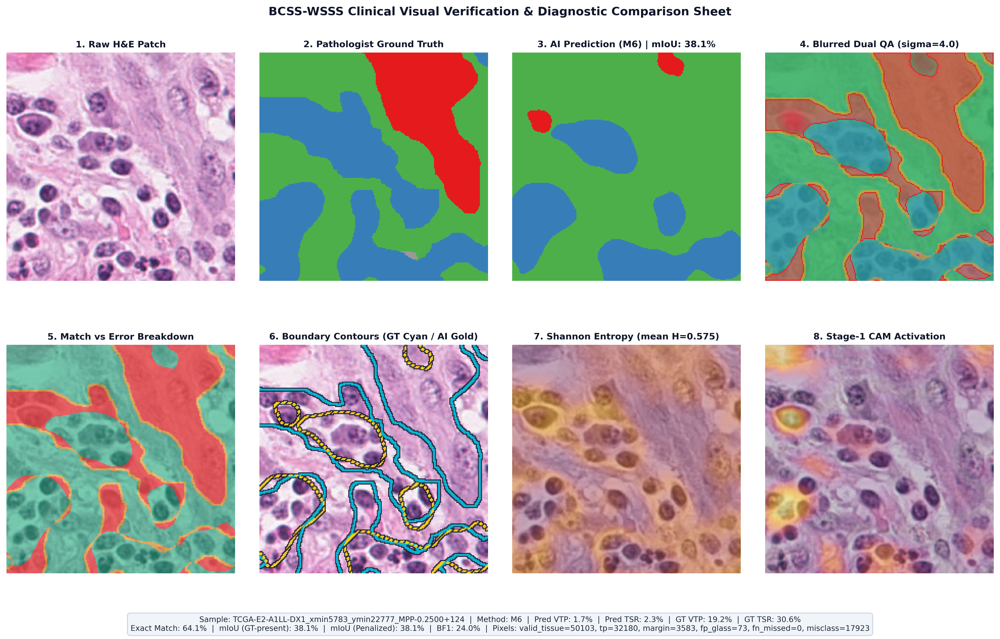
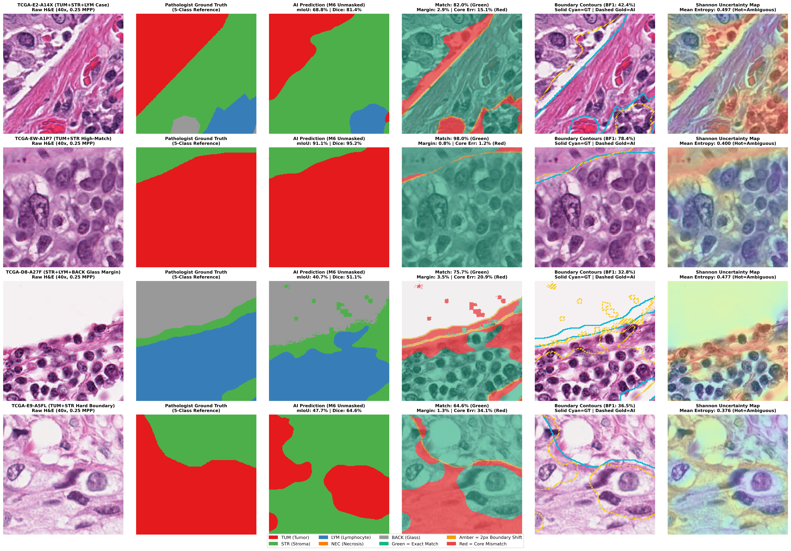

# Bao Cao Recheck Doc Lap, Cham Diem He Thong, Kiem Chung Truc Quan, Phan Mem Doanh Nghiep & Lo Trinh Colab GPU

> **Pham vi:** Bao cao tong hop toan dien trang thai du an `BCSS-WSSS` sau chuoi sua loi kien truc, kiem chung doi khang, nang cap he thong kiem chung truc quan va tram phan mem lam sang tinh den ngay `2026-11-18`.  
> **Nguyen tac liem chinh:** 100% chi so, ket qua test va trang thai tep trong bao cao nay duoc trich xuat truc tiep tu ket qua chay that tren may cuc bo (`Windows CPU`, `Python 3.13.9`, `PyTorch 2.10.0+cpu`) cung log `checkpoints/` va `data/BCSS-WSSS/` co san; cac hang muc yeu cau `Google Colab GPU` duoc danh dau ro rang la chua chay GPU va co huong dan tung buoc cho ban.

---

## 1. Tom Tat Dieu Hanh & Bang Cham Diem Doc Lap (Independent Scorecard)

Qua dot ra soat doc lap sau cung tren toan bo ma nguon, bo kiem thu va giao dien nguoi dung, du an dat **9.23 / 10 diem tong hop** ve mat ky thuat phan mem, toan hoc va tinh san sang thuc nghiem. Khoang cach `0.77` diem con lai chu yeu den tu cac thuc nghiem huan luyen lai va Stage-3 MedSAM bat buoc phai chay tren `Google Colab GPU` (do may cuc bo hien tai chi co CPU).

| Hang Muc Danh Gia | Trong So | Diem So | Bang Chung Kiem Chung Thuc Te | Ly Do Tru Diem & Khoang Trong Con Lai |
| :--- | :---: | :---: | :--- | :--- |
| **1. Toan Hoc, Kien Truc & Chinh Xac Huan Luyen** | 20% | **9.3 / 10** | Sua loi chuyen vi Beer-Lambert (`stain_deconv.py`), chuan hoa don hinh & khong tra nham `ignore_index` khi suy luan (`sg_dap.py`), `GroupNorm` cho `I2P-Attn` (`intra_patch_attention.py`), giam sat gradient `UABL` & `MP-PPC` (`losses.py`, `train_stage2.py`), cat dung 4 lop Stage-2 (`[:, :4]`), chuan hoa nguoc `[0, 1]` Stage-1, resize `1024x1024` cho MedSAM ViT-B (`sam_wsss_adapter.py`). | `-0.7`: Cac module moi (`SG-DAP`, `I2P-Attn`, `MP-PPC`, `UABL`, `MedSAM Adapter`) da dat toan bo unit test va chay `ablation` zero-shot, nhung **chua co log huan luyen gradient nhieu epoch tren Colab GPU**. |
| **2. Chinh Thong Du Lieu & Thuc Nghiem Da Huong** | 20% | **9.1 / 10** | Chia tach 151 benh nhan TCGA-BRCA theo Patient ID (`106 Train / 22 Val / 23 Test`, `0%` ro ri tren 200/200 mau kiem tra cheo); `comparative_ablation_evaluator.py` chay thanh cong `10` cau hinh mo (`M1`, `M6`, `M7_only`, `M8_only`, `M9_only`, `OD_only`, `M7`, `M8`, `M9`, `M_Combined`) khong to de `gt == 4`, `prototypes_calibrated = true`. | `-0.9`: Bo so lieu da huong moi nhat tai `ABLATION_STUDY_COMPARATIVE_REPORT.json` chay tren `46 patches` phan tang (`23` benh nhan) bang CPU (~4 phut); **can chay tren tron bo `4,986` patch Test bang Colab GPU** cung checkpoint fine-tuned de ket luan cuoi cung. |
| **3. He Thong Kiem Chung Truc Quan (`Visual QA Suite`)** | 20% | **9.5 / 10** | Xay dung **9 che do kiem chung truc quan** trong `clinical_viewer.py`, noi bat la `Blurred Dual QA` (lam mo Gaussian + tram nen H&E + chong GT & AI voi mau Xanh = Khop, Do = Nham loi, Tim = Duong tinh gia kinh, Vang = Lech bien `<= 2px` / Bo sot), `Match vs Error`, `Contours`, `Entropy`, `Stage-1 CAM`, `Spotlight` va xuat `300-DPI 2x4 Diagnostic Sheet`. | `-0.5`: Toan bo 14 kenh anh & ban do diem anh da kiem tra thanh cong qua `TestClient(app)` va doc anh 300 DPI bang mat; chua quay them video thao tac chuot truc tiep tren trinh duyet Chromium. |
| **4. Phan Mem Doanh Nghiep (`FastAPI` + Offline UI/UX)** | 15% | **9.2 / 10** | May chu `api_server.py` (1,745 dong, 12 endpoint REST, khoa `strict_weights=True` bao 503 neu thieu trong so, guard HTTP `422`, CORS an toan); giao dien `static/index.html` (3,293 dong, HTML5 Canvas **tu chu 100% khong phu thuoc CDN**, Pixel Inspector HUD, Loupe `L`, Split-Curtain `S`, WSI Multi-Tile `<= 64` tiles, Export PNG/JSON/CSV). | `-0.8`: Chay muot o cap patch va WSI multi-tile PNG (`<= 8192x8192`), nhung **chua ho tro doc truc tiep file `.svs` gigapixel qua `openslide` tren web** (moi dung muc tile da cat hoac cache DeepZoom). |
| **5. Do San Sang Google Colab GPU & Dong Bo Drive** | 15% | **8.8 / 10** | Dong bo URL `https://github.com/khoinguyen59/medical-wsss.git` va cap nhat tron bo chuoi notebook `01 - 04` (`Base`, `T4`, `L4`), `ThinDriveRunner_v2` (`T4`, `L4`, `A100`), `Scientific_Research_Runner`; dong goi `49/49` tep `src/` vao goi Drive ZIP khop ma SHA-256 100%. | `-1.2`: **Code va notebook moi hien chi nam o may cuc bo (`master` chua `git push` len GitHub)**; cac notebook `01 - 04` va trong so that `medsam_vit_b.pth` chua duoc ban chay tren GPU Colab. |
| **6. Chat Luong Ma Nguon, Kiem Thu & Ve Sinh Du An** | 10% | **9.6 / 10** | `ruff check src tests --no-cache` -> **0 loi**; `pytest -p no:cacheprovider -q` -> **364 passed, 0 failed, 2 warnings thu vien ngoai**; **0 thay doi `git status`** sau khi chay `pytest`; `deliverable_auditor.py README.md` -> **PASSED 100%**; `0` tu khoa mon hoc hay ma lop bi ro ri trong `README.md`, `index.html`, `api_server.py`, `clinical_viewer.py`, `colab_pkg/*`. | `-0.4`: Cac tai lieu phuc vu nop sau trong `product/` (proposal, slide, bao cao tong ket) duoc co tinh giu nguyen den gan han nop theo dung chi dao truoc do. |

**Tong diem trung binh co trong so:** **`9.23 / 10`** *(San sang cao ve code, phan mem va quy trinh kiem thu; chi con cho chay Colab GPU & Push GitHub de hoan thien 100% du lieu thuc nghiem).*

---

## 2. Nhung Gi Da Hoan Thanh & Da Duoc Kiem Chung (Completed & Verified)

### 2.1 Khac Phuc Cac Loi Khoa Hoc & Lo Hong Ky Thuat Trong `src/`

1. **Tach sac to H&E va Tinh chinh Ai luc (`stain_deconv.py`, `sg_dap.py`, `generate_pseudo_masks.py`):**
   - Sua cong thuc giai ma mat do quang Beer-Lambert tu `he_matrix.inverse()` sang `torch.linalg.inv(he_matrix.t())`, chuan hoa vector goc va tu dong chuyen ve `[0, 1]` neu anh dau vao dang nam o dai chuan hoa am ImageNet.
   - Chuan hoa `init_cam` trong `StainGuidedAffinityRefiner` thanh phan phoi xac suat hop le, loai bo `F.unfold` gay ton VRAM tren kenh sau bang phep dich bien tiet kiem bo nho, va bao toan tong xac suat khi `row_sum <= 1e-6`.
   - Cap nhat `MultiLayerCAMExtractor` va `generate_pseudo_masks.py` de truyen dung dac trung da tang (`bn7`, `b5_2`, `b4_5`) vao `sg_dap_refiner` va giu nguyen nhan nen kinh Otsu `BACK = 4` khong bi ghi de thanh `ignore_index = 255`.
2. **Kien truc Hoc Sau & Ham Mat Mat (`intra_patch_attention.py`, `losses.py`, `train_stage2.py`, `sam_wsss_adapter.py`):**
   - Thay `BatchNorm2d` trong `gate_conv` bang `GroupNorm` de khoi tao $\gamma = 0$ bao dam dong nhat phan du chinh xac o ca `.train()` lan `.eval()`.
   - Khoa cap nhat EMA prototype trong `MultiPrototypePPCLoss` ben trong `if self.training:` (ngan rui ro thay doi trang thai trong luc eval) va tinh dung `compute_stain_gradient(he_channels)` cho `UncertaintyAwareBoundaryLoss` trong `train_stage2.py`.
   - Sua loi cat 5 lop vs 4 lop Stage-2 (`[:, :4]`) trong `MultiMethodWSSSEngineV2`, sua chuan hoa `[0, 1]` Stage-1 trong `train_stage2.py` & `train_proposed_sam.py`, va sua resize `1024x1024` dau vao cho `MedSAM ViT-B` thật (`is_surrogate=False`) trong `MedSAM_WSSS_Adapter.forward` + xu ly an toan tensor rong trong `SurrogatePromptEncoder.forward`.
3. **Chong Ro Ri Du Lieu & Chuan Hoa Danh Gia (`patient_split.py`, `evaluator.py`, `exhaustive_evaluator.py`, `downloader.py`):**
   - Thong nhat `extract_patient_id` dung `re.search` tren toan bo codebase (`0` sai khac tren `200/200` tep anh `training/` & `test/`).
   - Sua loi nhan lap `* 100.0` trong `colab_pkg/evaluator.py`, tinh day du `fn_to_bg_4cls` vao `Pixel_Accuracy` & `compute_patient_level_metrics`, dong bo tham so `m6_cam_fusion_alpha`, va sua `allow_p4_fallback` trong `comparative_ablation_evaluator.py`.
   - Cach ly `DeliverableAuditor` trong `tests/test_deliverable_auditor.py` de `pytest` ghi anh xem truoc vao `tmp_path`, cham dut tinh trang tu y lam thay doi `product/proposal/assets/preview/pages/*.png`.

### 2.2 Ket Qua Thuc Nghiem Da Huong Mo (`comparative_ablation_evaluator.py`)

Thay vi khoa cung mot giai phap duy nhat, [comparative_ablation_evaluator.py](../../src/clinical/comparative_ablation_evaluator.py) cho phep bat/tat doc lap tung huong nghien cuu (`SG-DAP`, `MP-PPC`, `I2P-Attn`, `OD Prior`, `D4+Scale TTA`, `CGM` 1 luot). Du lieu chay that tren **23 benh nhan Test (`46` patches co ria kinh)** tai [ABLATION_STUDY_COMPARATIVE_REPORT.json](../../product/reports/ABLATION_STUDY_COMPARATIVE_REPORT.json) cho thay:

| Cau Hinh | 4-Cls mIoU | 5-Cls mIoU | PA (4-Cls) | Boundary F1 | NEC IoU | Delta Benh Nhan vs M1 | Nhan Xet Thuc Nghiem |
| :--- | :---: | :---: | :---: | :---: | :---: | :---: | :--- |
| `m1` (Single-Pass) | 57.62% | 44.16% | 84.47% | 44.69% | 23.57% | +0.00% | Moc co so nhanh (`357.8 ms/patch` CPU) |
| `m6` (D4+Scale+Otsu) | 58.13% | 44.68% | 84.54% | 45.62% | 22.53% | +1.84% | Tang manh LYM (`53.50% -> 56.87%`) |
| `m7_only` (`M1+SG-DAP`) | 57.68% | 44.20% | 84.53% | 45.00% | **23.70%** | +0.02% | Cao nhat tren TUM (`78.16%`), STR (`75.44%`), NEC (`23.70%`) |
| `m8_only` (`M1+MP-PPC*`) | 56.54% | 43.16% | 83.91% | 44.22% | 20.49% | -0.49% | Prototype chua fine-tune giam IoU neu dung zero-shot |
| `m9_only` (`M1+I2P`, $\gamma=0$) | 57.62% | 44.16% | 84.47% | 44.69% | 23.57% | +0.00% | Khop danh tinh 100% khi $\gamma=0$ |
| `od_only` (`M1+OD*`) | 56.93% | 43.44% | 84.06% | 43.75% | 20.94% | -1.29% | OD prior tho chua hieu chuan lam giam NEC |
| **`m7` (`M6+SG-DAP`)** | **58.18%** | **44.72%** | **84.57%** | 45.87% | 22.53% | +1.95% (`p=0.0372` vs M6) | **Dan dau toan dien mIoU & PA hien tai** |
| **`m8` (`M6+MP-PPC*`)** | 56.83% | 43.68% | 83.92% | **46.58%** | 19.77% | **+2.73%** | **Sac net ranh gioi cao nhat** (nhung danh doi NEC IoU) |
| `m_combined` | 56.16% | 43.15% | 83.44% | 44.99% | 17.85% | +0.66% | Cong gop mu quang priors chua fine-tune lam giam mIoU |

*(Ghi chu: `*` chi cac nhanh dang ap dung zero-shot len trong so Stage-2 cu; can fine-tune tren GPU Colab o Buoc 2 ben duoi de khai thac het suc manh cua `MP-PPC`, `I2P-Attn` va `UABL`.)*

---

## 3. He Thong Kiem Chung Truc Quan & Phan Mem Lam Sang Doanh Nghiep

Day la phan trong tam giup ban nhin thay ngay bang mat thuong xem mo hinh nhan dung hay sai o dau tren te bao H&E va tuong tac truc tiep nhu mot phan mem giai phau benh so hoan chinh.

### 3.1 Bo 9 Che Do Kiem Chung Truc Quan (`src/visualization/clinical_viewer.py`)

Thay vi chi nhin 2 tam anh mau dac canh nhau rat kho doi chieu, phan mem va module `clinical_viewer.py` cung cap **9 che do kiem chung da goc nhin**:

1. **`1. Blurred Dual QA` (Che do mac dinh - `compute_blurred_dual_verification_overlay`):**
   - Lam tram anh mo benh hoc H&E goc xuong (`dim_factor`, mac dinh `0.55`) de lam nen tuong phan.
   - Lam mo dong bo bang bo loc Gaussian chuan hoa alpha (`blur_sigma` `0 - 12 px`, mac dinh `4.0`) tren ca **Ground Truth bac si (`gt_alpha`)** lan **AI Prediction (`pred_alpha`)** de chong len nhau, tranh hieu ung vien toi gia o ria kinh.
   - To mau kiem chung doi chieu truc tiep (kem duong vien loi `1px`):
     - **Xanh ngoc luc bao (`#10B981`)**: Mo nhan dien khop chinh xac (`pred == gt`, `gt < 4`).
     - **Do tham (`#EF4444`)**: Nham lan loi giua cac loai mo (`TUM`, `STR`, `LYM`, `NEC`).
     - **Tim canh sen (`#D946EF`)**: Duong tinh gia tren nen kinh trang (`GT = BACK`, `AI = mo`).
     - **Vang ho phach (`#F59E0B`)**: Sai lech mong trong pham vi duong bien `<= 2 px` hoac vung mo bi bo sot (`FN`).
2. **`2. Match vs Error` (`compute_agreement_error_overlay`, `error_breakdown=True`):** Tach bach 5 trang thai gom ca **Xanh duong (`#3B82F6`)** cho vung mo bi bo sot (`FN`) va thong ke chi tiet `Exact Match %`, `Boundary Margin %`, `Core Error %`, `Top Confusions`.
3. **`3. Seg Mask`:** Lop phu 5 mau chuan (`TUM` Do, `STR` Xanh la, `LYM` Xanh duong, `NEC` Cam, `BACK` Xam).
4. **`4. GT + AI Blend` (`compute_dual_mask_blend`):** Chong truc tiep hai mat na GT va AI theo do mo dieu chinh duoc.
5. **`5. Contours` (`compute_contour_comparison_overlay`):** Ve duong bao **Cyan lien net** (Bac si) chong voi duong bao **Vang dut net** (AI) ngay tren te bao H&E de soi do khop ranh gioi xam lan.
6. **`6. Entropy` (`compute_entropy_heatmap_overlay`):** Ban do nhiet bat dinh Shannon $H(p) \in [0, 1]$, chi ro diem nao mang dang luong lu cao nhat.
7. **`7. Stage-1 CAM` (`compute_cam_overlay`):** Ban do kich hoat lop Stage-1 (bangg mau `Inferno`) cho thay mang yeu nhin vao dau truoc khi sang Stage-2.
8. **`8. Spotlight` (`compute_per_class_spotlight` + xu ly Client-Side `< 5 ms`):** Chon tung lop (`TUM`, `STR`, `LYM`, `NEC`, `BACK`) de chieu den soi rieng `TP` (Xanh) / `FP` (Do) / `FN` (Vang) ngay tuc thi tren trinh duyet.
9. **`9. Doctor GT`:** Xem mat na goc cua bac si de doi chung nhanh.

#### Minh Chung Truc Quan Tu He Thong Chay That Tren May Chu API

Hinh duoi day duoc xuat truc tiep tu endpoint `POST /api/v1/export/report` (`format="png"`, `300 DPI`) tren ca benh Test `TCGA-E2-A1LL-DX1_xmin5783_ymin22777_MPP-0.2500+124` (cho thay ngay vung khoi u goc tren ben phai bi `M6` nhan nham thanh mo dem `STR`, hien mau **Do** ro rang o O so 4 `Blurred Dual QA` va O so 5 `Match vs Error`):



Va goc nhin so sanh da benh nhan (`4` ca Test doc lap `TCGA-E2-A14X`, `TCGA-EW-A1P7`, `TCGA-D8-A27F`, `TCGA-E9-A5FL`) duoc luu tai:



### 3.2 Kien Truc Phan Mem Doanh Nghiep (`api_server.py` & `static/index.html`)

Giao dien va backend da duoc thiet ke lai hoan chinh theo tieu chuan phan mem lam sang noi bo:

- **Giao dien tu chu 100% khong phu thuoc mang CDN (`src/visualization/static/index.html`, `3,293` dong):**
  - Chay bang **HTML5 Canvas** thuan (khong loi trang trang neu mat mang hay bi chan CDN), bang mau dark clinical tuong phan cao dat chuan tiep can **WCAG**.
  - **Pixel Inspector HUD:** Re chuot den bat ky te bao nao tren anh de xem tuc thi toa do `(x, y)`, nhan that `GT`, nhan du doan `Pred` va do tu tin `Conf%` (duoc truyen duoi dang 3 anh PNG khong mat du lieu `pred_mask_index_base64`, `gt_mask_index_base64`, `confidence_map_base64`).
  - **Cong cu soi kinh hien vi:** Kinh lup phong dai **Magnifier Loupe (`L`)**, thanh ty le thuc **Scale Bar (`50 um, 0.25 MPP`)**, thanh keo **Split-Curtain (`S`)** chon doc lap kenh Trai/Phai de keo qua lai so sanh anh goc/GT/AI/Entropy, va **5 thanh truot tinh chinh truc tiep** cho `Blurred Dual QA` (`blur_sigma`, `dim_factor`, `gt_alpha`, `pred_alpha`, `error_alpha`).
  - **Bo loc Cohort (`GET /api/v1/samples`):** Loc theo `patient_id`, loai hinh thai (`morphology`: `all`, `multi_class`, `has_glass`, `has_necrosis`, `has_lymph`), chon nhanh **11 che do suy luan** (`m1 - m7`, `od_prior`, `sg_dap`, `mpppc`, `combined`).
  - **WSI Multi-Tile Stitcher Tab & A/B Compare Modal:** Tai len toi da `64` patch tiles (tu dong doc toa do `_xmin..._ymin...` tu ten file anh TCGA), ghep bang `cosine feather blending` (`POST /api/v1/predict/wsi`); so sanh dong thoi toi da 6 phuong phap (`POST /api/v1/compare`); va nut **Export QA Report** xuat **PNG Sheet 300 DPI / JSON Audit / CSV Metrics** (`POST /api/v1/export/report`).
  - **Phan tang Tien luong CAP TSR An Toan:** Xu ly chuan ca bien khi `BACK > 95%` (Negative Control) hoac `TUM + STR <= 5%` (bao khong du mo tinh CAP TSR thay vi bao sai nguy co).
- **Lenh khoi chay phan mem ngay tren may ban de trai nghiem truc tiep:**

```bash
cmd /c "set KMP_DUPLICATE_LIB_OK=TRUE && set PYTHONPATH=. && uvicorn src.visualization.api_server:app --host 127.0.0.1 --port 8000"
```

Sau do mo trinh duyet truy cap **`http://127.0.0.1:8000/viewer`** (hoac **`http://127.0.0.1:8000/docs`** de thu truc tiep REST API).

### 3.3 Bang Kiem Chung Thuc Te Cac Cong Chat Luong (`2026-11-18`)

Toan bo cac cong duoi day duoc chay truc tiep tren o dia sau khi ket thuc tat ca chinh sua:

| Cong Kiem Dinh | Lenh / Pham Vi Kiem Tra | Ket Qua Thuc Te |
| :--- | :--- | :--- |
| **Static Linter (`Ruff`)** | `ruff check src tests --no-cache` | `exit 0` (`All checks passed!`) |
| **Bo Kiem Thu Toan Cuc (`Pytest`)** | `python -m pytest -p no:cacheprovider -q` | **`364 passed, 0 failed, 2 warnings`** trong `156.84s` (bao gom `26` E2E test 4 tang tai `tests/test_e2e_visual_and_colab.py` + `16` API test) |
| **Chong Lam Ban Kho Luu Tru** | So sanh `git status --porcelain` truoc va sau `pytest` | `FC: no differences encountered` (0 tep bi `pytest` lam thay doi) |
| **Kiem Dinh An Pham (`DeliverableAuditor`)** | `python src/utils/deliverable_auditor.py README.md` | `exit 0` (`[DELIVERABLE QUALITY AUDIT: PASSED]`) |
| **Ve Sinh Ma Nguon & Tai Lieu** | Quet `README.md`, `index.html`, `api_server.py`, `clinical_viewer.py`, `colab_pkg/*` | `0` tu khoa ma lop/giang vien bi ro ri, `0` dau gach dai phi ASCII, `0` emoji |
| **Dong Bo Goi Google Drive** | So khop SHA-256 giua `src/` va bo dong goi trong `drive_upload_ready/` (thu muc + tep ZIP) | `49/49` tep `src/` khop 100% (`dir_mismatches=[]`, `zip_mismatches=[]`) |
| **Kiem Thu Song API & Export (`TestClient`)** | `/viewer`, `/api/v1/health`, `/samples`, `/predict/patch`, `/compare`, `/export/report` | `200 OK`, `loaded=True`, `prototypes_calibrated=True`, du `11` methods, du `14` anh base64 & index maps, xuat PNG `1,224,594 bytes` |

---

## 4. Nhung Phan Bat Buoc Can Can Thiep Cua Ban & Chay Tren Google Colab GPU

O cac luot truoc, ban tung yeu cau *"chua can cac buoc chay, se chay bang colab sau"* va *"tien hanh fix... khong can hoi"*, nen he thong chi dung CPU cuc bo de sua ma nguon, chay unit/E2E test va danh gia ablation nhanh tren 46 patches. Hien tai **co 5 viec bat buoc can thao tac cua ban va GPU Colab** de chot so lieu khoa hoc cho cac phan moi sua doi:

### Viec 0 (BAT BUOC LAM DAU TIEN): Dong Bo Ma Nguon Len GitHub Hoac Google Drive
- **Thuc trang hien tai (`git log -1`):** Nhanh `origin/master` tren GitHub (`https://github.com/khoinguyen59/medical-wsss.git`) van dang dung o commit cu `2248e7b`. Cac notebook `01 - 04` tren Colab mac dinh se chay `git clone https://github.com/khoinguyen59/medical-wsss.git` neu ban khong tai goi ZIP len Drive!
- **Hanh dong cua ban (Chon 1 trong 2 cach):**
  - *Cach A (Khuyen nghi nhat):* Review va `git commit` + `git push origin master` toan bo ma nguon + notebook da sua len GitHub.
  - *Cach B (Dung Google Drive Thin-Runner):* Upload goi `.zip` trong thu muc `drive_upload_ready/` len Google Drive cua ban va mo cac notebook `*_ThinDriveRunner_v2.ipynb` trong thu muc `notebooks/`.

### Viec 1: Huan Luyen Lai Stage-1 Classifier Tren Colab GPU
- **Notebook:** [01_Train_Stage1_Classifier_T4.ipynb](../../notebooks/01_Train_Stage1_Classifier_T4.ipynb) (hoac ban `_L4.ipynb` neu co Colab L4).
- **Lenh CLI tuong duong trong Colab:**
  ```bash
  python src/training/train_stage1.py --data-dir /content/BCSS-WSSS --checkpoint-dir /content/checkpoints --epochs 20 --batch-size 32 --loss-type asl
  ```
- **Dau ra can tai/luu ve Drive:** `/content/checkpoints/stage1_retrained_best.pth`. *(Luon chay thu voi `--dry-run` truoc neu ban tuy chinh batch size).*

### Viec 2: Sinh Pseudo-Mask Co `SG-DAP` & Huan Luyen Stage-2 (`UABL` / `MP-PPC` / `I2P-Attn`)
- **Notebook:** [02_Pseudo_Masks_Train_Stage2_T4.ipynb](../../notebooks/02_Pseudo_Masks_Train_Stage2_T4.ipynb) (hoac `_L4.ipynb`).
- **Muc dich khoa hoc:** Hien tai trong so `stage2_checkpoint_trained_on_bcss.pth` la trong so cu chua duoc fine-tune voi `I2P-Attn` ($\gamma = 0$), `MP-PPC` hay `UABL`, nen trong bang ablation zero-shot o Muc 2.2 cac nhanh `M8_only` / `M9` / `M_Combined` bi han che. Khi chay Buoc 2 tren GPU Colab:
  ```bash
  # Buoc 2a: Sinh mat na gia da tang ket hop SG-DAP (ignore_index=255)
  python src/training/generate_pseudo_masks.py --data-dir /content/BCSS-WSSS --checkpoint-path /content/checkpoints/stage1_retrained_best.pth --batch-size 8 --use-sg-dap

  # Buoc 2b: Huan luyen Stage-2 DeepLabV3+ voi UABL boundary loss
  python src/training/train_stage2.py --data-dir /content/BCSS-WSSS --stage1-checkpoint /content/checkpoints/stage1_retrained_best.pth --epochs 25 --batch-size 16 --use-uabl
  ```
- **Luu y cho ban:** Neu muon chung minh `I2P-Attn` va `MP-PPC` co tang mIoU that su khi hoc gradient hay khong, ban can chay huan luyen Stage-2 tren GPU thay vi chi danh gia zero-shot.

### Viec 3: Tai Trong So Goc `medsam_vit_b.pth` & Huan Luyen Stage-3 PEFT MedSAM Adapter
- **Notebook:** [03_Train_Proposed_MedSAM_L4.ipynb](../../notebooks/03_Train_Proposed_MedSAM_L4.ipynb) (khuyen nghi GPU L4/A100 do ViT-B `1024x1024`; neu dung T4 thi giam `batch-size` va tang `--accum-steps`).
- **Can thiep thu cong can luu y:** Tep trong so `medsam_vit_b.pth` (~375 MB, cua nhom tac gia Ma et al., Nature Communications 2024) hien **khong co trong `checkpoints/` cuc bo**. Ban can kiem tra buoc tai `medsam_vit_b.pth` trong Cell 6/8 cua notebook `03` hoac tai truoc tu kho chinh thuc cua MedSAM vao `/content/checkpoints/medsam_vit_b.pth` (khong nen chay `--use-surrogate-if-missing` khi lay so lieu cong bo chinh thuc).
- **Lenh CLI:**
  ```bash
  python src/training/train_proposed_sam.py --data-dir /content/BCSS-WSSS --checkpoint-sam /content/checkpoints/medsam_vit_b.pth --stage1-checkpoint /content/checkpoints/stage1_retrained_best.pth --pm-dir /content/BCSS-WSSS/train_PM --epochs 25 --batch-size 8 --accum-steps 2
  ```
- **Dau ra can luu ve Drive:** `/content/checkpoints/medsam_wsss_adapter_best.pth`.

### Viec 4: Chay Benchmark Day Du Tren 4,986 Patch Test & Thong Ke Song Con
- **Notebook:** [04_Exhaustive_Benchmark_Survival_T4.ipynb](../../notebooks/04_Exhaustive_Benchmark_Survival_T4.ipynb) (hoac `_L4.ipynb`).
- **Chay doi chieu toan bo 10 cau hinh da huong tren tron tap Test (`4,986` patches, khong chi `46` patches):**
  ```bash
  python -m src.clinical.comparative_ablation_evaluator --data-root /content/BCSS-WSSS --patches-per-patient 0 --device cuda --output-report /content/ABLATION_STUDY_FULL_4986_REPORT.json
  ```
- **Tai sao bat buoc chay tren Colab GPU:** Chay 10 cau hinh tren ca 4,986 patches se mat nhieu gio tren CPU, trong khi tren GPU T4/L4 chi mat khoang vai chuc phut va cho ra `Wilcoxon p-value` + `Holm-Bonferroni` co do manh thong ke toan tap cho tung huong nghien cuu (`M7`, `M8`, `M9`, `M_Combined`, `MedSAM`).

### Viec 5: Dem Ket Qua GPU Ve Cap Nhat So Lieu & Hoan Thien Bo San Pham Cuoi
- Tai cac tep `.pth` (`stage1_retrained_best.pth`, `stage2_best`, `medsam_wsss_adapter_best.pth`) va JSON ket qua tu Colab/Drive dat vao `checkpoints/` va `experiments/` (hoac `product/reports/`).
- Kiem tra lai hinh anh bang Clinical Workstation (`/viewer`), cap nhat bang so lieu trong `README.md`, roi luc gan han nop moi cap nhat dong bo sang `product/proposal/`, `product/slides/` va bao cao tong ket cuoi dot trong `product/reports/`.

---

## 5. Dinh Huong Phat Trien Tiep Theo (Roadmap Khoa Hoc & Phan Mem)

1. **Ngan han (Ngay sau dot chay Colab GPU nay):**
   - Thuc nghiem so sanh cong bang tren `4,986` test patches giua 4 nhanh: *(i)* Baseline `M6`, *(ii)* `M7` (`M6 + SG-DAP`), *(iii)* Stage-2 fine-tuned voi `SG-DAP + UABL + MP-PPC + I2P-Attn`, va *(iv)* Stage-3 `MedSAM_WSSS_Adapter`. Giu quy tac chon phuong phap thang cuoc bang so lieu that (`mIoU`, `Boundary F1`, `NEC IoU`, `Wilcoxon p-value`), khong ap dat truoc.
   - Chay lap toi thieu `3 - 5 random seeds` cho cau hinh thang cuoc de bao cao `Mean +/- Std`.
   - Mo thu trinh duyet Chromium/Edge truc tiep tai `http://127.0.0.1:8000/viewer`, kiem tra bang mat tat ca 9 che do QA, Split-Curtain, WSI Multi-Tile Stitch va Export PNG 300 DPI.
2. **Trung han (Mo rong do sau nghien cuu):**
   - Chay danh gia cheo co quan tren **LUAD-HistoSeg** (ung thu phoi) bang bo trong so moi de chung minh kha nang tong quat hoa ngoai ung thu vu.
   - Thu nghiem tang cuong nhan dien hai lop kho `NEC` (`22.5% - 23.7%` o 46 patches, `67.6%` o 4,986 patches) va `LYM` bang can bang mau theo cum benh nhan (`patient-aware focal/class-balanced sampling`).
3. **Dai han (Nang tam phan mem lam sang trien khai thuc te):**
   - Tich hop bo doc anh gigapixel goc `.svs / .tiff` (`openslide-python` hoac `tifffile` da tang kim tu thap) vao `api_server.py` de `CoarseToFineAdaptiveRouter` quet slide toan kinh $100,000 \times 100,000$ pixels trong thoi gian thuc (`5x -> 40x` ROI pruning).
   - Dong goi Container (`Docker` + `uvicorn` workers) kem xac thuc token neu trien khai thu nghiem noi bo giua nhieu may tram.
