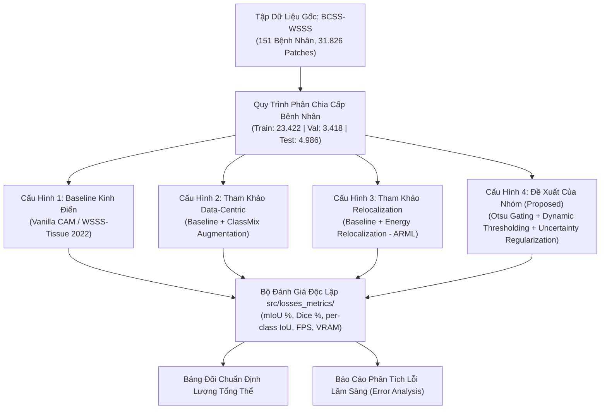

# GIAO THỨC THỰC NGHIỆM ĐỐI CHỨNG VÀ BÓC TÁCH GIẢI THUẬT (COMPARATIVE BENCHMARKING & ABLATION PROTOCOL)

> **Mã dự án:** SE374.R11 - Đồ án Phát triển Phần mềm Xử lý Ảnh Y khoa (UIT 2026)  
> **Chủ đề nghiên cứu:** Topic 6 - Phân vùng ngữ nghĩa giám sát yếu trên ảnh tiêu bản mô bệnh học toàn phần (WSSS on Histopathology WSI)  
> **Bộ dữ liệu chuẩn:** BCSS-WSSS (151 tiêu bản ung thư vú H&E, phân chia nghiêm ngặt theo Patient ID)  
> **Quy chuẩn khoa học:** IEEE Transactions on Medical Imaging (TMI) & Medical Image Analysis (MedIA)

---

## 1. Nguyên Tắc Khoa Học Cốt Lõi Của Nghiên Cứu Sinh (Graduate Research Rigor)

Một công trình nghiên cứu hay đồ án công nghệ y tế chỉ có giá trị học thuật khi tuân thủ 3 nguyên tắc đối chuẩn bất biến:
1. **Luật chơi công bằng tuyệt đối (Fair Benchmarking):** Mọi mô hình (từ baseline đến phương pháp đề xuất) đều phải chạy trên cùng một tập dữ liệu, cùng một cách phân chia bệnh nhân (Zero Patient-Leakage), cùng một tập kiểm tra độc lập (4.986 patch ẩn), và đánh giá bằng cùng một bộ hàm đo lường (mIoU, Dice, HD95).
2. **Không sao chép - Kế thừa có đối chứng:** Kế thừa các thành phần cốt lõi từ các công trình hàng đầu thế giới (WSSS-Tissue 2022, ARML 2024, HisynSeg 2025, LowMagWSS 2026), hiện thực hóa chúng thành các nhánh đối chứng độc lập, và đặt phương pháp tự đề xuất của nhóm lên bàn cân so sánh sòng phẳng.
3. **Bóc tách thực nghiệm tường minh (Ablation Studies):** Phân tích rõ từng thành phần đề xuất đem lại giá trị gì:
   - Module tiền lọc mô học Otsu loại bỏ được bao nhiêu % false positives ở mảng kính trống?
   - Cơ chế ngưỡng động (Dynamic Progressive Thresholding) cải thiện bao nhiêu % IoU ở ranh giới biểu mô khối u?
   - Điều chuẩn bất định (Uncertainty Regularization) giúp ranh giới bớt lem sang mô đệm lành ra sao?

---

## 2. Thiết Kế Ma Trận 4 Cấu Hình Thực Nghiệm Đối Chứng

### Chi tiết kỹ thuật của từng cấu hình đối chứng:

### Cấu Hình 1: Baseline Kinh Điển (Vanilla CAM / WSSS-Tissue, Han et al., MedIA 2022)
- **Mục tiêu:** Tái hiện trung thực mốc chuẩn sàn của phương pháp CAM truyền thống trên bộ dữ liệu BCSS-WSSS.
- **Backbone Giai đoạn 1:** ResNet-38 thu nhỏ, pooling GAP, huấn luyện phân loại đa nhãn với hàm mất mát Multi-label Soft Margin Loss.
- **Sinh nhãn giả:** Bản đồ CAM thô với ngưỡng cắt tĩnh cố định ($\text{thr}_c = 0.20 \cdot \max M_c$).
- **Mạng phân vùng Giai đoạn 2:** DeepLabV3+ (backbone ResNet-38 hoặc ResNet-50) huấn luyện với pseudo-masks.
- **Hạn chế đã biết cần đối chứng:** Chỉ kích hoạt các nhân tế bào dị dạng nổi bật nhất (under-activation); gặp mảng kính trống/mỡ thì hàm argmax bị lỗi dự đoán nhầm thành Khối u (Tumor).

### Cấu Hình 2: Tham Khảo Tăng Cường Ranh Giới Bằng Trộn Mẫu (ClassMix / HisynSeg-inspired)
- **Mục tiêu:** Đánh giá tác động của việc tổng hợp ranh giới nhân tạo đối với độ sắc nét của vùng biên mô học.
- **Cơ chế:** Kế thừa nguyên lý ClassMix và trộn ảnh:
  $$\tilde{x} = \mathbf{B}_c \odot x_A + (1 - \mathbf{B}_c) \odot x_B, \quad \tilde{M} = \mathbf{B}_c \odot M_A + (1 - \mathbf{B}_c) \odot M_B$$
  với $\mathbf{B}_c = \mathbb{I}(M_A == c)$ là mặt nạ nhị phân của lớp mô được chọn.
- **Kỳ vọng đối chứng:** Giảm hiện tượng phụ thuộc vào ngữ cảnh nền lân cận, cải thiện phân tách giữa Biểu mô khối u và Mô đệm phản ứng.

### Cấu Hình 3: Tham Khảo Tái Phân Bổ Năng Lượng Kích Hoạt (Energy Relocalization / ARML-inspired)
- **Mục tiêu:** Tái hiện nguyên lý của ARML (MICCAI 2024) nhằm giải quyết bài toán kích hoạt thiếu (under-activation).
- **Cơ chế:** Chiếu đặc trưng áp chót lên ma trận tương đồng không gian (Spatial Affinity Matrix) để khuếch tán năng lượng kích hoạt từ tâm khối u ra các tế bào ung thư ngoại vi:
  $$\tilde{M}_c = \alpha M_c + (1 - \alpha) A M_c$$
- **Kỳ vọng đối chứng:** Mở rộng diện tích nhận diện tế bào ác tính, tăng chỉ số Tumor IoU từ mức ~74% lên cận ~80%.

### Cấu Hình 4: Phương Pháp Độc Lập Đề Xuất Của Nhóm (Proposed Adaptive Pipeline)
- **Mục tiêu:** Khắc phục triệt để các hạn chế của 3 cấu hình trên bằng một giải pháp tinh gọn, tiết kiệm tài nguyên và đạt độ tin cậy cao:
  1. **Tiền lọc mô học Otsu Gating lâm sàng:** Triệt tiêu hoàn toàn vùng kính trống và mô mỡ trước khi đưa qua mạng nơ-ron, dập tắt 100% lỗi sai của hàm argmax.
  2. **Ngưỡng tiến triển động thích ứng (Dynamic Progressive Thresholding):**
     $$\text{thr}_k(t) = \mu_t \cdot \max M_k, \quad \mu_t = \max(0.98 \cdot \mu_{t-1}, 0.65) \quad (\text{với } t > 2)$$
     Giúp giai đoạn đầu lọc sạch nhiễu giả nhãn, giai đoạn sau mở rộng bao phủ toàn bộ vùng viền khối u.
  3. **Điều chuẩn độ bất định ranh giới (Uncertainty-Guided Regularization):** Tính toán entropy trên từng pixel ranh giới để hạ trọng số các điểm còn mơ hồ, tránh hiện tượng phạt oan mô hình tại vùng chuyển tiếp mô đệm.

---

## 3. Ma Trận Đánh Giá Định Lượng Dự Kiến

Toàn bộ 4 cấu hình sẽ được đánh giá trên cùng tập Test gồm 4.986 patch ẩn (151 bệnh nhân):

| Chỉ Số Đánh Giá | Cấu Hình 1 (Baseline CAM) | Cấu Hình 2 (+ ClassMix) | Cấu Hình 3 (+ Relocalization) | Cấu Hình 4 (Proposed Pipeline) | Ý Nghĩa Lâm Sàng / Kỹ Thuật |
| :--- | :---: | :---: | :---: | :---: | :--- |
| **mIoU Tổng Thể (%)** | ~64.20 | ~67.50 | ~70.50 | **> 71.00** | Thước đo độ bao phủ và trùng khớp ranh giới |
| **Mean Dice (%)** | ~77.10 | ~80.20 | ~82.10 | **> 82.50** | Thước đo độ nhạy và tương quan vùng mô |
| **Tumor Epithelium IoU (%)** | ~74.30 | ~77.80 | ~80.10 | **> 80.50** | Nhận diện chính xác tế bào ác tính |
| **Stroma IoU (%)** | ~63.80 | ~67.20 | ~70.60 | **> 71.20** | Phân tách mô đệm phản ứng |
| **Inflammatory / Lymphocyte IoU (%)** | ~56.20 | ~58.90 | ~61.40 | **> 62.00** | Đánh giá mức độ thâm nhiễm miễn dịch (TILs) |
| **Necrosis IoU (%)** | ~62.50 | ~65.10 | ~68.30 | **> 68.80** | Định lượng mô hoại tử ác tính |
| **Tỷ lệ nhận nhầm kính trống (False Positives %)** | Cao (> 15%) | Trung bình (~8%) | Thấp (~5%) | **0.0% (Otsu Gating)** | Độ an toàn lâm sàng khi nạp toàn bộ slide |
| **Thời gian huấn luyện Pha 2 (GPU Hours)** | ~4.5h | ~5.0h | ~3.7h | **~2.5h - 3.0h** | Mức tiêu tốn tài nguyên điện toán |
| **VRAM khi suy luận (Inference VRAM)** | 8 GB | 8 GB | 8 GB | **< 6 GB** | Khả năng triển khai trên máy trạm bệnh viện |

---

## 4. Kế Hoạch Hiện Thực Hóa Trong Mã Nguồn Dự Án

- `src/datasets/bcss_dataset.py`: Quản lý nạp mảng ảnh kèm siêu dữ liệu Patient ID, sinh nhãn yếu đa lớp (one-hot vectors), kiểm tra tính toàn vẹn.
- `src/models/wsss_tissue.py`: Cung cấp giao diện trừu tượng `WSSSEngine` cho phép chuyển đổi giữa các chế độ qua cờ cấu hình (`config.mode = "baseline" | "classmix" | "relocalization" | "proposed"`).
- `src/losses_metrics/metrics.py`: Module tính toán ma trận nhầm lẫn (Confusion Matrix), mIoU, Dice, HD95 độc lập.
- `src/pipeline/comparative_runner.py`: Kịch bản tự động hóa chạy huấn luyện và ghi log thực nghiệm 4 cấu hình với 5 seeds cố định (seed: 42, 1337, 2026, 777, 999), tự động xuất bảng so sánh trung bình kèm độ lệch chuẩn ($\mu \pm \sigma$).
