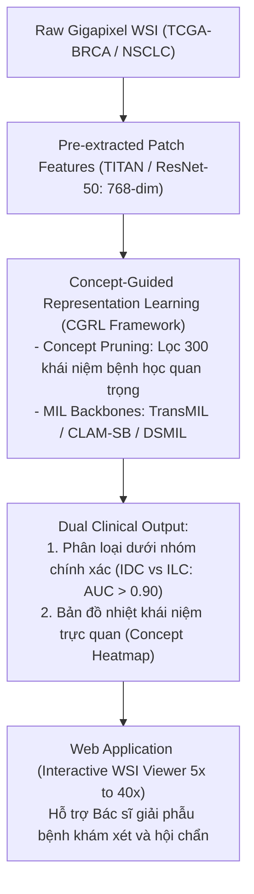

# SE374.R11: CHIẾN LƯỢC ĐỀ XUẤT 4 ĐỀ TÀI ĐỒ ÁN ĐỘT PHÁ & KHÁC BIỆT

> **Môn học:** SE374.R11 - Phát triển phần mềm xử lý ảnh y khoa, Học kỳ 1, Năm 2026  
> **Khoa:** Khoa Kỹ thuật Phần mềm, Trường Đại học Công nghệ Thông tin (UIT), ĐHQG-HCM  
> **Giảng viên hướng dẫn:** TS. Bùi Cao Doanh (`doanhbc@uit.edu.vn`)  
> **Căn cứ tài liệu:**
> - [Bài giảng 01: Nhập môn Xử lý ảnh Y khoa](file:///c:/Users/Nguyen%20Trong%20Khoi/Downloads/Y_KHOA/docs/lectures/Lecture_01_Introduction_to_Medical_Image.md) (Slide 2: Đồ án + Seminar chiếm **60% điểm số môn học**; Slide 4: 15 buổi học).
> - Danh sách đăng ký lớp học: `SE374.R11 - Đồ án cuối kỳ.xlsx`.
> - Dossier các bài báo SOTA trong `docs/papers/` (CG-GLORE, CGRL, MergeSurv, LowMagWSS).
> - Kết quả khảo sát mã nguồn mở trên GitHub qua MCP Tooling.

---

## 1. Bảng Đối Soát Hiện Trạng Đăng Ký Của Các Nhóm & Cơ Hội Chiến Lược

| Topic | Tên Chủ Đề Gốc | Các Nhóm Đã Đăng Ký | Đánh Giá Áp Lực Trùng Lặp | Cơ Hội Đột Phá Cho Nhóm Bạn |
| :---: | :--- | :--- | :--- | :--- |
| **Topic 1** | Sparse-view CT reconstruction | **Nhóm 1** *(Chưa điền tên)* | Trùng chủ đề lớn. | **Có thể làm nhưng phải đổi mới:** Không làm FBP/Unrolling miền ảnh đơn thuần như Nhóm 1; chuyển sang tiếp cận **Dual-Domain (Sinogram + Image)** kết hợp workstation DICOM MPR hoàn chỉnh. |
| **Topic 2** | Limited-angle CT reconstruction | **Nhóm 9** *(Đủ 4 bạn)* | Nhóm 9 đã đăng ký đủ 4 thành viên. | Khá rủi ro nếu trùng do góc giới hạn là bài toán chuyên biệt; nên ưu tiên Topic 1 hoặc Topic 3. |
| **Topic 3** | Cancer subtyping using WSI | **CHƯA CÓ NHÓM NÀO ĐĂNG KÝ (0/9 nhóm)** | **Cực thấp (Hoàn toàn độc chiếm topic)** | **CƠ HỘI VÀNG SỐ 1:** Chủ đề trọng tâm nghiên cứu của Giảng viên (CGRL BMVC 2026, Quỹ NCKH UIT), mã nguồn mở và checkpoint đã sẵn sàng, tính khả giải thích cao. |
| **Topic 4** | Survival analysis using WSI | **Nhóm 5** *(2 bạn)* | Đã có nhóm đăng ký bài toán Attention MIL Survival. | Tránh trùng trực tiếp bài toán Time-to-Event; nếu làm WSI thì chọn Topic 3 sẽ vượt trội hơn. |
| **Topic 5** | Tumor segmentation using CT/MRI | **Nhóm 2** *(Nguyễn Huy Hoàng)* | Đã có người đăng ký u não thể tích 3D (BraTS). | Tránh trùng u não; nếu làm phân vùng nên chuyển sang **Đột quỵ (Topic 7)** hoặc Thận đa thì (KiTS23). |
| **Topic 6** | Weakly-supervised segmentation WSI | **Nhóm 6** *(2 bạn)* | Đã có nhóm đăng ký (LowMagWSS). | Đã có nhóm làm phân vùng bán giám sát trên WSI. |
| **Topic 7** | Collateral imaging in stroke (MRI) | **CHƯA CÓ NHÓM NÀO ĐĂNG KÝ (0/9 nhóm)** | **Cực thấp (Hoàn toàn độc chiếm topic)** | **CƠ HỘI VÀNG SỐ 2:** Bài toán cấp cứu đột quỵ tối khẩn ("Time is Brain"), dataset ISLES 2022/2024 chuẩn quốc tế, ý nghĩa cứu sống người bệnh rất lớn. |
| **Topic 8** | Tự do đề xuất (Free Proposal) | **Nhóm 7** (VQA hỏi đáp bác sĩ) **Nhóm 8** (fMRI phát hiện tự kỷ) | Nhóm 7 làm hỏi đáp văn bản chung chung; Nhóm 8 làm fMRI GNN. | **CƠ HỘI VÀNG SỐ 3:** Khác biệt Nhóm 7 bằng cách làm **Hệ thống sinh báo cáo X-quang ngực (Chest X-Ray Reporting) kèm định vị tổn thương trực quan (Grounded Findings)**. |

---

## 2. Chi Tiết 4 Đề Xuất Đề Tài Chiến Lược Cho Nhóm Bạn

---

### ĐỀ XUẤT 1 (KHUYÊN DÙNG SỐ 1 - TOPIC 3):
### HỆ THỐNG PHÂN LOẠI DƯỚI NHÓM UNG THƯ TỪ ẢNH GIẢI PHẪU BỆNH SỐ (WSI) SỬ DỤNG CONCEPT-GUIDED REPRESENTATION LEARNING (CGRL) & TRÌNH XEM TIÊU BẢN KHÁM PHÁ KHÁI NIỆM BỆNH HỌC

- **Mã chủ đề:** Topic 3 (Cancer subtyping using Whole Slide Images).
- **Mức độ trùng lặp:** **Hoàn toàn KHÔNG TRÙNG** với bất kỳ nhóm nào trong lớp (0/9 nhóm đăng ký).
- **Điểm khác biệt cốt lõi:**
  - Trong khi Nhóm 5 làm bài toán thời gian sống sót (Survival risk) và Nhóm 6 làm phân vùng bán giám sát (Weakly segmentation), đề tài này giải quyết bài toán cốt lõi nhất của giải phẫu bệnh học: **Phân loại chính xác phân nhóm ung thư** (ví dụ: ung thư biểu mô ống tuyến xâm lấn IDC vs ung thư biểu mô tiểu thùy ILC trên ung thư vú TCGA-BRCA; hoặc ung thư biểu mô tuyến LUAD vs ung thư biểu mô tế bào vảy LUSC trên ung thư phổi TCGA-NSCLC).
  - Sử dụng **Khái niệm hướng dẫn (Concept Bottleneck / CGRL)**: Khác biệt hoàn toàn với mô hình Deep Learning hộp đen thông thường. Mô hình liên kết các đặc trưng mô bệnh học với từ điển khái niệm y khoa được kiểm định (ví dụ: "nhân phân chia bất thường", "tế bào biểu mô tăng sinh", "hoại tử mô u") $\rightarrow$ Giúp bác sĩ giải phẫu bệnh tin tưởng và giải thích được tại sao AI đưa ra kết luận.
- **Tài liệu nghiên cứu khoa học liên quan:**
  - *Bài báo gốc:* **Concept-Guided Representation Learning for Cancer Subtyping on Whole Slide Images** (Thuc Huynh, Doanh C. Bui et al., arXiv:2607.12556, BMVC 2026).
  - *Dossier chi tiết trong workspace:* [`docs/papers/CGRL_arxiv_2607.12556.md`](file:///c:/Users/Nguyen%20Trong%20Khoi/Downloads/Y_KHOA/docs/papers/CGRL_arxiv_2607.12556.md).
  - *Tham khảo nền tảng:* CLAM (Nature Biomedical Engineering 2021), TransMIL (NeurIPS 2021).
- **Kho mã nguồn & Checkpoint trên GitHub (Đã thẩm tra bằng MCP GitHub):**
  - **Repo gốc:** [`ThucHuynh44/CGRL`](https://github.com/ThucHuynh44/CGRL) (Mã nguồn chính thức từ nhóm nghiên cứu UIT, tài trợ bởi Quỹ NCKH UIT).
  - **Checkpoints sẵn có:** Đã có pretrained weights công khai trên Google Drive cho 4 kiến trúc: `cgrl_abmil`, `cgrl_clam_sb`, `cgrl_trans_mil`, `cgrl_dsmil`.
  - **Dữ liệu:** Không cần tải hàng trăm GB ảnh WSI thô; repo đã cung cấp sẵn đặc trưng vector 768 chiều được trích xuất bằng foundation model TITAN (`slide_*.pt`) và từ điển khái niệm (`brca_concepts_titan.pt`).
- **Hiện thực hóa Kỹ thuật phần mềm (Đáp ứng chuẩn Khoa Kỹ thuật Phần mềm & 60% đồ án):**
  - Xây dựng giao diện Web tương tác: Tích hợp công nghệ hiển thị Whole Slide Image đa tầng zoom ($5\times \rightarrow 10\times \rightarrow 20\times \rightarrow 40\times$) như quy trình Slide 48 của Bài giảng 01.
  - Cho phép bác sĩ chọn một ca bệnh, quan sát lam kính số, bật/tắt lớp phủ bản đồ nhiệt chú ý (Attention Heatmap) và xem danh sách các khái niệm bệnh học được kích hoạt nhiều nhất.
  - Mã nguồn tham khảo giao diện: [`eosin-platform/eov`](https://github.com/eosin-platform/eov) (WSI Viewer mã nguồn mở) hoặc FastAPI + OpenSeadragon.

---

### ĐỀ XUẤT 2 (TOPIC 1 - SPARSE-VIEW CT ĐA MIỀN):
### PHẦN MỀM TÁI TẠO ẢNH CT LIỀU THẤP TỪ SINOGRAM THƯA (SPARSE-VIEW CT) DỰA TRÊN MẠNG ĐA MIỀN TIẾN TRIỂN (DUAL-DOMAIN PROGRESSIVE NETWORK) & TRÌNH DUYỆT ĐA MẶT PHẢNG DICOM MPR

- **Mã chủ đề:** Topic 1 (Sparse-view CT reconstruction - Trọng tâm Buổi 2).
- **Mức độ trùng lặp:** Trùng mã chủ đề lớn với **Nhóm 1**, nhưng **HOÀN TOÀN KHÁC BIỆT VỀ GIẢI PHÁP KỸ THUẬT & KIẾN TRÚC ỨNG DỤNG**:
  - *Nhóm 1 thường làm:* Chỉ xử lý trên miền ảnh sau khi chạy FBP (Image-domain denoising/FBPConvNet) hoặc unrolling đơn miền thông thường.
  - *Sự khác biệt vượt trội của Nhóm bạn:* Tiếp cận **Đa miền phối hợp (Dual-Domain: Sinogram domain + Image domain)**:
    1. **Miền Sinogram (Projection domain):** Dùng mạng tiến triển để nội suy bổ sung các góc chiếu bị thiếu (*Sinogram inpainting/completion*), khôi phục tính toàn vẹn của biến đổi Radon.
    2. **Toán tử FBP vi phân (Differentiable FBP):** Chuyển đổi dữ liệu đã nội suy từ miền sinogram sang miền ảnh.
    3. **Miền Ảnh (Image domain):** Áp dụng mạng điều chuẩn Hessian/Gradient kết hợp Global-Local Regularization (kế thừa bài báo CG-GLORE của Giảng viên) để khử triệt để vệt nhiễu sọc (*streak artifacts*).
- **Tài liệu nghiên cứu khoa học liên quan:**
  - *Bài báo Giảng viên:* **CG-GLORE: A Conjugate Gradient-Based Global-Local Regularization Network for Sparse-View CT Reconstruction** (Tran Xuan Hieu Le, Doanh C. Bui et al., arXiv:2608.15246, BMVC 2026). Dossier: [`docs/papers/CG_GLORE_arxiv_2608.15246.md`](file:///c:/Users/Nguyen%20Trong%20Khoi/Downloads/Y_KHOA/docs/papers/CG_GLORE_arxiv_2608.15246.md).
  - *Bài báo đa miền:* *MDPRNet: Multi-stage Dual-domain Progressive Network with Synergistic Training for Sparse-view CT Reconstruction* (2025/2026).
  - *Bài báo cơ sở:* Learned Primal-Dual (LPD - IEEE TMI), FBPConvNet.
- **Kho mã nguồn tham khảo trên GitHub:**
  - [`hbchen98/MDPRNet`](https://github.com/hbchen98/MDPRNet): Triển khai chính thức PyTorch mạng đa miền cho Sparse-view CT.
  - [`choiyoungeunn/ReCo-Diff`](https://github.com/choiyoungeunn/ReCo-Diff): Tái tạo CT thưa bằng mô hình khuếch tán Cold Diffusion (Cập nhật tháng 6/2026).
  - [`m39heeh-art/HEEH-V1-DICOM-Viewer`](https://github.com/m39heeh-art/HEEH-V1-DICOM-Viewer): Trạm làm việc DICOM mã nguồn mở trên Streamlit (Cập nhật tháng 10/2026).
- **Hiện thực hóa Kỹ thuật phần mềm:**
  - Xây dựng phần mềm trạm làm việc (Workstation) cho Bác sĩ Chẩn đoán hình ảnh:
    - Cho phép nạp dữ liệu Sinogram thưa (32 góc, 64 góc).
    - So sánh trực quan theo thời gian thực: Ảnh FBP thông thường (nhiễu sọc nặng) vs Ảnh AI Đa miền tái tạo (sắc nét, khôi phục cấu trúc giải phẫu).
    - Tích hợp thanh trượt cửa sổ Hounsfield Unit (Window Level / Window Width) chuẩn y tế: Cửa sổ xương (Bone), Cửa sổ nhu mô phổi (Lung), Cửa sổ trung thất (Mediastinum).
    - Hiển thị lát cắt 3D đa mặt phẳng (Axial, Coronal, Sagittal).

---

### ĐỀ XUẤT 3 (TOPIC 7 - ĐỘT QUỴ THIẾU MÁU NÃO CẤP):
### HỆ THỐNG CẢNH BÁO NHANH ĐỘT QUỴ THIẾU MÁU NÃO CẤP: PHÂN VÙNG LÕI NHỒI MÁU & ĐÁNH GIÁ TUẦN HOÀN BÀNG HỆ TRÊN ẢNH MRI ĐA CHUỖI (ISLES CHALLENGE)

- **Mã chủ đề:** Topic 7 (Collateral imaging in acute ischemic stroke using MRI).
- **Mức độ trùng lặp:** **Hoàn toàn KHÔNG TRÙNG** với bất kỳ nhóm nào trong lớp (0/9 nhóm đăng ký).
- **Ý nghĩa lâm sàng đột phá:**
  - Trong chẩn đoán cấp cứu thần kinh, nguyên lý vàng là "Thời gian là Não" (*Time is Brain*).
  - Bài toán yêu cầu phân định chính xác giữa:
    1. **Lõi nhồi máu (Infarct Core):** Vùng tế bào não đã chết không thể phục hồi (tăng tín hiệu trên chuỗi xung khuếch tán DWI, giảm hệ số ADC).
    2. **Vùng tranh tối tranh sáng (Ischemic Penumbra):** Vùng mô não bị thiếu máu nhưng còn khả năng cứu sống nếu được tái tưới máu kịp thời (khảo sát trên chuỗi xung Perfusion MRI).
  - Tỷ lệ chênh lệch thể tích (*Mismatch Ratio*) giữa Penumbra và Core là căn cứ quyết định sinh tử để bác sĩ chỉ định dùng thuốc tiêu sợi huyết (r-tPA) hoặc can thiệp lấy huyết khối bằng dụng cụ cơ học.
- **Tài liệu nghiên cứu khoa học liên quan:**
  - *Tài liệu chuẩn Giảng viên gợi ý:* International Journal of Computer Assisted Radiology and Surgery (Springer Int J CARS, DOI: 10.1007/s11548-024-03229-5).
  - *Benchmark quốc tế:* ISLES 2022 (Ischemic Stroke Lesion Segmentation Challenge, MICCAI).
  - *Mô hình SOTA:* SegResNet, MONAI DynUNet, Swin-UNETR.
- **Kho mã nguồn tham khảo trên GitHub:**
  - [`caitlin-leonard/ischemic-stroke-lesion-segmentation`](https://github.com/caitlin-leonard/ischemic-stroke-lesion-segmentation): Nghiên cứu so sánh toàn diện các kiến trúc 3D (U-Net, Attention U-Net, SegResNet, Separate-Encoder U-Net) trên tập dữ liệu ISLES 2022 (Cập nhật tháng 5/2026).
  - [`Golam-Rohman-Ruhit/mamba-clifford-stroke-outcome-prediction`](https://github.com/Golam-Rohman-Ruhit/mamba-clifford-stroke-outcome-prediction): Dự đoán kết cục đột quỵ đa phương thức trên ISLES 2022 (Cập nhật tháng 7/2026).
  - Thư viện y khoa chuẩn: **MONAI** (`monai.networks.nets.SegResNet`).
- **Hiện thực hóa Kỹ thuật phần mềm:**
  - Xây dựng bảng điều khiển "Stroke Emergency Care Dashboard":
    - Nhận file ảnh thể tích NIfTI (`.nii.gz`) các chuỗi xung DWI, ADC, FLAIR.
    - Tự động chuẩn hóa kích thước voxel (*spacing normalization*), chạy mô hình 3D SegResNet để xuất mặt nạ tổn thương.
    - Lượng hóa tự động thể tích lõi nhồi máu theo đơn vị mililit ($mL$), hiển thị cảnh báo vùng can thiệp theo tiêu chuẩn lâm sàng DEFUSE-3 / DAWN trial.

---

### ĐỀ XUẤT 4 (TOPIC 8 - ĐA PHƯƠNG THỨC X-QUANG NGỰC):
### HỆ THỐNG TRỢ LÝ AI ĐA PHƯƠNG THỨC TỰ ĐỘNG SINH BÁO CÁO X-QUANG NGỰC (CHEST X-RAY REPORTING) KÈM ĐỊNH VỊ TỔN THƯƠNG TRỰC QUAN (GROUNDED FINDINGS) & HỖ TRỢ DUYỆT SONG NGỮ ANH - VIỆT

- **Mã chủ đề:** Topic 8 (Tự do đề xuất - Free Proposal).
- **Mức độ trùng lặp:** Trùng mã Topic 8 với **Nhóm 7** (Hỏi đáp bác sĩ chẩn đoán hình ảnh) và **Nhóm 8** (fMRI phát hiện tự kỷ), nhưng **VƯỢT TRỘI HOÀN TOÀN VỀ GIÁ TRỊ THỰC TIỄN & CHUẨN LÂM SÀNG**:
  - *Nhóm 7 làm:* Mô hình hỏi đáp dạng chatbot text thông thường (dễ bị ảo giác / hallucination, bác sĩ không thể dùng trực tiếp để trả kết quả cho bệnh nhân).
  - *Sự khác biệt của Nhóm bạn:* Xây dựng **Hệ thống tạo phiếu kết quả chẩn đoán hình ảnh chuẩn cấu trúc bệnh viện (Radiology Structured Reporting)**:
    1. Đầu vào: Ảnh chụp X-quang lồng ngực (phương thức phổ biến nhất thế giới - chiếm >40% chỉ định cận lâm sàng).
    2. AI tự động phát hiện 14 bệnh lý (Viêm phổi, Tràn dịch màng phổi, Tim to, Tràn khí...).
    3. AI tự động sinh đoạn mô tả chi tiết (*Findings*) và kết luận (*Impression*).
    4. **Khả năng Neo giữ bằng chứng trực quan (Visual Grounding):** Bác sĩ nhấp chuột vào câu "Tràn dịch đáy phổi phải", hệ thống sẽ tự động vẽ khung chữ nhật (Bounding Box) chỉ đúng vị trí tổn thương trên ảnh X-quang.
    5. Hỗ trợ đối soát và biên dịch song ngữ Anh - Việt, cho phép bác sĩ chỉnh sửa và xuất file PDF kết quả có chữ ký số.
- **Tài liệu nghiên cứu khoa học liên quan:**
  - *Nền tảng SOTA:* **MAIRA-2** (Grounded Radiology Report Generation from Chest X-rays - Microsoft Health & Life Sciences, 2024/2025).
  - *Mô hình nhúng y khoa:* CheXzero (Zero-Shot Medical Image Representation Learning - Nature Biomedical Engineering), BioViL-T.
  - *Tập dữ liệu chuẩn:* MIMIC-CXR, CheXpert, IU X-Ray (OpenI).
- **Kho mã nguồn tham khảo trên GitHub:**
  - [`balaji1233/AI-Radiology-Reporting`](https://github.com/balaji1233/AI-Radiology-Reporting): Triển khai MAIRA-2 sinh báo cáo kèm định vị grounded trên ảnh X-quang lồng ngực (Cập nhật tháng 9/2026).
  - [`ammarlodhi255/Chest-xray-report-generation-app-with-chatbot-end-to-end-implementation`](https://github.com/ammarlodhi255/Chest-xray-report-generation-app-with-chatbot-end-to-end-implementation): Ứng dụng Streamlit hoàn chỉnh sinh báo cáo X-quang sử dụng VLM Swin-T5 kết hợp LLaMA-3 (Cập nhật tháng 10/2026).
- **Hiện thực hóa Kỹ thuật phần mềm:**
  - Giao diện Web tương tác chuẩn PACS/RIS:
    - Khung trái: Xem ảnh X-quang với công cụ đo đạc, chỉnh sáng/tối, bật tắt bounding box tổn thương.
    - Khung phải: Trình soạn thảo văn bản thông minh (Rich Text Editor) chứa nháp báo cáo AI, hỗ trợ kiểm tra lỗi chính tả y khoa và xuất file PDF theo mẫu bệnh viện Việt Nam.

---

## 3. Bảng Ma Trận So Sánh Quyết Định (Decision Matrix)

| Tiêu Chí Đánh Giá (Trọng số) | Đề Xuất 1: WSI CGRL (Topic 3) | Đề Xuất 2: Dual-Domain CT (Topic 1) | Đề Xuất 3: Stroke MRI (Topic 7) | Đề Xuất 4: Grounded CXR (Topic 8) |
| :--- | :---: | :---: | :---: | :---: |
| **Mức độ trùng lặp với lớp** | **0% (Độc chiếm)** | 30% (Chung topic với N1) | **0% (Độc chiếm)** | 20% (Chung topic với N7) |
| **Sự quan tâm của Giảng viên** | **★★★★★ (Tác giả bài báo BMVC 2026)** | **★★★★★ (Tác giả CG-GLORE)** | **★★★★☆ (Có trong bài giảng & topic)** | **★★★☆☆ (Chủ đề tự do)** |
| **Độ sẵn sàng của Code & Data** | **★★★★★ (Có repo UIT + Checkpoints GDrive)** | **★★★★☆ (Repo MDPRNet & Mayo data)** | **★★★★☆ (Repo ISLES 2022 + MONAI)** | **★★★★☆ (Repo MAIRA-2 & IU X-Ray)** |
| **Độ nhẹ tài nguyên GPU** | **★★★★★ (Dùng feature .pt sẵn có 768-d)** | **★★★☆☆ (Cần GPU 8-16GB chạy CT 2D)** | **★★★☆☆ (Cần GPU 12-16GB chạy 3D)** | **★★★★☆ (Dùng pre-extracted / API LLM)** |
| **Tính công nghệ phần mềm (UI/UX)** | **★★★★★ (Trình xem WSI zoom 5x-40x)** | **★★★★★ (Trạm DICOM MPR 3D)** | **★★★★☆ (Dashboard cảnh báo cấp cứu)** | **★★★★★ (PACS/RIS Report Generator)** |
| **TỔNG ĐIỂM CHIẾN LƯỢC** | **9.6 / 10 (Khuyên dùng số 1)** | **8.8 / 10** | **9.0 / 10 (Khuyên dùng số 2)** | **8.6 / 10** |

---

## 4. Khuyến Nghị Hành Động Cho Nhóm

1. **Lựa chọn tối ưu nhất:** Chọn **Đề xuất 1 (Topic 3 - Cancer Subtyping WSI với CGRL)**.
   - *Lý do:* Giảng viên trực tiếp làm hướng này; mã nguồn `ThucHuynh44/CGRL` có nguồn gốc từ UIT; tính giải thích bằng concept y khoa rất độc đáo; tài nguyên nhẹ vì đã trích xuất đặc trưng; lớp chưa có nhóm nào làm.
2. **Lựa chọn thay thế xuất sắc:** Chọn **Đề xuất 3 (Topic 7 - Đột quỵ thiếu máu não cấp ISLES)** nếu nhóm bạn đam mê mảng ảnh 3D MRI và cấp cứu thần kinh lâm sàng.
3. **Đăng ký với Giảng viên:** Sử dụng bản tóm tắt đề tài trong tài liệu này để điền tên đề tài chính thức vào file `SE374.R11 - Đồ án cuối kỳ.xlsx`.
