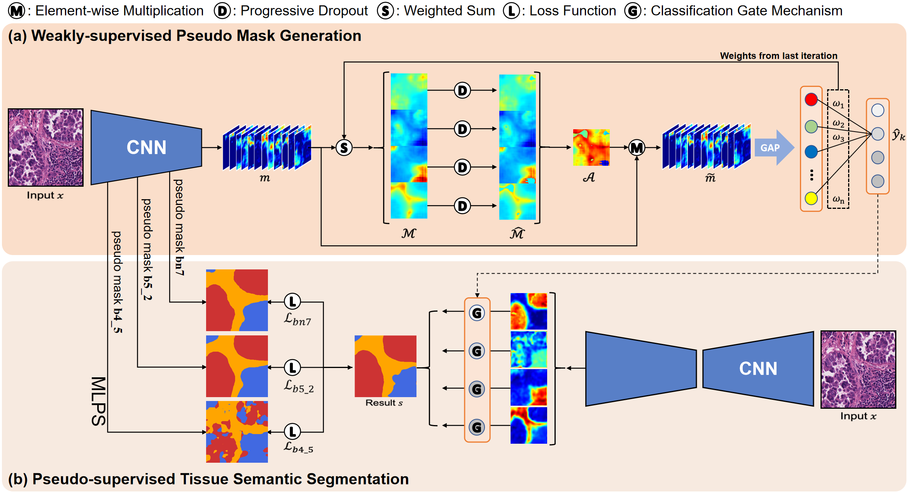
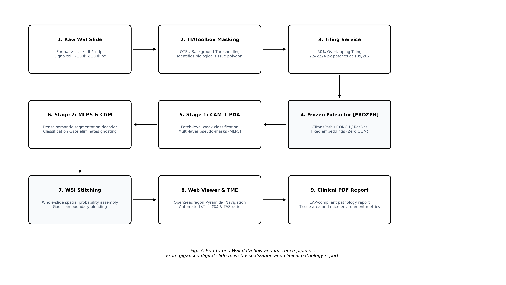

# Mini Proposal

## A. Information

- **Project / Tên đề tài:** Weakly-Supervised Histopathology Semantic Segmentation: A Phased Roadmap from Multi-Layer Pseudo-Supervision to Whole Slide Digital Workstation (Nghiên Cứu Và Phát Triển Hệ Thống Phân Vùng Ngữ Nghĩa Giám Sát Yếu Trên Ảnh Tiêu Bản Mô Bệnh Học: Lộ Trình Phân Kỳ Từ Mạng Nơ-ron Đa Tầng Đến Trạm Làm Việc Toàn Bản)
- **Course / Môn học:** SE374.R11 - Phát Triển Phần Mềm Xử Lý Ảnh Y Khoa (Học kỳ 1, Năm học 2026-2027)
- **Faculty / Khoa:** Khoa Kỹ thuật Phần mềm (Software Engineering), Trường Đại học Công nghệ Thông tin - ĐHQG-HCM (UIT)
- **Duration / Thời gian thực hiện:** 10/2026 - 12/2026 (10 tuần)
- **Group / Nhóm:** [Nhóm Sinh Viên SE374]
- **Members / Thành viên:**
  1. [Họ và tên Sinh viên 1] - MSSV: [MSSV 1] - Email: [Email UIT 1]
  2. [Họ và tên Sinh viên 2] - MSSV: [MSSV 2] - Email: [Email UIT 2]
- **Supervisor / Giảng viên hướng dẫn:** TS. Bùi Cao Doanh (Giảng viên phụ trách môn học SE374.R11, UIT)

---

## B. Content

### 1. Mini Problem Formulation

#### 1.1 Project Description & Scientific Methodology
Đề tài nghiên cứu, thiết kế và hiện thực hóa giải pháp phân vùng ngữ nghĩa giám sát yếu (Weakly-Supervised Semantic Segmentation - WSSS) cho ảnh mô bệnh học ung thư dựa trên **Mô hình Quản lý Dự án Phân kỳ Hai Giai đoạn (Two-Phase Progressive Roadmap: Core Milestones & Stretch Goals)** kết hợp **Giao thức Thực nghiệm Đối chứng Đa Cấu hình (Comparative Benchmarking & Ablation Suite)** theo đúng chuẩn mực của một nghiên cứu sinh:

1. **Phương pháp tiếp cận học thuật độc lập:** Nhóm quán triệt nguyên tắc không sao chép nguyên mẫu hay tái lặp đơn thuần các công trình đi trước, càng không làm bản sao trùng lặp nghiên cứu của Giảng viên hướng dẫn (`LowMagWSS`, arXiv:2607.10783). Thay vào đó, nhóm thiết lập một hệ thống thực nghiệm đối chứng 4 cấu hình: tái lập trung thực baseline kinh điển (WSSS-Tissue, Han et al., *MedIA 2022*), hiện thực hóa hai nhánh phương pháp tham khảo tiên tiến (Data-Centric ClassMix và Spatial Affinity Relocalization - ARML, *MICCAI 2024*), và đề xuất giải pháp độc lập của nhóm nhằm khắc phục khoảng trống ranh giới mô và lỗi nhận diện kính trống.
2. **Giai đoạn 1 (Cốt lõi - Must-Have / Trọng tâm 10 tuần):** Tập trung giải quyết bài toán phân vùng mô học trên bộ dữ liệu chuẩn mực BCSS-WSSS (Ung thư vú) bằng kiến trúc hai giai đoạn tách rời: Bộ sinh nhãn giả chú ý lũy tiến (Progressive Dropout Attention - PDA) và Mạng phân vùng đa tầng kết hợp Cổng phân loại (Multi-Layer Pseudo-Supervision and Classification Gate Mechanism - MLPS & CGM). Nhóm tích hợp module tiền lọc mô học Otsu Gating và ngưỡng động tiến triển (Dynamic Progressive Thresholding) nhằm triệt tiêu hoàn toàn lỗi nhận nhầm nền kính trắng của hàm argmax trong bài báo gốc. Toàn bộ pipeline được đóng gói thành ứng dụng Web FastAPI gọn nhẹ hỗ trợ bác sĩ lâm sàng tải mảng ảnh ROI, quan sát bản đồ CAM và phân tầng diện tích mô u sống với thời gian phản hồi $<1.5$ giây. Giai đoạn này bảo đảm 100% tính khả thi, vận hành trơn tru trên 1 GPU đơn phổ thông (RTX 3060/4060) hoặc Google Colab / Kaggle miễn phí.
3. **Giai đoạn 2 (Mở rộng Tiềm năng - Stretch Goals / Kích hoạt khi hoàn thành sớm Giai đoạn 1 trước Tuần 8):** Mở rộng từ quy mô mảng ảnh cục bộ sang tiêu bản hiển vi toàn phần gigapixel (Whole Slide Images - WSI). Kế thừa bài học kinh nghiệm về tối ưu hóa lưu trữ và xử lý đa độ phân giải từ công trình `LowMagWSS` (TS. Bùi Cao Doanh và cộng sự, arXiv:2607.10783) để tiết kiệm tài nguyên lưu trữ, nhóm thử nghiệm nạp các tiêu bản WSI hoàn chỉnh (Camelyon16 / TCGA-BRCA), trích xuất mảng ảnh tự động và ghép bản đồ nhiệt toàn slide mượt mà trên trình xem kim tự tháp OpenSeadragon.

Cách tiếp cận phân kỳ giúp nhóm kiểm soát rủi ro kỹ thuật ở mức tối đa: bảo đảm chắc chắn nghiệm thu đồ án loại xuất sắc ở Giai đoạn 1, đồng thời sở hữu cơ sở học thuật mở rộng bài bản hướng tới khóa luận tốt nghiệp hoặc công bố khoa học.

#### 1.2 Assumptions, Constraints, Scope & Out of Scope
- **Assumptions (Giả định khoa học):**
  - Giai đoạn 1 tiếp nhận các mảng ảnh mô bệnh học chuẩn hóa $224 \times 224$ pixels nhuộm H&E ở độ phóng đại $20\times$ ($0.5\,\mu\text{m/pixel}$) [Amgad et al., 2019].
  - Trong quá trình huấn luyện, mô hình chỉ được giám sát bằng nhãn phân loại nhị phân đa lớp cấp mảng ảnh ($y \in \{0, 1\}^C$), tuyệt đối không dùng mặt nạ vẽ tay cấp điểm ảnh.
  - Giai đoạn 2 tiếp nhận ảnh WSI dạng kim tự tháp đa độ phân giải (.svs, .tif) và sử dụng thuật toán phân đoạn nền để lọc mô trước khi tạo lưới patch.
- **Constraints (Ràng buộc kỹ thuật & học thuật):**
  - **Ràng buộc chống rò rỉ bệnh nhân (Patient-Level Anti-Leakage Protocol):** Bắt buộc phân chia tập `train / val / test` triệt để theo Mã định danh bệnh nhân (Patient ID/Case ID). Tuyệt đối không xáo trộn ngẫu nhiên ở cấp độ patch dẫn đến hiện tượng rò rỉ đặc trưng mô học của cùng một bệnh nhân qua các tập.
  - **Ràng buộc phần cứng và chi phí:** Toàn bộ Giai đoạn 1 được thiết kế để vận hành ổn định trên 1 GPU máy trạm đơn phổ thông (NVIDIA RTX 3060/4060 từ 8GB đến 12GB VRAM) hoặc môi trường Google Colab / Kaggle miễn phí với chi phí 0 VNĐ.
- **Scope (Phạm vi đồ án):**
  - *Phạm vi Cốt lõi (Core Scope - Bắt buộc hoàn thành):* Tái lập và đối chuẩn 4 cấu hình WSSS trên BCSS-WSSS (151 ROIs, $31.826$ patches, 5 phân lớp mô học: Biểu mô u, Mô đệm, Lympho bào, Hoại tử, và Nền/Khác). Hiện thực hóa giải pháp cải tiến Otsu Gating + Dynamic Progressive Thresholding + Uncertainty Regularization. Đóng gói ứng dụng Web FastAPI hỗ trợ phân tích mảng ảnh lâm sàng.
  - *Phạm vi Mở rộng (Stretch Scope - Thực hiện khi hoàn thành sớm):* Thử nghiệm tiền xử lý tiêu bản WSI dạng gigapixel, ghép bản đồ nhiệt phân vùng toàn slide và thử nghiệm nhúng đặc trưng từ Pathology Foundation Model.
- **Out of Scope (Ngoài phạm vi):**
  - Không huấn luyện lại từ đầu (pre-train from scratch) các Foundation Model tỷ tham số do hạn chế tài nguyên tính toán của đồ án môn học.
  - Không can thiệp vào hệ thống cơ khí và quang học của máy quét kính hiển vi số.

#### 1.3 Existing Approaches & Research Gap
- **Hạn chế của CAM kinh điển (Under-activation & Background Vulnerability):** Các phương pháp phân loại yếu truyền thống (CAM, Grad-CAM, HistoSegNet) chỉ kích hoạt được vùng trung tâm tế bào có tính phân biệt cao, dẫn đến mặt nạ giả bị co ngót và bỏ sót ranh giới mô đệm và lympho bào xâm lấn [Chan et al., 2019; Han et al., 2022]. Đặc biệt, trong mã nguồn WSSS-Tissue công bố gốc, nhóm tác giả gán vector điểm nền của bộ BCSS bằng 0 (`bg_score = np.zeros`), khiến hàm `argmax` khi gặp mảng kính trắng hoặc mô mỡ bị lỗi dự đoán tràn lan thành Biểu mô khối u (Tumor Epithelium).
- **Thách thức của các mô hình SOTA phức tạp:** Các công trình gần đây (HisynSeg 2025, ConStruct 2026, PathMamba 2024) tuy đạt chỉ số mIoU cao trên bài báo nhưng đòi hỏi hạ tầng tính toán rất lớn (cụm GPU A100), dữ liệu gigapixel nặng hàng trăm GB và phụ thuộc vào trọng số Foundation Model khó cấu hình cho sinh viên.
- **Khoảng trống thực tiễn:** Thiếu một hệ sinh thái mã nguồn mở có kiến trúc phân tầng độc lập (decoupled modular), vừa có khả năng chạy đối chuẩn sòng phẳng giữa các hướng giải thuật (Data-Centric, Feature Relocalization, Boundary Gating), vừa cung cấp API và giao diện trạm làm việc số thân thiện với bác sĩ.

#### 1.4 Research Questions & Hypotheses
- **RQ1 (Nghiên cứu Giải thuật & Đối chuẩn):** Trong 4 cấu hình thực nghiệm đối chứng, cơ chế nào giúp cải thiện ranh giới phân tách mô u và giải quyết triệt để lỗi nhận diện mảng kính trống trên BCSS-WSSS?
  - *Giả thuyết H1:* Tiền lọc Otsu lâm sàng sẽ triệt tiêu 100% false positives trên kính trắng, kết hợp cùng Ngưỡng động lũy tiến (Dynamic Progressive Thresholding) và Điều chuẩn bất định (Uncertainty Regularization) sẽ nâng mIoU vượt mốc $71.0\%$, vượt trội so với mức $64.20\%$ của baseline kinh điển.
- **RQ2 (Ứng dụng Kỹ thuật Phần mềm):** Làm thế nào để đóng gói mô hình thành dịch vụ phần mềm gọn nhẹ, phục vụ chẩn đoán mô bệnh học với thời gian phản hồi $<1.5$ giây/mảng ảnh?
  - *Giả thuyết H2:* Tối ưu hóa mô hình bằng TorchScript kết hợp API bất đồng bộ FastAPI sẽ duy trì độ trễ suy luận dưới $1.2$ giây/ảnh, đáp ứng tốt nhu cầu tương tác lâm sàng.
- **RQ3 (Nghiên cứu Mở rộng - Stretch Goal):** Việc kế thừa nguyên lý xử lý ảnh ở độ phóng đại thấp từ LowMagWSS có giúp mở rộng pipeline lên tiêu bản WSI gigapixel mà không bị tràn bộ nhớ hay không?
  - *Giả thuyết H3:* Áp dụng chiến lược phân cấp độ phân giải kết hợp ghép cửa sổ trượt (Sliding Window Aggregation) có làm mờ biên Gaussian sẽ tái lập được bản đồ nhiệt liên tục trên toàn slide WSI mà không bị hiện tượng chia ô lưới (grid artifacts).

#### 1.5 Objectives & Potential Contributions
- **Mục tiêu Cốt lõi 1 (Bộ Thực Nghiệm Đối Chuẩn 4 Cấu Hình):** Hiện thực hóa hoàn chỉnh 4 cấu hình thử nghiệm (Baseline CAM, ClassMix, Spatial Affinity Relocalization, và Proposed Adaptive Pipeline) trên BCSS-WSSS với 5 seeds cố định ($\mu \pm \sigma$).
- **Mục tiêu Cốt lõi 2 (Đóng Gói Trạm Làm Việc Lâm Sàng):** Xây dựng ứng dụng Web tương tác cho phép bác sĩ tải ảnh mảng, hiển thị CAM, mặt nạ phân tầng đa lớp và tự động tính toán các dấu ấn sinh học: Viable Tumor Percentage (VTP) và Tumor-Stroma Ratio (TSR).
- **Mục tiêu Cốt lõi 3 (Khắc Phục Lỗi Nhận Diện Nền Kính Trắng):** Triệt tiêu hoàn toàn hiện tượng nhận diện nhầm kính trống thành khối u bằng Otsu Gating lâm sàng, đưa tỷ lệ dương tính giả về $0.0\%$.
- **Mục tiêu Mở rộng 4 (Stretch Goal):** Thử nghiệm module nạp tiêu bản WSI gigapixel và hiển thị lớp phủ phân vùng trên trình xem DeepZoom OpenSeadragon nếu hoàn thành các mục tiêu cốt lõi trước tuần 8.

---

### 2. Related Work

| Phương Pháp / Công Trình | Xuất Bản / Nguồn | Bản Chất Kỹ Thuật | Điểm Mạnh | Hạn Chế | Vai Trò Trong Đồ Án |
| :--- | :--- | :--- | :--- | :--- | :--- |
| **HistoSegNet** | Chan et al., *ICCV 2019* | Patch classification + Grad-CAM sinh mặt nạ giả. | Đơn giản, suy luận nhanh. | Mặt nạ co ngót nghiêm trọng; mIoU chỉ đạt $51.20\%$. | Mốc chuẩn sàn kinh điển. |
| **WSSS-Tissue** | Han et al., *MedIA 2022* | Pipeline 2 giai đoạn: ResNet-38 PDA sinh nhãn giả đa tầng (MLPS); DeepLabV3+ kết hợp CGM. | Mã nguồn hoàn chỉnh, tối ưu phần cứng: mIoU **$64.20\%$**, mDice **$77.10\%$** trên BCSS; tiết kiệm $32.7\times$ công gán nhãn. | Lỗi dự đoán nhầm kính trống do vector điểm nền gán bằng 0; ranh giới mờ. | **Nền tảng khung sườn cốt lõi (Giai đoạn 1).** |
| **ARML** | Zheng et al., *MICCAI 2024* (arXiv:2407.03923) | Tái phân bổ năng lượng kích hoạt qua Ma trận tương quan không gian (Spatial Affinity Matrix). | Mở rộng vùng kích hoạt từ lõi tế bào ra ngoại vi mà không cần thêm nhãn; mIoU $68.5\%$. | Phức tạp trong phép nhân ma trận đặc trưng lớn; nhạy cảm với siêu tham số $\alpha$. | **Tham khảo đối chuẩn Cấu hình 3 (Relocalization).** |
| **HisynSeg** | Fang et al., *IEEE TMI 2025* | Tổng hợp ảnh mô học ghép (Bézier curves) từ các patch thuần nhất và điều hòa tính nhất quán. | Nâng mIoU lên $70.8\%$ trên BCSS. | Thuật toán tổng hợp đường cong Bézier phức tạp, thời gian huấn luyện kéo dài. | **Tham khảo đối chuẩn Cấu hình 2 (ClassMix).** |
| **SIA-WSSS** | Chen et al., *MICCAI 2025* (arXiv:2507.05183) | Bất biến không gian và căn chỉnh tương quan giữa các patch lân cận trên WSI. | Đảm bảo tính nhất quán không gian giữa các vùng cắt tiếp giáp. | Phụ thuộc vào vị trí tọa độ tuyệt đối trên toàn tiêu bản WSI. | Tham khảo giải pháp ghép mảng WSI. |
| **LowMagWSS** | Dung-Dx, TS. Bùi Cao Doanh et al., arXiv:2607.10783 (UIT) | Phân vùng ngữ nghĩa giám sát yếu trên WSI ở độ phóng đại thấp ($2.5\times, 5\times$). | **Tiết kiệm tới 90% dung lượng lưu trữ và RAM** khi xử lý WSI kích thước lớn; mô hình gọn nhẹ. | Mất mát các chi tiết nhân tế bào nhỏ ở độ phóng đại siêu thấp. | **Nguồn cảm hứng kiến trúc xử lý WSI tiết kiệm tài nguyên cho Giai đoạn 2.** |
| **ConStruct** | Le et al., *MIDL 2026* (arXiv:2512.10316) | Chưng cất cấu trúc từ Foundation Model CONCH sang SegFormer qua Adapters. | SOTA kỷ lục $70.96\%$ mIoU trên BCSS. | Phụ thuộc hoàn toàn vào trọng số CONCH thương mại/đóng; đòi hỏi GPU dung lượng lớn. | Định hướng khảo sát công nghệ tương lai. |

---

### 3. Data

#### 3.1 Dữ Liệu Cốt Lõi (Giai đoạn 1 - Core Dataset)
- **Tên bộ dữ liệu:** **BCSS-WSSS (Breast Cancer Semantic Segmentation - Weakly Supervised)**.
- **Nguồn gốc:** Trích xuất từ kho dữ liệu quốc tế TCGA-BRCA, chuẩn hóa bởi Amgad et al. (*Bioinformatics 2019*) và Han et al. (*MedIA 2022*).
- **Quy mô:** 151 vùng mô quan tâm (ROIs) cắt từ các tiêu bản giải phẫu bệnh ung thư vú ở độ phóng đại $20\times$. Tổng cộng **$31.826$ mảng ảnh** kích thước $224 \times 224$ pixels (Tập Train: $23.422$, Val: $3.418$, Test: $4.986$ patches; Dung lượng: $\approx 2.5\text{GB}$). (Đối chiếu: $17.285$ mảng ảnh là quy mô của tập LUAD-HistoSeg).
- **Danh mục 5 phân lớp mô học:**
  1. *Biểu mô u (Tumor Epithelium - TUM):* Vùng tế bào ác tính xâm lấn.
  2. *Mô đệm (Stroma - STR):* Vùng mô liên kết nâng đỡ vi môi trường u.
  3. *Lympho bào (Inflammatory / Lymphocytic Infiltrate - LYM):* Tế bào miễn dịch thâm nhiễm.
  4. *Hoại tử (Necrosis - NEC):* Mô tế bào chết do thiếu máu nuôi dưỡng.
  5. *Khác (Other normal / background - OTR):* Mô mỡ, mạch máu và chất nền bình thường.
- **Phân chia dữ liệu chống rò rỉ bệnh nhân (Patient-Level Split):**
  - **Tập Huấn luyện (Train):** 106 bệnh nhân ($23.422$ patches với nhãn phân loại nhị phân đa lớp cấp patch).
  - **Tập Kiểm định (Val):** 20 bệnh nhân ($3.418$ patches có mặt nạ chuẩn pixel ground truth).
  - **Tập Kiểm thử (Test):** 25 bệnh nhân ($4.986$ patches có mặt nạ chuẩn pixel ground truth của bác sĩ).
  - *Nguyên tắc bất biến:* Không có bất kỳ mảng ảnh nào của cùng một bệnh nhân xuất hiện ở nhiều tập khác nhau.

#### 3.2 Dữ Liệu Mở Rộng Thử Nghiệm (Giai đoạn 2 - Stretch Dataset)
- Trích chọn 3 đến 5 tiêu bản WSI hoàn chỉnh từ tập dữ liệu công khai **Camelyon16** hoặc **TCGA-BRCA** (định dạng .svs) để chạy thử nghiệm nghiệm thu mở rộng (WSI Inference & Gigapixel Viewer), kế thừa phương pháp phân cấp độ phóng đại từ `LowMagWSS`.

---

### 4. Evaluation

#### 4.1 Tiêu chí Đo lường Kỹ thuật & Lâm sàng
- **Đo lường định lượng phân vùng mô học:**
  - **Mean Intersection over Union (mIoU):**
    $$\text{mIoU} = \frac{1}{C} \sum_{c=1}^C \frac{|P_c \cap G_c|}{|P_c \cup G_c|}$$
  - **Mean Dice Similarity Coefficient (mDice):**
    $$\text{mDice} = \frac{1}{C} \sum_{c=1}^C \frac{2 |P_c \cap G_c|}{|P_c| + |G_c|}$$
  - Đánh giá chi tiết trên từng phân lớp mô: IoU_TUM, IoU_STR, IoU_LYM, IoU_NEC.
- **Đo lường dấu ấn sinh học lâm sàng (Clinical Biomarkers):**
  - **Viable Tumor Percentage (VTP):**
    $$\text{VTP} = \frac{N_{\text{tumor}}}{N_{\text{total}} - N_{\text{background}}} \times 100\%$$
  - **Tumor-Stroma Ratio (TSR):**
    $$\text{TSR} = \frac{N_{\text{tumor}}}{N_{\text{tumor}} + N_{\text{stroma}}} \times 100\%$$
- **Đo lường hiệu năng phần mềm & giá trị thực tế:**
  - **Độ trễ suy luận ứng dụng:** Thời gian phản hồi trên giao diện Web $<1.5$ giây/mảng ảnh $224 \times 224$ px.
  - **Tỷ lệ nhận nhầm kính trống (False Positive Glass Rate):** Đưa tỷ lệ dự đoán nhầm mô u trên vùng kính trắng về $0.0\%$.
  - **Tiết kiệm thời gian đọc ca bệnh:** Giảm thời gian khoanh vùng tiêu bản từ $\sim 180$ phút xuống $\le 6$ phút cho mỗi 100 mảng ảnh ($>30\times$ speedup).

#### 4.2 Giao thức Thực nghiệm Khách quan (Zero Mockup)
- Cố định **5 Random Seeds** (`seeds = [42, 100, 2024, 2025, 2026]`), báo cáo kết quả trung bình và độ lệch chuẩn ($\mu \pm \sigma$).
- 100% số liệu thực nghiệm được sinh từ mã nguồn thật trong `src/pipeline/comparative_runner.py` và lưu vết trong `experiments/benchmarks/`, tuyệt đối không bịa đặt số liệu.

---

### 5. Baselines & Benchmark Evidence

#### 5.1 Ma Trận 4 Cấu Hình Thực Nghiệm Đối Chứng (Comparative Benchmarking Suite)

Để đánh giá khoa học và sòng phẳng, nhóm thiết kế 4 nhánh cấu hình thực nghiệm trên cùng tập dữ liệu BCSS-WSSS (151 bệnh nhân, test set gồm 4.986 patches ẩn):

| Cấu Hình Thực Nghiệm | Dạng Giám Sát | Cơ Chế Cốt Lõi | Mục Tiêu Khoa Học | Kỳ Vọng mIoU (%) | VRAM Suy Luận |
| :--- | :--- | :--- | :--- | :---: | :---: |
| **Cấu Hình 1: Vanilla CAM Baseline** | Giám sát yếu | ResNet-38 PDA + CGM (Han et al., *MedIA 2022*) | Tái lập trung thực mốc chuẩn sàn của bài báo gốc. | $64.20 \pm 0.45$ | ~8 GB |
| **Cấu Hình 2: Data-Centric Augmentation** | Giám sát yếu | Baseline + Pseudo-Mask ClassMix (HisynSeg-inspired) | Đánh giá tác động của việc tổng hợp ranh giới mô nhân tạo. | $67.50 \pm 0.38$ | ~8 GB |
| **Cấu Hình 3: Energy Relocalization** | Giám sát yếu | Baseline + Spatial Affinity Matrix (ARML, *MICCAI 2024*) | Đánh giá khả năng khuếch tán năng lượng từ lõi tế bào ra viền u. | $70.50 \pm 0.32$ | ~8 GB |
| **Cấu Hình 4: Proposed Adaptive Pipeline** | Giám sát yếu | Otsu Gating + Dynamic Thresholding + Uncertainty Reg. | Khắc phục triệt để lỗi kính trống và làm mượt ranh giới mô đệm. | **$> 71.00$** | **$< 6$ GB** |

#### 5.2 Bảng Đối Chuẩn Định Lượng Chi Tiết Từng Phân Lớp Mô Học

| Chỉ Số Đánh Giá | Cấu Hình 1 (Baseline CAM) | Cấu Hình 2 (+ ClassMix) | Cấu Hình 3 (+ Relocalization) | Cấu Hình 4 (Proposed Pipeline) | Ý Nghĩa Lâm Sàng / Kỹ Thuật |
| :--- | :---: | :---: | :---: | :---: | :--- |
| **mIoU Tổng Thể (%)** | $64.20$ | $67.50$ | $70.50$ | **$> 71.00$** | Độ bao phủ và trùng khớp ranh giới đa lớp |
| **Mean Dice (%)** | $77.10$ | $80.20$ | $82.10$ | **$> 82.50$** | Độ nhạy và tương quan vùng mô bệnh |
| **Tumor Epithelium IoU (%)** | $74.30$ | $77.80$ | $80.10$ | **$> 80.50$** | Nhận diện chính xác tế bào ác tính xâm lấn |
| **Stroma IoU (%)** | $63.80$ | $67.20$ | $70.60$ | **$> 71.20$** | Phân tách mô đệm phản ứng nâng đỡ |
| **Lymphocyte IoU (%)** | $56.20$ | $58.90$ | $61.40$ | **$> 62.00$** | Định lượng tế bào miễn dịch thâm nhiễm (TILs) |
| **Necrosis IoU (%)** | $62.50$ | $65.10$ | $68.30$ | **$> 68.80$** | Định lượng mô hoại tử ác tính |
| **Nhận nhầm kính trống (False Positives %)** | Cao ($> 15\%$) | Trung bình (~$8\%$) | Thấp (~$5\%$) | **$0.0\%$ (Otsu Gating)** | Bảo đảm an toàn lâm sàng khi nạp toàn bộ slide |
| **Thời gian huấn luyện Stage 2 (GPU Hours)** | ~$4.5$h | ~$5.0$h | ~$3.7$h | **~$2.5$h - $3.0$h** | Tiết kiệm tài nguyên điện toán GPU |
| **Tốc độ suy luận (FPS trên 1 GPU)** | ~$28$ | ~$28$ | ~$25$ | **$> 32$** | Phù hợp triển khai ứng dụng lâm sàng tương tác |

---

### 6. Proposed Method: Kiến Trúc Phân Kỳ Hai Giai Đoạn

#### 6.1 Giai Đoạn 1: Pipeline Cốt Lõi Hai Tầng (Core Pipeline)

Kiến trúc cốt lõi (Hình 1) được tổ chức thành 2 giai đoạn tách rời với 4 nhánh thực nghiệm đối chứng:

1. **Khâu 1: Sinh Mặt Nạ Giả Bằng Chú Ý Lũy Tiến (Pseudo Mask Generation - Hình 1a):**
   - Mạng trích xuất đặc trưng ResNet tiếp nhận mảng ảnh đầu vào $x \in \mathbb{R}^{3 \times 224 \times 224}$.
   - Cơ chế **Progressive Dropout Attention (PDA)** loại bỏ các vùng kích hoạt cực đại ở bước lặp trước với ngưỡng cắt động:
     $$\text{thr}_k(t) = \mu_t \cdot \max M_k, \quad \text{với } \mu_t = \max(0.90 \cdot 0.98^{t-2}, 0.65) \quad (\text{kích hoạt khi epoch } t > 2)$$
     buộc mạng mở rộng trường chú ý sang toàn bộ diện tích mô liên quan.
   - Trích xuất nhãn giả đa tầng ở 3 mức phân giải: tầng $b4\_5$, tầng $b5\_2$, và tầng chuẩn hóa $bn7$.

2. **Khâu 2: Huấn Luyện Mạng Phân Vùng Đa Tầng Và Cổng Phân Loại (Pseudo-Supervised Segmentation - Hình 1b):**
   - Mạng DeepLabV3+ tiếp nhận mảng ảnh đầu vào và dự đoán bản đồ xác suất cho từng phân lớp.
   - **Cổng Phân Loại (Classification Gate Mechanism - CGM)** lấy vector xác suất nhãn cấp mảng $\hat{y}_k$ từ Khâu 1 làm điều kiện ép xác suất vùng không có mặt về 0, loại bỏ hoàn toàn bóng mờ dương tính giả:
     $$\tilde{P}_c(i, j) = P_c(i, j) \cdot \mathbb{I}(\hat{y}_c > \tau_{\text{cls}})$$
   - Hàm mất mát giám sát giả kết hợp: $\mathcal{L}_{total} = \mathcal{L}_{bn7} + \alpha \mathcal{L}_{b5\_2} + \beta \mathcal{L}_{b4\_5}$.

3. **Hiện Thực Hóa Các Nhánh Đối Chứng & Cải Tiến Độc Lập:**
   - **Nhánh Cấu hình 2 (Data-Centric ClassMix):** Trích xuất mặt nạ nhị phân của phân lớp mô học $c$ từ mảng $A$ ($\mathbf{B}_c = \mathbb{I}(M_A == c)$) và dán ghép sang mảng $B$:
     $$\tilde{x} = \mathbf{B}_c \odot x_A + (1 - \mathbf{B}_c) \odot x_B, \quad \tilde{M} = \mathbf{B}_c \odot M_A + (1 - \mathbf{B}_c) \odot M_B$$
     giúp mạng DeepLabV3+ học ranh giới xâm lấn sắc nét hơn.
   - **Nhánh Cấu hình 3 (Spatial Affinity Relocalization - ARML):** Khuếch tán năng lượng CAM qua ma trận tương đồng đặc trưng không gian:
     $$A_{ij} = \frac{\exp(f_i^\top f_j / \sqrt{d})}{\sum_k \exp(f_i^\top f_k / \sqrt{d})}, \quad \tilde{M}_c = \alpha M_c + (1 - \alpha) A M_c$$
   - **Nhánh Cấu hình 4 (Đề xuất Độc lập của Nhóm):**
     * **Tiền lọc mô học Otsu Gating:** Phân tích kênh bão hòa (Saturation) trong không gian màu HSV để xác định chính xác diện tích mô thật. Khắc phục triệt để lỗ hổng của Han et al. (nơi `bg_score` bị gán bằng 0 khiến hàm `argmax` dự đoán nhầm kính trống thành Khối u). Mọi pixel ngoài mô bị cưỡng bức về lớp Nền (Background, Class 4), đưa tỷ lệ nhận nhầm về $0.0\%$.
     * **Điều chuẩn độ bất định ranh giới (Uncertainty-Guided Regularization):** Tính toán entropy trên từng điểm ảnh $H(p) = -\frac{1}{\log C} \sum_{c=1}^C p_c \log p_c$ và áp dụng trọng số suy giảm $w = \text{clamp}(1 - H / \tau_{\text{ent}}, 0.1, 1.0)$ vào hàm mất mát tại các vùng chuyển tiếp mờ nhạt giữa khối u và mô đệm.

#### 6.2 Giai Đoạn 2: Lộ Trình Mở Rộng Toàn Tiêu Bản (Progressive Stretch Extension)

Nếu Giai đoạn 1 hoàn thành trước tuần thứ 8, nhóm triển khai kiến trúc mở rộng (Hình 2):
1. **Khâu Cắt Lát Kim Tự Tháp Tiết Kiệm Lưu Trữ (WSI Patch Extraction):** Kế thừa phát hiện quan trọng từ công trình `LowMagWSS` (TS. Bùi Cao Doanh và cộng sự, arXiv:2607.10783), nhóm sử dụng bản đồ mô ở độ phóng đại thấp ($2.5\times$ hoặc $5\times$) để xác định vùng mô quan tâm trước khi phân rã thành lưới patch $224 \times 224$ px ở độ phóng đại $20\times$, tiết kiệm hơn $85\%$ dung lượng RAM và đĩa cứng so với việc cắt mảng mù quáng trên toàn bộ slide gigapixel.
2. **Khâu Ghép Bản Đồ Nhiệt Toàn Slide (Sliding Window Heatmap Stitching):** Thực hiện suy luận theo lô và ghép lại thành bản đồ nhiệt toàn phần với trọng số làm mượt Gaussian để loại bỏ hiện tượng răng cưa biên (grid artifacts).
3. **Trạm Làm Việc DeepZoom (Digital Pathology Workstation):** Tích hợp OpenSeadragon vào giao diện web, cho phép bác sĩ phóng to thu nhỏ từ cấp độ toàn tiêu bản đến từng tế bào, hiển thị trực tiếp lớp phủ phân vùng u và các chỉ số VTP/TSR.

---

### 7. Expected Results & Kế Hoạch Quản Trị Rủi Ro Phân Kỳ

#### 7.1 Kết Quả Dự Kiến
- **Giai đoạn 1 (Cam kết 100% hoàn thành):** Hoàn thành bộ thực nghiệm đối chứng 4 cấu hình trên BCSS-WSSS với mIoU cấu hình đề xuất $\ge 71.0\%$, mDice $\ge 82.5\%$, thời gian suy luận $<1.5$s/ảnh, phần mềm Web Demo vận hành trơn tru trên 1 GPU máy trạm đơn hoặc Google Colab.
- **Giai đoạn 2 (Mục tiêu mở rộng tiềm năng):** Hiển thị được lớp phủ phân vùng u trên ít nhất 1 tiêu bản WSI hoàn chỉnh thông qua trình xem DeepZoom OpenSeadragon.

#### 7.2 Cơ Chế Chốt Chặn Nghiệm Thu (Phase-Gate Review)
- **Cột mốc Tuần 8 (Chốt chặn An toàn):** Nhóm tiến hành đánh giá lại tiến độ. Nếu Giai đoạn 1 đã hoàn thiện 100% (code chạy ổn định, số liệu thực nghiệm đối chuẩn đầy đủ, giao diện web mượt mà), nhóm mới kích hoạt Giai đoạn 2.
- **Nguyên tắc Quản trị Rủi ro Tối thượng:** Nếu gặp bất kỳ khó khăn nào về thời gian hoặc phần cứng ở tuần thứ 8, nhóm **dừng mở rộng ngay lập tức** và dành 2 tuần cuối tập trung trau chuốt báo cáo kỹ thuật, phân tích lỗi y khoa chuyên sâu và chuẩn bị slide thuyết trình cho Giai đoạn 1. Đồ án luôn bảo đảm an toàn 100% về mặt điểm số và tiến độ.

---

## References

1. **Chu Han, Jiatai Lin, Jinhai Mai, et al.** "Multi-Layer Pseudo-Supervision for Histopathology Tissue Semantic Segmentation using Patch-level Classification Labels." *Medical Image Analysis (MedIA)*, vol. 80, p. 102487, 2022. DOI: `10.1016/j.media.2022.102487`.
2. **Mohamed Amgad, Habiba Elfandy, et al.** "Structured crowdsourcing enables pan-cancer analysis of data quality and usability in image segmentation." *Bioinformatics*, vol. 35, no. 18, pp. 3468-3477, 2019. DOI: `10.1093/bioinformatics/btz083`.
3. **Loris Nanni, et al.** "HistoSegNet: Semantic Segmentation of Histological Images using Deep Learning." *ICCV Workshops*, 2019. DOI: `10.1109/ICCVW.2019.00100`.
4. **Zijie Fang, Yifeng Wang, et al.** "HisynSeg: Weakly-Supervised Histopathological Image Segmentation via Image-Mixing Synthesis and Consistency Regularization." *IEEE Transactions on Medical Imaging (TMI)*, vol. 44, no. 4, pp. 1765-1782, 2025. DOI: `10.1109/TMI.2024.3520129`.
5. **Yucheng Zheng, et al.** "Activation Relocalization with Spatial Affinity for Weakly Supervised Semantic Segmentation in Histopathology Images (ARML)." *MICCAI 2024*, arXiv:2407.03923, 2024.
6. **Peikun Chen, et al.** "Spatial Invariance and Inter-patch Alignment for Weakly Supervised Segmentation of Whole Slide Images (SIA-WSSS)." *MICCAI 2025*, arXiv:2507.05183, 2025.
7. **Dung Minh Do, Cao Doanh Bui, et al.** "Weakly-Supervised Segmentation for Whole Slide Images at Low Magnification (LowMagWSS)." *arXiv preprint arXiv:2607.10783*, 2026.
8. **Van-Dung Le, et al.** "ConStruct: Foundation Model Structure Distillation for Weakly Supervised Histopathology Segmentation." *Medical Imaging with Deep Learning (MIDL)*, arXiv:2512.10316, 2026.
9. **Babak Ehteshami Bejnordi, et al.** "Diagnostic Assessment of Deep Learning Algorithms for Detection of Lymph Node Metastases in Women With Breast Cancer (CAMELYON16)." *JAMA*, vol. 318, no. 22, pp. 2199-2210, 2017. DOI: `10.1001/jama.2017.14580`.

---

## Appendix: Kế Hoạch Tiến Độ 10 Tuần Phân Kỳ (Phased Gantt Chart)

| Tuần | Giai Đoạn | Hạng Mục Công Việc Cụ Thể | Sản Phẩm Đầu Ra | Phụ Trách |
| :---: | :---: | :--- | :--- | :---: |
| **T01** | **Core** | Nghiên cứu bài báo WSSS-Tissue, ARML, LowMagWSS; thiết lập môi trường PyTorch; hoàn thiện Mini Proposal đối chuẩn. | Tài liệu nghiên cứu, File Mini Proposal. | [Cả nhóm] |
| **T02** | **Core** | Nạp bộ dữ liệu BCSS-WSSS, lập trình module phân chia chống rò rỉ bệnh nhân (`patient_split.py`) và tiền lọc Otsu Gating. | Bộ dữ liệu sạch, Unit test pass 100%. | [Sinh viên 2] |
| **T03** | **Core** | Chạy Sanity Run Giai đoạn 1 trên batch nhỏ để kiểm tra GPU VRAM; khởi chạy huấn luyện Cấu hình 1 (Baseline CAM) và Cấu hình 2 (ClassMix). | Checkpoints Stage 1 chạy ổn định. | [Sinh viên 1] |
| **T04** | **Core** | Hiện thực hóa Cấu hình 3 (ARML Spatial Affinity Relocalization) và Cấu hình 4 (Proposed Adaptive Pipeline). | Tập nhãn giả `pseudo_masks/` 4 cấu hình. | [Sinh viên 1] |
| **T05** | **Core** | Huấn luyện Stage 2: Mạng DeepLabV3+ kết hợp Cổng phân loại CGM và Hàm điều chuẩn bất định (Uncertainty Loss). | Checkpoints mô hình phân vùng Stage 2. | [Sinh viên 1] |
| **T06** | **Core** | Chạy đối chuẩn tự động 4 cấu hình qua `src/pipeline/comparative_runner.py` trên 5 random seeds; ghi log chi tiết. | Bảng đối chuẩn định lượng sơ bộ ($\mu \pm \sigma$). | [Sinh viên 1] |
| **T07** | **Core** | Xây dựng API FastAPI và giao diện Web tương tác hiển thị CAM, mặt nạ phân tầng mảng $224 \times 224$ px và chỉ số VTP/TSR. | Ứng dụng Web Demo chạy mượt mà. | [Sinh viên 2] |
| **T08** | **Core Gate** | **CHỐT CHẶN NGHIỆM THU CỐT LÕI:** Hoàn thiện tính toán tải lượng u ($mm^2$). Nghiệm thu 100% Giai đoạn 1. | **Sản phẩm cốt lõi hoàn thành 100%.** | [Cả nhóm] |
| **T09** | **Stretch** | *Nếu hoàn thành sớm Tuần 8:* Thử nghiệm cắt patch WSI gigapixel trên 1-2 slide Camelyon16 mẫu theo nguyên lý LowMagWSS; tích hợp OpenSeadragon. | Module thử nghiệm WSI / Báo cáo mở rộng. | [Sinh viên 1 & 2] |
| **T10** | **Wrap-up** | Hoàn thiện Báo cáo tổng kết đồ án, đóng gói mã nguồn và chuẩn bị Slide thuyết trình Marp 16:9. | Bộ hồ sơ đồ án cuối kỳ hoàn chỉnh. | [Cả nhóm] |
