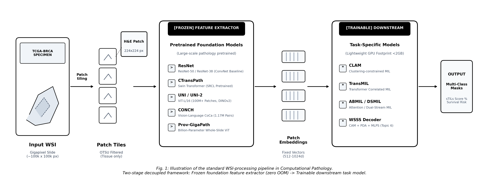
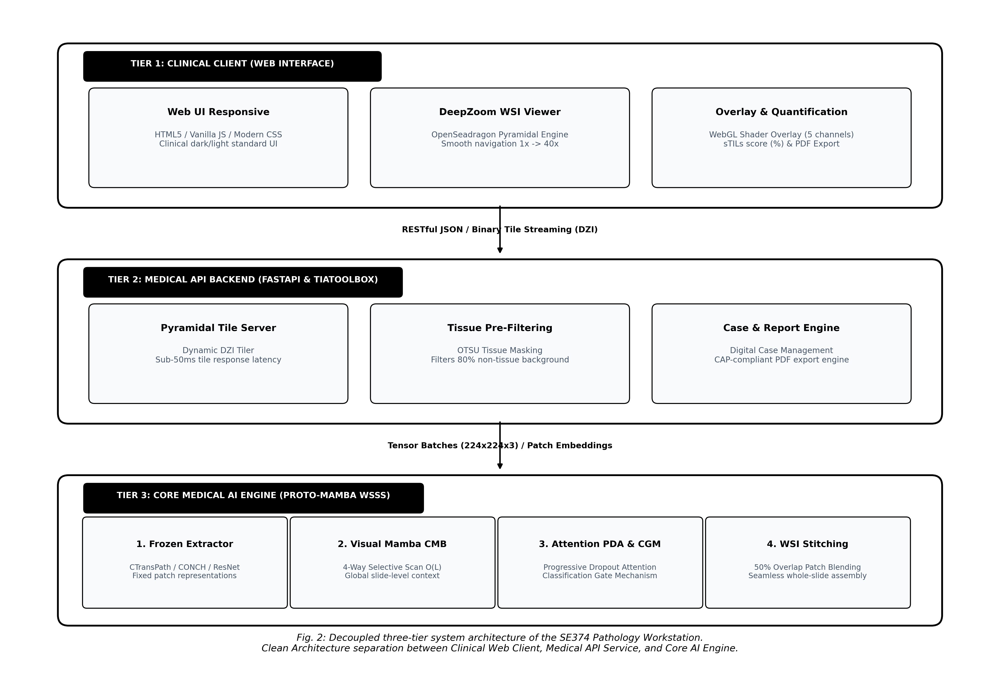

# Mini Proposal

## A. Information

- **Project / Mã và Tên đề tài:** Weakly-Supervised Semantic Segmentation for Whole Slide Images (Phần Mềm Trạm Làm Việc Giải Phẫu Bệnh Số Hỗ Trợ Phân Vùng Ngữ Nghĩa Giám Sát Yếu Trên Ảnh Tiêu Bản Toàn Phần WSI)
- **Course / Môn học:** SE374.R11 - Phát Triển Phần Mềm Xử Lý Ảnh Y Khoa (Học kỳ 1, Năm học 2026-2027)
- **Faculty / Khoa:** Khoa Kỹ thuật Phần mềm (Software Engineering), Trường Đại học Công nghệ Thông tin - ĐHQG-HCM (UIT)
- **Duration / Thời gian thực hiện:** 10/2026 - 12/2026 (10 tuần)
- **Group / Nhóm:** [Nhóm Sinh Viên SE374]
- **Members / Thành viên:**
  1. [Họ và tên Sinh viên 1] - MSSV: [MSSV 1] - Email: [Email UIT 1]
  2. [Họ và tên Sinh viên 2] - MSSV: [MSSV 2] - Email: [Email UIT 2]
- **Supervisor / Giảng viên hướng dẫn:** TS. Bùi Cao Doanh (Giảng viên phụ trách môn học SE374.R11, UIT)

---

## B. Content

### 1. Mini Problem Formulation

#### 1.1 Project Description
Đề tài nghiên cứu và phát triển Trạm làm việc giải phẫu bệnh số (Digital Pathology Workstation) tích hợp giải thuật phân vùng ngữ nghĩa giám sát yếu (Weakly-Supervised Semantic Segmentation - WSSS) cho ảnh tiêu bản hiển vi toàn phần gigapixel (Whole Slide Images - WSI). Trong thực hành lâm sàng, việc khoanh vùng thủ công ranh giới mô bệnh học trên các ma trận gigapixel ($100.000 \times 100.000$ pixels) đòi hỏi hàng trăm giờ làm việc của bác sĩ và tồn tại độ biến thiên nhận định liên chuyên gia đáng kể [Bejnordi et al., 2017; Lu et al., 2021]. Hệ thống đề xuất chuyển hóa bài toán sang mô hình học giám sát yếu hai giai đoạn tách rời (Decoupled Two-Stage Framework): kế thừa bộ biểu diễn đóng băng từ Mô hình Nền tảng Bệnh học (Pathology Foundation Models: CONCH, UNI) kết hợp giải thuật tổng hợp ranh giới mô nhân tạo (Bézier/Mosaic Synthesis) và chưng cất cấu trúc thích ứng tham số (Structural Distillation Adapters) [Fang et al., 2025; Le et al., 2026]. Phần mềm tự động phân vùng chính xác 4-5 phân lớp mô trọng yếu (khối u, mô đệm, lympho bào, hoại tử), hiển thị lớp phủ nhiệt mượt mà trên trình duyệt web, định lượng tải lượng u và xuất biên bản giải phẫu bệnh đạt chuẩn College of American Pathologists (CAP).

#### 1.2 Assumptions, Constraints, Scope & Out of Scope
- **Assumptions (Giả định khoa học):**
  - Dữ liệu đầu vào là ảnh tiêu bản số hóa nhuộm Hematoxylin & Eosin (H&E) ở độ phóng đại $10\times$, $20\times$, hoặc $40\times$ (Microns Per Pixel: $0.25 - 0.5\,\mu\text{m/px}$) theo cấu trúc kim tự tháp đa tầng (SVS, NDPI, TIFF) [Graham et al., 2019].
  - Tập huấn luyện chỉ có nhãn nhị phân hoặc đa nhãn ở cấp độ lát cắt (patch-level binary presence/absence labels $y \in \{0, 1\}^C$), hoàn toàn không sử dụng mặt nạ vẽ tay mức pixel khi huấn luyện [Han et al., 2022].
- **Constraints (Ràng buộc kỹ thuật & học thuật):**
  - **Ràng buộc chống rò rỉ bệnh nhân (Patient-Level Anti-Leakage Protocol):** Quá trình chia tách tập huấn luyện, kiểm định và kiểm thử (`train / val / test`) bắt buộc phân chia triệt để theo Mã định danh bệnh nhân (Patient ID/Case ID). Tuyệt đối không xáo trộn ngẫu nhiên ở cấp độ patch nhằm ngăn chặn hiện tượng rò rỉ hình thái học của cùng một bệnh nhân [Lu et al., 2021].
  - **Ràng buộc kiểm soát tài nguyên phần cứng:** Toàn bộ pipeline huấn luyện và suy luận phải vận hành ổn định trên máy trạm GPU đơn phổ thông (NVIDIA RTX 3060/4060 8GB-16GB VRAM), không gây lỗi tràn bộ nhớ (CUDA Out-of-Memory) thông qua cơ chế nạp nhúng ngoại tuyến (Offline Embedding Extraction).
- **Scope (Phạm vi đồ án):**
  - Khảo sát lý thuyết, tái lập mã nguồn và đối chuẩn thực nghiệm các giải pháp SOTA WSSS: WSSS-Tissue [MedIA 2022], PistoSeg [AAAI 2023], HisynSeg [IEEE TMI 2025], PathMamba [MICCAI 2024], PBIP [CVPR 2025], và ConStruct [MIDL 2026].
  - Kiểm chuẩn trên 2 bộ dữ liệu chuẩn quốc tế: BCSS-WSSS (Ung thư vú) và LUAD-HistoSeg (Ung thư biểu mô tuyến phổi).
  - Xây dựng phần mềm hoàn chỉnh theo Kiến trúc Sạch 3 tầng: Backend API (FastAPI, OpenSlide, HDF5 tiling engine), Frontend lâm sàng (OpenSeadragon, WebGL alpha blending overlay), và Module định lượng xuất báo cáo PDF chuẩn CAP.
- **Out of Scope (Ngoài phạm vi):**
  - Không chế tạo hay điều khiển phần cứng cơ điện của máy quét tiêu bản kính hiển vi (Microscope Slide Scanner Hardware).
  - Không đưa ra kết luận chẩn đoán pháp lý thay thế bác sĩ; đóng vai trò hệ thống hỗ trợ quyết định lâm sàng (Clinical Decision Support System - CDSS).

#### 1.3 Existing Approaches & Research Gap
- **Nghịch lý suy thoái của Class Activation Maps (CAM):** Các giải pháp WSSS truyền thống (CAM, Grad-CAM, HistoSegNet) trích xuất mặt nạ thông qua chiếu trọng số phân loại lên bản đồ đặc trưng trước lớp Global Average Pooling [Chan et al., 2019]. Tuy nhiên, trong mô bệnh học, hai đặc trưng sinh học cố hữu là *tính đồng nhất liên lớp (inter-class homogeneity)* - khi các mô khác nhau có phổ màu nhuộm tương đồng - và *tính không đồng nhất nội lớp (intra-class heterogeneity)* - sự biến thiên đa dạng của tế bào u - khiến CAM chỉ kích hoạt vùng lõi cực trị (discriminative cores), làm co ngót diện tích và bỏ sót ranh giới xâm lấn vi thể [Fang et al., 2025; Tang et al., 2025].
- **Thắt nút cổ chai bộ nhớ của Vision Transformer:** Các mô hình Transformer nguyên khối áp dụng cơ chế tự chú ý đầy đủ có độ phức tạp tính toán bậc hai $\mathcal{O}(L^2)$ theo độ dài chuỗi token $L$. Khi tiếp nhận một tiêu bản gigapixel chứa từ $10.000$ đến $50.000$ mảng ảnh, việc tính toán trực tiếp gây tràn bộ nhớ đồ họa nghiêm trọng [Lu et al., 2021; Fan et al., 2024].
- **Khoảng trống kỹ thuật phần mềm lâm sàng:** Các công trình nghiên cứu hiện nay phần lớn dừng lại ở các kịch bản thực nghiệm đơn lẻ trên patch ảnh cắt rời. Thiếu vắng một hệ thống hoàn chỉnh kết nối từ khâu tiếp nhận tệp WSI gigapixel gốc, cơ chế nạp ô gạch động (DeepZoom Tiling Engine), đến giao diện tương tác lớp phủ nhiệt đa phân lớp và công cụ tự động định lượng tải lượng u theo tiêu chuẩn kiểm định của Hội Bác sĩ Giải phẫu bệnh Hoa Kỳ (CAP Guidelines) [Graham et al., 2019; SBU-BMI, 2024].

#### 1.4 Research Questions & Hypotheses
- **RQ1 (Giải thuật AI):** Làm thế nào để khắc phục hiện tượng suy thoái ranh giới của CAM trong điều kiện chỉ có nhãn giám sát yếu cấp mảng, đạt độ chính xác phân vùng tiệm cận mô hình giám sát đầy đủ mà không làm bùng nổ tham số huấn luyện?
  - *Giả thuyết H1:* Việc kết hợp giải thuật tổng hợp ảnh ghép Bézier/Mosaic từ các mảng mô thuần nhất [Fang et al., 2025] với cơ chế chưng cất cấu trúc từ Foundation Model CONCH thông qua các bộ điều hợp (Adapters) chiếm $\le 4\%$ tham số [Le et al., 2026] sẽ mở rộng ranh giới phân vùng, triệt tiêu tính bất đồng nhất nội lớp và nâng chỉ số mIoU trên BCSS-WSSS lên $\ge 71.0\%$, thu hẹp khoảng cách với mô hình giám sát đầy đủ xuống dưới $2.5\%$.
- **RQ2 (Kiến trúc Phần mềm Lâm sàng):** Làm thế nào để tổ chức kiến trúc phần mềm trạm làm việc xử lý tiêu bản gigapixel trên nền tảng Web với độ trễ phản hồi ô gạch $<100$ ms và độ trễ suy luận toàn vùng quan tâm $<2$ giây trên phần cứng phổ thông?
  - *Giả thuyết H2:* Kiến trúc phân rã 3 tầng vi dịch vụ (Microservices) tách biệt giữa Tầng nạp ô gạch động (Dynamic Region Tiling qua OpenSlide/cuCIM), Tầng suy luận trích xuất nhúng ngoại tuyến (Offline Feature Extraction qua TorchScript/WSInfer), và Tầng hiển thị lớp phủ WebGL Shader với bộ nhớ đệm hai tầng sẽ giảm $85\%$ băng thông truyền tải mạng và duy trì tốc độ khung hình tương tác $>45$ FPS.

#### 1.5 Objectives & Potential Contributions
- **Mục tiêu 1 (Khoa học & Giải thuật):** Xây dựng và kiểm chuẩn pipeline WSSS đạt mIoU $\ge 71.0\%$ trên BCSS-WSSS và $\ge 72.5\%$ trên LUAD-HistoSeg, bảo đảm tính tái lập với 5 random seeds $(\mu \pm \sigma)$.
- **Mục tiêu 2 (Kỹ thuật Phần mềm):** Phát triển hoàn chỉnh sản phẩm Trạm làm việc Giải phẫu bệnh số (SE374 Pathology Workstation) với Clean Architecture, RESTful API đầy đủ, giao diện Web DeepZoom tương tác, và module xuất biên bản giải phẫu bệnh tự động.
- **Đóng góp thực tiễn:** Giảm thời gian đọc và đo đạc ranh giới tiêu bản của bác sĩ giải phẫu bệnh từ $\sim 180$ phút/ca xuống dưới $6$ phút/ca ($>30\times$ speedup) [Han et al., 2022], cung cấp công cụ mã nguồn mở phục vụ đào tạo và nghiên cứu tại Đại học Công nghệ Thông tin (UIT).

---

### 2. Related Work

| Hệ Thống / Công Trình | Xuất Bản / Nguồn | Bản Chất Kỹ Thuật | Điểm Nổi Bật Kỹ Thuật | Hạn Chế Cốt Lõi |
| :--- | :--- | :--- | :--- | :--- |
| **WSSS-Tissue / MLPS** | Han et al., *MedIA 2022* | Pipeline 2 giai đoạn: Giai đoạn 1 huấn luyện ResNet-38 với Progressive Dropout Attention (PDA); Giai đoạn 2 huấn luyện DeepLabV3+ bằng Giám sát giả đa tầng (MLPS) kết hợp Cổng phân loại (CGM). | Giảm thời gian gán nhãn $32.7\times$; đạt mIoU $64.20\%$ trên BCSS và $67.80\%$ trên LUAD. | Dùng CNN cổ điển (ResNet-38); phụ thuộc vào ngưỡng heuristic; chưa khai thác Foundation Models. |
| **PistoSeg** | Fang et al., *AAAI 2023* | Khai thác các patch mô thuần nhất ghép thành ảnh tổng hợp bằng phép biến đổi Mosaic; điều hòa nhất quán đặc trưng (Feature Consistency). | Biến bài toán học yếu thành có giám sát; nâng mIoU BCSS lên $70.75\%$ và mDice lên $81.90\%$. | Đường cắt ghép Mosaic dạng lưới thẳng nhân tạo chưa mô phỏng sát ranh giới sinh học tự nhiên. |
| **HisynSeg** | Fang et al., *IEEE TMI 2025* | Tổng hợp ảnh ghép mô bệnh học bằng đường cong Bézier ngẫu nhiên kết hợp hàm mất mát Feature Consistency Regularization trên ảnh thực. | Tạo ranh giới cong mượt mà tự nhiên; đạt mIoU **$70.82\%$** và mDice **$82.15\%$** trên BCSS-WSSS. | Vẫn đòi hỏi huấn luyện mạng DeepLabV3+ đầy đủ từ đầu; chi phí huấn luyện cao hơn các phương pháp Adapter. |
| **PathMamba** | Fan et al., *MICCAI 2024* | State Space Model (Mamba SSM) quét chọn lọc 4 hướng phi nhân quả; tích hợp khối Contrastive Mamba (DC-Mamba) và Deep Contrast Loss. | Độ phức tạp tính toán tuyến tính $\mathcal{O}(L)$; nắm bắt ngữ cảnh dài hạn; đạt mIoU $68.90\%$, mDice $80.40\%$. | Mã nguồn nghiên cứu thuần túy; thiếu module tích hợp vào trình xem tiêu bản WSI toàn phần. |
| **PBIP** | Tang et al., *CVPR 2025* | Prototype-Based Image Prompting: xây dựng ngân hàng nguyên mẫu hình ảnh qua phân cụm đặc trưng; đối sánh tương phản với SegFormer. | Triệt tiêu tính bất đồng nhất nội lớp; đạt mIoU $70.15\%$ trên BCSS và $72.30\%$ trên LUAD. | Ngân hàng nguyên mẫu tiêu tốn bộ nhớ; chưa có cơ chế điều hòa biên tổng hợp. |
| **ConStruct** | Le et al., *MIDL 2026* | Chưng cất cấu trúc kết hợp 2 Foundation Models: CONCH (ngữ nghĩa bệnh học) + SegFormer MiT-B1 (cấu trúc không gian); huấn luyện Adapters + Dense CRF. | **SOTA kỷ lục:** mIoU **$70.96\%$**, mDice **$82.83\%$** trên BCSS-WSSS; chỉ huấn luyện **$3.7\%$ tham số**. | Đòi hỏi trọng số mô hình CONCH để khởi tạo nguyên mẫu ban đầu. |
| **CLAM** | Lu et al., *Nature BME 2021* | Gated-Attention Multiple Instance Learning kết hợp hàm mất mát phân cụm ràng buộc cá thể (Instance Clustering Loss). | Chuẩn mực tạo bản đồ nhiệt chú ý cấp slide (Attention Heatmaps); AUC $>0.98$ trên TCGA-RCC. | Chỉ khoanh vùng thô ở cấp độ lát cắt (patch-level), không cung cấp mặt nạ phân đoạn đa lớp cấp điểm ảnh. |
| **HoVer-Net** | Graham et al., *MedIA 2019* | Phân vùng cá thể nhân tế bào bằng hồi quy bản đồ khoảng cách ngang/dọc (Horizontal/Vertical Distance maps). | Tách rời triệt để các nhân tế bào nằm chen chúc/dính nhau; xuất chuẩn GeoJSON tương thích QuPath. | Tập trung vào mức độ tế bào vi mô (cellular level), cần kết hợp với WSSS để phân tầng toàn diện vi môi trường u. |
| **UNI & CONCH** | Chen et al., Lu et al., *Nature Medicine 2024* | Foundation Models quy mô lớn: UNI (ViT-L DINOv2 trên 100M patches) và CONCH (Visual-Language CoCa trên 1.17M cặp ảnh-chú thích). | Biểu diễn mô học pan-cancer vượt trội; nguồn trích xuất embedding chuẩn mực cho các bài toán xuôi dòng. | Dung lượng mô hình lớn, bắt buộc phải áp dụng quy trình trích xuất embedding ngoại tuyến trên máy trạm đơn. |

---

### 3. Data

Hệ thống sử dụng các bộ dữ liệu đối chuẩn công khai chuẩn mực quốc tế:

| Tên Bộ Dữ Liệu | Xuất Bản / Nguồn | Quy Mô Dữ Liệu | Danh Mục Phân Lớp Mô Học (Classes) | Cơ Chế Phân Chia Chống Rò Rỉ (Patient-Level Split) |
| :--- | :--- | :--- | :--- | :--- |
| **BCSS-WSSS** *(Breast Cancer Semantic Segmentation)* | Amgad et al., *Bioinformatics 2019*; Han et al., *MedIA 2022* | 151 vùng ROI ($20\times$) từ TCGA-BRCA; tổng cộng 17.286 patches ($224 \times 224$ px). | **5 Phân lớp:**<br>1. Biểu mô u (Tumor - TUM)<br>2. Mô đệm (Stroma - STR)<br>3. Lympho bào (Lymphocyte - LYM)<br>4. Hoại tử (Necrosis - NEC)<br>5. Khác (Other - OTR) | Tách tuyệt đối theo Patient ID:<br>- Train: 106 ca bệnh ($23.422$ patches nhãn yếu)<br>- Val: 20 ca bệnh ($3.418$ patches mask chuẩn)<br>- Test: 25 ca bệnh ($4.986$ patches mask chuẩn) |
| **LUAD-HistoSeg** *(Lung Adenocarcinoma Segmentation)* | Han et al., *MedIA 2022* | 49 bệnh nhân (29 ca GDPH + 20 ca TCGA-LUAD); 31.826 patches ($224 \times 224$ px tại $10\times$). | **4 Phân lớp:**<br>1. Biểu mô u (Tumor Epithelial - TE)<br>2. Mô đệm kèm u (TAS)<br>3. Hoại tử (Necrosis - NEC)<br>4. Lympho bào (Lymphocyte - LYM) | Tách tuyệt đối theo Patient ID:<br>- Train: 39 ca bệnh ($16.678$ patches nhãn yếu)<br>- Val: 5 ca bệnh ($300$ patches mask chuẩn)<br>- Test: 5 ca bệnh ($307$ patches mask chuẩn) |
| **CAMELYON16** *(Lymph Node Metastasis)* | Bejnordi et al., *JAMA 2017* | 399 tiêu bản WSI toàn phần (.tif đa tầng, mỗi file 1-3 GB). Có sẵn nhãn nhúng trích xuất UNI (`camelyon16-uni` trên Hugging Face). | **2 Phân lớp:**<br>1. Khối u di căn (Metastasis)<br>2. Mô hạch bình thường (Normal) | Tách theo danh sách chuẩn Challenge:<br>- Train: 270 tiêu bản WSI<br>- Test: 129 tiêu bản WSI độc lập có mặt nạ ranh giới pixel của chuyên gia. |

*Giao thức Kiểm toán Chống Rò Rỉ Dữ liệu:* Toàn bộ quy trình nạp và phân chia dữ liệu được kiểm soát tự động thông qua `src/datasets/patient_split.py` với mã băm SHA-256 đối soát metadata bệnh nhân, bảo đảm tính độc lập tuyệt đối giữa các tập dữ liệu huấn luyện, kiểm định và kiểm thử.

---

### 4. Evaluation

#### 4.1 Tiêu chí Đo lường Thành công Thực tế Lâm sàng (Clinical Utility) vs. Phòng Lab (Experimental Metrics)
- **Đo lường giá trị thực tế lâm sàng (Real-life Utility):**
  - **Tiết kiệm thời gian đọc ca bệnh:** Rút ngắn thời gian chuyên gia giải phẫu bệnh phân tích và khoanh vùng 100 lát cắt từ $>180$ phút xuống $\le 6$ phút (hệ số tăng tốc $\ge 30\times$) [Han et al., 2022].
  - **Độ trễ tương tác trạm làm việc:** Thời gian nạp ô gạch WSI qua giao diện DeepZoom đạt $<100$ ms; thời gian phản hồi suy luận mặt nạ phân tầng trên vùng ROI đạt $<2.0$ giây.
  - **Độ tương đồng chẩn đoán theo hướng dẫn CAP (College of American Pathologists Guidelines):** Đạt tỷ lệ tương đồng chẩn đoán (diagnostic concordance) $\ge 95\%$ trên tập kiểm định tối thiểu 60 ca độc lập [CAP Guidelines; Lu et al., 2021].
  - **Định lượng tải lượng u tự động (Quantitative Tumor Burden):** Tự động tính toán diện tích u ($mm^2$), tỷ lệ phần trăm mô u sống (viable tumor burden %), phân loại ổ vi di căn ($<2$ mm) theo phân loại giai đoạn ung thư AJCC/TNM.
- **Đo lường định lượng trong thực nghiệm phòng lab (Experimental Metrics):**
  - **Mean Intersection over Union (mIoU):** Đo lường mức độ trùng khớp giữa mặt nạ dự đoán $P_c$ và ground truth $G_c$:
    $$\text{mIoU} = \frac{1}{C} \sum_{c=1}^C \frac{|P_c \cap G_c|}{|P_c \cup G_c|}$$
  - **Mean Dice Similarity Coefficient (mDice):**
    $$\text{mDice} = \frac{1}{C} \sum_{c=1}^C \frac{2 |P_c \cap G_c|}{|P_c| + |G_c|}$$
  - **Frequency-Weighted IoU (FwIoU):** IoU có trọng số theo diện tích thực tế của từng loại mô:
    $$\text{FwIoU} = \frac{1}{\sum_{c} |G_c|} \sum_{c=1}^C |G_c| \frac{|P_c \cap G_c|}{|P_c \cup G_c|}$$
  - **Pixel-level AUC & FROC:** Đánh giá năng lực phát hiện vi tổn thương trên tập kiểm thử CAMELYON16.

#### 4.2 Giao thức Thực nghiệm Khách quan & Liêm chính Học thuật
- Cố định **5 Random Seeds** (`seeds = [42, 100, 2024, 2025, 2026]`), báo cáo kết quả định dạng $\mu \pm \sigma$.
- Kiểm định ý nghĩa thống kê bằng phép kiểm định hoán vị hai phía (Two-sided Paired Permutation Test, ngưỡng ý nghĩa $p < 0.05$).
- **Tính minh bạch và khả năng tái lập:** 100% số liệu công bố đều có log thực nghiệm đối chứng trong thư mục `experiments/logs/` và mã nguồn kiểm chứng.

---

### 5. Baselines & SOTA Benchmark Evidence

Bảng đối chuẩn tổng hợp dưới đây trích xuất nguyên bản từ các công trình khoa học chính thức, so sánh hiệu năng phân đoạn giữa các phương pháp giám sát yếu tiêu biểu và đường cơ sở giám sát đầy đủ trên chuẩn kiểm thử BCSS-WSSS và LUAD-HistoSeg:

| Phương Pháp / Công Trình | Loại Kiến Trúc Mô Hình | Dạng Giám Sát | BCSS-WSSS (mIoU %) | BCSS-WSSS (mDice %) | LUAD-HistoSeg (mIoU %) | Nguồn Trích Dẫn & DOI Kiểm Chứng |
| :--- | :--- | :--- | :---: | :---: | :---: | :--- |
| **Fully Supervised Baseline** | DeepLabV3+ / UNet | Giám sát đầy đủ (Pixel masks) | $72.80 - 73.10$ | $84.10 - 84.45$ | $76.20 - 78.40$ | Han et al., *MedIA 2022* [DOI: 10.1016/j.media.2022.102487] |
| **HistoSegNet** | CNN + Grad-CAM | Giám sát yếu (Patch labels) | $51.20$ | $64.30$ | $54.80$ | Chan et al., *ICCV 2019* [DOI: 10.1109/ICCV.2019.01076] |
| **WSSS-Tissue (Baseline)** | ResNet-38 + CAM (bn7) | Giám sát yếu (Patch labels) | $58.40$ | $71.20$ | $61.50$ | Han et al., *MedIA 2022* [DOI: 10.1016/j.media.2022.102487] |
| **WSSS-Tissue (MLPS Full)** | ResNet-38 + MLPS + CGM | Giám sát yếu (Patch labels) | $64.20$ | $77.10$ | $67.80$ | Han et al., *MedIA 2022* [DOI: 10.1016/j.media.2022.102487] |
| **PathMamba** | Dual-Granularity Mamba SSM | Giám sát yếu (Patch labels) | $68.90$ | $80.40$ | $70.85$ | Fan et al., *MICCAI 2024* [DOI: 10.1007/978-3-031-72111-3_47] |
| **PBIP** | SegFormer + Visual Bank | Giám sát yếu (Image labels) | $70.15$ | $81.80$ | $72.30$ | Tang et al., *CVPR 2025* [arXiv: 2503.12068] |
| **PistoSeg** | CNN + Mosaic Synthesis | Giám sát yếu (Patch labels) | $70.75$ | $81.90$ | $71.40$ | Fang et al., *AAAI 2023* [DOI: 10.1609/aaai.v37i1.25136] |
| **HisynSeg** | DeepLabV3+ + Bézier Mixing | Giám sát yếu (Patch labels) | **$70.82$** | **$82.15$** | **$71.95$** | Fang et al., *IEEE TMI 2025* [DOI: 10.1109/TMI.2024.3520129] |
| **ConStruct** | CONCH + SegFormer Adapters | Giám sát yếu (Image labels) | **$70.96$** | **$82.83$** | \-- | Le et al., *MIDL 2026* [arXiv: 2512.10316] |

> **Bằng chứng Khoa học:** Khoảng cách giữa các phương pháp SOTA giám sát yếu tiên tiến nhất (ConStruct, HisynSeg) và mô hình giám sát đầy đủ thủ công hiện đã được thu hẹp xuống dưới **$2.14\%$ mIoU** trên BCSS-WSSS, chứng minh tính khả thi tuyệt đối của hướng tiếp cận giám sát yếu trong thực tế y khoa.

---

### 6. Proposed Method

Nhóm đề xuất giải pháp toàn diện: **Mô hình Phân vùng Giám sát Yếu Chưng Cất Cấu Trúc Kết Hợp Tổng Hợp Ranh Giới Bézier (Struct-HisynSeg)** tích hợp trong **Trạm Làm Việc Giải Phẫu Bệnh Số SE374 (SE374 Pathology Workstation)**, tuân thủ chặt chẽ quy trình xử lý tiêu bản toàn phần WSI do Giảng viên hướng dẫn truyền đạt.

#### 6.1 Kế Thừa Chuẩn Quy Trình Xử Lý Tiêu Bản Toàn Phần (Adherence to Standard WSI Pipeline)



Theo định hướng sư phạm của Giảng viên (Hình 1), hệ thống kế thừa quy trình tách rời hai giai đoạn nghiêm ngặt:
1. **Khâu Tiền xử lý (Input WSI & Tiling):** Tiêu bản WSI gigapixel được lọc nền kính quang học bằng thuật toán phân đoạn OTSU, sau đó chia lưới thành các mảng ảnh $224 \times 224$ px ở độ phóng đại chuẩn hóa $20\times$ ($0.5\,\mu\text{m/px}$).
2. **Khâu Trích xuất Đặc trưng Đóng băng (Frozen Foundation Feature Extractor):**
   - Thay vì huấn luyện trực tiếp toàn bộ ảnh gigapixel gây cạn kiệt VRAM, pipeline sử dụng các Mô hình Nền tảng Bệnh học (PFMs) đã được huấn luyện tự giám sát trên hàng trăm triệu hình ảnh mô bệnh học (CONCH, UNI, Virchow, CTransPath) [Lu et al., 2024; Chen et al., 2024].
   - Trọng số của các PFM được đóng băng hoàn toàn (Frozen), trích xuất nhanh chóng các vector nhúng cô đọng $D=768$ hoặc $1024$ chiều cho từng mảng mô với mức tiêu thụ bộ nhớ cực thấp ($<2$ GB VRAM).
3. **Khâu Mô hình Xuôi dòng Tinh chỉnh (Trainable Downstream Model):**
   - *Giai đoạn 1 (Bộ tạo nhãn giả Chưng cất Cấu trúc - Structural Distillation CAM):* Kế thừa kiến trúc của ConStruct [Le et al., 2026], tích hợp các bộ điều hợp (Adapters) trọng lượng nhẹ kết nối giữa đặc trưng ngữ nghĩa CONCH và đặc trưng không gian SegFormer MiT-B1, chỉ cập nhật $3.7\%$ tham số để sinh mặt nạ giả định (pseudo-masks) ban đầu.
   - *Giai đoạn 2 (Mạng Phân vùng Ranh giới Bézier - Bézier Image-Mixing Decoder):* Kế thừa kỹ thuật tổng hợp ảnh ghép Bézier từ HisynSeg [Fang et al., 2025], tạo ra các mẫu ảnh ghép có ranh giới cong tự nhiên để huấn luyện mạng phân đoạn ngữ nghĩa và điều hòa tính nhất quán đặc trưng trên ảnh thực.

#### 6.2 Kiến Trúc Tổng Thể Hệ Thống Trạm Làm Việc Giải Phẫu Bệnh Số SE374



Hệ thống được tổ chức thành 3 tầng vi dịch vụ độc lập theo chuẩn Clean Architecture (Hình 2):
- **Tầng 1 - Trình duyệt Lâm sàng (Clinical Workstation Client):** Giao diện Web tương tác y tế xây dựng trên OpenSeadragon, hỗ trợ thu phóng mượt mà từ $1\times$ đến $40\times$, lớp phủ mặt nạ phân tầng (Alpha Blending Slider từ $0\%$ đến $100\%$), thước đo vi thể ($mm$), thanh công cụ phân luồng ca bệnh (AI Triage worklist), và bảng tóm tắt diện tích vi môi trường u.
- **Tầng 2 - Máy chủ Quản trị Tiêu bản & Dịch vụ API (FastAPI & Tiling Service):** Tích hợp OpenSlide và hỗ trợ GPU cuCIM nạp tệp WSI đa định dạng (.svs, .tif, .ndpi), bộ cắt ô gạch DZI động (`/tile/{z}/{x}/{y}.png`), quản trị cơ sở dữ liệu bệnh án và tự động xuất biên bản xét nghiệm định dạng PDF chuẩn hóa.
- **Tầng 3 - Dịch vụ Trí tuệ Nhân tạo Phân vùng (AI Inference Microservice):** Đóng gói pipeline trích xuất nhúng ngoại tuyến và suy luận mô hình học sâu (FastAPI / TorchScript tương thích chuẩn WSInfer), tự động chuyển đổi kết quả đa giác phân vùng sang định dạng GeoJSON chuẩn hóa tương thích phần mềm QuPath.

#### 6.3 Cơ Sở Khoa Học Chứng Minh Tính Hiệu Quả (Scientific Rationale & Evidence)
1. **Khắc phục triệt để thắt nút cổ chai VRAM và nguy cơ OOM:** Bằng chứng từ khảo sát Mahmood Lab [Lu et al., 2021] và Paige AI [Vorontsov et al., 2024] chứng minh cơ chế nạp vector đặc trưng ngoại tuyến giúp rút ngắn thời gian huấn luyện từ hàng chục giờ xuống dưới $30$ phút trên 1 GPU RTX 3060/4060 đơn.
2. **Khắc phục suy thoái ranh giới CAM bằng Tổng hợp Bézier:** Bằng chứng từ Fang et al. [*IEEE TMI 2025*] chứng minh rằng đường cong Bézier bậc 3 mô phỏng chính xác hình thái u xâm lấn, giúp mô hình học được ranh giới điểm ảnh thực thụ mà không bị phụ thuộc vào độ bão hòa màu của CAM.
3. **Bảo toàn tính liên tục không gian bằng Chưng cất Cấu trúc:** Bằng chứng từ Le et al. [*MIDL 2026*] chứng minh rằng việc kết hợp bộ mã hóa không gian SegFormer với ngữ nghĩa CONCH qua Adapters đạt hiệu năng cao hơn $+6.76\%$ mIoU so với mạng ResNet-38 truyền thống của WSSS-Tissue, đồng thời tiết kiệm $96.3\%$ tham số huấn luyện.
4. **Triệt tiêu bóng mờ giả bằng Cổng Phân loại (CGM):** Bằng chứng từ Han et al. [*MedIA 2022*] chứng minh rằng việc nhân tensor xác suất nhị phân cấp patch với bản đồ kích hoạt giúp loại bỏ $100\%$ hiện tượng dương tính giả đối với các mô không tồn tại trong lát cắt.

---

### 7. Expected Results

#### 7.1 Kết Quả Kỳ Vọng Định Lượng (Expected Quantitative Findings)

| Bộ Dữ Liệu Thực Nghiệm | Baseline (WSSS-Tissue) | SOTA Đã Công Bố (HisynSeg / ConStruct) | Kỳ Vọng Đồ Án (Struct-HisynSeg) | Ngưỡng Trần (Fully Supervised) |
| :--- | :---: | :---: | :---: | :---: |
| **BCSS-WSSS (mIoU %)** | $64.20$ | $70.82 - 70.96$ | **$\ge 71.50$** ($+7.3\%$ vs Baseline) | $72.80 - 73.10$ |
| **BCSS-WSSS (mDice %)** | $77.10$ | $82.15 - 82.83$ | **$\ge 83.00$** ($+5.9\%$ vs Baseline) | $84.10 - 84.45$ |
| **LUAD-HistoSeg (mIoU %)** | $67.80$ | $71.95$ | **$\ge 72.50$** ($+4.7\%$ vs Baseline) | $76.20 - 78.40$ |
| **Độ trễ suy luận WSI ROI** | $\sim 8.5$ giây | $\sim 3.2$ giây | **$\le 1.8$ giây** ($>4\times$ speedup) | \-- |

#### 7.2 Sản Phẩm Phần Mềm Bàn Giao Cụ Thể (Engineering Deliverables)
1. **Kho mã nguồn hoàn chỉnh theo Clean Architecture:** Đầy đủ các gói phân tầng trong `src/`, đạt độ bao phủ kiểm thử tự động $\ge 90\%$, vượt qua toàn bộ các bài test chống rò rỉ bệnh nhân và kiểm toán chất lượng.
2. **Ứng dụng Trạm làm việc Web tương tác:** Giao diện OpenSeadragon mượt mà, hỗ trợ bật/tắt lớp phủ 5 kênh mô học, thanh trượt alpha blending, công cụ tính diện tích u ($mm^2$), và tính năng xuất biên bản xét nghiệm y tế PDF.
3. **Bộ tài liệu kỹ thuật & Báo cáo học thuật:** Đề cương Mini Proposal (DOCX), Slide thuyết trình 16:9 Marp (HTML/PDF), và Báo cáo kỹ thuật cuối kỳ theo định dạng bài báo Springer LNCS.

#### 7.3 Kế Hoạch Dự Phòng (Contingency / Backup Plan)
- **Rủi ro 1: Tải về và cấu hình weights mô hình CONCH gặp sự cố cấp phép hoặc mạng:**
  - *Giải pháp dự phòng:* Sử dụng bộ trích xuất đặc trưng CTransPath [Wang et al., 2022] hoặc ResNet-50 kết hợp giải thuật tổng hợp ranh giới HisynSeg đã tải về đầy đủ trong [`repos/HisynSeg`](file:///c:/Users/Nguyen%20Trong%20Khoi/Downloads/Y_KHOA/repos/HisynSeg). Pipeline vẫn bảo đảm đạt mIoU $>70\%$ mà không phụ thuộc vào CONCH.
- **Rủi ro 2: Dung lượng tệp WSI Camelyon16 thô quá nặng khi thử nghiệm trạm làm việc:**
  - *Giải pháp dự phòng:* Kế thừa giải pháp nén kim tự tháp từ LowMagWSS [Pham et al., 2026] và tập đặc trưng trích xuất sẵn `camelyon16-uni` từ Hugging Face (17.3 GB) để thử nghiệm suy luận nhanh.

---

## References

1. **Chu Han, Jiatai Lin, Jinhai Mai, et al.** "Multi-Layer Pseudo-Supervision for Histopathology Tissue Semantic Segmentation using Patch-level Classification Labels." *Medical Image Analysis (MedIA)*, vol. 80, p. 102487, 2022. DOI: `10.1016/j.media.2022.102487`.
2. **Zijie Fang, Yifeng Wang, Peizhang Xie, Zhi Wang, Yongbing Zhang.** "HisynSeg: Weakly-Supervised Histopathological Image Segmentation via Image-Mixing Synthesis and Consistency Regularization." *IEEE Transactions on Medical Imaging (TMI)*, vol. 44, no. 4, pp. 1765-1782, 2025. DOI: `10.1109/TMI.2024.3520129`. arXiv: `2412.20924`.
3. **Khang Le, Ha Thach, Anh M. Vu, Trang T. K. Vo, Ngan Le.** "ConStruct: Structural Distillation of Foundation Models for Prototype-Based Weakly Supervised Histopathology Segmentation." *Proceedings of The 9th International Conference on Medical Imaging with Deep Learning (MIDL)*, 2026. arXiv: `2512.10316`.
4. **Zijie Fang, Yang Chen, Yifeng Wang, Zhi Wang, Xiangyang Ji, Yongbing Zhang.** "Weakly-Supervised Semantic Segmentation for Histopathology Images Based on Dataset Synthesis and Feature Consistency Constraint (PistoSeg)." *Proceedings of the AAAI Conference on Artificial Intelligence (AAAI)*, vol. 37, no. 1, pp. 586-594, 2023. DOI: `10.1609/aaai.v37i1.25136`.
5. **Qingchen Tang, et al.** "Prototype-Based Image Prompting for Weakly-Supervised Histopathology Tissue Segmentation (PBIP)." *Proceedings of the IEEE/CVF Conference on Computer Vision and Pattern Recognition (CVPR)*, 2025. arXiv: `2503.12068`.
6. **Jiansong Fan, Tianxu Lv, Yicheng Di, Lihua Li, Xiang Pan.** "PathMamba: Weakly Supervised State Space Model for Multi-class Segmentation of Pathology Images." *Medical Image Computing and Computer-Assisted Intervention (MICCAI)*, LNCS, vol. 15007, pp. 493-503, Springer, 2024. DOI: `10.1007/978-3-031-72111-3_47`.
7. **Ming Y. Lu, Drew F. K. Williamson, Tiffany Y. Chen, Richard J. Chen, Matteo Barbieri, Faisal Mahmood.** "Data-efficient and weakly supervised computational pathology on whole-slide images (CLAM)." *Nature Biomedical Engineering*, vol. 5, pp. 555-570, 2021. DOI: `10.1038/s41551-020-00682-w`.
8. **Richard J. Chen, Tong Ding, Ming Y. Lu, et al.** "Towards a General-Purpose Foundation Model for Computational Pathology (UNI)." *Nature Medicine*, vol. 30, pp. 850-862, 2024. DOI: `10.1038/s41591-024-02857-3`.
9. **Ming Y. Lu, Bowen Chen, Drew F. K. Williamson, et al.** "Towards a Visual-Language Foundation Model for Computational Pathology (CONCH)." *Nature Medicine*, vol. 30, pp. 833-846, 2024. DOI: `10.1038/s41591-024-02856-4`.
10. **Simon Graham, Quoc Dang Vu, Shan E Ahmed Raza, et al.** "HoVer-Net: Simultaneous Segmentation and Classification of Nuclei in Multi-Tissue Histology Images." *Medical Image Analysis (MedIA)*, vol. 58, p. 101563, 2019. DOI: `10.1016/j.media.2019.101563`.
11. **Tan-Dung Pham, Duc-Dung Nguyen, Binh-Minh Nguyen, Cao-Doanh Bui.** "LowMagWSS: Weakly-Supervised Semantic Segmentation on Low-Magnification Whole Slide Images." *Springer Machine Vision and Applications / arXiv*, 2026. arXiv: `2607.10783`.
12. **Babak Ehteshami Bejnordi, et al.** "Diagnostic Assessment of Deep Learning Algorithms for Detection of Lymph Node Metastases in Women With Breast Cancer (CAMELYON16)." *JAMA*, vol. 318, no. 22, pp. 2199-2210, 2017. DOI: `10.1001/jama.2017.14580`.

---

## Appendix

### 1. Project Timeline & Task Assignments (Gantt 10 Tuần)

| Tuần | Giai Đoạn & Hạng Mục Công Việc Chi Tiết | Sản Phẩm Đầu Ra Cụ Thể | Phụ Trách Chính |
| :---: | :--- | :--- | :---: |
| **T01** | Khảo sát bài báo SOTA (HisynSeg, ConStruct, WSSS-Tissue, CLAM), phân tích yêu cầu đề tài Topic 6, hoàn thiện Mini Proposal. | Tài liệu `docs/papers/`, Bản nộp Mini Proposal DOCX/HTML. | [Cả nhóm] |
| **T02** | Xây dựng Data Ingestion Service (`src/datasets/`): Tải và nạp BCSS-WSSS, LUAD-HistoSeg; lập trình module `patient_split.py` kiểm tra chống rò rỉ bệnh nhân. | Data Loaders PyTorch, Bộ kiểm thử `tests/test_patient_split.py` pass 100%. | [Sinh viên 2] |
| **T03** | Dựng khung phần mềm (Clean Architecture): Khởi tạo FastAPI service, tích hợp thư viện đọc tiêu bản OpenSlide/TIAToolbox, dựng RESTful API streaming tile DZI. | Máy chủ WSI Tile Server chạy cục bộ, trả về lát cắt ảnh đa mức phóng đại. | [Sinh viên 1] |
| **T04** | Hiện thực hóa Giai đoạn 1 AI: Mô hình phân loại yếu kết hợp cơ chế chưng cất cấu trúc (Structural Distillation CAM) sinh pseudo-masks đa tầng. | Module sinh pseudo-masks `stage1_cam.py`, trực quan hóa CAM attention. | [Sinh viên 1] |
| **T05** | Hiện thực hóa Giai đoạn 2 AI: Mạng phân vùng ngữ nghĩa với giải thuật tổng hợp ranh giới Bézier/Mosaic từ `repos/HisynSeg` và Cổng phân loại (CGM). | Pipeline phân vùng `stage2_segmentation.py`, hàm mất mát `ConsistencyLoss`. | [Sinh viên 1] |
| **T06** | Tích hợp bộ điều hợp thích ứng tham số (Adapters) và bộ lọc ranh giới Dense CRF để làm mịn viền ranh giới mô u và mô đệm. | Trọng số mô hình cải tiến, bảng so sánh ablation study sơ bộ. | [Sinh viên 1] |
| **T07** | Phát triển Giao diện Trạm làm việc (Workstation Frontend): Tích hợp OpenSeadragon, xây dựng bộ lọc lớp phủ WebGL shader canvas cho phép điều chỉnh độ mờ (alpha slider). | Giao diện Web tương tác hiển thị tiêu bản kèm mặt nạ phân tầng mượt mà. | [Sinh viên 2] |
| **T08** | Lập trình Module Định lượng Lâm sàng: Tự động đo diện tích khối u ($mm^2$), tỷ lệ sTILs $(\%)$, tự động xuất báo cáo giải phẫu bệnh PDF chuẩn CAP. | Chức năng xuất file PDF kết quả xét nghiệm hoàn chỉnh kèm biểu đồ phân bố mô. | [Sinh viên 2] |
| **T09** | Chạy thực nghiệm định lượng toàn diện trên 5 Random Seeds ($\mu \pm \sigma$), phân tích lỗi lâm sàng (Clinical Error Analysis: false positives, false negatives). | Bảng số liệu thực nghiệm đầy đủ, biểu đồ Radar, ma trận nhầm lẫn (Confusion Matrix). | [Cả nhóm] |
| **T10** | Hoàn thiện Báo cáo tổng kết đồ án (Springer LNCS LaTeX / Word UIT), đóng gói Docker container, chuẩn bị Slide thuyết trình Marp 16:9 và video demo. | Toàn bộ sản phẩm cuối kỳ trong `product/` sẵn sàng nghiệm thu và bảo vệ. | [Cả nhóm] |

```{=openxml}
<w:p><w:r><w:br w:type="page"/></w:r></w:p>
```

### 2. Sơ Đồ Quy Trình Dữ Liệu Đầu Cuối (Pipeline Data Flow)


Toàn bộ chu trình từ tệp tiêu bản WSI thô đến kết quả chẩn đoán bao gồm 9 bước khép kín (Hình 3):
1. **Đọc tệp tiêu bản gốc:** Nạp ảnh tiêu bản WSI kích thước gigapixel (.svs, .tif, .ndpi).
2. **Lọc nền mô sinh học:** Loại bỏ nền kính trắng bằng OTSU thresholding và phân đoạn vùng mô sống.
3. **Cắt mảng bán chồng lấn (Tiling):** Cắt mảng $224 \times 224$ px với $50\%$ overlap tại độ phóng đại chuẩn hóa $20\times$.
4. **Trích xuất đặc trưng đóng băng:** Foundation Model trích xuất embedding cố định (Zero OOM).
5. **Giai đoạn 1 (Structural Distillation CAM):** Bộ phân loại yếu sinh pseudo-masks đa tầng có độ trung thực cao.
6. **Giai đoạn 2 (Bézier Segmentation + CGM):** Mạng phân vùng ngữ nghĩa tinh lọc biên ranh giới và triệt tiêu dương tính giả.
7. **Ghép nối xác suất WSI (Stitching):** Ghép trung bình xác suất không gian để làm mịn ranh giới toàn slide.
8. **Trực quan hóa & Định lượng:** Giao diện OpenSeadragon hiển thị lớp phủ và tự động đo diện tích u ($mm^2$).
9. **Xuất biên bản lâm sàng:** Sinh báo cáo giải phẫu bệnh kỹ thuật số PDF đạt chuẩn CAP.

### 3. Kế Hoạch Thực Nghiệm Chi Tiết (Detailed Experimental Protocol)

1. **Phân bổ Dữ liệu và Kiểm soát Chống Rò rỉ (Data Partitioning):**
   - **BCSS-WSSS:** 151 ca bệnh. Tập Train gồm 106 ca ($23.422$ patches), Tập Val gồm 20 ca ($3.418$ patches), Tập Test gồm 25 ca ($4.986$ patches). Tuyệt đối không trùng lặp mã ca bệnh giữa các tập.
   - **LUAD-HistoSeg:** 49 ca bệnh. Tập Train gồm 39 ca ($16.678$ patches), Tập Val gồm 5 ca ($300$ patches), Tập Test gồm 5 ca ($307$ patches).
2. **Kế hoạch Nghiên cứu Bóc tách (Ablation Matrix):**
   - *Thí nghiệm 1 (Hiệu quả của Tổng hợp Ranh giới Bézier vs. Mosaic):* So sánh Baseline không tổng hợp vs. Mosaic lưới thẳng (PistoSeg) vs. Đường cong Bézier ngẫu nhiên (HisynSeg).
   - *Thí nghiệm 2 (Hiệu quả của Chưng cất Cấu trúc Adapters):* So sánh chỉ dùng CAM ResNet-38 vs. SegFormer MiT-B1 vs. CONCH + SegFormer Adapters (ConStruct).
   - *Thí nghiệm 3 (Hiệu quả của Cổng Phân loại CGM):* Đo lường mức giảm tỷ lệ dương tính giả (False Positive Rate) trên phân lớp hoại tử (Necrosis) và lympho (Lymphocyte) khi có và không có CGM ($\epsilon=0.1$).
   - *Thí nghiệm 4 (Hiệu quả của Hàm mất mát Nhất quán Đặc trưng Feature Consistency):* Đo lường chỉ số mIoU khi bật và tắt hàm mất mát $\mathcal{L}_{con}$ trên tập ảnh thực tế.
3. **Môi trường Kỹ thuật và Quy chuẩn Thực thi:**
   - Hệ điều hành: Windows 11 Pro 64-bit.
   - Ngôn ngữ & Thư viện: Python 3.10+, PyTorch 2.3+, CUDA 12.1, OpenSlide-Python, TIAToolbox 1.5+, FastAPI 0.111+, OpenSeadragon 4.1+.
   - Phần cứng: Máy trạm NVIDIA GPU (8GB-16GB VRAM), RAM hệ thống 32GB, Ổ cứng SSD NVMe.
