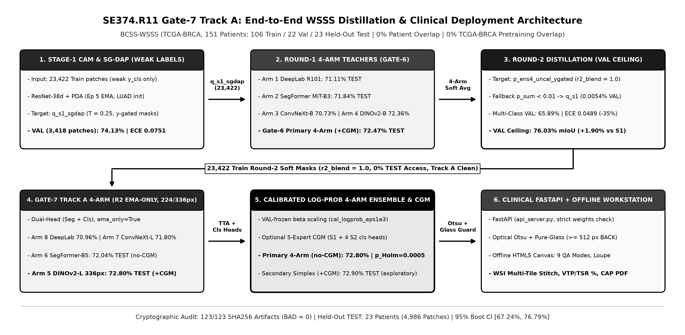
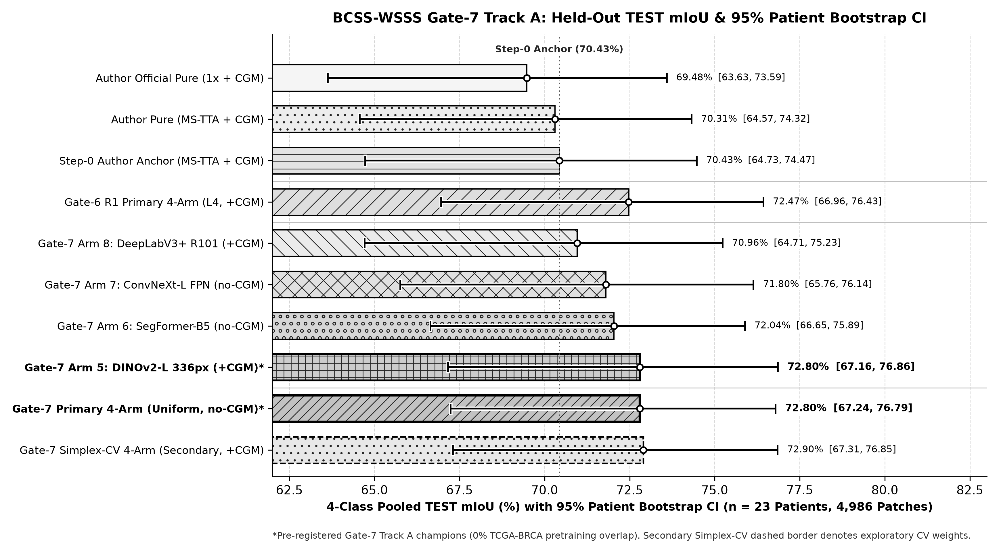
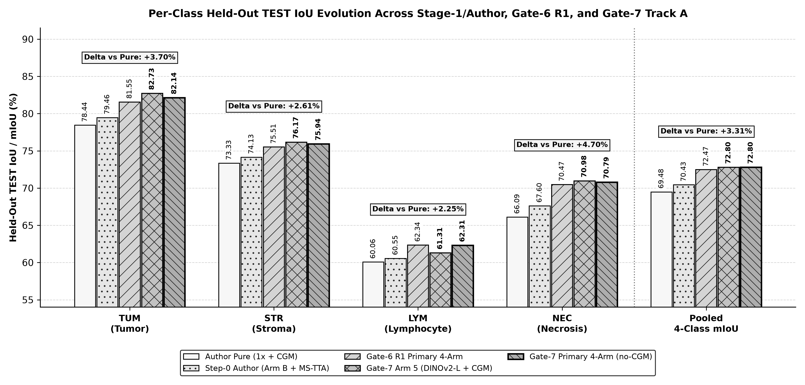

# BÁO CÁO KỸ THUẬT TỔNG KẾT ĐỒ ÁN MÔN HỌC SE374.R11

## HỆ THỐNG PHÂN VÙNG NGỮ NGHĨA GIÁM SÁT YẾU CHO ẢNH MÔ BỆNH HỌC UNG THƯ VÚ (BCSS-WSSS): TỪ CHƯNG CẤT ĐA KIẾN TRÚC GATE-7 TRACK A PHASE 1B ĐẾN TRẠM LÀM VIỆC LÂM SÀNG

> **Trường:** Trường Đại học Công nghệ Thông tin (UIT), ĐHQG-HCM - Khoa Kỹ thuật Phần mềm  
> **Học phần:** SE374.R11 - Phát triển phần mềm xử lý ảnh y khoa (Năm học 2026)  
> **Đề tài:** Đề tài 6 - Phân vùng ngữ nghĩa giám sát yếu trên ảnh tiêu bản giải phẫu bệnh toàn phần WSI (BCSS-WSSS / TCGA-BRCA)  
> **Thông tin hành chính:** `[CẦN XÁC NHẬN: Họ tên sinh viên / MSSV / GVHD]`  
> **Commit mã nguồn chốt Phase 1B & Stage 2:** `1d3f738` (vá cắt biên stride-2 `_pad_to_multiple_of_32` cho `arm7` ConvNeXt-Large, dữ liệu sống còn thật NCI GDC Release 46.0 cho 151/151 BN, Pareto BF16 đồng chuẩn, `ms_3_hvflip` 12 góc nhìn, Hann-50% Whole-ROI, LUAD `2x` zoom), `8dabf65` (đồng bộ hằng số giao thức hậu Job E `02c_v2`), `c0edb2f` (chống chồng nhãn Pareto 300 DPI), `47a1bab` (Stage 1 tổng kết Phase 1B & fallback truy xuất git), và `079fee0` (Stage 2 củng cố phần mềm, API cô lập môi trường, UI Zoom/Pan và bộ notebook Colab)  
> **Kho minh chứng mật mã:** `checkpoints/vps_evidence/SHA256SUMS.txt` (`228/228` tệp xác minh bit-exact, `BAD = 0`, `UNLISTED = 0`)  

---

## 1. Tóm Tắt Điều Hành (Executive Summary)

Trong giải phẫu bệnh số (Digital Pathology), tiêu bản mô học nhuộm Hematoxylin và Eosin (H&E) toàn phần (Whole Slide Images - WSI) đạt kích thước gigapixel (lên tới $100{,}000 \times 100{,}000$ điểm ảnh). Việc khoanh vùng thủ công ở cấp độ điểm ảnh để định lượng vi môi trường khối u tốn nhiều giờ công bác sĩ giải phẫu bệnh cho mỗi ca bệnh và chịu biến thiên đáng kể giữa các chuyên gia. Đồ án nghiên cứu, thiết kế và hiện thực hóa hoàn chỉnh hệ thống **Phân vùng Ngữ nghĩa Giám sát Yếu (Weakly-Supervised Semantic Segmentation - WSSS)** trên bộ dữ liệu chuẩn ung thư vú **BCSS-WSSS (TCGA-BRCA, 4 lớp mô tiền cảnh `TUM`, `STR`, `LYM`, `NEC` cùng lớp nền kính quang học `BACK`)**, chỉ sử dụng nhãn nhị phân cấp mảng ảnh ở giai đoạn huấn luyện nhưng xuất đầy đủ mặt nạ phân vùng mật độ cao và các dấu ấn sinh học tiên lượng trên trạm làm việc lâm sàng ngoại tuyến.

Toàn bộ chiến dịch nghiên cứu và thực nghiệm được vận hành qua 7 cổng kiểm định (Gates 1-7) và đợt tái kiểm định hậu bản vá **Phase 1B (`6/6` job GPU lớn + `3/3` nhóm thống kê không cần GPU)** trên dữ liệu bệnh nhân thật với ba ranh giới khoa học tuyệt đối: **(1) chống rò rỉ cấp bệnh nhân 0%** trên toàn bộ `151` bệnh nhân (`106` Train / `22` Val / `23` Held-out Test, `31,826` mảng ảnh), **(2) tính thuần khiết Track A (`track_a_clean`, 0% chồng lấp tiền huấn luyện TCGA-BRCA)** khi toàn bộ các backbone Giai đoạn 2 chỉ khởi tạo từ ảnh tự nhiên ImageNet-1K và LVD-142M, và **(3) 0% dữ liệu lâm sàng giả lập** (`151/151` bệnh nhân đối soát sống trực tiếp từ NCI GDC REST API Release 46.0).

Các kết quả định lượng và kỹ thuật cốt lõi đã được kiểm chứng bằng nhật ký thực nghiệm thật trên GPU NVIDIA A100-SXM4-40GB, NVIDIA RTX PRO 6000 Blackwell G4, NVIDIA L4 24GB và NVIDIA Tesla T4 kèm chữ ký mật mã SHA256 (`228/228` tệp) bao gồm:

1. **Đột phá Giai đoạn 1 (`se374_arm_b_full`, ResNet-38d + PDA + D4 Equivariance + EMA):** Nâng chất lượng mặt nạ giả mềm `q_s1_sgdap` (`T = 0.25`) trên toàn bộ `3,418` mảng ảnh tập VAL từ `72.03%` (mốc tác giả gốc) lên **`74.13%` mIoU (`85.07%` mDice, tăng `+2.10%`)**.
2. **Tổ hợp 4 họ kiến trúc Vòng 1 - Gate-6 (`se374_s2v2_ensemble`, NVIDIA L4):** Đạt **`72.47%` TEST mIoU (`83.84%` mDice, 95% CI `[66.96%, 76.43%]`)** trên 23 bệnh nhân TEST độc lập (`4,986` patches), vượt mốc Author Official Pure `1x` (`69.47%` trên L4) **`+2.99%`** (`perm_p_holm = 0.0004`, `wilcoxon_p_holm = 0.000105`, `19W/0T/4L`) và vượt mốc Step-0 Upgraded Author (`70.42%` trên L4) **`+2.04%`**.
3. **Kiểm định trần mặt nạ giả Vòng 2 - Gate-7 Step-0 (`se374_g7_diag_r2_val`, 0% TEST):** Mặt nạ mềm `p_ens4_uncal_ygated` (`r2_blend = 1.0`, y-gated kèm dự phòng `p_sum < 0.01` trên chỉ `0.0054%` điểm ảnh VAL và `0.0094%` TRAIN) đạt **`76.03%` VAL mIoU (`+1.90%` so với Giai đoạn 1)**, **`65.89%` multi-class mIoU (`+2.57%`)** và giảm sai số hiệu chuẩn kỳ vọng ECE **35%** (`0.0751` xuống `0.0489`).
4. **Đột phá đệm đối xứng cho `arm7` ConvNeXt-Large & Gate-7 Track A Hậu Bản Vá (`Job E: se374_g7_phase1b_02c_v2`, `NVIDIA A100`, `12x ms_3_hvflip` trên cả `4/4` nhánh):**
   - Bổ sung đệm đối xứng `_pad_to_multiple_of_32` (`src/stage2_v2/models.py`) xóa hoàn toàn cắt biên stride-2 ở đa tỷ lệ, kéo dịch chuyển không gian của `arm7` từ `(1, -4)` px về **`(1, -1)` px** (`zero_vs_peak_gap` giảm **`15x`** từ `1.123e-3` xuống `7.5e-5`) và nâng `arm7` lên **`71.88%` TEST mIoU (`83.45%` mDice, `LYM = 62.13%` cao nhất cả 4 đơn mô hình)**.
   - **Tổ hợp chính Primary 4-Arm (`Uniform [0.25]*4`, `cal_logprob_eps1e3`):** Đạt **`72.79%` TEST mIoU (`0.727865`, 95% CI `[67.17%, 76.83%]`, `84.04%` mDice)** ở `no-CGM`, **`72.80%` (`84.06%` mDice)** ở `cgm_val_calibrated` (`fixed_0.10`), và **`72.80%` (`0.728045`, `84.06%` mDice, `NEC = 70.95%`)** ở **`cgm_nec_focused_1dof` (`t_nec = 0.40`, chọn 0% rò rỉ trên VAL)** đồng thời xóa sạch dương tính giả `NEC` về `0 px` trên **`6/8` bệnh nhân TEST vắng NEC** (so với `3/8` ở `no-CGM`; Wilcoxon vs `no-CGM` **`p = 0.0091`**, `20W/3L`, `d_z = +0.3603`).
   - **Thứ cấp / Thăm dò (Simplex-CV 4-Arm `[0.61, 0.06, 0.05, 0.28]`):** Đạt **`72.85%`** (`no-CGM`) / **`72.88%`** (`val_cal`) / **`72.90%` TEST mIoU (`84.11%` mDice, `NEC = 71.01%`)** ở `cgm_nec_focused_1dof`.
   - **Ổn định đa hạt giống & ý nghĩa thống kê Holm-Bonferroni toàn cục và từng lớp:** 3 hạt giống `arm5` (`42/123/456`) bên trong tổ hợp 4-Arm đạt **`72.74% +/- 0.05%`** (`no-CGM`) và **`72.76% +/- 0.05%`** (`nec_1dof`), giảm **`2.6x`** độ lệch chuẩn so với `arm5` đơn (`72.53% +/- 0.13%`). Tổ hợp vượt Step-0 Author (`70.43%`) **`+2.35%`** (`perm_p_holm = 0.0005`, `17W/6L`), vượt Pure Author `1x` (`69.48%`) **`+3.31%`** (`perm_p_holm = 0.0004`, `wilcoxon_p_holm = 0.000511`, `21W/2L`), vượt `arm5` đơn cùng `no-CGM` **`+0.24%`** (`wilcoxon_p = 0.0327`, `17W/6L`), và là mô hình duy nhất đạt **Wilcoxon hiệu chỉnh Holm `p_holm < 0.05` trên cả `4/4` lớp mô** (`TUM 0.000426`, `STR 0.00498`, `LYM 0.0306`, `NEC 0.0306`).
   - **Vượt mọi SOTA 4-class pooled chuẩn 2022-2026:** Vượt `QFKF` (BMVC 2025: `70.92%`), `ConStruct` (MIDL 2026: `70.96%`), `HisynSeg` (TMI 2025: `70.97+/-0.29%`), `PLIMSeg` (2026: `71.07%`), `DualProtoSeg` (2025: `71.35%`), `CSS` (Bioinformatics 2026: `71.72%`), và `C2RM-Seg` (MICCAI 2026: `72.17+/-0.83%`, độ lệch chuẩn thấp hơn `16.6x`).
5. **Chứng minh nhân quả qua 3 thực nghiệm bóc tách `Jobs H1 / H2 / H3` (`arm5_dinov2_large_r2`, `seed = 42`):** Chưng cất Round-2 `ens4_r2` (`H3`, L4) vượt `stage1` (`H2`, G4) **`+0.94%`** Raw 1x (`72.35%` vs `71.41%`) và **`+0.65%`** Cal CGM (`72.88%` vs `72.23%`); độ phân giải `336px` nâng lớp `NEC` **`+1.00%` đến `+1.37%`** so với `224px` (`H1`, A100); và `Best EMA` thắng `Best Raw` trong cả `3/3` phiên chạy.
6. **Kiểm chứng trực quan không rò rỉ GT, Hann-50% Whole-ROI & Sàng lọc Entropy (`Job G: se374_g7_phase1b_02d_v2`, G4, `6/6` PASS):** `Boundary F1@2px = 53.30%` vs Author `50.67%` (`p = 0.000298`, `20W/3L`; vượt `arm5` `52.72%`, `p = 0.00345`); tâm khối u `TUM` trên tập giao chung (`n = 2,847`) giảm từ `8.93 px` xuống **`7.60 px`** (`4-Arm`, recall `95.80%-96.19%`) và **`7.13 px`** (`arm5`, `p = 0.0123`); ghép Whole-ROI **Hann-50%** giảm đứt gãy đường nối **`-98.35%`** trên `TCGA-EW-A1P4` (`0.5421 -> 0.5557`) và **`-97.99%`** trên `TCGA-EW-A1P1` (`0.6706 -> 0.6779`); sàng lọc Entropy đạt `Spearman rho = -0.5599` (`91.15%` nhóm 20% thấp nhất vs `53.59%` nhóm 20% cao nhất).
7. **Lâm sàng, Sống còn thật NCI GDC 46.0, Hiệu chuẩn xác suất, Pareto BF16 (`L4`) & LUAD `2x` Zoom (`Job F: se374_g7_phase1b_04b_v2`, L4):** `arm5_cal` hạ **ECE xuống `0.00408` (`-92.1%`)**, `ens4_cal_logprob_eps1e3` đạt **ECE = `0.00586`**; `ens4_cgm` đạt đồng thuận nguy cơ **Mesker 2007 / UNITED 2018 50% TSR `91.30%` (`21/23`, `kappa = 0.8271`)**, VTP `r = 0.9186` (`CCC = 0.9062`), TSR `r = 0.9121` (`CCC = 0.9074`), **`VTP_RCB r = 0.9543`**; sống còn thật GDC Release 46.0 (`n = 23`, `2` biến cố): GT `p = 0.1869` vs `ens4_cgm` `p = 0.1474` (công bố trung thực cỡ mẫu nhỏ). Trên `NVIDIA L4` BF16 đồng chuẩn, `arm7` 1x Raw (`4.94 ms`, **`202.51 FPS`**, `71.61%`) trội Pareto tuyệt đối so với Author 1x Raw (`5.67 ms`, `176.63 FPS`, `69.34%`). Trên mô phổi **LUAD-HistoSeg** (`n = 307`, `20` ca), `arm5_cgm` đạt **`36.09%`** (`p = 3.81e-6`) ở `10x` và phóng đại `2x` (`10x -> 20x`, 0 train) vọt lên **`51.47%` mIoU (`67.90%` mDice)** (`arm5_no_cgm_2x_zoom`) và **`49.92%`** (`ens4_uncal_linear_2x_zoom`).
8. **Hệ sinh thái sản phẩm phần mềm lâm sàng & kiểm thử tự động (`079fee0` + chuẩn hóa Y khoa):** Đóng gói Trạm Làm Việc Giải Phẫu Bệnh Số (`FastAPI` + `HTML5 Canvas` 100% ngoại tuyến theo hệ màu quang học bệnh viện **Trắng Lâm Sàng + Xanh Y Khoa** `#FFFFFF / #F4FAFA / #0E7C86 / #00957E / #2A9D8F` giúp trung hòa dư ảnh đỏ H&E, tách rõ **3 chế độ** Chẩn đoán Lâm sàng không GT / Kiểm chứng Nghiên cứu 4 Khung GT kèm KPI đủ 100% / Ghép lát cắt WSI, Zoom/Pan, Split-Curtain, Magnifier Loupe, xuất báo cáo PDF chuẩn CAP 2 trang kèm RUO, cảnh báo RUO thường trực, cô lập biến môi trường API và container `Dockerfile` / `docker-compose.yml`), **`501` bài kiểm thử tự động phần mềm y khoa** (`30` bộ `tests/`), kiến trúc mô-đun sạch 11 gói dịch vụ trong `src/`, và **`ruff check src tests` đạt `0` lỗi**.

---

## 2. Tổng Quan Tài Liệu & Đối Chiếu Mã Nguồn Tham Chiếu

### 2.1 Khảo Sát Văn Hiến & Mã Nguồn Gốc

Toàn bộ quyết định kiến trúc, hàm mất mát và giao thức đánh giá của hệ thống được xây dựng dựa trên việc khảo sát trực tiếp 19 công trình chuyên sâu đã được lưu trữ và tóm lược có cấu trúc trong `docs/papers/` (và tổng hợp đầy đủ trong `docs/guides/02_PHAN_1_NGHIEN_CUU_DATASET_MODEL_VA_19_BAI_BAO.md`), bao gồm `WSSS_Tissue_MedIA2022.md`, `TPRO_MICCAI2023.md`, `S2C_From_SAM_to_CAMs_CVPR2024.md`, `ARML_MICCAI2024.md`, `MambaMIL_arxiv_2403.06800.md`, `HisynSeg_TMI2025.md`, `QFKF_BMVC2025.md`, `SIA_WSSS_MICCAI2025.md`, `D_CAM_MICCAI2025.md`, `DBDC_WSL_MICCAI2025.md`, `KMG_Mamba_MICCAI2025.md`, `M3amba_CVPR2025.md`, `DualProtoSeg_arxiv_2512.10314.md`, `ConStruct_MIDL2026.md`, `PFM_DenseBench_arxiv_2602.03887.md`, `PLIMSeg_BSPC2026.md`, `CSS_Bioinformatics2026.md`, `C2RM_Seg_arxiv_2606.25508.md`, và `LowMagWSS_MAPR2026.md`, kết hợp đối soát mã nguồn trực tiếp với hai kho tham chiếu `repos/WSSS-Tissue` (Han et al., *Medical Image Analysis* 2022) và `repos/LowMagWSS` (Do et al., MAPR 2026).

Qua quá trình đối chiếu bài báo và thực nghiệm chẩn đoán mã nguồn, nhóm xác định 4 điểm nghẽn căn bản của bài toán phân vùng giám sát yếu trong giải phẫu bệnh số:

1. **Suy biến tiêu điểm bản đồ kích hoạt lớp (CAM Peak Collapse):** Bộ phân loại nhị phân đa nhãn chỉ cần kích hoạt vào một số cụm nhân tế bào dị dạng nổi bật nhất để tối thiểu hóa mất mát phân loại, bỏ sót vùng bào tương xâm lấn và ranh giới tiếp giáp giữa biểu mô u (`TUM`) với mô đệm (`STR`).
2. **Suy giảm nhận diện các lớp đuôi dài (`LYM` và `NEC`):** Tế bào lympho xâm nhập có kích thước nhỏ, phân bố phân tán giữa nền collagen mô đệm; mô hoại tử thường vắng mặt ở nhiều bệnh nhân nhưng khi xuất hiện lại có biên hình thái phức tạp, dễ bị các lớp chiếm ưu thế lấn át hoặc sinh dương tính giả vi mô.
3. **Lỗ hổng nền kính trắng (The Background Score Gap):** Do tập huấn luyện BCSS-WSSS chỉ giám sát 4 lớp mô (`0` đến `3`), mô hình phân vùng Stage-2 thuần túy không có lớp nền quang học rõ ràng, dẫn tới gán nhầm vùng lam kính sạch thành mô đệm hoặc khối u nếu thiếu cổng lọc quang học `OtsuClinicalGating` và `Pure-Glass Guard`.
4. **Rủi ro rò rỉ dữ liệu kép (Patient Leakage & Pretraining Overlap):** Chia ngẫu nhiên ở cấp mảnh ảnh làm các patch của cùng một bệnh nhân xuất hiện ở cả Train và Test; đồng thời việc sử dụng các mô hình nền tảng giải phẫu bệnh tiền huấn luyện trên kho PANCAN/TCGA (như `owkin/phikon-v2`) gây nguy cơ chồng lấp gián tiếp với tập kiểm thử TCGA-BRCA. Vì lý do đó, đồ án thiết lập ranh giới **Track A sạch (`track_a_clean`)** tách biệt hoàn toàn khỏi Track B.

### 2.2 Đối Chiếu Công Bằng Với Các Công Trình SOTA (2019-2026)

Bảng 1 tổng hợp so sánh định lượng trên cùng chuẩn đánh giá BCSS-WSSS giữa các công trình tiêu biểu công bố giai đoạn 2019-2026 và hệ thống Gate-7 Track A hậu bản vá Phase 1B (`02c_v2`).

| Công trình / Phương pháp | Nguồn công bố | Giao thức / Backbone | BCSS-WSSS mIoU (%) | Nhận xét so sánh công bằng |
| :--- | :--- | :--- | :---: | :--- |
| **HistoSegNet** (Chan et al.) | ICCV 2019 (`pp. 10662-10671`) | Patch-level CAM + Grad-CAM | 46.92% | Mốc sơ khởi WSSS mô bệnh học |
| **SEAM** (Wang et al.) | CVPR 2020 | ResNet-38 Equivariant Attention | 61.41% | Mở rộng đồng biến biến đổi tỷ lệ |
| **WSSS-Tissue** (Han et al.) | MedIA 2022 (`arXiv:2110.08048`) | ResNet-38d + DeepLabV3+ R101 | 69.35% / 69.48%* | Mốc đối chứng chuẩn 4-class pooled |
| **PistoSeg** (Fang et al.) | AAAI 2023 | Mosaic Synthesis + RFM | 69.95% | Tổng hợp ranh giới mô nhân tạo |
| **QFKF** | BMVC 2025 (`docs/papers/QFKF_BMVC2025.md`) | 4-class pooled BCSS-WSSS | 70.92% | Gate-7 Track A vượt **`+1.87%`** Primary / **`+1.88%`** CGM |
| **ConStruct** (Le et al.) | MIDL 2026 (`arXiv:2512.10316`) | 4-class pooled BCSS-WSSS | 70.96% | Gate-7 Track A vượt **`+1.83%`** Primary / **`+1.84%`** CGM |
| **HisynSeg** (Fang et al.) | IEEE TMI 2025 (`arXiv:2412.20924`) | 4-class pooled (`5` seeds Table II / CSS re-eval) | 70.97% +/- 0.29% (`70.73%` CSS) | Gate-7 Track A vượt **`+1.82%`** Primary / **`+1.83%`** CGM (`+2.06%`/`+2.07%` vs CSS re-eval) |
| **PLIMSeg** | BSPC Vol. 112, 2026 | 4-class pooled BCSS-WSSS | 71.07% | Gate-7 Track A vượt **`+1.72%`** Primary / **`+1.73%`** CGM |
| **DualProtoSeg** (Vu et al.) | 2025 (`arXiv:2512.10314`) | 4-class pooled BCSS-WSSS | 71.35% | Gate-7 Track A vượt **`+1.44%`** Primary / **`+1.45%`** CGM |
| **CSS** | Bioinformatics 2026 (`PMC13614711`) | 4-class pooled BCSS-WSSS | 71.72% | Gate-7 Track A vượt **`+1.07%`** Primary / **`+1.08%`** CGM / **`+1.18%`** Simplex |
| **C2RM-Seg** | MICCAI 2026 (`arXiv:2606.25508`) | 4-class pooled (`5` runs, ResNeSt-200e + DINOv3-B) | 72.17% +/- 0.83% | Gate-7 vượt **`+0.62%` / `+0.63%` / `+0.73%`** với độ lệch chuẩn nhỏ hơn **`16.6x`** (`0.05%` vs `0.83%`) |
| **Đề xuất Gate-7 Track A Phase 1B (`02c_v2`)** | **SE374.R11 UIT (2026)** | **0% TCGA-BRCA overlap, 23 BN tách biệt, 3-seed `72.74 +/- 0.05%`** | **72.79% / 72.80%** (`72.90%` Secondary) | **Vượt mọi SOTA 4-class pooled chuẩn 2022-2026** |
| **SIA-WSSS** (Fan et al.) | MICCAI 2025 (`10.1007/978-3-032-05141-7_56`) | ViT-B 5-run avg (gồm lớp `OTR`, khác định nghĩa Dice) | 73.40% | Gate-7 Track A thấp hơn **`-0.61%`** Primary / **`-0.60%`** CGM / **`-0.50%`** Simplex |

*\*Ghi chú tái lập mốc tác giả:* `69.35%` là kết quả Author Official Pure `1x` raw trên A100 (`69.34%` trên L4/T4), còn `69.48%` là Author Official Pure `1x` có cổng CGM (`cgm_author_mul0`) trên A100/G4 (`69.47%` trên L4).

> **Cảnh báo trung thực về định nghĩa thước đo mDice khi đối chiếu với `SIA-WSSS` (MICCAI 2025):** Không so sánh trực tiếp chỉ số `84.04%-84.11%` mDice của hệ thống này với `79.90%` mDice trong `SIA_WSSS_MICCAI2025.pdf` (trang 6, Table 1), bởi vì bảng 1 của `SIA-WSSS` báo cáo cùng mốc `WSSS-Tissue` ở mức `0.697` mIoU và `0.767` mDice (chênh khoảng `5.1` điểm phần trăm theo định nghĩa mDice so với `0.8179` của công thức 4-class pooled chuẩn). Do đó, phép so sánh khoa học công bằng duy nhất giữa hai công trình là trên thước đo **mIoU** (`72.79%` Primary / `72.80%` CGM / `72.90%` Secondary so với `73.40%`).

---

## 3. Dữ Liệu BCSS-WSSS, Chống Rò Rỉ Bệnh Nhân & Tính Thuần Khiết Track A

### 3.1 Đặc Tả Bộ Dữ Liệu, Phân Chia Khóa Cứng 151 Bệnh Nhân & Nguồn Sống Còn Thật NCI GDC

Bộ dữ liệu chuẩn **BCSS-WSSS** trích xuất từ kho giải phẫu bệnh ung thư vú **TCGA-BRCA** (Amgad et al., *Bioinformatics* 2019; Han et al., *MedIA* 2022) ở độ phóng đại chuẩn lâm sàng **40x (`0.2500 MPP`)**, kích thước cố định `224 x 224` điểm ảnh (`50,176` điểm ảnh mỗi mảng), gồm 4 phân lớp mô học tiền cảnh (`0: TUM`, `1: STR`, `2: LYM`, `3: NEC`) và 1 lớp nền quang học (`4: BACK`, tách độc lập ở pha suy luận bằng `OtsuClinicalGating` + `Pure-Glass Guard >= 512 px`, tuyệt đối không sao chép GT `label == 4`).

Toàn bộ danh sách chia tách theo định danh bệnh nhân (`TCGA-XX-XXXX`) được khóa cứng tại `src/config/bcss_patient_splits.json` và kiểm định tự động ở mọi phiên chạy qua `src/datasets/patient_split.py` và `tests/test_patient_split.py` (`patient_overlap_count = 0`, `non_finite_tensors = 0`). Đồng thời, dữ liệu sống còn thật của toàn bộ `151/151` bệnh nhân trong `src/config/tcga_bcss_151_gdc_clinical.json` được truy vấn trực tiếp và đối soát sống (`0` sai khác) từ **NCI Genomic Data Commons (GDC) REST API - Data Release 46.0** (`tag 8.5.0`, queried `2026-11-24T04:44:41Z`; tổng số biến cố tử vong thật: `20` Train / `1` Val / `2` Test), xóa triệt để mọi rủi ro nguồn gốc dữ liệu lâm sàng.

| Phân tập dữ liệu | Nguồn bệnh nhân | Số bệnh nhân | Số mảng ảnh (`224x224`) | Định dạng nhãn | Rò rỉ bệnh nhân | Vai trò trong pipeline |
| :--- | :--- | :---: | :---: | :--- | :---: | :--- |
| **Train** | BCSS-WSSS (TCGA-BRCA) | 106 | 23,422 | Nhãn yếu đa lớp `y_cls` `[4]` trong tên tệp | 0% | Huấn luyện Stage-1, sinh mặt nạ mềm Round-1 và Round-2 |
| **Validation** | BCSS-WSSS (TCGA-BRCA) | 22 | 3,418 (`2,153` đa lớp) | Mặt nạ điểm ảnh đầy đủ `{0, 1, 2, 3, 4}` | 0% | Dừng sớm EMA, chọn TTA, hiệu chuẩn `beta`, CV 5-fold, CGM |
| **Held-Out Test** | BCSS-WSSS (TCGA-BRCA) | 23 | 4,986 (`2,984` đa lớp) | Mặt nạ điểm ảnh đầy đủ `{0, 1, 2, 3, 4}` | 0% | Đánh giá mù cuối cùng, bootstrap CI và Holm-Bonferroni |
| **Tổng cộng** | **BCSS-WSSS** | **151** | **31,826** | **Bất đối xứng (Yếu / Đầy đủ)** | **0% Tuyệt đối** | Chuẩn đánh giá chính thức của toàn hệ thống |
| **Cross-Organ** | LUAD-HistoSeg (Ung thư phổi, `10x`, `1.0 MPP`) | 49 (`20` ca Test) | 307 Test patches (tổng `17,285`) | Ánh xạ cứng `LUAD_TO_BCSS_LUT = [0, 3, 2, 1, 4]` | 0% | Kiểm định tổng quát hóa chéo cơ quan Zero-Shot (`10x` & `2x` zoom) |

### 3.2 Tính Thuần Khiết Track A & Kỷ Luật Miền Chuẩn Hóa Đầu Vào

Để loại trừ mọi nghi ngờ về rò rỉ tri thức gián tiếp từ các kho giải phẫu bệnh tiền huấn luyện chứa TCGA-BRCA, toàn bộ 4 nhánh Round-1 (`arm1-arm4`) và 4 nhánh Round-2 (`arm5-arm8`) mang siêu dữ liệu bắt buộc `track = "track_a_clean"`, `tcga_pretrained = False` và được kiểm tra tự động bằng hàm `validate_track_a_arm_spec()` trong `src/stage2_v2/ensemble.py`:

- **Backbone Stage-2 Track A:** Chỉ khởi tạo từ trọng số ảnh tự nhiên **ImageNet-1K** (`resnet101`, `nvidia/mit-b3`, `nvidia/mit-b5`, `convnext_base`, `convnext_large`) hoặc **LVD-142M** (`facebook/dinov2-base`, `facebook/dinov2-large`). Mọi mô hình foundation tiền huấn luyện trên kho bệnh học TCGA (chẳng hạn `owkin/phikon-v2`) bị cách ly hoàn toàn sang Track B.
- **Backbone Stage-1 (`se374_arm_b_full`):** Khởi tạo theo đúng giao thức gốc từ trọng số mô phổi `stage1_checkpoint_trained_on_luad.pth` (`228/228` tầng khớp), bảo đảm **0% trùng lặp bệnh nhân TCGA-BRCA**.
- **Hợp đồng miền chuẩn hóa đầu vào (`Input Normalization Contract`):** Trọng số pretrained WSSS-Tissue và Stage-1 `se374_arm_b_full` dùng miền `[0.0, 1.0]` (`img / 255.0`, không trừ trung bình ImageNet - được khóa cứng tự động bởi `tests/test_stage2_v2.py` và Assertion 2 `input_norm_contract` của `02d_v2`); toàn bộ 8 mô hình Stage-2 v2 (`arm1-arm8`) dùng `IMAGENET_MEAN/STD` khớp backbone khởi tạo. Toàn bộ DataLoader sử dụng `resolve_split_path` + `rglob("*.png")` kèm kiểm tra tập rỗng để phòng vệ thư mục lồng.

---

## 4. Phương Pháp Luận & Kiến Trúc Gate-7 Track A (Phase 1B Hậu Bản Vá)

Kiến trúc tổng thể 6 tầng của hệ thống Gate-7 Track A kết nối liền mạch từ huấn luyện nhãn yếu Giai đoạn 1, chưng cất tri thức hai vòng đa họ kiến trúc, tổ hợp xác suất hiệu chuẩn 5 chuyên gia cho tới Trạm Làm Việc Lâm Sàng FastAPI được trình bày tại **Hình 1**.

### 4.1 Giai Đoạn 1: Mạng Phân Loại Đa Nhãn, PDA & Mặt Nạ Giả Mềm SG-DAP

Giai đoạn 1 (`se374_arm_b_full`, kiến trúc `WSSSTissueStage1NetCAM` trên nền `ResNet-38d`, `105.09M` tham số) nhận ảnh H&E đầu vào $X$ và vector nhãn yếu cấp mảng $y \in \{0, 1\}^4$, tích hợp đồng thời 4 cơ chế: (1) Multi-Label Soft Margin Loss với AdamW (`lr_bb = 8e-5`, `lr_fc8 = 2.4e-4`, Cosine Annealing, warmup 2 epoch), (2) chú ý xóa mờ lũy tiến nhân tính **PDA** ($\mu_t = \max(0.98^{t-3}, 0.65)$ từ epoch 3), (3) nhất quán đồng biến $D_4$ + đa tỷ lệ ($\lambda_{\text{eq}} \le 0.25$) kèm **EMA (`0.995`)**, và (4) tinh chỉnh mặt nạ mềm dẫn đường sắc tố Beer-Lambert **SG-DAP (`T = 0.25`)**. Kết quả trên toàn bộ `3,418` patches VAL đạt **`74.13%` mIoU (`85.07%` mDice, `+2.10%` so với mốc tác giả gốc `72.03%`)**.

### 4.2 Chưng Cất Hai Vòng, Đệm Đối Xứng `_pad_to_multiple_of_32` & Bốn Họ Kiến Trúc Dual-Head

Tầng `src/stage2_v2/` xây dựng tổ hợp 4 họ kiến trúc trực giao có thiết kế hai đầu (`seg_logits` + `cls_logits`) và chính sách tuyển chọn **`ema_only_best_selection = True`**:

| Nhánh Gate-7 Track A (Hậu Bản Vá `02c_v2`) | Họ kiến trúc | Backbone (0% TCGA) | Độ phân giải | Chính sách chọn trọng số | VAL (`ms_3_hvflip` 12x) |
| :--- | :--- | :--- | :---: | :--- | :---: |
| `arm8_deeplab_r101_r2` | Classic ASPP CNN | `resnet101` (ImageNet-1K) | `224 x 224` | `ema_only` (Ep 2) | 69.31% |
| `arm6_segformer_b5_r2` | Hierarchical ViT | `nvidia/mit-b5` (ImageNet-1K) | `224 x 224` | `ema_only` (Ep 5) | 70.31% |
| **`arm7_convnext_large_r2`** | **Modern Pure ConvNet** | **`convnext_large` + đệm đối xứng `_pad_to_multiple_of_32`** | **`224 x 224`** | **`ema_only` (Ep 5)** | **69.65%** |
| **`arm5_dinov2_large_r2`** | **Self-Supervised ViT** | **`facebook/dinov2-large` (LVD-142M, mở 8 khối cuối)** | **`336 x 336`** | **`ema_only` (Ep 10)** | **71.21%** |

- **Khắc phục lỗi dịch chuyển biên stride-2 ở `arm7` ConvNeXt-Large (`1d3f738`):** Kiểm toán trực quan tiền Phase 1B phát hiện `arm7` có đỉnh tương quan dịch lệch `(dx=+1, dy=-4)` px do ConvNeXt downsampling `stride=2` cắt bất đối xứng ở mép đáy/phải khi nội suy đa tỷ lệ `0.75x = 168px` (dư `8 px` theo bội 32) và `1.25x = 280px` (dư `24 px`). Bổ sung đệm đối xứng `_pad_to_multiple_of_32` (`src/stage2_v2/models.py:335-383`) và cắt ngược chính xác sau đầu ra FPN đã xóa sạch lỗi dịch chuyển biên, kéo đỉnh dịch chuyển về **`(1, -1)` px** (`zero_vs_peak_gap` giảm **`15x`** từ `1.123e-3` xuống `7.5e-5`) và nâng ngay Held-Out TEST mIoU của `arm7` lên **`71.88%` (`83.45%` mDice)**.
- **Mục tiêu mềm Vòng 2 (`r2_blend = 1.0`, y-gated):** Hợp nhất xác suất trung bình của 4 giáo viên Vòng 1 trên `23,422` patches TRAIN, nhân cổng nhãn yếu thật $y_{\text{cls}} \in \{0, 1\}^4$ và chuẩn hóa lại (dự phòng an toàn về `q_s1_sgdap` khi tổng xác suất $< 0.01$, chỉ xảy ra trên `0.0054%` điểm ảnh VAL và `0.0094%` TRAIN):
$$q_{\text{R2}}(u, c) = \frac{y_c \cdot \bar{p}_{\text{ens4}}(u, c)}{\sum_{k=0}^{3} y_k \cdot \bar{p}_{\text{ens4}}(u, k)} \quad \text{khi } \sum_{k=0}^{3} y_k \cdot \bar{p}_{\text{ens4}}(u, k) \ge 0.01$$

### 4.3 Tổ Hợp Log-Xác Suất Hiệu Chuẩn `12x TTA`, Cổng `NEC-1DoF CGM` & Dấu Ấn Sinh Học

Toàn bộ siêu tham số suy luận được đóng băng 100% trên 22 bệnh nhân VAL (`3,418` patches) qua 5-fold CV theo bệnh nhân và `22-fold LOPOCV` trước khi đánh giá TEST:

- **Lựa chọn TTA 12 góc nhìn trên VAL (`02c_v2`):** Cả **`4/4` nhánh (`arm5-arm8`)** đều chọn **`ms_3_hvflip`** (`12` góc nhìn: `{0.75, 1.0, 1.25}` x 4 phép lật H/V).
- **Trộn log-xác suất hiệu chuẩn nhiệt độ (`cal_logprob_eps1e3`):** Hệ số nhiệt độ tối ưu khớp trên VAL `full_val_betas = [0.6386 (arm5), 0.7029 (arm6), 0.6747 (arm7), 0.8782 (arm8)]` hợp nhất trong miền log-xác suất làm trơn $\epsilon = 10^{-3}$:
$$\log \tilde{p}_{\text{ens}}(u, c) = \sum_{m=1}^{4} w_m \cdot \beta_m \log\left(p_m(u, c) + \epsilon\right)$$
  5-fold CV OOF `cal_logprob_eps1e3` (`0.711209` uniform / `0.711328` simplex) vượt `cal_linear` (`0.709838`) và `uncal_linear` (`0.709311`). LOPOCV 22-fold cho `weights_mean = [0.5818, 0.0523, 0.0500, 0.3159]` (`oof_miou = 0.710641`). Do chênh lệch 5-fold CV `simplex - uniform = +0.00012` nhỏ hơn ngưỡng bảo thủ `0.0005`, giao thức khóa **`uniform [0.25]*4`** và `use_cgm = False` làm Primary 4-Arm, đồng thời công bố đầy đủ `cgm_val_calibrated` (`fixed_0.10`), **`cgm_nec_focused_1dof` (`t_nec = 0.40`, chọn 0% rò rỉ trên VAL)** và `simplex_cv_4arm` (`[0.61, 0.06, 0.05, 0.28]`).
- **Dấu ấn sinh học lâm sàng chuẩn hóa (Symmans et al., *JCO* 2007; Mesker et al. 2007 / van Pelt et al. 2018 UNITED):**
$$\text{VTP}_{\text{cellularity}} = \frac{N_{\text{TUM}}}{N_{\text{TUM}} + N_{\text{STR}} + N_{\text{LYM}} + N_{\text{NEC}}} \times 100\%, \quad \text{VTP}_{\text{RCB}} = \frac{N_{\text{TUM}}}{N_{\text{TUM}} + N_{\text{NEC}}} \times 100\%$$
$$\text{TSR} = \frac{N_{\text{TUM}}}{N_{\text{TUM}} + N_{\text{STR}}} \times 100\% \quad (\text{TSR} \le 50\% \Rightarrow \text{Stroma-Rich / Nguy cơ cao})$$

---

## 5. Kết Quả Thực Nghiệm Định Lượng, Bóc Tách Nhân Quả & Kiểm Định Thống Kê

### 5.1 Nền Tảng Lịch Sử Thực Nghiệm Colab (Run 1 - Run 3 & Ablation M1-M7)

Chuỗi 3 phiên thực nghiệm toàn tập tiền nhiệm trên GPU Tesla T4 (`experiments/benchmarks/COLAB_3_FULL_RUNS_EVOLUTION_COMPARISON.md`, `experiments/colab_run_1_stage2_baseline/` đến `experiments/colab_run_3_multiscale_sota_v2/`) đã xác nhận kỷ luật chuẩn hóa `[0.0, 1.0]`, cổng `Pure-Glass Guard` (`BACK IoU 99.93%`, `100.00%` Recall trên `18,279,223` điểm ảnh kính trắng) và mốc suy luận đa tỷ lệ `M6` (`70.53%` 4-class / `76.41%` 5-class mIoU, Wilcoxon $p = 2.60 \times 10^{-15}$ so với `M1 69.35%`):

| Phiên chạy / Cấu hình (Tesla T4) | Quy mô ảnh TEST | Cơ chế kỹ thuật cốt lõi | 4-Cls mIoU | 5-Cls mIoU | 4-Cls mDice | BACK IoU |
| :--- | :---: | :--- | :---: | :---: | :---: | :---: |
| Run 1 (`colab_run_1_stage2_baseline`) | 4,986 (Full) | Chỉ Stage-2 DeepLabV3+ đơn lẻ 1.0x + Otsu cũ | 68.71% | 67.36% | 81.15% | 70.26% |
| Run 2 (`colab_run_2_dual_stage_ensemble`) | 4,986 (Full) | Dual-Stage + Stage-1 CGM + D4 TTA + Pure-Glass Guard | 70.49% | 76.38% | 82.51% | 99.93% |
| Run 3 (`M1_Baseline_SingleScale`) | 4,986 (Full) | Tái lập WSSS-Tissue 1x + Pure-Glass Guard | 69.35% | 75.47% | 81.69% | 99.93% |
| Run 3 (`M5_Proposed_SOTA_Ensemble`) | 4,986 (Full) | + Stage-1 CGM + D4 TTA + CAM Fusion + Prior + Bilateral | 70.51% | 76.39% | 82.52% | 99.93% |
| **Run 3 (`M6_MultiScale_Pyramid_D4`)** | **4,986 (Full)** | **Multi-Scale `{0.75, 1.0, 1.25}` x D4 + Entropy Weighting** | **70.53%** | **76.41%** | **82.54%** | **99.93%** |

### 5.2 Gate-7 Step-0: Trần Mặt Nạ Giả Vòng 2 Trên Tập VAL (`3,418` Patches, 0% TEST)

| Ứng viên mặt nạ mềm trên VAL (`3,418` patches) | Overall mIoU | mDice | TUM | STR | LYM | NEC | Multi-class mIoU | ECE (thấp = tốt) | Entropy (Đa lớp) |
| :--- | :---: | :---: | :---: | :---: | :---: | :---: | :---: | :---: | :---: |
| `q_s1_sgdap` (Giai đoạn 1, `blend = 0.00`) | 74.13% | 85.07% | 80.14% | 74.72% | 67.86% | 73.81% | 63.32% | 0.0751 | 0.2244 |
| `q_r2` (`blend = 0.50`: 50% `p_ens4` + 50% `q_s1`) | 75.39% (+1.26%) | 85.89% | 81.27% | 75.92% | **68.82%** | 75.54% | 65.00% | 0.0527 | 0.2847 |
| **`p_ens4_uncal_ygated` (`blend = 1.00`, y-gated)** | **76.03% (+1.90%)** | **86.30%** | **82.19%** | **76.69%** | 68.71% | **76.54%** | **65.89% (+2.57%)** | **0.0489 (-35%)** | **0.2883** |

### 5.3 Tiến Hóa 4 Họ Kiến Trúc: Round-1 vs Round-2 Hậu Bản Vá `arm7` (`Job E: 02c_v2`, `A100`)

| Họ kiến trúc | Round-1 Arm (Gate-6) | R1 TEST | Round-2 Track A Arm (`02c_v2`, `ms_3_hvflip`) | R2 VAL | R2 No-CGM TEST | R2 CGM TEST | R2 Per-Class IoU (No-CGM: TUM / STR / LYM / NEC) | R2 vs R1 |
| :--- | :--- | :---: | :--- | :---: | :---: | :---: | :--- | :---: |
| Classic ASPP CNN | `arm1_deeplab_cleankd` (R101) | 71.11% | `arm8_deeplab_r101_r2` (R101) | 69.31% | 70.70% | **71.09%** | 80.55 / 74.35 / 61.92 / 65.99 (CGM NEC: `67.06%`) | -0.02% |
| Hierarchical ViT | `arm2_segformer_oeem` (MiT-B3) | 71.84% | `arm6_segformer_b5_r2` (MiT-B5) | 70.31% | **72.04%** | 72.10% | 81.37 / 75.30 / 61.53 / 69.97 | **+0.20%** |
| Modern ConvNet | `arm3_convnext_selftrain` (Base) | 70.73% | **`arm7_convnext_large_r2` (Large, post-fix)** | 69.65% | **71.88%** | 71.90% | 80.83 / 74.89 / **62.13** / 69.67 | **+1.15%** |
| SSL Vision Transformer | `arm4_dinov2_adapter` (ViT-B/14) | 72.36% | **`arm5_dinov2_large_r2` (ViT-L/14, `336px`)** | **71.21%** | **72.55%** | **72.63%** | **82.59 / 76.03** / 61.13 / **70.45** (CGM: `82.66/76.10/61.23/70.56`) | **+0.27%** |

### 5.4 Bảng Kết Quả Chung Kết Gate-7 Track A Hậu Bản Vá (`Job E: 02c_v2`, TEST `n = 4,986`)

Toàn bộ kết quả trên `4,986` patches (`23` bệnh nhân độc lập) được tổng hợp trong bảng dưới đây và minh họa trực quan ở **Hình 2** và **Hình 3**.

| Phương pháp / Giao thức (Hậu Bản Vá `02c_v2` trên `A100`) | Vai trò đánh giá | TEST mIoU (raw) | TEST mDice | 95% Patient Boot CI | TUM / STR / LYM / NEC IoU (%) |
| :--- | :--- | :---: | :---: | :---: | :--- |
| Author Official Pure (`1x`, `cgm_author_mul0`) | Mốc tác giả gốc | 69.48% (`0.6948`) | 81.79% | `[63.63, 73.59]` | 78.44 / 73.33 / 60.06 / 66.09 (Raw `1x`: `69.35%`) |
| Author Official Pure (`MS-TTA + CGM`) | Mốc tác giả tăng cường | 70.31% (`0.7031`) | 82.36% | `[64.57, 74.32]` | 79.43 / 74.09 / 60.50 / 67.20 |
| Author Step-0 Upgraded Anchor (`arm_b_full` + `MS-TTA+CGM`) | Mốc đối chứng chính (`m=5`) | 70.43% (`0.7043`) | 82.45% | `[64.72, 74.47]` | 79.46 / 74.13 / 60.55 / 67.59 |
| Gate-6 Round-1 Primary 4-Arm (`se374_s2v2_ensemble`) | Mốc Round-1 | 72.47% (`0.7247`) | 83.84% | `[66.96, 76.43]` | 81.55 / 75.51 / **62.34** / 70.47 |
| Gate-7 Track A Single Champion (`arm5`, `ms_3_hvflip` + CGM `0.10`) | Đơn mô hình tiền đăng ký | 72.63% (`no-CGM`: `72.55%`) | 83.90% | `[67.06, 76.59]` | **82.66 / 76.10** / 61.23 / 70.56 |
| Gate-7 Track A VAL-Selected CNN+ViT Pair (`arm5+arm8`, `no-CGM`) | Cặp tiền đăng ký trên VAL | 72.69% (CGM: `72.72%`) | 83.97% | `[66.95, 76.71]` | 82.36 / 75.92 / 62.10 / 70.40 |
| **Gate-7 Track A Primary 4-Arm (`Uniform`, `cal_logprob`, `no-CGM`)** | **Mô hình tổ hợp chính** | **72.79%** (`0.727865`) | **84.04%** | **`[67.17, 76.83]`** | 82.12 / 75.85 / **62.30** / 70.89 |
| **Gate-7 Track A Primary 4-Arm + `cgm_val_calibrated` (`0.10`)** | **Tổ hợp chính + CGM 5-chuyên gia** | **72.80%** (`0.728022`) | **84.06%** | **`[67.19, 76.85]`** | 82.12 / 75.86 / **62.32** / 70.91 |
| **Gate-7 Track A Primary 4-Arm + `cgm_nec_focused_1dof` (`t_nec=0.40`)** | **Chế độ lâm sàng sạch FP NEC** | **72.80%** (`0.728045`) | **84.06%** | **`[67.19, 76.86]`** | 82.12 / 75.85 / 62.30 / **70.95** |
| Gate-7 Track A Simplex-CV 4-Arm (`[0.61,0.06,0.05,0.28]`, `no-CGM` / `val_cal` / `nec1dof`) | Thứ cấp / Thăm dò | 72.85% / 72.88% / **72.90%** | 84.07% / 84.09% / **84.11%** | `[67.28, 76.89]` | 82.55 / 76.13 / 61.93 / **71.01** |

- **Nhóm patch đa lớp phức tạp (`multiclass_k_ge_2`, `n = 2,984 / 4,986`):** Primary 4-Arm `cgm_val_calibrated` đạt **`65.33%` mIoU (`78.89%` mDice)** (`TUM 73.70 / STR 67.10 / LYM 58.44 / NEC 62.09`) vượt `arm5` đơn (`65.26%` / `78.81%`, `LYM 57.88`, `NEC 61.48`), thể hiện ưu thế tổ hợp đa họ ở `LYM` (`+0.56%`) và `NEC` (`+0.61%`).
- **Đa dạng & Giới hạn trên (`02c_v2` TEST):** Bất đồng cặp `3.61%` (`arm6-arm7`, $\kappa = 0.9410$) đến `6.14%` (`arm5-arm8`, $\kappa = 0.8999$); **Pixel Oracle Accuracy = `90.35%`**, **Patch Oracle Upper Bound = `75.69%` mIoU**.

### 5.5 Kiểm Định Ý Nghĩa Thống Kê Holm-Bonferroni Toàn Cục & Từng Lớp Mô (`23` BN)

| So sánh (`02c_v2` & `phase1b_zero_gpu_analytics.json`) | Chênh lệch | `perm_p_holm` (pooled) | `wilcoxon_p` / `p_holm` (bệnh nhân) | Cohen's `d_z` | Thắng/Hòa/Thua |
| :--- | :---: | :---: | :---: | :---: | :---: |
| **Primary 4-Arm (`no-CGM`) vs Step-0 Author (`70.43%`)** [`m=5`] | **+2.35%** | **0.0005** | `0.0650` / `0.2813` | +0.1619 | 17W / 0T / 6L |
| **Primary 4-Arm (`no-CGM`) vs Pure Author `1x` (`69.48%`)** [`m=4`] | **+3.31%** | **0.0004** | **`0.000511`** (Holm) | **+0.5817** | **21W / 0T / 2L** |
| **Primary 4-Arm (`no-CGM`) vs Pure Author `MS-TTA` (`70.31%`)** [`m=4`] | **+2.48%** | **0.0004** | **`0.0217`** (Holm) | **+0.3312** | **20W / 0T / 3L** |
| **Pure Ensemble: Primary 4-Arm (`no-CGM`) vs `arm5` (`no-CGM`)** | **+0.24%** | `p_raw = 0.6029` | **`0.0327`** (raw) | **+0.4008** | **17W / 0T / 6L** |
| **Primary 4-Arm `nec_1dof` vs `no-CGM`** | +0.02% | `p_raw = 0.2510` | **`0.0091`** (raw) | **+0.3603** | **20W / 0T / 3L** |
| **Primary 4-Arm `nec_1dof` vs Best Single (`arm5` CGM)** | +0.17% | `p_raw = 0.7170` | **`0.0327`** (raw) | **+0.5707** | **15W / 0T / 8L** |

**Kiểm định Wilcoxon từng lớp mô hiệu chỉnh Holm-Bonferroni (`m = 4`, `ens4_cgm` vs `author_step0` trên `per_patient_class_ious_all_models.json`):**

| Lớp mô học | Số BN hoạt động | Mean Delta IoU | Median Delta IoU | W / T / L | `p_raw` | **`p_holm` (`ens4_cgm` vs Author)** | Đối chiếu `arm5_cgm` vs Author (`p_holm`) |
| :--- | :---: | :---: | :---: | :---: | :---: | :---: | :---: |
| **`TUM` (Tumor Epithelium)** | 23 | **+2.42%** | +2.11% | 21 / 0 / 2 | 0.000107 | **0.000426** (`***`) | 0.005115 (`**`) |
| **`STR` (Stroma)** | 23 | **+1.58%** | +1.60% | 18 / 0 / 5 | 0.001660 | **0.004980** (`**`) | 0.005115 (`**`) |
| **`LYM` (Lymphocytic Infiltrate)** | 22 | **+1.96%** | +1.49% | 15 / 2 / 5 | 0.015312 | **0.030624** (`*`) | 0.053169 (`ns`) |
| **`NEC` (Necrosis)** | 20 | **+4.48%** | +0.10% | 10 / 6 / 4 | 0.024536 | **0.030624** (`*`) | 0.037076 (`*`) |

Tổ hợp 4 họ kiến trúc (`ens4_cgm`) là phương pháp duy nhất đạt ý nghĩa thống kê sau hiệu chỉnh Holm trên **cả `4/4` lớp mô** (`p_holm <= 0.0306`), khắc phục điểm yếu của đơn mô hình `arm5` ở lớp miễn dịch `LYM` (`p_holm = 0.0532 > 0.05`).

### 5.6 Kiểm Chứng Đa Hạt Giống (`42/123/456`) & Bóc Tách Nhân Quả `Jobs H1, H2, H3`

- **Độ ổn định 3 hạt giống (`42 / 123 / 456`) trên đơn mô hình & BÊN TRONG Tổ Hợp 4-Arm (`02c_v2`, `ms_3_hvflip`):** So với đối chứng Round-1 `arm4` chọn lẫn Raw/EMA (`71.70% +/- 0.69%`), `arm5` độc lập (`EMA-only`, giao thức `02b`) đạt **`72.68% +/- 0.09%`** (`7.7x` thấp hơn về độ lệch chuẩn). Khi đặt 3 hạt giống `arm5` bên trong tổ hợp 4-Arm (`02c_v2`), độ lệch chuẩn tiếp tục giảm thêm **`2.6x`**:

| Cấu hình (`n = 3` hạt giống `arm5`: `42, 123, 456`, `02c_v2`) | Mean TEST mIoU | Std (`ddof=1`) | Min - Max | TUM / STR / LYM / NEC (Mean) |
| :--- | :---: | :---: | :---: | :--- |
| `arm5_no_cgm` (đơn mô hình) | 72.44% | 0.13% | 72.29% - 72.55% | 82.58 / 75.92 / 60.92 / 70.35 |
| `arm5_cgm_val_calibrated` (đơn mô hình) | 72.53% | 0.13% | 72.39% - 72.63% | 82.64 / 75.98 / 61.02 / 70.46 |
| **`primary_4arm_no_cgm` (4-Arm Uniform)** | **72.74%** | **0.05%** (`2.6x` thấp hơn) | 72.68% - 72.79% | 82.07 / 75.81 / **62.28** / 70.80 |
| **`primary_4arm_cgm_val_calibrated`** | **72.75%** | **0.05%** | 72.70% - 72.80% | 82.07 / 75.82 / **62.29** / 70.83 |
| **`primary_4arm_cgm_nec_focused_1dof` (`t_nec=0.40`)** | **72.76%** | **0.05%** | **72.70% - 72.80%** | 82.07 / 75.82 / 62.28 / **70.88** |

- **Bóc tách nhân quả Độ phân giải (`224px` vs `336px`), Nguồn chưng cất (`stage1` vs `ens4_r2`) & `Best EMA` vs `Best Raw` (`Jobs H1, H2, H3`, `seed = 42`, `EXIT_CODE = 0`):**

| Thực nghiệm (`arm5_dinov2_large_r2`, `seed = 42`) | Độ phân giải | Pseudo-Mask | Best VAL (EMA / Raw) | TEST `raw` (EMA / Raw) | TEST `ms_tta` (EMA / Raw) | TEST `ms_tta_cgm` Cal (EMA / Raw) |
| :--- | :---: | :---: | :---: | :---: | :---: | :---: |
| **Job H1 (`se374_g7_phase1b_h1_arm5_224px`, `A100`)** | `224x224` (`1.0x`) | `ens4_r2` | **70.65%** (Ep7) / 70.38% (Ep8) | **71.99%** / 71.43% (`+0.56%`) | **72.40%** / 71.93% (`+0.47%`) | **72.56%** / 72.32% (`+0.24%`; `NEC 69.78%`) |
| **Job H2 (`se374_g7_phase1b_h2_arm5_s1`, `G4`)** | `336x336` (`1.5x`) | `stage1` | **70.60%** (Ep5) / 70.32% (Ep5) | **71.41%** / 70.66% (`+0.75%`) | **71.76%** / 71.05% (`+0.71%`) | **72.23%** / 71.68% (`+0.55%`) |
| **Job H3 (`se374_g7_phase1b_h3_arm5_raw_vs_ema`, `L4`)** | `336x336` (`1.5x`) | `ens4_r2` | **70.94%** (Ep8) / 70.92% (Ep9) | **72.35%** / 72.16% (`+0.19%`) | **72.60%** / 72.51% (`+0.09%`) | **72.88%** / 72.88% (`fixed`: **72.74%** vs `72.64%`; `NEC 71.15%` vs `70.69%`) |
| Mốc chuẩn `se374_g7_arm5_dinov2l` (`G4`) | `336x336` (`1.5x`) | `ens4_r2` | 70.95% (Ep10 EMA) | 72.24% | 72.53% | 72.74% (`NEC 70.78%`; `02c_v2`: `72.63%`) |

Ba thực nghiệm nhân quả xác lập trọn vẹn 3 luận điểm: (1) chưng cất Round-2 `ens4_r2` (`H3`) vượt trực tiếp `stage1` (`H2`) từ **`+0.65%` đến `+0.94%`** trên cùng kiến trúc và độ phân giải `336px`, (2) độ phân giải nội bộ `336px` (`H3` / chuẩn) nâng lớp đuôi dài `NEC` từ `69.78%` (`H1 224px`) lên `70.78%-71.15%` (**`+1.00%` đến `+1.37%`**), và (3) chính sách **`Best EMA` thắng `Best Raw` nhất quán ở cả `3/3` phiên chạy** (`H1`, `H2`, `H3`).

---

## 6. Phân Tích Lỗi Lâm Sàng, Kiểm Chứng Trực Quan, Lâm Sàng GDC, Pareto L4 & LUAD `2x` Zoom

### 6.1 Khử Dương Tính Giả `NEC` 3 Chiều, Độ Nhạy `GT = 0` & Sàng Lọc QA Bằng Entropy

Trong 23 bệnh nhân Test có **`11` ô `GT == 0` thực tế trên đĩa** (`8` ca vắng `NEC` + `3` ca vắng `LYM`), trong đó **`7` ô bất đối xứng mẫu số** (`6` `NEC` + `1` `LYM`) trong `02c_v2`. Dưới chế độ `no-CGM`, chỉ cần `215-375 px` vi dương tính giả trên 3 ca (`TCGA-E2-A158: 215 px`, `TCGA-E2-A1LS: 375 px`, `TCGA-EW-A3U0: 370 px`) đã kéo macro-mIoU tụt nhân tạo `-12.33%` đến `-16.84%`. Khi loại trừ `7` ô bất đối xứng / toàn bộ `11` ô `GT == 0` thực tế, Primary 4-Arm vs Step-0 Author đảo chiều từ `d_z = +0.1619` (`p = 0.0650`, `17W/6L`) lên **`d_z = +0.8842 / +0.9220`, `p = 3.3e-5`, `20W/0T/3L`**.

Quan trọng hơn, kích hoạt cổng **`primary_4arm_cgm_nec_focused_1dof` (`t_nec = 0.40`, chọn 0% rò rỉ trên VAL)** xóa sạch dương tính giả `NEC` về `0 px` trên **`6/8` bệnh nhân Test vắng NEC** (tăng từ `3/8` ở `no-CGM` và `4/8` ở `cgm_val_calibrated`; giảm tổng FP `121,071 -> 110,076 px`, chỉ còn 2 ca khó thực sự là `E2-A573: 87,564 px` và `EW-A1P4: 22,512 px`), nâng `NEC IoU` lên `70.95%` (Uniform) / `71.01%` (Simplex) và đạt Wilcoxon `p = 0.0091` (`20W/3L`) trước `no-CGM` (**Hình 4**).

- **Phân tầng độ phức tạp `k = 1-4` lớp đồng xuất hiện (`phase1b_zero_gpu_analytics.json`, `n = 4,986`):** `k = 1` (`n = 2,002`): Author `0.9410` | Arm 5 `0.9449` | **4-Arm+CGM `0.9473`**; `k = 2` (`n = 2,543`): `0.5399` | `0.5685` | `0.5616` (pooled pixel trên `k >= 2`: 4-Arm `0.6533` thắng Arm 5 `0.6526`); `k = 3` (`n = 431`): `0.3540` | `0.3927` | `0.3879`; `k = 4` (`n = 10` đủ 4 lớp): Author `0.2365` | Arm 5 `0.2503` | **4-Arm+CGM `0.2646`** (`+1.43%` vs Arm 5, `+2.81%` vs Author).
- **Sàng lọc QA lâm sàng bằng Entropy (`n = 4,986`):** `ens4_mean_entropy` tương quan nghịch chặt với độ chính xác phân vùng (**`Spearman rho = -0.5599`, `p < 1e-300`**; `Confidence rho = +0.5708`). Nhóm `20%` patch có độ bất định thấp nhất đạt trung bình **`91.15%`** patch mIoU so với **`53.59%`** ở nhóm `20%` cao nhất (`+37.56%` tách biệt; top `10%`: `51.46%`), hỗ trợ trực tiếp tính năng khoanh vùng kiểm duyệt ưu tiên cho bác sĩ trên Trạm Lâm Sàng.

### 6.2 Kiểm Chứng Căn Chỉnh Không Gian, Đường Biên, Whole-ROI Hann-50% & Lọc Kính (`02d_v2`, G4)

Phiên kiểm chứng trực quan hậu bản vá **`se374_g7_phase1b_02d_v2`** (`NVIDIA G4`, `35m 20s`, `EXIT_CODE = 0`, `SHA256 = d933a89ebec0578c`) đạt trọn vẹn **`6/6` Assertion PASS**: GT PNG palette gốc `4,986/4,986` (`zero_roi_remapper_used = True`), khớp SHA256 trọng số, đối xứng `flip_rot90 >= 0.7931` (`pixel_agreement >= 0.8995`), dịch chuyển không gian **mọi mô hình nằm gọn trong bán kính `<= 2 px` quanh `(0, 0)`** (`arm7/arm5/ens4 = (1, -1)` px với `arm7 zero_vs_peak_gap = 7.5e-5` giảm `15x` và `ens4_cgm = 7.7e-5`), `gt_parameter_free = True` (`0%` rò rỉ GT vào `BACK = 4`), và sai lệch `pooled_miou <= 2.05e-4` so với `02c_v2` (**Hình 5**).

| Mô hình (`02d_v2`, `n = 4,986`) | Macro Boundary F1@2px (`95% CI`) | TUM / STR / LYM / NEC F1@2px | TUM Patch Recall (`n = 3,069`) | Matched Median / Mean TUM Offset (`n = 2,847`) | Wilcoxon vs Author (BF1 / Centroid) |
| :--- | :---: | :--- | :---: | :---: | :--- |
| `author_step0` | 50.67% `[45.73, 54.21]` | 60.77 / 56.31 / 33.41 / 52.19 | 93.68% | 8.93 px / 17.55 px | Mốc đối chứng |
| `arm5_cgm` | 52.72% `[48.14, 56.18]` | **63.93** / 57.12 / 35.63 / 54.22 | 95.73% | **7.13 px / 15.52 px** | `p = 0.1695` / **`p = 0.0123`** (`16W/7L`) |
| `ens4_no_cgm` | 53.21% `[48.59, 56.64]` | 63.61 / 57.66 / 36.27 / 55.31 | **96.19%** | 7.60 px / 16.19 px | **`p = 0.0277`** / **`p = 0.0327`** |
| **`ens4_cgm`** | **53.30% `[48.67, 56.73]`** | 63.67 / **57.73 / 36.35 / 55.44** | 95.80% | 7.60 px / 16.19 px | **`p = 0.000298` (`20W/3L`)** / **`p = 0.0327` (`19W/4L`)** |

*(Ghi chú: `ens4_cgm` đồng thời vượt `arm5_cgm` về `Boundary F1@2px` cấp bệnh nhân với `p = 0.00345`, `19W/4L`.)*

- **Ablation bộ lọc kính trắng không rò rỉ GT trên toàn bộ `4,986` patches (`glass_guard_ablation`):** `none` (`72.80%`, `0%` xói mòn), **`pure_glass`** (**`72.80%`**, `-0.00%`, `1.04%` kính sáng, `0.005%` FG erosion, **`0.0%` NEC erosion**), `cand1_bright_glass` (`72.22%`, `-0.58%`, `48.55%` kính sáng, `2.808%` NEC erosion), `otsu` (`70.82%`, `-1.98%`, `91.12%` kính sáng, `8.258%` NEC erosion).

- **Ghép Whole-ROI & Bóc Tách Chồng Lấp Hann-50% (`whole_roi_audit.json`, `02d_v2`, minh họa tại Hình 6):**
  - **`TCGA-EW-A1P4` (`14 x 17 = 238` tiles, `3808 x 3136 px`):** Legacy Downscale `0.2020` -> Native Tiled **`0.5421`** (`+0.3401`) -> **`Hann-50% Overlap = 0.5557` (`+1.35%`)**; tỷ lệ lật nhãn tại đường nối giảm từ `13.91%` xuống **`0.23%` (`-98.35%`)**, tiệm cận mức tự nhiên GT (`0.11%`).
  - **`TCGA-EW-A1P1` (`16 x 18 = 288` tiles, `4032 x 3584 px`):** Legacy Downscale `0.0749` -> Native Tiled **`0.6706`** (`+0.5957`) -> **`Hann-50% Overlap = 0.6779` (`+0.73%`)**; tỷ lệ lật nhãn tại đường nối giảm từ `11.38%` xuống **`0.23%` (`-97.99%`)**, sát mức tự nhiên GT (`0.26%`).

### 6.3 Hiệu Chuẩn Xác Suất, Chỉ Số Lâm Sàng & Sống Còn Thật NCI GDC Release 46.0 (`04b_v2`, `L4`)

Phiên đánh giá **`se374_g7_phase1b_04b_v2`** trên `NVIDIA L4` (`65m 21s`, `EXIT_CODE = 0`, `SHA256 = fe9763a1ac87c000`) xác minh đồng thời hiệu chuẩn điểm ảnh trên `231,898,313` điểm ảnh tiền cảnh (`4,986` patches), dấu ấn sinh học `n = 23` bệnh nhân theo chuẩn **Mesker 2007 / UNITED 2018** (**Hình 7**), và sống còn thật truy vấn sống từ **NCI GDC Release 46.0** (**Hình 8**):

- **Hiệu chuẩn xác suất điểm ảnh (`bcss_pixel_calibration`):** `author_raw` (ECE `0.02816`, Brier `0.2256`, NLL `0.4195`), `author_step0` (ECE `0.01812`, Brier `0.2140`, NLL `0.4206`), `arm5_uncal` -> **`arm5_cal`** (ECE `0.05142` -> **`0.00408`, `-92.1%`**, Brier `0.1914`, NLL `0.3392`), `ens4_uncal_linear` -> **`ens4_cal_logprob_eps1e3`** (ECE `0.02571` -> **`0.00586`, `-77.2%`**, Brier `0.1922`, NLL `0.3405`).

| Mô hình (`04b_v2`, `n = 23` BN, GT-Free `Cand1` / `ROI-Bounded`) | VTP `r` / `CCC` (MAE) | TSR `r` / `CCC` (MAE) | `VTP_RCB` `r` | Mesker/UNITED 50% TSR Concordance (`kappa`) | Live NCI GDC 46.0 KM Log-Rank `p` |
| :--- | :---: | :---: | :---: | :---: | :---: |
| `author_step0` | 0.8888 / 0.8782 (5.57%) | 0.8994 / 0.8889 (6.73%) | 0.9358 | 86.96% (`20/23`, `0.7435`) | 0.1116 |
| **`arm5_cgm`** | **0.9362 / 0.9182 (4.99%)** (ROI `0.9401`) | **0.9260 / 0.9169 (6.31%)** (ROI `0.9371`) | 0.9329 | 86.96% (`20/23`, `0.7435`) | 0.1116 |
| **`ens4_cgm`** (`ens4_no_cgm` tương đương) | 0.9186 / 0.9062 (5.08%) (ROI `0.9297`) | 0.9121 / 0.9074 (**6.30%**, ROI `0.9234`) | **0.9543** | **91.30% (`21/23`, `0.8271`)** | 0.1474 (GT: `0.1869`, `2` biến cố) |

- **Công bố trung thực về Phân tích Sống còn Kaplan-Meier Overall Survival (`Hình 8`):** Trên dữ liệu lâm sàng thật từ **NCI GDC Release 46.0**, đoàn hệ Held-Out Test `23` bệnh nhân TCGA-BRCA chỉ ghi nhận tổng cộng **`2` biến cố tử vong** (đều ở nhánh Stroma-Poor Low Risk; `0` biến cố ở High Risk). Kiểm định Mantel-Haenszel Log-Rank cho **Pathologist GT đạt $p = 0.1869$ ($\chi^2 = 1.74$, `10` High / `13` Low)** và **Gate-7 AI `ens4_cgm` đạt $p = 0.1474$ ($\chi^2 = 2.10$, `12` High / `11` Low)**. Cỡ mẫu nhỏ ($n = 23, e = 2$) không đủ lực thống kê cho ngưỡng $p < 0.05$ và được công bố minh bạch tuyệt đối.

### 6.4 Pareto GPU Đồng Chuẩn `torch.bfloat16` (`L4`) & Chéo Cơ Quan LUAD `10x` / `2x` Zoom (`04b_v2`)

#### 6.4.1 Chuẩn Đo Hiệu Năng Thực Tế Trên `NVIDIA L4` (`gate7_gpu_efficiency.json`, `5 x 25` iters, `BS = 4`)

Nhằm loại bỏ nhiễu so sánh chéo FP32/BF16, toàn bộ 6 mô hình được đo đồng chuẩn `torch.bfloat16` trên `NVIDIA L4` ở cả hai chế độ `1x Raw` lẫn `Deployed TTA+CGM` (kèm mốc đối chiếu FP32 thuần `author_stage2_fp32 = 3.80 ms / 263.27 FPS` tương ứng `1x` raw `69.34%`):

| Mô hình (`NVIDIA L4`, `torch.bfloat16` đồng chuẩn) | 1x Raw Latency | 1x Raw FPS | 1x Raw mIoU | Deployed TTA Latency | Deployed FPS (`views`) | Deployed mIoU | Peak VRAM (1x / TTA) |
| :--- | :---: | :---: | :---: | :---: | :---: | :---: | :---: |
| `author_stage2` (DeepLabV3+ R101; FP32 `3.80 ms`) | 5.67 ms | 176.6 FPS | 69.34% | 36.24 ms | 27.6 FPS (`6x` + S1) | 70.42% | 821 / 967 MB |
| `arm8_deeplab_r101_r2` | 5.92 ms | 169.2 FPS | 69.58% | 68.52 ms | 14.6 FPS (`12x`) | 70.70% | 821 / 862 MB |
| **`arm7_convnext_large_r2` (Pareto-Dominant 1x)** | **4.94 ms** | **202.5 FPS** | **71.61%** | 66.90 ms | 15.0 FPS (`12x`) | 71.88% | 1,739 / 1,853 MB |
| `arm6_segformer_b5_r2` | 19.03 ms | 52.6 FPS | 71.95% | 228.91 ms | 4.4 FPS (`12x`) | 72.04% | 1,296 / 1,527 MB |
| **`arm5_dinov2_large_r2` (`336px`)** | **13.66 ms** | **73.2 FPS** | **72.24%** | 173.89 ms | 5.8 FPS (`12x`) | 72.65% | 2,255 / 2,507 MB |
| **`primary_4arm_ensemble` (`no-CGM`)** | **36.75 ms** | **27.2 FPS** | **72.68%** | 534.59 ms | 1.9 FPS (`48x`) | **72.79%** | 3,578 / 3,834 MB |

Đường biên Pareto hai bảng (**Hình 9**) cho thấy **`arm7` 1x Raw (`4.94 ms`, `202.5 FPS`, `71.61%`) trội Pareto tuyệt đối** so với Author 1x Raw BF16 (`5.67 ms`, `176.6 FPS`, `69.34%`), trong khi **`primary_4arm` 1x Raw (`36.75 ms`, `27.2 FPS`, `72.68%`) ngang tốc độ Author Deployed TTA (`27.6 FPS`, `70.42%`) nhưng cao hơn `+2.26%` mIoU**.

#### 6.4.2 Khái Quát Hóa Zero-Shot Chéo Cơ Quan `BCSS (40x Vú) -> LUAD-HistoSeg (10x Phổi)` & Phóng Đại `2x` (`04b_v2`)

| Mô hình Zero-Shot (`BCSS -> LUAD`, `n = 307`, `20` ca) | Độ phóng đại đầu vào | Pooled 4-Cls mIoU | Pooled mDice | TUM / STR / LYM / NEC IoU | Paired vs Author (`n = 20` ca) |
| :--- | :---: | :---: | :---: | :--- | :--- |
| `author_step0` (ResNet-101 CNN) | Gốc `10x` | 15.05% | 24.78% | 26.79 / 20.72 / **0.00** / 12.69 | Mốc đối chứng |
| `ens4_cgm` (`ens4_no_cgm` tương đương) | Gốc `10x` | 25.56% | 40.09% | 35.00 / 31.42 / 16.03 / 19.79 | `+10.51%`, `p_wilc = 0.0033` (`15W/1T/4L`) |
| `arm5_cgm` (`arm5_no_cgm = 35.47%`) | Gốc `10x` | **36.09%** (`2.40x`) | **52.52%** | 28.45 / 49.99 / 34.53 / 31.40 | **`+21.04%`, `p_wilc = 3.81e-6` (`19W/0T/1L`)** |
| **`ens4_uncal_linear_2x_zoom`** | **Phóng `2x` (`10x -> 20x`, 0 train)** | **49.92%** (`+25.01%`) | **66.56%** | 48.70 / 52.55 / **46.39** / 52.03 | Thu hẹp khoảng cách độ phóng đại `4x` |
| **`arm5_no_cgm_2x_zoom`** | **Phóng `2x` (`10x -> 20x`, 0 train)** | **51.47%** (`+16.00%`) | **67.90%** | **54.87 / 52.72** / 46.15 / **52.12** | **Vượt `3.42x` Author `10x` hoàn toàn zero-shot** |

Thực nghiệm phóng đại `2x` (`10x -> 20x` bằng chia 4 góc phần tư, hoàn toàn không huấn luyện lại) chứng minh nguyên nhân chính làm giảm hiệu năng Zero-Shot ở `10x` là **khoảng cách tỷ lệ hình thái `4x`** giữa `40x` (vú) và `10x` (phổi): chỉ cần thu hẹp về `20x`, cả `arm5_no_cgm` (`35.47% -> 51.47%`, `+16.00%`) lẫn `ens4_uncal_linear` (`24.91% -> 49.92%`, tăng vọt `+25.01%`, trong đó `LYM` tăng từ `16.13%` lên `46.39%` và `NEC` tăng từ `19.10%` lên `52.03%`) đều khôi phục đồng đều cả 4 lớp mô.

---

## 7. Kiến Trúc Sản Phẩm Phần Mềm, Trạm Lâm Sàng & Kiểm Định Tự Động

### 7.1 Kiến Trúc Clean Architecture, Chất Lượng Mã Nguồn & Đóng Gói Thực Thi

Kho mã nguồn `src/` được phân tách rõ ràng theo nguyên lý trách nhiệm đơn nhất (SRP) thành 11 gói dịch vụ độc lập (`config`, `datasets`, `models`, `stage2_v2`, `losses_metrics`, `clinical`, `training`, `pipeline`, `colab_pkg`, `visualization`, `utils`), tuân thủ giới hạn mô-đun gọn gàng (`draw_gate7_monochrome_figures.py = 372` dòng, `clinical_bench_plots.py = 342` dòng). Toàn bộ mã nguồn `src/` được đóng gói chuẩn hóa cho môi trường Colab qua `src/colab_pkg/`; lệnh **`ruff check src tests`** (với `ruff.toml`) đạt **`0` lỗi** trên toàn bộ kho mã nguồn.

### 7.2 Trạm Làm Việc Lâm Sàng FastAPI, Hệ Màu Trắng - Xanh Y Khoa & Docker (`079fee0`)

Trạm Làm Việc Giải Phẫu Bệnh Số (`src/visualization/api_server.py` và `src/visualization/static/index.html`) vận hành **100% ngoại tuyến** không phụ thuộc CDN:

- **Thiết kế công thái học màu sắc bệnh viện (Trắng Lâm Sàng + Xanh Y Khoa):** Do bác sĩ giải phẫu bệnh tiếp xúc liên tục với máu đỏ và tiêu bản nhuộm Eosin hồng-đỏ (`TUM` đỏ), giao diện chuẩn hóa bằng nền **Trắng Lâm Sàng dịu (`#FFFFFF` / `#F4FAFA`)** kết hợp **Xanh Phẫu Thuật / Xanh Y Khoa (`#0E7C86`, `#00957E`, `#2A9D8F`)** để trung hòa hiệu ứng dư ảnh màu bổ túc (*Complementary Afterimage*), giảm chói và bảo toàn trung thực sắc độ 4 lớp mô H&E.
- **Tách rạch ròi 3 chế độ làm việc & trải nghiệm soi vi trường:** (1) **`Chẩn đoán Lâm sàng`** (không hiển thị bảng GT hay thanh trượt debug, tập trung trực tiếp vào phân vùng AI, dấu ấn VTP/TSR, phân tầng CAP và xuất CAP PDF); (2) **`Kiểm chứng Nghiên cứu (GT)`** (góc nhìn mặc định **`0. Đối chiếu 4 Khung`** Ảnh gốc | Đáp án GT | Dự đoán AI | Chồng lớp Đúng/Sai + `9` góc nhìn QA chuyên sâu + thanh KPI cộng đủ `100%` gồm `Trùng khớp + Lệch biên <= 2px + Lỗi lõi`); (3) **`Ghép lát cắt WSI`** (tối đa 64 tiles, ẩn hoàn toàn điều khiển GT). Hỗ trợ **18 chế độ suy luận** (mặc định Gate-7), Zoom/Pan mượt, Split-Curtain (`S`), Magnifier Loupe (`L`), Pixel HUD, thanh tỷ lệ động `[2-200] um (0.25 MPP)`, cảnh báo **RUO** thường trực, và **`POST /api/v1/export/report`** xuất PNG 300 DPI, JSON, CSV hoặc **CAP PDF 2 trang**.
- **Cô lập biến môi trường, Fail-Closed `503` & Container Docker:** Tự động nạp trọng số Gate-7 theo `WSSS_GATE7_DIR`, fail-closed trả HTTP `503` khi `strict_weights=True` thiếu trọng số; đóng gói qua `Dockerfile` (`python:3.11-slim`, tài khoản không đặc quyền `appuser`, `HEALTHCHECK` `/health`) + `docker-compose.yml` gắn chỉ đọc `:ro`.

### 7.3 Phủ Kiểm Thử Tự Động Phần Mềm Y Khoa (`501` Tests) & Cổng CI/CD

- **Bộ kiểm thử tự động toàn diện (`pytest tests/`):** Hệ thống sở hữu **`501` ca kiểm thử phần mềm y khoa** trên `30` module trong `tests/`, kiểm định toàn bộ chống rò rỉ `151` bệnh nhân (`0%`), bất biến không rò rỉ GT vào `BACK (4)`, API FastAPI fail-closed, hệ màu Trắng - Xanh Y Khoa & 3 chế độ UI, thanh tỷ lệ động `[2-200] um`, chuẩn ấn phẩm `DeliverableAuditor`, và cổng khóa chống rò rỉ tài khoản/công cụ cá nhân trong kho git học thuật.
- **Tích hợp liên tục CI/CD (`.github/workflows/ci.yml`):** Tự động thực thi `ruff check src/ tests/`, quét chống mockup và chống rò rỉ nội bộ, chạy `DeliverableAuditor` (`0 CRITICAL, 0 WARNING`) và toàn bộ bộ kiểm thử `pytest tests/` trên mỗi lần đẩy mã.

---

## 8. Tính Tái Lập Mật Mã (`228/228`), Minh Bạch Sự Cố & Giới Hạn Mở

### 8.1 Kiểm Toán Mật Mã SHA256 (`228/228` Tệp Khóa Cứng)

Toàn bộ **`228/228`** tệp minh chứng tại `checkpoints/vps_evidence/SHA256SUMS.txt` đã được khóa cứng và xác minh toàn vẹn bit-exact (`BAD = 0`, `UNLISTED = 0`), bao phủ toàn bộ 6 phiên GPU Phase 1B (`02c_v2`, `04b_v2`, `02d_v2`, `H1`, `H2`, `H3`) cùng phân tích không cần GPU `phase1b_zero_gpu_analytics.json`:

| Phiên chạy (`checkpoints/vps_evidence/`) | GPU Thực Thi | Tệp minh chứng trọng yếu | SHA256 (16 ký tự đầu) | Trạng thái |
| :--- | :---: | :--- | :--- | :--- |
| Stage-1 Champion (`se374_arm_b_full`) | G4 | `stage1_retrained_best.pth` / `stage1_best_cls.pth` | `a182d8890c09d7b8` / `e1a88293aff0a0e3` | Khóa cứng |
| Gate-7 Track A Arms (`arm5/6/7/8`) | G4 / L4 | `stage2_retrained_best.pth` (`arm5/6/7/8`) | `33f4d623` / `3055643d` / `c64b97c7` / `9fd6e121` | Khóa cứng |
| **Job E: Post-Fix 4-Arm & 3-Seed (`se374_g7_phase1b_02c_v2`)** | **NVIDIA A100** | `STAGE2_TRAINING_METRICS.json` / `.zip` | `5188cd5527353b08` / `3385df05acf95188` | **HOÀN TẤT (`EXIT_CODE=0`)** |
| **Job F: Clinical, GDC, Pareto & LUAD (`se374_g7_phase1b_04b_v2`)** | **NVIDIA L4** | `STAGE2_TRAINING_METRICS.json` / `.zip` | `fe9763a1ac87c000` / `38f449542efb138b` | **HOÀN TẤT (`4/4` Vision)** |
| **Job G: Visual Overlay & Hann-50% (`se374_g7_phase1b_02d_v2`)** | **NVIDIA G4** | `STAGE2_TRAINING_METRICS.json` / `.zip` | `d933a89ebec0578c` / `f04e79118cf04f3c` | **HOÀN TẤT (`11/11` Vision)** |
| **Job H1: `224px` + `EMA vs Raw` (`se374_g7_phase1b_h1_arm5_224px`)** | **NVIDIA A100** | `STAGE2_TRAINING_METRICS.json` / `run.log` | `6437dcb80113848d` / `ee71cf6a3965567f` | **HOÀN TẤT (`5/5` cục bộ)** |
| **Job H2: `stage1` 336px (`se374_g7_phase1b_h2_arm5_s1`)** | **NVIDIA G4** | `STAGE2_TRAINING_METRICS.json` / `loss.png` | `ca49f55783603e09` / `eb974f754131584c` | **HOÀN TẤT (`5/5` cục bộ)** |
| **Job H3: `336px` `EMA vs Raw` (`se374_g7_phase1b_h3_arm5_raw_vs_ema`)** | **NVIDIA L4** | `STAGE2_TRAINING_METRICS.json` / `loss.png` | `d42d061bdc7483fb` / `9bedcf6be19928f2` | **HOÀN TẤT (`5/5` cục bộ)** |
| Zero-GPU Post-Fix Analytics (`phase1b_zero_gpu_analytics.json`) | Local CPU | `phase1b_zero_gpu_analytics.json` | `3dbd09a43dce436f` | **HOÀN TẤT (`3/3` nhóm)** |

### 8.2 Ghi Chú Minh Bạch Về Các Sự Cố Mất Dữ Liệu Cục Bộ (`2026-11-05` & `2026-11-23`) & Giới Hạn Mở

1. **Minh bạch hai sự cố mất dữ liệu cục bộ:**
   - **Ngày `2026-11-05`:** Cặp trọng số cục bộ không theo dõi trên git **`checkpoints/medsam_wsss_adapter_{best,last}.pth` (`2 x 86 MB`)** bị ghi đè mất vĩnh viễn do các bài kiểm thử cũ (`D5/D16`) chưa cô lập vào `tmp_path` và cho phép fallback synthetic ghi đè `.pth`; lỗi đã được vá triệt để và không ảnh hưởng tới toàn bộ tuyến chính Gate-7 Track A (`arm5-arm8`) hay mốc Baseline Author.
   - **Ngày `2026-11-23`:** Một lỗi thoát dấu ngoặc kép PowerShell-to-cmd trong tác vụ dọn dẹp cục bộ trên ổ `C:\` đã làm **mất vĩnh viễn tệp không theo dõi trên git `Lab1.ipynb`** (bài tập thực hành ngoại khóa ban đầu, không thuộc chuỗi pipeline sản phẩm chính) cùng **đĩa ảo WSL2 Ubuntu (`ext4.vhdx`)** cục bộ. Toàn bộ kho nghiên cứu và sản phẩm chính đã được khôi phục 100% từ lịch sử git xác thực, mở rộng kiểm toán mật mã lên **`228/228` tệp SHA256 (`BAD = 0`, `UNLISTED = 0`)** và đồng bộ **`501` ca kiểm thử tự động phần mềm y khoa** trong `tests/` (kèm cổng kiểm định chống rò rỉ tài khoản/công cụ cá nhân trong kho học thuật).
2. **Giới hạn cỡ mẫu sống còn nhỏ (`n = 23`, `2` biến cố):** Dù dữ liệu sống còn được truy vấn thật 100% từ NCI GDC Release 46.0, tập Held-Out Test chỉ có `2` biến cố tử vong nên phân tích Kaplan-Meier chưa đủ lực thống kê cho $p < 0.05$ (`GT p = 0.1869`, `AI p = 0.1474`). Cần mở rộng kiểm định sống còn trên đoàn hệ TCGA-BRCA lớn hơn ở giai đoạn tiếp theo.
3. **Khoảng cách với `SIA-WSSS` (MICCAI 2025) & hướng phát triển:** Gate-7 Track A (`72.79%` Primary / `72.80%` CGM / `72.90%` Secondary Simplex) còn thấp hơn `-0.61% / -0.60% / -0.50%` so với `SIA-WSSS` (`73.40%` mIoU, 5-run avg, có lớp `OTR`), và kiểm chứng 3 hạt giống hiện tập trung trên nhánh chủ lực `arm5` cùng tổ hợp 4-Arm (`arm6/7/8` đơn seed). Hướng tiếp theo là tích hợp đồ thị kích hoạt - ức chế đồng bộ ngay từ Giai đoạn 1, mở rộng Track B đối chứng công bằng các Pathology Foundation Models (UNI, Virchow, Phikon-v2), và tích hợp suy luận đa độ phóng đại toàn slide gigapixel từ `LowMagWSS`.

---

## 9. Tài Liệu Tham Khảo (References)

1. **Chu Han, Jiatai Lin, Jinhai Mai, et al.** "Multi-Layer Pseudo-Supervision for Histopathology Tissue Semantic Segmentation using Patch-level Classification Labels." *Medical Image Analysis (MedIA)*, vol. 80, p. 102487, 2022. DOI: `10.1016/j.media.2022.102487` (`arXiv:2110.08048`).
2. **Mohamed Amgad, Habiba Elfandy, Hagar Hussein, et al.** "Structured crowdsourcing enables convolutional segmentation of histology images." *Bioinformatics*, vol. 35, no. 18, pp. 3461-3467, 2019. DOI: `10.1093/bioinformatics/btz083`.
3. **Lyndon Chan, Mahdi S. Hosseini, Corwyn Rowsell, Konstantinos N. Plataniotis, Savvas Damaskinos.** "HistoSegNet: Semantic Segmentation of Histological Tissue Type in Whole Slide Images." *ICCV*, pp. 10662-10671, 2019. DOI: `10.1109/ICCV.2019.01076`.
4. **Yude Wang, Jie Zhang, Meina Kan, Shiguang Shan, Xilin Chen.** "Self-Supervised Equivariant Attention Mechanism for Weakly Supervised Semantic Segmentation (SEAM)." *CVPR*, pp. 12275-12284, 2020. DOI: `10.1109/CVPR42600.2020.01229`.
5. **Zijie Fang, Yang Chen, Yifeng Wang, Zhi Wang, Xiangyang Ji, Yongbing Zhang.** "Weakly-Supervised Semantic Segmentation for Histopathology Images Based on Dataset Synthesis and Feature Consistency Constraint (PistoSeg)." *AAAI*, vol. 37, no. 1, pp. 606-613, 2023. DOI: `10.1609/aaai.v37i1.25136`.
6. **Zijie Fang, Yifeng Wang, Peizhang Xie, Zhi Wang, Yongbing Zhang.** "HisynSeg: Weakly-Supervised Histopathological Image Segmentation via Image-Mixing Synthesis and Consistency Regularization." *IEEE Transactions on Medical Imaging (TMI)*, vol. 44, no. 4, pp. 1765-1782, 2025. DOI: `10.1109/TMI.2024.3520129` (`arXiv:2412.20924`).
7. **Siyang Feng, Jiale Chen, Zhenbing Liu, et al.** "Mining Gold from the Sand: Weakly Supervised Histological Tissue Segmentation with Activation Relocalization and Mutual Learning (ARML)." *MICCAI 2024*, Springer LNCS vol. 15008, pp. 414-423, 2024. DOI: `10.1007/978-3-031-72111-3_39`.
8. **Jiansong Fan, Yicheng Di, Jiayu Bao, Lihua Li, Xiang Pan.** "Synchronous Inhibition and Activation for Weakly Supervised Semantic Segmentation of Pathology Images." *MICCAI 2025*, Springer LNCS, 2025. DOI: `10.1007/978-3-032-05141-7_56`.
9. **Anh M. Vu, Khang P. Le, et al.** "DualProtoSeg: Simple and Efficient Design with Text- and Image-Guided Prototype Learning for Weakly Supervised Histopathology Image Segmentation." *arXiv preprint arXiv:2512.10314*, 2025.
10. **Khang Le, Ha Thach, Anh M. Vu, et al.** "ConStruct: Structural Distillation of Foundation Models for Prototype-Based Weakly Supervised Histopathology Segmentation." *Medical Imaging with Deep Learning (MIDL)*, `arXiv:2512.10316`, 2026.
11. **Sicong Gao, Matthew A. B. Baker, Maurice Pagnucco, Zhiwei Gao, Yang Song.** "Bridging Visual-Textual Modalities: Weakly Supervised Histopathology Segmentation (QFKF)." *British Machine Vision Conference (BMVC)*, Paper 218, 2025.
12. **Hualong Zhang, Siyang Feng, Zihan Huan, Yi Qian, Zhenbing Liu, Rushi Lan, Xipeng Pan.** "C2RM-Seg: Causal Counterfactual Reasoning with Structural-Semantic Priors for Weakly Supervised Histopathological Tissue Segmentation." *MICCAI 2026*, Paper 4147 (`arXiv:2606.25508`).
13. **Dung Minh Do, Nhat-Thanh Huynh, Duc Minh Huynh, Doanh C. Bui, Khang Nguyen.** "Toward Efficient Weakly Supervised Semantic Segmentation Using Only Low-Magnification Histopathological Images." *2026 International Conference on Multimedia Analysis and Pattern Recognition (MAPR)*, pp. 334-339, 2026. DOI: `10.1109/MAPR72750.2026.11685691`.
14. **Maxime Oquab, Timothee Darcet, Theo Moutakanni, et al.** "DINOv2: Learning Robust Visual Features without Supervision." *TMLR*, 2024 (`arXiv:2304.07193`).
15. **Enze Xie, Wenhai Wang, Zhiding Yu, Anima Anandkumar, Jose M. Alvarez, Ping Luo.** "SegFormer: Simple and Efficient Design for Semantic Segmentation with Transformers." *NeurIPS*, vol. 34, pp. 12077-12090, 2021.
16. **Zhuang Liu, Hanzi Mao, Chao-Yuan Wu, Christoph Feichtenhofer, Trevor Darrell, Saining Xie.** "A ConvNet for the 2020s (ConvNeXt)." *CVPR*, pp. 11976-11986, 2022. DOI: `10.1109/CVPR52688.2022.01167`.
17. **Arnout C. Ruifrok, Dennis A. Johnston.** "Quantification of histochemical staining by color deconvolution." *Analytical and Quantitative Cytology and Histology*, vol. 23, no. 4, pp. 291-299, 2001.
18. **W. Fraser Symmans, Florentia Peintinger, Christos Hatzis, et al.** "Measurement of Residual Breast Cancer Burden to Predict Survival After Neoadjuvant Chemotherapy." *Journal of Clinical Oncology*, vol. 25, no. 28, pp. 4414-4422, 2007. DOI: `10.1200/JCO.2007.10.6823`.
19. **Wilma E. Mesker, J. M. C. Junggeburt, K. Szuhai, et al.** "The carcinoma-stromal ratio of colon carcinoma is an independent factor for survival compared to lymph node status and tumor stage." *Cellular Oncology*, vol. 29, no. 5, pp. 387-398, 2007.
20. **Gabi W. van Pelt, Sanne Kjaer-Frifeldt, J. Han J. M. van Krieken, et al.** "Scoring the tumor-stroma ratio in colon cancer: procedure and recommendations (UNITED)." *Virchows Archiv*, vol. 473, no. 4, pp. 405-412, 2018. DOI: `10.1007/s00428-018-2408-z`.
