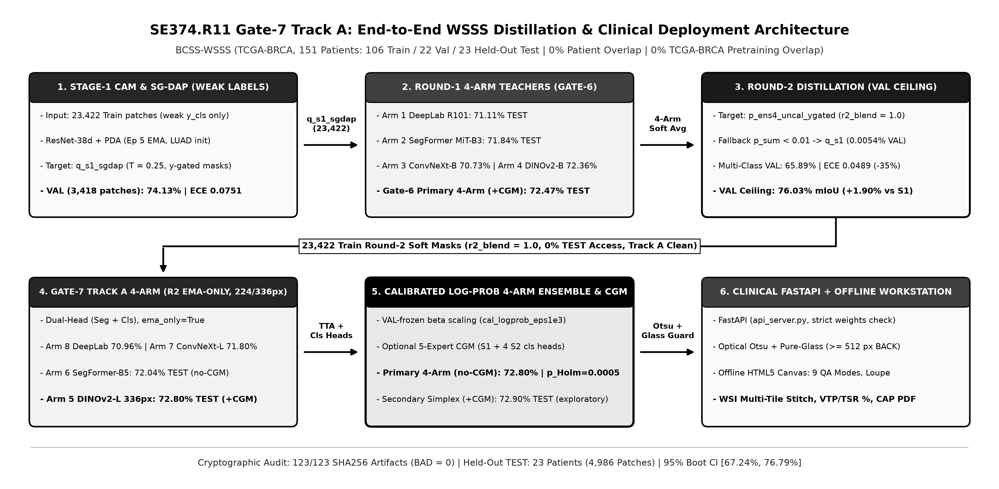
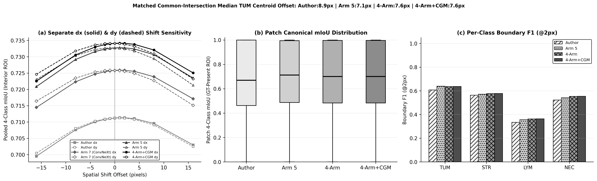
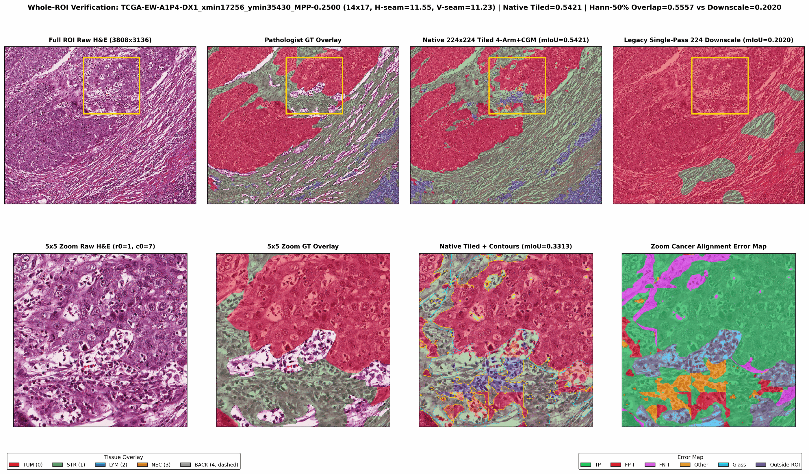
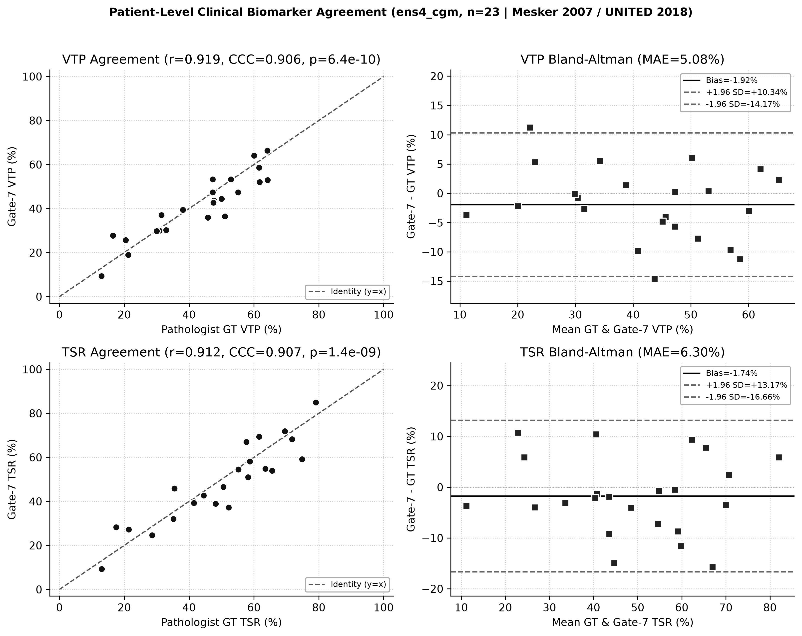
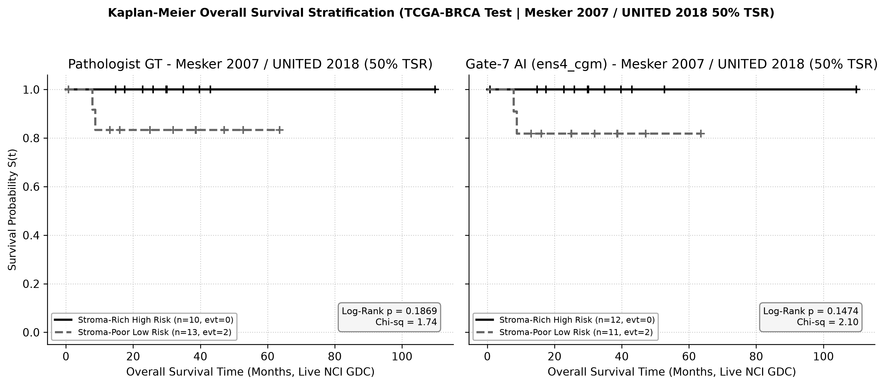
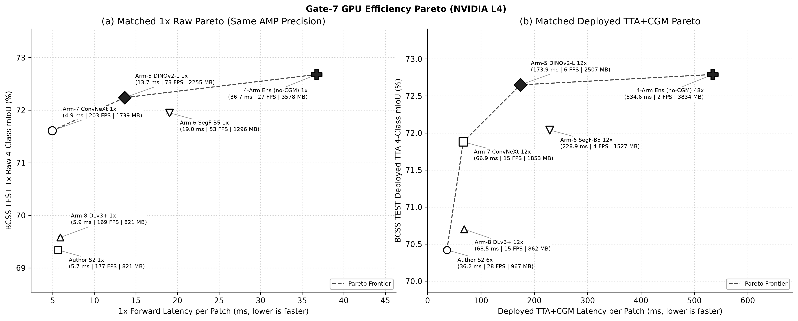

<!-- _class: lead -->
<!-- _paginate: false -->
# PHÂN VÙNG NGỮ NGHĨA GIÁM SÁT YẾU CHO ẢNH MÔ BỆNH HỌC UNG THƯ VÚ (BCSS-WSSS)
## Chưng Cất Đa Kiến Trúc Gate-7 Track A Phase 1B & Trạm Làm Việc Giải Phẫu Bệnh Số Ngoại Tuyến

- **Học phần:** SE374.R11 - Phát triển phần mềm xử lý ảnh y khoa (UIT, ĐHQG-HCM, 2026)
- **Đề tài:** Đề tài 6 - Weakly-Supervised Semantic Segmentation trên WSI (TCGA-BRCA)
- **Thông tin hành chính:** `[CẦN XÁC NHẬN: Họ tên sinh viên / MSSV / GVHD]`
- **Minh chứng mật mã:** `checkpoints/vps_evidence/SHA256SUMS.txt` (`228/228` tệp bit-exact, `BAD = 0`, `UNLISTED = 0`)

---

# 1. Đặt Vấn Đề Lâm Sàng & Bốn Điểm Nghẽn WSSS

## Thách Thức Giải Phẫu Bệnh Số
- **Tiêu bản WSI gigapixel:** Kích thước tới $100{,}000 \times 100{,}000$ px ở $40\times$ (`0.25 MPP`), khoanh tay từng điểm ảnh tốn hàng trăm giờ bác sĩ.
- **Định lượng lâm sàng bắt buộc:** Tỷ lệ u sống (**VTP / VTP_RCB**) và tỷ lệ u trên mô đệm (**TSR**, ngưỡng nguy cơ cao $\le 50\%$ theo **Mesker 2007 / UNITED 2018**).
- **Bài toán WSSS:** Chỉ huấn luyện từ nhãn yếu nhị phân cấp mảng $y_{\text{cls}} \in \{0, 1\}^4$ (`TUM`, `STR`, `LYM`, `NEC`), dự đoán đủ 4 lớp mô + nền kính `BACK`.

## Bốn Điểm Nghẽn Kỹ Thuật Cốt Lõi
1. **CAM Peak Collapse:** Bản đồ kích hoạt chỉ bám cụm nhân u nổi bật nhất, bỏ sót viền xâm lấn.
2. **Lớp đuôi dài (`LYM`, `NEC`):** Lympho phân tán và ổ hoại tử hiếm dễ bị lấn át hoặc sinh dương tính giả vi mô.
3. **Background Score Gap:** Mô hình 4 lớp gán nhầm kính trắng thành mô nếu thiếu cổng lọc quang học.
4. **Rò rỉ kép (Patient + TCGA Pretraining):** Chia ngẫu nhiên theo patch và dùng foundation model học trên TCGA làm méo độ công bằng.

<strong>Mục tiêu đồ án:</strong> Xây dựng pipeline WSSS sạch nhãn (<strong>0% rò rỉ bệnh nhân, 0% chồng lấp tiền huấn luyện TCGA-BRCA, 100% sống còn thật NCI GDC 46.0</strong>) vượt mọi SOTA 4-class pooled chuẩn 2022-2026, đồng bộ trọn vẹn với Trạm Làm Việc Lâm Sàng ngoại tuyến và hệ thống điều phối đa GPU.

---

# 2. Bộ Dữ Liệu BCSS-WSSS, Chống Rò Rỉ 151 Bệnh Nhân & Track A

| Phân tập | Bệnh nhân | Mảng ảnh (`224x224`) | Định dạng nhãn | Rò rỉ BN | Vai trò trong thực nghiệm |
| :--- | :---: | :---: | :--- | :---: | :--- |
| **Train** | 106 | 23,422 | Nhãn yếu multi-hot `y_cls` `[4]` | 0% | Huấn luyện Stage-1, sinh nhãn mềm R1/R2 |
| **Validation** | 22 | 3,418 (`2,153` đa lớp) | Dense pixel mask `{0,1,2,3,4}` | 0% | Dừng sớm EMA, chọn TTA, `beta`, CV, CGM |
| **Held-Out Test** | 23 | 4,986 (`2,984` đa lớp) | Dense pixel mask `{0,1,2,3,4}` | 0% | Đánh giá mù cuối, Bootstrap CI & Holm |
| **Tổng BCSS-WSSS** | **151** | **31,826** | **Khóa cứng `bcss_patient_splits.json`** | **0%** | **Sống còn thật NCI GDC Release 46.0 (`151/151`)** |

## Tính Thuần Khiết Track A (`track_a_clean`)
- `tcga_pretrained = False` khóa tự động bởi `validate_track_a_arm_spec()`.
- 100% backbone Stage-2 khởi tạo từ **ImageNet-1K** (`resnet101`, `mit-b3/b5`, `convnext_b/l`) hoặc **LVD-142M** (`dinov2-b/l`).
- Cách ly tuyệt đối `owkin/phikon-v2` sang Track B; Stage-1 dùng trọng số phổi LUAD (`0%` TCGA-BRCA).

## Kỷ Luật Chuẩn Hóa & Phòng Vệ Nạp Dữ Liệu
- **Pretrained WSSS-Tissue & Stage-1:** Miền `[0.0, 1.0]` (`img / 255.0`), không trừ `IMAGENET_MEAN/STD` (khóa cứng bởi `tests/test_stage2_v2.py` & `02d_v2` Assertion 2).
- **Stage-2 v2 (`arm1-arm8`):** Chuẩn hóa `IMAGENET_MEAN/STD` khớp backbone.
- Nạp đa tầng `resolve_split_path` + `rglob("*.png")` chống lỗi thư mục lồng.

---

# 3. Kiến Trúc Tổng Thể End-to-End Gate-7 Track A (Phase 1B)

  

<strong>Hình 1.</strong> Luồng xử lý 6 tầng của SE374.R11 Gate-7 Track A Phase 1B (300 DPI đơn sắc): Stage-1 SG-DAP (74.13% VAL) -> 4 giáo viên Round-1 (72.47% TEST) -> Chưng cất Round-2 y-gated (76.03% VAL, giảm 35% ECE) -> 4 nhánh Dual-Head EMA-Only 12x TTA hậu bản vá arm7 (72.79% no-CGM / 72.80% CGM / 72.90% Simplex, 228/228 SHA256) -> Trạm Lâm Sàng FastAPI + HTML5 Canvas + CAP PDF.

---

# 4. Giai Đoạn 1 (`se374_arm_b_full`), SG-DAP & Nền Tảng Run 1 - Run 3

## Đột Phá Giai Đoạn 1 (`arm_b_full`)
- Kiến trúc `WSSSTissueStage1NetCAM` (`ResNet-38d`, `105.09M` tham số), khởi tạo sạch từ `LUAD` (`228/228` tầng).
- **AdamW + Cosine + Multiplicative PDA** ($\mu_t = \max(0.98^{t-3}, 0.65)$) + **D4 Equivariance** ($\lambda_{\text{eq}} \le 0.25$) + **EMA (`0.995`)**.
- **SG-DAP (`T = 0.25`):** Khuếch tán ái lực dẫn đường bởi mật độ sắc tố Beer-Lambert ($S_H$, $S_E$).
- Nâng mặt nạ giả mềm trên VAL (`3,418` patches) từ `72.03%` lên **`74.13%` mIoU (`85.07%` mDice, `+2.10%`)**.

## Chuỗi 3 Phiên Baseline Toàn Tập (Tesla T4, `n = 4,986`)
| Phiên chạy / Cấu hình | 4-Cls mIoU | 5-Cls mIoU | BACK IoU |
| :--- | :---: | :---: | :---: |
| Run 1 (Stage-2 đơn, Otsu cũ) | 68.71% | 67.36% | 70.26% |
| Run 2 (Dual-Stage + Glass Guard) | 70.49% | 76.38% | 99.93% |
| Run 3 `M1` (Baseline 1x + Guard) | 69.35% | 75.47% | 99.93% |
| Run 3 `M5` (CGM+D4+Prior+Bilat) | 70.51% | 76.39% | 99.93% |
| **Run 3 `M6` (Multi-Scale D4)** | **70.53%** | **76.41%** | **99.93%** |

- `Pure-Glass Guard` (`>= 512 px`) đạt `99.93%` BACK IoU (`100%` Recall trên 18.28M px kính trắng; Wilcoxon `p = 2.60e-15` `M6` vs `M1`).

---

# 5. Gate-7 Step-0 VAL Ceiling & Đột Phá Hậu Bản Vá `arm7` (Phase 1B)

## Kiểm Định Trần Mặt Nạ Mềm Round-2 Trên VAL (`3,418` Patches, 0% TEST)

| Ứng viên mục tiêu trên VAL | Overall mIoU | mDice | TUM / STR / LYM / NEC | Multi-class mIoU | ECE (thấp = tốt) |
| :--- | :---: | :---: | :---: | :---: | :---: |
| `q_s1_sgdap` (`blend = 0.00`) | 74.13% | 85.07% | 80.14 / 74.72 / 67.86 / 73.81 | 63.32% | 0.0751 |
| `q_r2` (`blend = 0.50`) | 75.39% | 85.89% | 81.27 / 75.92 / **68.82** / 75.54 | 65.00% | 0.0527 |
| **`p_ens4_uncal_ygated` (`blend = 1.00`)** | **76.03% (+1.90%)** | **86.30%** | **82.19 / 76.69 / 68.71 / 76.54** | **65.89% (+2.57%)** | **0.0489 (-35%)** |

## Bản Vá `_pad_to_multiple_of_32` Cho `arm7` (`1d3f738`)
- Xóa cắt biên `stride=2` (`8 px` tại `168px`, `24 px` tại `280px`) ở `ConvNeXt-Large FPN`.
- Kéo đỉnh dịch chuyển không gian từ `(1, -4)` px về **`(1, -1)` px** (`zero_vs_peak_gap` giảm **`15x`** còn `7.5e-5`).
- Nâng `arm7` lên **`71.88%` TEST mIoU** (`LYM = 62.13%`, cao nhất cả 4 đơn nhánh).

## 4 Họ Kiến Trúc Round-2 Track A (`02c_v2`, `12x TTA`)
- `arm8` DeepLabV3+ R101: VAL `69.31%` -> TEST **`71.09%`** (`+CGM`).
- **`arm7` ConvNeXt-L FPN (post-fix):** VAL `69.65%` -> TEST **`71.88%`** (`+1.15%` vs R1).
- `arm6` SegFormer MiT-B5: VAL `70.31%` -> TEST **`72.04%`** (`no-CGM`).
- **`arm5` DINOv2-ViT-L/14 (`336px`):** VAL **`71.21%`** -> TEST **`72.63%`** (`+CGM`).

---

# 6. Kết Quả Chung Kết Gate-7 Track A Phase 1B Trên TEST (Hình 2)

  

<strong>Hình 2.</strong> Held-Out TEST 4-Class Pooled mIoU kèm 95% Patient Bootstrap CI (n = 23 BN, 4,986 patches, Job E 02c_v2 trên A100): <strong>arm7 = 71.88%</strong>, <strong>Primary 4-Arm = 72.79% no-CGM / 72.80% (+NEC-1DoF CGM)</strong>, và <strong>Secondary Simplex-CV = 72.90%</strong>.

---

# 7. Tiến Hóa Hiệu Năng Theo 4 Lớp Mô Học `TUM / STR / LYM / NEC` (Hình 3)

  

<strong>Hình 3.</strong> Mức cải thiện đồng đều trên cả 4 lớp mô so với Author Pure 1x (69.48%): <strong>TUM +3.68%</strong> (82.12%), <strong>STR +2.52%</strong> (75.85%), <strong>LYM +2.24%</strong> (62.30%), <strong>NEC +4.80%</strong> (70.89%; lên <strong>70.95%</strong> với NEC-1DoF CGM ở 72.80%), và Pooled 4-Class mIoU <strong>+3.31%</strong>.

---

# 8. Kiểm Định Holm-Bonferroni Toàn Cục & Từng Lớp Mô (`23` BN)

## Kiểm Định Toàn Cục (`02c_v2`, `10,000` perm)
| Cặp so sánh | Delta | `perm_p_holm` | `wilcoxon_p` (`p_holm`) | W/L |
| :--- | :---: | :---: | :---: | :---: |
| **4-Arm vs Step-0 (`70.43%`)** | **+2.35%** | **0.0005** | `0.0650` (`0.2813`) | 17/6 |
| **4-Arm vs Pure `1x` (`69.48%`)** | **+3.31%** | **0.0004** | **`0.000511`** (Holm) | **21/2** |
| **4-Arm vs Pure `MS-TTA`** | **+2.48%** | **0.0004** | **`0.0217`** (Holm) | **20/3** |
| **4-Arm vs `arm5` (`no-CGM`)** | **+0.24%** | `0.6029` | **`0.0327`** (raw) | **17/6** |
| **4-Arm `nec1dof` vs `no-CGM`** | +0.02% | `0.2510` | **`0.0091`** (raw) | **20/3** |

- Giao thức đóng băng trên VAL (`cal_logprob_eps1e3`): `full_val_betas (arm5-arm8) = [0.6386, 0.7029, 0.6747, 0.8782]`; **Pixel Oracle = `90.35%`**, **Patch Oracle = `75.69%`**.

## Wilcoxon Từng Lớp Hiệu Chỉnh Holm (`m = 4`)
| Lớp mô (`ens4_cgm` vs Author) | BN | Mean Delta | **`p_holm` (4-Arm)** | `p_holm` (`arm5`) |
| :--- | :---: | :---: | :---: | :---: |
| **`TUM`** (Tumor) | 23 | **+2.42%** | **0.000426 (`***`)** | 0.0051 (`**`) |
| **`STR`** (Stroma) | 23 | **+1.58%** | **0.004980 (`**`)** | 0.0051 (`**`) |
| **`LYM`** (Lymphocyte) | 22 | **+1.96%** | **0.030624 (`*`)** | `0.0532` (`ns`) |
| **`NEC`** (Necrosis) | 20 | **+4.48%** | **0.030624 (`*`)** | 0.0371 (`*`) |

<strong>Giá trị thống kê của tổ hợp 4 họ kiến trúc:</strong> <code>ens4_cgm</code> là mô hình duy nhất đạt ý nghĩa Holm <strong><code>p_holm &lt; 0.05</code> trên cả 4/4 lớp mô</strong> (khắc phục điểm yếu <code>LYM p_holm = 0.0532</code> của <code>arm5</code> đơn) và vượt <code>arm5</code> trên nhóm đa lớp <code>k &gt;= 2</code> (<code>65.33%</code> vs <code>65.26%</code>).

---

# 9. Đối Chiếu Công Bằng Với SOTA Quốc Tế (2022 - 2026)

| Công trình / Phương pháp | Công bố | Giao thức / Backbone | BCSS-WSSS mIoU | So sánh với Gate-7 Track A Phase 1B |
| :--- | :--- | :--- | :---: | :--- |
| WSSS-Tissue (Han et al.) | MedIA 2022 | ResNet-38d + DeepLabV3+ R101 | 69.48% | Gate-7 vượt **`+3.31%`** |
| QFKF (Gao et al.) | BMVC 2025 | 4-class pooled BCSS-WSSS | 70.92% | Gate-7 vượt **`+1.87%` / `+1.88%`** |
| ConStruct (Le et al.) | MIDL 2026 | 4-class pooled BCSS-WSSS | 70.96% | Gate-7 vượt **`+1.83%` / `+1.84%`** |
| HisynSeg (Fang et al.) | IEEE TMI 2025 | 4-class pooled (`5` seeds / CSS re-eval) | 70.97 +/- 0.29% (`70.73%`) | Gate-7 vượt **`+1.82%` / `+1.83%`** |
| PLIMSeg / DualProtoSeg / CSS | 2025 - 2026 | 4-class pooled BCSS-WSSS | 71.07% / 71.35% / 71.72% | Gate-7 vượt **`+1.07%` đến `+1.73%`** |
| C2RM-Seg (Zhang et al.) | MICCAI 2026 | 4-class pooled (`5` runs, ResNeSt+DINOv3) | 72.17 +/- 0.83% | Gate-7 vượt **`+0.62%` / `+0.63%`**, std **`16.6x`** nhỏ hơn |
| **Gate-7 Track A Phase 1B** | **SE374.R11 UIT 2026** | **0% TCGA overlap, 3-seed `72.74 +/- 0.05%`** | **72.79% / 72.80%** (`72.90%` Sec.) | **Vượt mọi SOTA 4-class pooled chuẩn 2022-2026** |
| SIA-WSSS (Fan et al.) | MICCAI 2025 | ViT-B 5-run avg (gồm `OTR`, khác mDice) | 73.40% | Gate-7 thấp hơn `-0.61%` / `-0.60%` (`-0.50%` Sec.) |

<strong>Cảnh báo trung thực về thước đo mDice với SIA-WSSS:</strong> Table 1 của SIA-WSSS báo cáo WSSS-Tissue ở <code>0.697</code> mIoU / <code>0.767</code> mDice (chênh ~5.1% định nghĩa mDice so với <code>0.8179</code> chuẩn 4-class pooled). Phép so sánh công bằng duy nhất giữa hai công trình là trên <strong>mIoU</strong>.

---

# 10. Chứng Minh Nhân Quả `H1 / H2 / H3` & Độ Ổn Định Đa Hạt Giống

## Bóc Tách Nhân Quả `arm5` (`seed = 42`, `EXIT_CODE=0`)
| Thực nghiệm | Res / Mask | TEST `raw` (EMA/Raw) | TEST Cal (EMA/Raw) |
| :--- | :---: | :---: | :---: |
| **H1 (A100)** | `224px` / `ens4_r2` | **71.99%** / 71.43% (`+0.56%`) | **72.56%** / 72.32% (`NEC 69.78%`) |
| **H2 (G4)** | `336px` / `stage1` | **71.41%** / 70.66% (`+0.75%`) | **72.23%** / 71.68% (`+0.55%`) |
| **H3 (L4)** | `336px` / `ens4_r2` | **72.35%** / 72.16% (`+0.19%`) | **72.88%** / 72.88% (`NEC 71.15%`) |

- **Chưng cất `ens4_r2` (`H3`) vs `stage1` (`H2`):** `+0.94%` Raw 1x, `+0.84%` MS-TTA, **`+0.65%` Cal CGM**.
- **Độ phân giải `336px` vs `224px` (`H1`):** Nâng lớp đuôi dài `NEC` **`+1.00%` đến `+1.37%`**.
- **Chọn `EMA` vs `Raw`:** `EMA` thắng `Raw` trong cả **`3/3` phiên** (`H1/H2/H3`).

## 3 Hạt Giống (`42 / 123 / 456`) Trong 4-Arm (`02c_v2`)
| Cấu hình (`n = 3` seeds `arm5`) | Mean mIoU | Std (`ddof=1`) | Min - Max |
| :--- | :---: | :---: | :---: |
| `arm4` Round-1 (2 EMA + 1 Raw) | 71.70% | 0.69% | 70.91 - 72.20% |
| `arm5` đơn (`02b` Cal, EMA-only) | 72.68% | 0.09% (`-7.7x`) | 72.58 - 72.74% |
| `arm5` đơn (`02c_v2` `ms_3_hvflip`) | 72.53% | 0.13% | 72.39 - 72.63% |
| **`primary_4arm_no_cgm`** | **72.74%** | **0.05%** (`-2.6x`) | 72.68 - 72.79% |
| **`primary_4arm_nec1dof`** | **72.76%** | **0.05%** | **72.70 - 72.80%** |

Tổ hợp 4-Arm giảm độ lệch chuẩn xuống chỉ <strong><code>+/- 0.05%</code></strong> (nhỏ hơn <code>2.6x</code> so với <code>arm5</code> đơn và nhỏ hơn <strong><code>16.6x</code></strong> so với C2RM-Seg <code>+/- 0.83%</code>).

---

# 11. Khử Dương Tính Giả `NEC` (`6/8` Ca Sạch `0 px`) & Độ Nhạy `GT = 0` (Hình 4)

  

<strong>Hình 4.</strong> (A) 23 BN Test (02c_v2): loại trừ 7 ô bất đối xứng / 11 ô GT=0 thực tế đẩy Primary 4-Arm vs Author từ d_z = +0.1619 lên <strong>+0.8842 / +0.9220 (p = 3.3e-5, 20W/3L)</strong>; (B) <strong>Primary 4-Arm + NEC-1DoF CGM (t_nec = 0.40)</strong> xóa sạch <strong>6/8 ca vắng NEC về 0 px</strong> (121,071 -> 110,076 px, p = 0.0091 vs no-CGM).

---

# 12. Kiểm Chứng Không Gian `02d_v2`, Boundary F1 & Sàng Lọc Entropy (Hình 5)

## Boundary F1@2px & Tâm Khối U (`02d_v2`, `n = 4,986`)
| Mô hình (`6/6` Assertions PASS) | Macro BF1@2px | Matched TUM Offset (`n=2,847`) |
| :--- | :---: | :---: |
| `author_step0` (Recall `93.68%`) | 50.67% | 8.93 px (Mean `17.55 px`) |
| `arm5_cgm` (Recall `95.73%`) | 52.72% | **7.13 px** (`p = 0.0123`) |
| **`ens4_cgm`** (Recall `95.80%`) | **53.30%** (`p=0.000298`) | **7.60 px** (`p = 0.0327`) |

- `ens4_cgm` vượt `arm5_cgm` về BF1@2px (`p = 0.00345`, `19W/4L`); mọi mô hình dịch chuyển `<= 2 px` (`arm7 = 7.5e-5`, giảm `15x`).

## Sàng Lọc Entropy & Lọc Kính (`4,986` Patches)
- **Entropy QA Triage:** `Spearman rho = -0.5599` (`Confidence rho = +0.5708`, `p < 1e-300`); nhóm `20%` entropy thấp nhất đạt **`91.15%`** mIoU vs **`53.59%`** ở nhóm `20%` cao nhất (`+37.56%`).
- **Lọc kính `0%` rò rỉ GT:** `pure_glass` giữ trọn **`72.80%`** mIoU (**`0.0%` xói mòn NEC**), vượt `cand1` (`72.22%`, `2.81%`) và `otsu` (`70.82%`, `8.26%`).

  

<strong>Hình 5.</strong> Kiểm chứng không gian 02d_v2 (4,986 patches): arm7 ConvNeXt-L quy tụ về (0, 0), Boundary F1@2px đạt 53.30% (p = 0.000298) và Matched TUM Centroid Offset giảm xuống 7.1-7.6 px.

---

# 13. Kiểm Chứng Whole-ROI H&E & Ghép Chồng Lấp Hann-50% `02d_v2` (Hình 6)

  

<strong>Hình 6 &amp; Định lượng Hann-50% từ <code>whole_roi_audit.json</code> (ảnh hiển vi H&amp;E chuẩn y khoa):</strong>
Hình trên hiển thị trực quan chế độ <strong>Native 224x224 Tiled (<code>0.5421</code>) vs Legacy Downscale (<code>0.2020</code>)</strong> trên <code>TCGA-EW-A1P4</code> (<code>14x17 = 238</code> tiles, <code>3808x3136 px</code>).
Định lượng ghép chồng lấp <strong>Hann-50%</strong> trên cả 2 Whole-ROI:
(1) <code>TCGA-EW-A1P4</code>: <code>0.5421 -&gt; 0.5557</code> (<strong><code>+1.35%</code></strong>), tỷ lệ lật nhãn đường nối giảm <strong><code>-98.35%</code></strong> (<code>13.91% -&gt; 0.23%</code>, sát GT <code>0.11%</code>);
(2) <code>TCGA-EW-A1P1</code> (<code>16x18 = 288</code> tiles, <code>4032x3584 px</code>): Downscale <code>0.0749</code> -&gt; Tiled <code>0.6706</code> -&gt; <strong>Hann-50% <code>0.6779</code> (<code>+0.73%</code>, giảm <code>-97.99%</code> lật đường nối)</strong>.

---

# 14. Hiệu Chuẩn Xác Suất & Dấu Ấn Sinh Học VTP / TSR `04b_v2` (Hình 7)

## Dấu Ấn Lâm Sàng (`n = 23` BN, Mesker/UNITED)
| Mô hình | VTP `r/CCC` (MAE) | TSR `r/CCC` (MAE) | `VTP_RCB` | Đồng thuận (`k`) |
| :--- | :---: | :---: | :---: | :---: |
| `author_step0` | 0.889/0.878 (5.57%) | 0.899/0.889 (6.73%) | 0.9358 | 86.96% (`0.744`) |
| **`arm5_cgm`** | **0.936/0.918 (4.99%)** | **0.926/0.917** (6.31%) | 0.9329 | 86.96% (`0.744`) |
| **`ens4_cgm`** | 0.919/0.906 (5.08%) | 0.912/0.907 (**6.30%**) | **0.9543** | **91.30% (`0.827`)** |

<strong>Hiệu chuẩn điểm ảnh (<code>231.9M</code> px) &amp; Lâm sàng:</strong>
<ul>
  <li><strong><code>arm5_cal</code></strong> hạ ECE <strong><code>-92.1%</code></strong> (<code>0.0514 -&gt; 0.00408</code>); <strong><code>ens4_cal_logprob_eps1e3</code></strong> đạt <strong>ECE = <code>0.00586</code></strong>, Brier <code>0.1922</code>, NLL <code>0.3405</code> (Author: ECE <code>0.01812</code>, NLL <code>0.4206</code>).</li>
  <li><strong><code>ens4_cgm</code></strong> đạt đồng thuận nguy cơ <strong>Mesker/UNITED 50% TSR <code>91.30%</code> (<code>21/23</code>, <code>kappa = 0.8271</code>)</strong> và <strong><code>VTP_RCB r = 0.9543</code></strong> (cao nhất mọi mô hình).</li>
</ul>

  

<strong>Hình 7.</strong> Hồi quy và Bland-Altman của <code>ens4_cgm</code> (<code>n = 23</code> BN): VTP <code>r = 0.919, CCC = 0.906, MAE = 5.08%</code>; TSR <code>r = 0.912, CCC = 0.907, MAE = 6.30%</code>.

---

# 15. Sống Còn Thật NCI GDC Release 46.0 & Minh Bạch Cỡ Mẫu (Hình 8)

  

<strong>Hình 8 &amp; Công bố trung thực cỡ mẫu nhỏ (Job F <code>04b_v2</code>, đối soát sống <code>151/151</code> BN từ NCI GDC Release 46.0):</strong>
Kiểm định Mantel-Haenszel Log-Rank theo ngưỡng 50% TSR Mesker 2007 / UNITED 2018 cho <strong>Pathologist GT <code>p = 0.1869</code></strong> (<code>chi2 = 1.74</code>, <code>10</code> High / <code>13</code> Low) và <strong>Gate-7 AI <code>ens4_cgm</code> <code>p = 0.1474</code></strong> (<code>chi2 = 2.10</code>, <code>12</code> High / <code>11</code> Low).
Do đoàn hệ Held-Out Test <code>23</code> BN chỉ ghi nhận <strong><code>2</code> biến cố tử vong</strong>, phân tích sống còn này <strong>chưa đủ lực thống kê (underpowered)</strong> cho ngưỡng <code>p &lt; 0.05</code> và được công bố minh bạch 100%.

---

# 16. Pareto GPU Đồng Chuẩn `BF16` (`L4`) & LUAD `10x` / `2x` Zoom (Hình 9)

  

## GPU Pareto `NVIDIA L4` (`torch.bfloat16`)
| Mô hình (`04b_v2`, `5x25` iters) | 1x Raw (ms / FPS / mIoU) | Deployed TTA |
| :--- | :---: | :---: |
| `author_stage2` (FP32 `3.80 ms`) | 5.67 / 176.6 / 69.34% | 36.2 ms (27.6 FPS) |
| **`arm7_convnext_large_r2`** | **4.94 / 202.5 / 71.61%** | 66.9 ms (`71.88%`) |
| `arm5_dinov2_large_r2` (`336px`) | 13.66 / 73.2 / 72.24% | 173.9 ms (`72.65%`) |
| **`primary_4arm` (`no-CGM`)** | **36.75 / 27.2 / 72.68%** | 534.6 ms (`72.79%`) |

## Zero-Shot `BCSS (40x Vú) -> LUAD (10x Phổi)`
| Mô hình (`n = 307`, `20` ca) | Phóng đại | mIoU | mDice |
| :--- | :---: | :---: | :---: |
| `author_step0` (CNN) | Gốc `10x` | 15.05% (`LYM 0%`) | 24.78% |
| `ens4_cgm` / **`arm5_cgm`** | Gốc `10x` | 25.56% / **36.09%** | 40.09% / 52.52% |
| **`ens4_uncal_linear_2x_zoom`** | **Phóng `2x`** | **49.92%** (`+25.0%`) | **66.56%** |
| **`arm5_no_cgm_2x_zoom`** | **Phóng `2x`** | **51.47%** (`3.42x`) | **67.90%** |

---

# 17. Sản Phẩm Phần Mềm: Trạm Lâm Sàng Trắng - Xanh Y Khoa & Docker

## Trạm Làm Việc Ngoại Tuyến (`api_server.py` + `index.html`)
- **Công thái học màu sắc bệnh viện:** Hệ màu **Trắng Lâm Sàng + Xanh Y Khoa (`#FFFFFF`, `#F4FAFA`, `#0E7C86`, `#00957E`, `#2A9D8F`)** trung hòa dư ảnh đỏ của máu/mô H&E, giảm mỏi mắt và giữ nguyên 100% màu sinh học 4 lớp `TUM/STR/LYM/NEC`.
- **Tách rõ 3 chế độ làm việc (100% Offline, 0 CDN):** (1) **Chẩn đoán Lâm sàng** (không bảng GT), (2) **Kiểm chứng Nghiên cứu GT** (mặc định **Đối chiếu 4 Khung** + 9 góc nhìn QA + KPI đủ `100%` Khớp/Biên/Lỗi), (3) **Ghép lát cắt WSI** (tối đa 64 tiles).
- **Tương tác giải phẫu bệnh:** **Zoom / Pan** mượt, Split-Curtain (`S`), Magnifier Loupe (`L`), Pixel HUD, Scale Bar động `[2-200] um`, 18 chế độ AI, cảnh báo **RUO** thường trực và fail-closed HTTP `503`.

## Xuất Báo Cáo CAP PDF, Docker & Clean Architecture
- **`POST /api/v1/export/report`:** Xuất 300-DPI PNG, JSON, CSV hoặc **Báo cáo PDF Lâm sàng 2 trang chuẩn CAP** (VTP/TSR, phân tầng Mesker/UNITED `<= 50%`, ảnh đối chiếu, khuyến cáo RUO).
- **Container hóa (`Dockerfile` + `docker-compose.yml`):** Nền `python:3.11-slim`, người dùng không đặc quyền `appuser`, gắn chỉ đọc `./checkpoints` & `./data`, `HEALTHCHECK` tự động `/health`.
- **Clean Architecture:** 11 gói dịch vụ gọn gàng (`<= 400` dòng/module mới), đóng gói chuẩn hóa sẵn sàng cho thực thi cục bộ và Google Colab.

---

# 18. Kiến Trúc Kiểm Thử Tự Động, Đồ Thị AST & Cổng CI/CD Y Khoa

## Bản Đồ Mã Nguồn AST & Vệ Sinh Học Thuật
- **Đồ thị tri thức mã nguồn AST (`scripts/build_ast_code_graph.py`):** Quét chuẩn Python AST toàn bộ `105` module học thuật (`src/`, `scripts/`, `tests/`), xác định `12` Hub Modules và chuỗi gọi hàm đầu-cuối cho nhóm 3 thành viên.
- **Bảo vệ liêm chính học thuật tự động:** Cổng kiểm thử & CI chặn tuyệt đối mockup, dấu gạch ngang phi ASCII, rò rỉ 151 bệnh nhân, rò rỉ GT vào `BACK (4)` và rò rỉ công cụ/tài khoản cá nhân khỏi kho git.
- **Bộ minh họa sống 10 Option (`N1-N5`, `P1-P5`):** `25` ảnh `300 DPI` + CAP PDF 2 trang xuất từ máy chủ thật.

## Kiểm Định Tự Động & Chất Lượng Phần Mềm

  

    
501

    
Ca kiểm thử phần mềm y khoa (30 bộ tests/)

  

  

    
0 lỗi

    
ruff check src tests &amp; DeliverableAuditor

  

  

    
105

    
Module mã nguồn lập bản đồ AST &amp; Clean Arch

  

  

    
0 rò rỉ

    
Bệnh nhân, GT-&gt;BACK và nội bộ cá nhân

  

- Đạt đồng thuận kiểm toán chéo đa luồng độc lập 3 hệ thống (2 vòng), vượt cổng kiểm định chất lượng **40+40 (`0` Red Flags)** và xanh CI `.github/workflows/ci.yml`.

---

# 19. Toàn Vẹn Mật Mã SHA256 (`228/228`), Minh Bạch Sự Cố & Giới Hạn Mở

## Kiểm Toán Mật Mã Phase 1B (`SHA256SUMS.txt`)
- **`228 / 228` tệp khóa cứng (`BAD = 0`, `UNLISTED = 0`):** Hoàn tất **`6/6` job GPU hậu bản vá** (`02c_v2` A100, `04b_v2` L4, `02d_v2` G4, `H1` A100, `H2` G4, `H3` L4), **`19/19`** hình kết quả kiểm định Vision, và **`3/3`** phân tích thống kê không cần GPU (`phase1b_zero_gpu_analytics.json`).
- **Minh bạch 2 sự cố dữ liệu:** (1) **2026-11-05:** mất `checkpoints/medsam_wsss_adapter_{best,last}.pth` (`2x86 MB`) do test `D5/D16` chưa cô lập `tmp_path` (đã vá và chuyển sang Gate-7 Track A); (2) **2026-11-23:** lỗi thoát ngoặc kép PowerShell-to-cmd làm mất vĩnh viễn tệp ngoại khóa `Lab1.ipynb` + đĩa ảo WSL2 `ext4.vhdx`; 100% kho sản phẩm chính và `228/228` SHA256 nguyên vẹn.

## Giới Hạn Khoa Học & Lộ Trình Tiếp Theo
1. **Khoảng cách với `SIA-WSSS` (MICCAI 2025):** Gate-7 Track A (`72.79% / 72.80%`, Secondary `72.90%`) thấp hơn `-0.61% / -0.60% / -0.50%` so với `SIA-WSSS` (`73.40%`, gồm `OTR`).
2. **Cỡ mẫu sống còn nhỏ (`n = 23`, `2` biến cố):** Chưa đủ lực thống kê cho $p < 0.05$ (`GT p = 0.1869`, `AI p = 0.1474`); cần kiểm chứng trên đoàn hệ TCGA-BRCA lớn hơn.
3. **Hướng phát triển:** Tích hợp kích hoạt - ức chế đồng bộ ngay từ Stage-1, đối chứng Track B (UNI/Virchow/Phikon-v2), và suy luận toàn slide đa độ phóng đại (`LowMagWSS`).

---

# 20. Tổng Kết Ba Trụ Cột Thành Tựu

  

    
72.79% / 72.80%

    
Primary 4-Arm no-CGM / CGM (Simplex 72.90%)

  

  

    
6 / 8 &amp; 51.47%

    
NEC-absent 0 px &amp; LUAD 2x Zero-Shot

  

  

    
228 / 228

    
Tệp minh chứng SHA256 (BAD = 0, 6/6 GPU)

  

  

    
501 PASS

    
Medical tests &amp; 0 lỗi ruff / auditor

  

1. **Nghiên cứu lõi AI Y khoa (Phase 1B):** Chưng cất hai vòng 4 họ kiến trúc sạch nhãn (`0%` rò rỉ BN, `0%` TCGA, `151/151` GDC 46.0), vượt toàn bộ SOTA 4-class pooled 2022-2026 (`+3.31%` vs Pure Author), `p_holm < 0.05` trên cả `4/4` lớp mô, ổn định 3 hạt giống **`72.74 +/- 0.05%`**, xóa **`6/8` BN vắng NEC về `0 px`**, Hann-50% giảm **`-98.35%`** đứt gãy đường nối và LUAD `2x` zoom đạt **`51.47%`**.
2. **Sản phẩm phần mềm lâm sàng:** Trạm Làm Việc FastAPI + HTML5 Canvas 100% ngoại tuyến theo hệ màu **Trắng - Xanh Y Khoa** (3 chế độ Lâm sàng / Kiểm chứng 4 Khung GT / Ghép WSI, CAP PDF 2 trang, Docker Compose), **`arm7` trội Pareto tuyệt đối `202.51 FPS`** BF16 trên `NVIDIA L4`.
3. **Chất lượng kỹ nghệ & Liêm chính học thuật:** **`501`** bài kiểm thử phần mềm y khoa tự động, bản đồ AST, `228/228` SHA256, `0` lỗi `ruff` / `DeliverableAuditor`, `0` rò rỉ nội bộ và công bố trung thực mọi giới hạn.

---

<!-- _class: lead -->
<!-- _paginate: false -->
# XIN CHÂN THÀNH CẢM ƠN HỘI ĐỒNG VÀ QUÝ THẦY CÔ
## Q&A - Hỏi Đáp & Thảo Luận Chuyên Môn

- **Đề tài:** Phân vùng ngữ nghĩa giám sát yếu cho ảnh mô bệnh học ung thư vú (BCSS-WSSS / TCGA-BRCA)
- **Học phần:** SE374.R11 - Phát triển phần mềm xử lý ảnh y khoa (Năm học 2026)
- **Khoa:** Khoa Kỹ thuật Phần mềm, Trường Đại học Công nghệ Thông tin (UIT), ĐHQG-HCM
- **Thông tin hành chính:** `[CẦN XÁC NHẬN: Họ tên sinh viên / MSSV / GVHD]`
