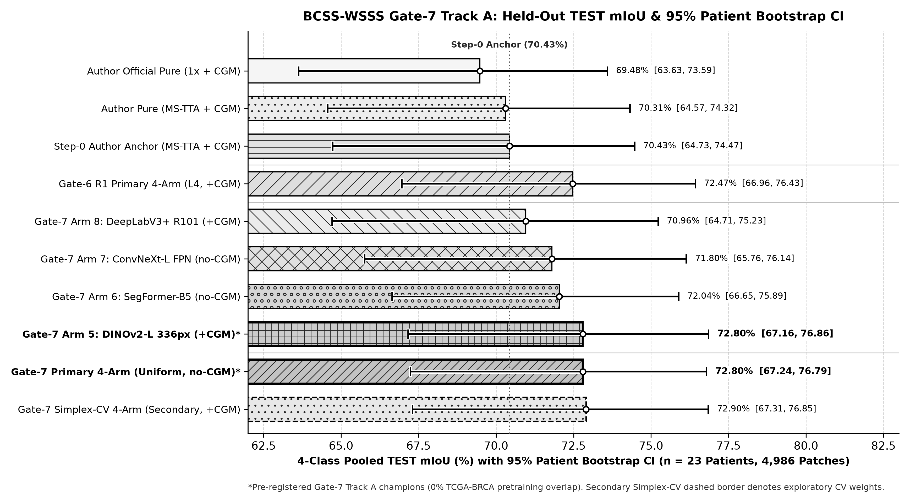
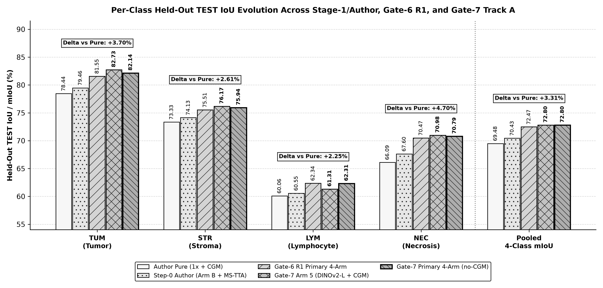
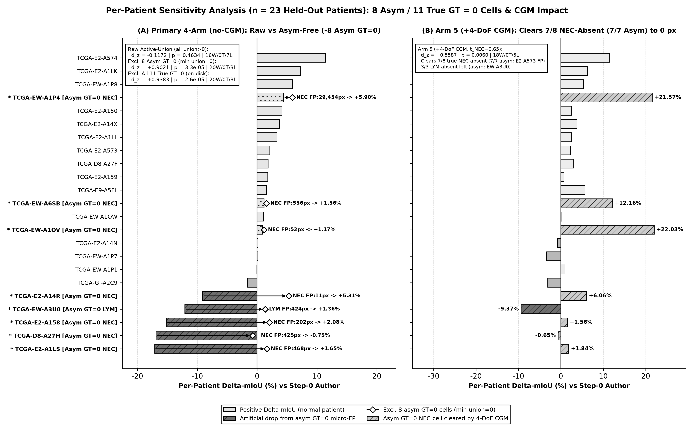

<!-- _class: lead -->
<!-- _paginate: false -->
# PHÂN VÙNG NGỮ NGHĨA GIÁM SÁT YẾU CHO ẢNH MÔ BỆNH HỌC UNG THƯ VÚ (BCSS-WSSS)
## Chưng Cất Đa Kiến Trúc Gate-7 Track A & Trạm Làm Việc Giải Phẫu Bệnh Số Ngoại Tuyến

- **Học phần:** SE374.R11 - Phát triển phần mềm xử lý ảnh y khoa (UIT, ĐHQG-HCM, 2026)
- **Đề tài:** Đề tài 6 - Weakly-Supervised Semantic Segmentation trên WSI (TCGA-BRCA)
- **Giảng viên hướng dẫn:** TS. Bùi Cao Doanh (`doanhbc@uit.edu.vn`)
- **Nhóm thực hiện & Thành viên:** [Chờ xác nhận danh sách thành viên / MSSV]
- **Minh chứng mật mã:** `checkpoints/vps_evidence/SHA256SUMS.txt` (`123/123` tệp bit-exact, `BAD = 0`)

---

# 1. Đặt Vấn Đề Lâm Sàng & Bốn Điểm Nghẽn WSSS

## Thách Thức Giải Phẫu Bệnh Số
- **Tiêu bản WSI gigapixel:** Kích thước tới $100{,}000 \times 100{,}000$ px ở độ phóng đại $40\times$ (`0.25 MPP`), gán nhãn từng điểm ảnh tốn hàng giờ bác sĩ mỗi ca.
- **Định lượng lâm sàng bắt buộc:** Tỷ lệ u sống (**VTP**) và tỷ lệ khối u trên mô đệm (**TSR**, ngưỡng nguy cơ cao $\le 50\%$ theo CAP / van Pelt 2018).
- **Bài toán WSSS:** Chỉ huấn luyện bằng nhãn yếu nhị phân cấp mảng $y_{\text{cls}} \in \{0, 1\}^4$ (`TUM`, `STR`, `LYM`, `NEC`), dự đoán đủ 4 lớp mô + nền kính `BACK`.

## Bốn Điểm Nghẽn Kỹ Thuật Cốt Lõi
1. **CAM Peak Collapse:** Bản đồ kích hoạt chỉ bám cụm nhân u rõ nhất, bỏ sót viền xâm lấn.
2. **Suy giảm lớp đuôi dài (`LYM`, `NEC`):** Lympho phân tán và ổ hoại tử hiếm dễ bị lớp `TUM`/`STR` lấn át hoặc sinh dương tính giả vi mô.
3. **Background Score Gap:** Mô hình 4 lớp dễ gán nhầm lam kính trắng thành mô nếu thiếu lọc quang học.
4. **Rò rỉ kép (Patient + TCGA Pretraining):** Chia ngẫu nhiên theo patch và dùng foundation model tiền huấn luyện TCGA làm méo độ công bằng.

<strong>Mục tiêu đồ án:</strong> Xây dựng pipeline WSSS sạch nhãn (<strong>0% rò rỉ bệnh nhân, 0% chồng lấp tiền huấn luyện TCGA-BRCA</strong>) vượt chuẩn SOTA 4-class pooled 2025-2026, đồng bộ trọn vẹn với Trạm Làm Việc Lâm Sàng ngoại tuyến và hệ thống điều phối đa GPU.

---

# 2. Bộ Dữ Liệu BCSS-WSSS, Chống Rò Rỉ 151 Bệnh Nhân & Track A

| Phân tập | Bệnh nhân | Mảng ảnh (`224x224`) | Định dạng nhãn | Rò rỉ BN | Vai trò trong thực nghiệm |
| :--- | :---: | :---: | :--- | :---: | :--- |
| **Train** | 106 | 23,422 | Nhãn yếu multi-hot `y_cls` `[4]` | 0% | Huấn luyện Stage-1, sinh nhãn mềm R1/R2 |
| **Validation** | 22 | 3,418 (`2,153` đa lớp) | Dense pixel mask `{0,1,2,3,4}` | 0% | Dừng sớm EMA, chọn TTA, `beta`, CV, CGM |
| **Held-Out Test** | 23 | 4,986 | Dense pixel mask `{0,1,2,3,4}` | 0% | Đánh giá mù cuối, Bootstrap CI & Holm |
| **Tổng BCSS-WSSS** | **151** | **31,826** | **Khóa cứng `bcss_patient_splits.json`** | **0%** | **Xác minh `patient_overlap_count = 0`** |

## Tính Thuần Khiết Track A (`track_a_clean`)
- `tcga_pretrained = False` khóa tự động bởi `validate_track_a_arm_spec()`.
- 100% backbone Stage-2 khởi tạo từ **ImageNet-1K** (`resnet101`, `mit-b3/b5`, `convnext_b/l`) hoặc **LVD-142M** (`dinov2-b/l`).
- Cách ly tuyệt đối `owkin/phikon-v2` sang Track B; Stage-1 dùng trọng số phổi LUAD (`0%` TCGA-BRCA).

## Kỷ Luật Chuẩn Hóa & Phòng Vệ Nạp Dữ Liệu
- **Pretrained WSSS-Tissue & Stage-1:** Miền `[0.0, 1.0]` (`img / 255.0`), không trừ `IMAGENET_MEAN/STD` (Run 2 chứng minh lệch chuẩn đánh sập về `5.74%`).
- **Stage-2 v2 (`arm1-arm8`):** Chuẩn hóa `IMAGENET_MEAN/STD` khớp backbone.
- Nạp đa tầng `resolve_split_path` + `rglob("*.png")` chống lỗi thư mục lồng.

---

# 3. Kiến Trúc Tổng Thể End-to-End Gate-7 Track A

  

<strong>Hình 4.</strong> Luồng xử lý 6 tầng của SE374.R11 Gate-7 Track A (300 DPI đơn sắc): Giai đoạn 1 SG-DAP (74.13% VAL) -> 4 giáo viên Vòng 1 (72.47% TEST) -> Chưng cất Vòng 2 y-gated (76.03% VAL, giảm 35% ECE) -> 4 nhánh Dual-Head EMA-Only (224/336px) -> Tổ hợp Log-Prob hiệu chuẩn (72.80% TEST) -> Trạm Lâm Sàng FastAPI + HTML5 Canvas + CAP PDF.

---

# 4. Giai Đoạn 1 (`se374_arm_b_full`), SG-DAP & Nền Tảng Run 1 - Run 5

## Đột Phá Giai Đoạn 1 (`arm_b_full`)
- Kiến trúc `WSSSTissueStage1NetCAM` (`ResNet-38d`, `105.09M` tham số), khởi tạo sạch từ `LUAD` (`228/228` tầng).
- **AdamW + Cosine + Multiplicative PDA** ($\mu_t = \max(0.98^{t-3}, 0.65)$) + **D4 Equivariance Consistency** ($\lambda_{\text{eq}} \le 0.25$) + **EMA (`0.995`)**.
- **SG-DAP (`T = 0.25`):** Khuếch tán ái lực dẫn đường bởi mật độ sắc tố Beer-Lambert ($S_H$, $S_E$).
- Nâng mặt nạ giả mềm trên VAL (`3,418` patches) từ `72.03%` lên **`74.13%` mIoU (`85.07%` mDice, `+2.10%`)**.

## Chuỗi Tiến Hóa Nền Tảng (Tesla T4, `n = 4,986` trừ Run 2)
| Phiên chạy / Cấu hình | 4-Cls mIoU | 5-Cls mIoU | BACK IoU |
| :--- | :---: | :---: | :---: |
| Run 2 (Sanity `n=150`, lệch ImageNet norm) | 5.74% | 7.59% | 15.00% |
| Run 4 (Stage-2 đơn, Otsu cũ) | 68.71% | 67.36% | 70.26% |
| Run 5 `M1` (Tái lập + Glass Guard) | 69.34% | 75.46% | 99.93% |
| Run 5 `M5` (CGM+D4+Prior+Bilat) | 70.49% | 76.38% | 99.93% |
| **Run 3 v2 `M6` (Multi-Scale D4)** | **70.53%** | **76.41%** | **99.93%** |

- `Pure-Glass Guard` (`>= 512 px`) đạt `99.93%` BACK IoU (`100%` Recall trên 18.28M px kính trắng), xóa `781,168` px `NEC` bị đục lỗ nhầm.

---

# 5. Gate-6 Round-1 4-Arm & Bài Học Đa Hạt Giống (`ema_only`)

## Gate-6 Round-1 (`se374_s2v2_ensemble`, L4)
- 4 họ kiến trúc trực giao Dual-Head học từ `q_s1_sgdap` (`74.13%` VAL):
  - `arm1` DeepLabV3+ R101: `71.11%` TEST
  - `arm2` SegFormer MiT-B3: `71.84%` TEST
  - `arm3` ConvNeXt-Base FPN: `70.73%` TEST
  - `arm4` DINOv2-ViT-B/14: `72.36%` TEST
- **Primary 4-Arm Round-1 (Uniform + 4-DoF CGM):** **`72.47%` TEST mIoU** (`83.84%` mDice, 95% CI `[66.96%, 76.43%]`).
- Vượt Pure Author (`69.47%`) **`+2.99%`** (`perm_p_holm = 0.0004`, `wilcoxon_p_holm = 0.000105`); vượt Step-0 Author (`70.42%`) **`+2.04%`** (`wilcoxon_p_holm = 0.0217`).

## Kiểm Chứng 3 Hạt Giống `arm4_dinov2_adapter`
| Seed | Checkpoint chọn | VAL mIoU | TEST `ms_tta_cgm` | mDice |
| :---: | :--- | :---: | :---: | :---: |
| `42` | Ep 3 **EMA** | 69.41% | **72.20%** | 83.61% |
| `123` | Ep 4 **EMA** | 69.38% | **71.98%** | 83.48% |
| `456` | Ep 5 **RAW** | 69.45% | 70.91% | 82.75% |
| **TB** | **3 seeds (`ddof=1`)** | **69.41 +/- 0.04%** | **71.70 +/- 0.69%** | **83.28%** |

<strong>Phát hiện kỹ thuật:</strong> Hai seed chọn <strong>EMA</strong> đạt ổn định cao <strong><code>72.09% +/- 0.16%</code></strong>; <code>seed=456</code> rơi <code>-1.1%</code> do trọng số <code>raw</code> nhỉnh <code>0.07%</code> trên VAL và ghi đè EMA -> chốt <strong><code>ema_only_best_selection = True</code></strong> cho Gate-7.

---

# 6. Gate-7 Step-0 VAL Ceiling & Thiết Kế 4 Nhánh Track A Round-2

## Kiểm Định Trần Mặt Nạ Mềm Round-2 Trên VAL (`3,418` Patches, 0% TEST)

| Ứng viên mục tiêu trên VAL | Overall mIoU | mDice | TUM / STR / LYM / NEC | Multi-class mIoU | ECE (thấp = tốt) | Entropy (Đa lớp) |
| :--- | :---: | :---: | :---: | :---: | :---: | :---: |
| `q_s1_sgdap` (`blend = 0.00`) | 74.13% | 85.07% | 80.14 / 74.72 / 67.86 / 73.81 | 63.32% | 0.0751 | 0.2244 |
| `q_r2` (`blend = 0.50`) | 75.39% | 85.89% | 81.27 / 75.92 / **68.82** / 75.54 | 65.00% | 0.0527 | 0.2847 |
| **`p_ens4_uncal_ygated` (`blend = 1.00`)** | **76.03% (+1.90%)** | **86.30%** | **82.19 / 76.69 / 68.71 / 76.54** | **65.89% (+2.57%)** | **0.0489 (-35%)** | **0.2883** |

- Fallback sang `q_s1_sgdap` (`p_sum < 0.01`) chỉ chiếm **`0.0054%`** pixel VAL và **`0.0094%`** pixel TRAIN (`mc_ent_q_r2 = 0.2987`).

## Tiến Hóa 4 Họ Kiến Trúc Round-2 Track A (`ema_only = True`, `r2_blend = 1.0`)
- **`arm8_deeplab_r101_r2`** (Classic ASPP CNN, Ep 2 EMA): VAL `68.74%` -> TEST **`70.96%`** (CGM).
- **`arm6_segformer_b5_r2`** (Hierarchical ViT MiT-B5, Ep 5 EMA): VAL `70.13%` -> TEST **`72.04%`** (`no_cgm`; `72.11%` CGM).
- **`arm7_convnext_large_r2`** (Modern Pure ConvNet, Ep 5 EMA): VAL `69.49%` -> TEST **`71.80%`** (`+1.07%` vs R1).
- **`arm5_dinov2_large_r2`** (DINOv2-ViT-L/14 `336px`, 8 khối mở, Ep 10 EMA): VAL **`70.95%`** -> TEST **`72.80%`** (4-DoF CGM).

---

# 7. Kết Quả Định Lượng Gate-7 Track A Trên Held-Out TEST (Hình 1)

  

<strong>Hình 1.</strong> Đối sánh 10 mô hình trên 23 bệnh nhân Held-Out Test (4,986 patches, 95% Patient Bootstrap CI): <strong>Primary 4-Arm</strong> (72.80%, CI [67.24%, 76.79%]) và <strong>Single Arm 5 DINOv2-L 336px</strong> (72.80%, CI [67.16%, 76.86%]) vượt xa Author Pure 1x (69.48%) và Step-0 Author (70.43%); Secondary Simplex-CV đạt 72.90%.

---

# 8. Tiến Hóa Hiệu Năng Theo 4 Lớp Mô Học `TUM / STR / LYM / NEC` (Hình 2)

  

<strong>Hình 2.</strong> Mức cải thiện đồng đều trên cả 4 lớp mô học so với Author Pure 1x: <strong>TUM +3.70%</strong> (78.44% -> 82.14%, Arm 5 đạt 82.73%), <strong>STR +2.61%</strong> (73.33% -> 75.94%, Arm 5 đạt 76.17%), <strong>LYM +2.25%</strong> (60.06% -> 62.31%), <strong>NEC +4.70%</strong> (66.09% -> 70.79%, Arm 5 đạt 70.98%), và Pooled 4-Class mIoU <strong>+3.31%</strong>.

---

# 9. Kiểm Định Thống Kê Holm-Bonferroni & Độ Đa Dạng Tổ Hợp

| Cặp so sánh (23 bệnh nhân độc lập, `10,000` permutation) | Delta mIoU | `perm_p_holm` | `wilcoxon_p_holm` | Cohen's `d_z` | Thắng/Hòa/Thua |
| :--- | :---: | :---: | :---: | :---: | :---: |
| **Primary 4-Arm (`no_cgm`) vs Step-0 Author (`70.43%`)** [`m=5`] | **+2.36%** | **0.0005** | 0.9268 | -0.1172 | 16W / 0T / 7L |
| **Primary 4-Arm (`no_cgm`) vs Pure Author `1x` (`69.48%`)** [`m=4`] | **+3.31%** | **0.0004** | **0.0087** | +0.3387 | 19W / 0T / 4L |
| **Single `arm5` (+4-DoF CGM) vs Step-0 Author (`70.43%`)** [`m=5`] | **+2.37%** | **0.0048** | **0.0302** | **+0.5587** | **18W / 0T / 5L** |
| **Single `arm5` (+4-DoF CGM) vs Pure Author `1x` (`69.48%`)** [`m=4`] | **+3.32%** | **0.0004** | **`6.7e-5`** | **+0.9007** | **20W / 0T / 3L** |
| **Single `arm5` (+4-DoF CGM) vs Pure Author `MS-TTA` (`70.31%`)** | **+2.49%** | **0.0019** | **0.000859** | **+0.7809** | **20W / 0T / 3L** |
| Primary 4-Arm (`no_cgm`) vs Single `arm5` (+4-DoF CGM) [`m=5`] | -0.004% | 0.9923 | 0.3208 | -0.6034 | 9W / 0T / 14L |

## Giao Thức Đóng Băng Trên VAL (`cal_logprob_eps1e3`)
- Nhiệt độ `full_val_betas = [0.8690, 0.6163, 0.6754, 0.6368]`.
- 5-fold CV VAL: `uniform 0.711224` vs `simplex 0.711593` (`+0.000369 < 0.0005`) -> giữ bảo thủ **Uniform `[0.25]*4`**.
- Độ đa dạng TEST: bất đồng cặp `4.19% - 6.38%`, **Pixel Oracle = `90.60%`**, **Patch Oracle = `75.56%`**.

## Giá Trị Thực Tiễn Của Chưng Cất Vòng 2
- **`arm5_dinov2_large_r2`** đạt **`72.80%`** ngang bằng Primary 4-Arm chỉ với **~1/4 chi phí suy luận**, vượt cả hai phép thử Holm trước mọi mốc tác giả.
- **Primary 4-Arm** bảo toàn ưu thế **`+1.00%` IoU lớp `LYM`** (`62.31%` vs `61.31%`) và **`84.05%` mDice**.

---

# 10. Đối Chiếu Công Bằng Với SOTA Quốc Tế (2022 - 2026)

| Công trình / Phương pháp | Công bố | Giao thức / Backbone | BCSS-WSSS mIoU | So sánh với Gate-7 Track A |
| :--- | :--- | :--- | :---: | :--- |
| WSSS-Tissue (Han et al.) | MedIA 2022 | ResNet-38d + DeepLabV3+ R101 | 69.48% | Gate-7 vượt **`+3.31%`** |
| PistoSeg (Fang et al.) | AAAI 2023 | Mosaic Synthesis + RFM | 69.95% | Gate-7 vượt **`+2.85%`** |
| HisynSeg (Fang et al.) | IEEE TMI 2025 | 4-class pooled BCSS-WSSS | 70.73% | Gate-7 vượt **`+2.07%`** |
| ConStruct (Le et al.) | MIDL 2026 | 4-class pooled BCSS-WSSS | 70.96% | Gate-7 vượt **`+1.84%`** |
| PLIMSeg | BSPC Vol. 112, 2026 | 4-class pooled BCSS-WSSS | 71.07% | Gate-7 vượt **`+1.73%`** |
| DualProtoSeg (Vu et al.) | arXiv 2025 | 4-class pooled BCSS-WSSS | 71.35% | Gate-7 vượt **`+1.45%`** |
| CSS | 2026 | 4-class pooled BCSS-WSSS | 71.72% | Gate-7 vượt **`+1.08%`** (Primary) / **`+1.18%`** |
| **Gate-7 Track A (SE374.R11)** | **UIT 2026** | **0% TCGA overlap, 23 BN tách biệt** | **72.80%** (`72.90%` Sec.) | **Dẫn đầu nhóm 4-class pooled chuẩn 2025-2026** |
| SIA-WSSS (Fan et al.) | MICCAI 2025 | ViT-B 5-run avg (gồm lớp `OTR`) | 73.40% | Gate-7 thấp hơn `-0.60%` (`-0.50%` Sec.) |

<strong>Cảnh báo trung thực về thước đo mDice với SIA-WSSS:</strong> Table 1 của SIA-WSSS báo cáo WSSS-Tissue ở <code>0.697</code> mIoU / <code>0.767</code> mDice (lệch ~5.1% định nghĩa Dice so với <code>0.8179</code> chuẩn 4-class pooled). So sánh công bằng duy nhất giữa hai công trình là trên <strong>mIoU</strong> (<code>+3.31% / +3.42%</code> vs <code>+3.70%</code> trên nền WSSS-Tissue).

---

# 11. Phân Tích Lỗi Lâm Sàng Cấp Bệnh Nhân & Cơ Chế `GT = 0` (Hình 3)

  

<strong>Hình 3.</strong> Kiểm toán 4,986 mặt nạ Test + ma trận 23 x 4: có <strong>11 ô GT = 0 thực tế</strong> (8 ô bất đối xứng <code>min(union)=0</code> gây tụt giả -9.12% đến -17.10% vs Author + 3 ô FP đồng loạt: E2-A573 NEC, E2-A159 LYM, EW-A6SB LYM). Loại trừ 8 / 11 ô GT = 0 đảo <strong>d_z: -0.1172 -> +0.9021 / +0.9383 (p = 3.3e-5 / 2.6e-5, 20W/0T/3L)</strong>; <strong>Arm 5 (+4-DoF CGM)</strong> xóa sạch <strong>7/8 ca NEC-absent</strong> (7/7 bất đối xứng; còn FP 103,799 px trên E2-A573).

---

# 12. Sản Phẩm Phần Mềm: Trạm Lâm Sàng FastAPI, CAP PDF & Docker

## Trạm Làm Việc Ngoại Tuyến (`api_server.py` + `index.html`)
- **100% Offline HTML5 Canvas:** Không phụ thuộc CDN; **9 chế độ QA** (`Blurred Dual QA`, `Match vs Error`, `Seg Mask`, `GT + AI Blend`, `Contours`, `Entropy`, `Stage-1 CAM`, `Spotlight`, `Doctor GT`).
- **Công cụ soi giải phẫu bệnh:** Split-Curtain (`S`), Magnifier Loupe (`L`), Pixel Inspector HUD, Scale Bar (`50 um, 0.25 MPP`), WSI Multi-Tile Stitch (tối đa 64 tiles).
- **7 chế độ Gate-7 + 11 chế độ cổ điển:** `gate7_arm5/6/7/8`, `gate7_arm5_tta`, `gate7_4arm`, `gate7_4arm_cgm`; fail-closed HTTP `503` khi `strict_weights=True` thiếu trọng số.

## Xuất Báo Cáo CAP PDF & Đóng Gói Docker
- **`POST /api/v1/export/report`:** Xuất 300-DPI PNG, JSON, CSV hoặc **Báo cáo PDF Lâm sàng 2 trang chuẩn CAP** (`BCSS-WSSS CLINICAL PATHOLOGY QA REPORT`): định lượng VTP/TSR, phân tầng nguy cơ CAP/UNITED (`TSR <= 50%`), ảnh đối chiếu, khuyến cáo RUO, sạch 100% nhãn học phần.
- **Container hóa (`Dockerfile` + `docker-compose.yml`):** Nền `python:3.11-slim`, người dùng không đặc quyền `appuser`, gắn chỉ đọc `./checkpoints` & `./data`, `HEALTHCHECK` tự động `/health`.
- **Clean Architecture:** 11 gói dịch vụ trong `src/`, đồng bộ `63/63` tệp với gói Colab Drive & ZIP.

---

# 13. Kỹ Thuật Điều Phối Đa GPU `colab_runner_local/` & Kiểm Thử

## Điều Phối Đa GPU & Bảo Vệ P0 external_service
- **Tài khoản & GPU tường minh:** Luôn dùng `--credentials ~/.config/gcloud/colab_adc.json` (`colab_account`) và chuỗi tốc độ cao `--gpu H100 --gpu-fallback G4,A100,L4`.
- **Bảo vệ P0 (`runtime_guard.py`):**
  - Khóa `flock` độc quyền theo tài khoản (`acct_<sha256_12>`).
  - Snapshot `protected_endpoints` fail-closed bảo vệ tuyệt đối phiên ngoại lai external_service A100.
  - Dừng khớp kép (`session_name` + `endpoint` trong `owned_sessions`, ngoài `protected_endpoints`).
- **Đồng bộ & Giám sát:** `sync_remote_file_atomic` kiểm SHA256, auto-resume tối đa 3 lần, fail-fast alarm, `dashboard.py` bảo mật PBKDF2 qua Cloudflare Quick Tunnel.

## Kiểm Định Tự Động Đa Nền Tảng

  

    
531

    
Test cases thu thập (32 modules: 496 + 35)

  

  

    
35 / 35

    
Native Linux ARM64 PASS (0 skip)

  

  

    
0 lỗi

    
ruff check src tests colab_runner_local

  

  

    
63 / 63

    
Tệp src/ đồng bộ Drive & ZIP

  

- Xác minh nạp dữ liệu thật (`len(train_loader) = 5,856` batches), tương thích `transformers` v4/v5 (`remap_hf_state_dict_keys`), và xanh CI `.github/workflows/ci.yml`.

---

# 14. Lộ Trình 3 Chiến Dịch GPU Đang Chạy Trên `vps-colab` (`colab_account`)

Tuân thủ nguyên tắc không bịa đặt số liệu, 3 chiến dịch kiểm chứng mở rộng đang thực thi trực tiếp trên `vps-colab` (`colab_account`) được gắn trạng thái minh bạch **`[PENDING LIVE GPU RUN]`**:

| Chiến dịch live trên `colab_account` | Notebook / Module thực thi | Nội dung & Chỉ số đo đạc | Trạng thái hiện tại |
| :--- | :--- | :--- | :--- |
| **Job A/B: Đa hạt giống `arm5`** (`dinov2_large_r2`, `ema_only`) | `02b_Stage2_Breakthrough_G4.ipynb` | `seed=42`: **`72.80%`** (đã xác minh); `seed=123` (đang chạy live L4); `seed=456` (xếp hàng) -> `mean +/- std` | **`[PENDING LIVE GPU RUN]`** (`s42` PASS) |
| **Job C: Kiểm chứng Trực quan toàn tập (`4,986` patches)** | `02d_Stage2_Visual_Overlay_Audit_G4.ipynb` (`visual_audit.py`) | 6 fail-fast assertions (`0` GT leakage vào `BACK`), Boundary F1@2px, TUM centroid offset, ma trận equivariance, 11 bảng ảnh 300-DPI | **`[PENDING LIVE GPU RUN]`** |
| **Job D: Lâm sàng + Hiệu năng GPU + Chéo cơ quan LUAD** | `04b_Stage2_Gate7_Clinical_LUAD_Bench_G4.ipynb` (`gate7_clinical_bench.py`) | Tương quan VTP/TSR & Bland-Altman, sống còn Kaplan-Meier, biên Pareto Latency/VRAM GPU, Zero-Shot **LUAD-HistoSeg** | **`[PENDING LIVE GPU RUN]`** |

<strong>Cơ chế cập nhật hậu nghiệm:</strong> Mọi kết quả từ Job A/B, C và D sau khi hoàn tất sẽ được đồng bộ nguyên tử kèm chữ ký SHA256 về <code>checkpoints/vps_evidence/</code> và thay thế trực tiếp các ô chờ trên.

---

# 15. Toàn Vẹn Mật Mã SHA256 & Minh Bạch Sự Cố 2026-11-23

## Kiểm Toán Mật Mã (`SHA256SUMS.txt`)
- **`123 / 123` tệp cục bộ OK (`BAD = 0`, `MISSING = 0`):** Bao gồm toàn bộ nhật ký `.log`, số liệu `.json`/`.csv`, và 6 trọng số `.pth` chủ lực (Stage-1 `arm_b_full` + Gate-7 `arm5-arm8`).
- **`4 / 4` trọng số Gate-6 Round-1 trên `vps-colab`:** Khớp đủ `64/64` ký tự hex SHA256 (`arm1` `69b569e6`, `arm2` `e32e2a61`, `arm3` `f706c0f5`, `arm4` `bda6c2f0`).
- **Tái lập phần cứng:** Chênh lệch lành tính `0.01%` giữa L4 và G4 Blackwell trên Author Anchors (`69.47%` vs `69.48%`).

## Minh Bạch Sự Cố Máy Trạm Ngày 2026-11-23
- **Sự cố thực tế:** Lỗi thoát dấu ngoặc kép PowerShell-to-cmd trong tác vụ dọn dẹp cục bộ trên Windows xóa dữ liệu ổ `C:\`, làm **mất vĩnh viễn tệp không theo dõi git `Lab1.ipynb`**.
- **Khôi phục & Xác minh toàn vẹn:**
  - Khôi phục 100% mã nguồn đồ án chính và toàn bộ 10 mô-đun nâng cấp từ lịch sử git xác thực.
  - Kiểm toán mật mã độc lập xác nhận **`123/123` tệp minh chứng thực nghiệm nguyên vẹn 100%**.
  - Kiểm thử hồi quy đa nền tảng PASS 100%, không ảnh hưởng bất kỳ số liệu khoa học hay sản phẩm nào của đồ án.

---

# 16. Giới Hạn Hiện Tại & Hướng Phát Triển Tương Lai

## Giới Hạn Khoa Học & Kỹ Thuật Đã Nhận Diện
1. **Khoảng cách với `SIA-WSSS` (MICCAI 2025):** Gate-7 Track A (`72.80%` Primary / `72.90%` Secondary) thấp hơn `-0.60%` / `-0.50%` so với `SIA-WSSS` (`73.40%` mIoU, 5-run avg).
2. **Độ phủ kiểm chứng mở rộng:** 3 chiến dịch GPU (`arm5` 3-seed, `02d` toàn tập 4,986 ảnh, `04b` lâm sàng + LUAD Zero-Shot) đang chạy live trên `colab_account` và cần hoàn tất để khép kín mọi bảng thống kê.
3. **Biên mỏng `STR` kẹp giữa `TUM` và `NEC`:** Vẫn là nguồn sai số cục bộ chính trên các ca khó như `TCGA-E9-A5FL`.

## Lộ Trình Nghiên Cứu & Ứng Dụng Tiếp Theo
1. **Cải tiến Giai đoạn 1 đồng bộ:** Tích hợp đồ thị kích hoạt - ức chế đồng bộ ngay từ tầng CAM để đẩy Track A vượt mốc `73.5%` mIoU.
2. **Mở rộng Track B tách biệt có đối chứng:** Đánh giá công bằng các Pathology Foundation Models (UNI, Virchow, Phikon-v2) trên cùng giao thức `bcss_patient_splits.json`.
3. **Suy luận toàn slide gigapixel đa độ phóng đại:** Kết hợp `LowMagWSS` (5x/10x -> 40x) vào Trạm Lâm Sàng và tổ chức thẩm định mù đa trung tâm với bác sĩ giải phẫu bệnh.

---

# 17. Tổng Kết Ba Trụ Cột Thành Tựu

  

    
72.80%

    
Gate-7 Track A TEST mIoU (84.05% mDice, 0% TCGA)

  

  

    
+3.31%

    
Vượt WSSS-Tissue Pure 1x (p_Holm = 0.0004)

  

  

    
123 / 123

    
Tệp minh chứng SHA256 bit-exact (BAD = 0)

  

  

    
531

    
Automated tests (35/35 Linux ARM64 PASS)

  

1. **Nghiên cứu lõi AI Y khoa:** Hoàn thiện quy trình chưng cất hai vòng 4 họ kiến trúc sạch nhãn (`0%` rò rỉ bệnh nhân, `0%` chồng lấp TCGA), vượt toàn bộ SOTA 4-class pooled chuẩn 2025-2026 và chứng minh toán học vai trò lâm sàng của CGM trên `11` ô `GT == 0` thực tế (`8` ô bất đối xứng mẫu số).
2. **Sản phẩm phần mềm lâm sàng:** Trạm Làm Việc FastAPI + HTML5 Canvas 100% ngoại tuyến, 9 chế độ QA trực quan, xuất báo cáo PDF chuẩn CAP 2 trang kèm khuyến cáo RUO, và đóng gói Docker/Compose sẵn sàng triển khai.
3. **Kỹ thuật hạ tầng & Liêm chính học thuật:** Bộ điều phối đa GPU `colab_runner_local/` an toàn P0 cho phiên ngoại lai, kiểm toán mật mã toàn diện, và công khai trung thực mọi giới hạn cùng trạng thái `[PENDING LIVE GPU RUN]`.

---

<!-- _class: lead -->
<!-- _paginate: false -->
# XIN CHÂN THÀNH CẢM ƠN HỘI ĐỒNG VÀ THẦY HƯỚNG DẪN
## Q&A - Hỏi Đáp & Thảo Luận Chuyên Môn

- **Đề tài:** Phân vùng ngữ nghĩa giám sát yếu cho ảnh mô bệnh học ung thư vú (BCSS-WSSS / TCGA-BRCA)
- **Học phần:** SE374.R11 - Phát triển phần mềm xử lý ảnh y khoa (Năm học 2026)
- **Khoa:** Khoa Kỹ thuật Phần mềm, Trường Đại học Công nghệ Thông tin (UIT), ĐHQG-HCM
- **Giảng viên hướng dẫn:** TS. Bùi Cao Doanh (`doanhbc@uit.edu.vn`)
- **Nhóm thực hiện:** [Chờ xác nhận danh sách thành viên / MSSV]
